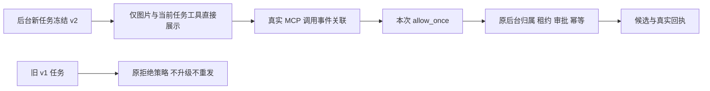

# T1060 readonly v2 独立合同复审理由

## 结论

**合同复审通过，未发现新增阻止项。** 已审 SPEC SHA256：`af4fdfdd5a605b76269a3d04fdf47b65fc75e7a306c49b9712080d892332ce0c`。这是实施前合同判断，不能当作源码落地、正式产品链、真实工具或图片验收通过。原三条发现完整保留，状态仍为 resolved。

大白话：v2 让图片工具和当前任务的工具直接出现在模型面前。一次工具许可只准对应这一回合真实调用；真正执行仍由原后台权限决定。旧任务继续旧策略。

## 逐项判断

| 项目 | 审查依据与判断 |
| --- | --- |
| 用户授权与边界 | SPEC 授权段、FR3:49–53 与 DEC-T1060-02:3717–3721 将补充限定为已有图片与任务 MCP 目的；没有新脚本/文件/命令、永久信任、全局 MCP 或 committed 工具。沿既有用户授权可做窄修复，独立审核不替代真实验收。 |
| 策略冻结 | SPEC:43–45 规定 backend 创建输入绑定参与摘要，新任务冻结 v2、旧 v1 不升级、旧缺绑定保持原 native、旧 unknown 不重发。不能在 Worker 按当前设置或新默认值替代被冻结的策略。 |
| 工具模式 | SPEC:55–57 的 v2 局部例外明确替换 v1 的 code_mode 布尔表示；enabled 仍 false，只有 image_gen 与当前唯一 MCP 的精确规范化命名空间。无工具时只有 image_gen。不能加入 functions、通配符或额外服务器。 |
| 原生能力核验 | SPEC:57 明确启动 argv、native config/read 实际回显、thread 与工具集合都核验，且集合恰为本轮声明。合同要求逐项/集合精确一致；仅验证对象形状或名称前缀不满足合同。用户配置层与禁用全局 MCP 不能暗中改变最终集合。 |
| MCP 单次许可 | SPEC:59 要求原客户端当前 prompt、session/toolCallId 与真实 MCP 事件、原始 server、冻结 none/proposal tool、is_mcp_tool_approval 与原 allow_once 选项同时成立。用原 per-prompt 权限 callback 接点；会话级默认许可不能承接迟到或未归属的请求。非 MCP、URL、缺关联、外来身份、取消/异常均取消。 |
| 原后台权限 | 原 external-task-tool.service.ts:34–41 列表限安全名称、冻结版本与 effect、host 执行；:43–68 校验原 task/业务/当前归属/started 回合/摘要/幂等；:86–105 原 approve 与当前租约、非 not-applicable 返回阻止，committed/unknown 不伪结算。ACP allow_once 只解除原生单次询问，不替代这些后台判断。 |
| 真实完成标准 | SPEC:80–84 要求保留 v1 失败、精确回显/错命名空间/关联拒绝/取消/单次许可/旧冻结检查，并用正式 host/Worker 验证真实 MCP 与图片、pending 同字节读回和真实 ID。临时 adapter 成功不能算产品修复，纯文本合法路径保留。 |

## 固定上游事实

本次只读取已有固定下载源码，并核对选中 7 个文件 SHA 与原 source-manifest 一致，没有重新运行上游程序。

- Codex 0.159.3，`01fc69f4026735edfdf6789820549727a4867b11`：`features/src/feature_configs.rs:24–46` 和 `features/src/lib.rs:900–914` 定义联合表与精确命名空间；`core/src/config/mod.rs:2717–2747` 读取列表不要求 enabled=true；`core/src/tools/spec_plan.rs:520–550` 对精确名字设置 DirectModelOnly。
- 同固定 Codex 的 `codex-mcp/src/tools.rs:108–214`、`mcp/mod.rs:572–590`、`rmcp_client.rs:839–856` 定义官方 MCP 起始身份、清洗、前缀与碰撞逻辑。当前任务服务器受限为短、唯一的本轮名字；不得把通用 MCP 名字随意按固定词表编码或伪造公开状态字段。
- 固定 codex-acp 2.1.1 原 `permissions/mcp.ts:97–133` 已生成 is_mcp_tool_approval；:135–166 将原 allow_once 转 native accept 且不持久化。`CodexElicitationHandler.ts:172–182` 注明真实 item/started 先到，原 lifecycle 用 thread/server 关联 callId；`ElicitationReporter.ts:18–27` 复用其 ID。`McpToolReporter.ts:16–25,48–49` 原 rawInput 是原始 server/tool/arguments，renderer 保留为 rawInput，并有 is_mcp_tool_call 元数据。
- 固定 acpx 原 `client.ts:2173–2212,2309–2407` 使用原 pending prompt owner、取消 signal、宿主 callback 优先与异常取消；无需新许可协议或另一张任务表。宿主仍须落实 SPEC 规定的当前 prompt 关联，不能只靠 sessionId。

## 实施/验收待办事实（不是新增合同 finding）

- 当前生产 `codex-acp-host.ts`、`CreatorOsPolicy.ts` 与 `chat-worker.ts` 仍为 v1：新合同尚未实施；本审查没有运行产品或模型。
- 既有 `/tmp/t1060-ai-capability-research/probe-review.md` 明确临时 probe 的 native 回显只做形状验证，未比较回显命名空间与声明相等。新 SPEC 已覆盖此缺口，正式实现必须有真实 RED → GREEN；本次没有将旧 probe 当 equality 证据。
- 旧 v1 完整源码路径与 v2 严格分支都需合同测试；v1 不可被联合表/许可例外默升级。额外键、列表顺序与集合、重复名称、清洗/碰撞、无工具、配置覆盖必须按固定协议定义处理。
- 单次许可需清除/消费本次关联，拒绝同 ID 重复请求、迟到请求和 prompt 外请求，取消竞态也不能接受。测试需区分已发取消与远端终止证明。
- 真实 host/Worker 到后台 pending、同字节读回、真实工具执行与身份、实际取消/unknown 仍按 SPEC 验证；本次不评 WorkBuddy、不重查其入口，不将缺证据写成 PASS。

## 归档

- `spec-review-recheck.json` 是可交 reviewctl record 的 spec-review-round/v2/recheck 评审包，未加入自造状态结构。
- `reviewed-spec.md` 是只读审查快照；`review-metadata.json` 记录当前 SPEC 摘要和历史发现原样保留。
- `source-sha256.json` 记录当前参考源码和固定上游摘要，供主会话记录前核对是否漂移。
- 本次共享仓库写入 0，测试 0，模型/浏览器/安装 0；没有读取或复制认证。
