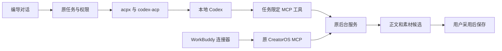

# T-1060 接入实现与验证记录

日期：2026-10-04。工作树：`codex/user-diagnostics`。本记录区分当场执行证据和仍待验的能力；任务保留「进行中 / 待验」。

## 已实现

本地 Codex 的新编导任务已接入固定开源 ACP 客户端和适配器；以前的任务继续按创建时的协议执行。工具仍调用 CreatorOS 原服务，图片进入原素材候选，用户采用后保存。WorkBuddy 连接器和设置中的配置复制已接入现有 MCP，尚未在 WorkBuddy 中安装或首次信任。

| 来源 | 固定版本 / 提交 | 实际复用 |
| --- | --- | --- |
| acpx | `27efb1b57b9de22105a91e9154b1d29b51ede8cb` | 原 `AcpClient` 及源码闭包、权限处理、通知尾队列；未引入上游任务和历史权威。 |
| codex-acp | `2.1.1` / `68d7d2d5ddfc0ed5746f9f6130892dda685e65dd` | 原 ACP 到 Codex app-server 适配器、图片报告与真实回合元数据；仅加宿主权限和构建兼容补丁。 |
| Univer WorkBuddy 连接器 | `856eae4fe416b28adffb96092d67ff26c7797ff4` | 原包装模板及 EOF/信号幂等关闭生命周期，接本产品已有 stdio MCP。 |
| CreatorOS 原有实现 | 现有 execution、候选、素材保存与 MCP 服务 | 保留任务、租约、归属、幂等和用户采用权威；复用原桌面依赖闭包复制工具。 |

许可、来源摘要和窄补丁在 `ai-worker/vendor/*` 及 `scripts/workbuddy/SOURCE.md`；最终工作树文件摘要见 [source-sha256.json](source-sha256.json)。CodeBuddy 未进入可选引擎。WorkBuddy 以外部 MCP 连接器交付。

## 当场通过的检查

所有表内测试均未启用失败重试。UI 使用组件测试，未使用浏览器自动化。

| 检查 | 结果 | 证据 |
| --- | --- | --- |
| Worker 协议、任务冻结、权限、环境、图片、通知收尾 | 7 文件、30 项通过 | [worker-suite-final.log](worker-suite-final.log) |
| 后台隔离数据库 / 临时对象存储、工具归属、图片幂等 | 2 文件、11 项通过 | [backend-suite-final.log](backend-suite-final.log) |
| 新 Codex 输入绑定 | 1 项通过，23 项未运行 | [submission-focused-final.log](submission-focused-final.log) |
| WorkBuddy 设置与聊天图片卡 | 3 文件、15 项通过 | [ui-suite-final.log](ui-suite-final.log) |
| MCP CLI 生命周期及参数 | 17 项通过 | [mcp-suite-final.log](mcp-suite-final.log) |
| 本机临时打包 Worker 启动 / 依赖缺失路径 | 6 项通过 | [packaged-worker-final.log](packaged-worker-final.log) |
| LED-047 界面性能防复发 | 8 文件、162 项通过 | [led047.log](led047.log) |
| 连接器包装 | 3 项通过 | [workbuddy-package-green.log](workbuddy-package-green.log) |
| 原生 MCP 启动参数 | 隔离 Rust 模块 1 项通过，9 项过滤 | [workbuddy-native-test.json](workbuddy-native-test.json) |
| Worker / contract / MCP 类型检查 | exit 0 | [Worker](worker-typecheck-with-fixture.log)、[contract](contract-typecheck-final.log)、[MCP](mcp-typecheck.log) |
| Worker 全部入口与适配器构建 | exit 0；适配器版本 `2.1.1` | [worker-build-final.log](worker-build-final.log)、[adapter-version.log](adapter-version.log) |
| 真实本机 Codex 登录与 ACP 会话初始化 | `0.159.3`、authenticated、available；未发送模型提示 | [bundled-codex-status-valid.log](bundled-codex-status-valid.log) |
| Windows 依赖闭包与已有 vendor 身份 | 32 项通过；目录修正前 26 项真实失败 | [desktop-closure-final.log](desktop-closure-final.log)、[desktop-packaging-review.md](desktop-packaging-review.md) |
| 原普通桌面打包回归 | 19 项通过 | [desktop-ordinary-regression.log](desktop-ordinary-regression.log) |

真实 ACP 客户端配固定上游 stdio 测试 Agent 的 4096 条通知突发，证明 prompt 返回时仍可能有通知未处理；复用其原 `waitForSessionUpdatesIdle` 后全部收齐，再结算正文和图片。此证据不是实际模型生成。

桌面闭包检查与独立复核见 [打包交付](desktop-packaging-delivery.md) 和后续打包复核记录。模拟 Windows 包字节只用于依赖复制/身份合同，不能作为真实 Windows 可执行文件或启动证据。

## 连接器工件

[下载 WorkBuddy 连接器](workbuddy-package/creatoros-workbuddy-connector-0.1.0.zip)。公开 ZIP SHA256：`5249047f7a40ec544385dbac94033059882e9829554e74eb76d9f5437a0893f9`。

包内是无个人路径、无凭据的配置模板和 Skill。实际随包 Node、MCP CLI、connection descriptor 参数由桌面设置中的原生 `cli_access_status` 提供，仅 ready 且 enabled 时允许复制。不会生成虚构的 `get_active_project`；项目由真实 accounts/projects 操作和明确 ID 读取。

## 全局检查与范围外欠债

`pmem sync` 已运行；全局 `reconcile` exit 1，34 errors / 1 warning。与 T1059 的 35 errors / 1 warning 相比，新增错误 0；LED-046 原失败已消除。完整差异见 [reconcile-delta.json](reconcile-delta.json)。未修改违规基线或其它任务评审回执来强行通过。

最后 boundary scan 为 7 条、基线 5；额外两项均是已有 `live-chat-session.ts` 的 AI SDK 引入，由 T1026 跟踪。其它历史根因由 T1015、T1027、T916 等已登记任务保留。orphan 和本任务精确写集 preflight 已通过。

后台全量类型检查仍有旧 WIP 错误；本任务隔离集成测试通过，不能宣称后台全量类型检查通过。完整 submission 测试的旧 guide fixture 版本失败保留在首轮日志，未作为本轮输入绑定失败或全量通过。

## 待验及交付边界

- 临时项目真实 Codex ACP 文本回合已完成：`end_turn`、170 字符、真实 providerTurn 元数据；证据见 [real-acp-prompt.log](real-acp-prompt.log)。这不是现有用户项目或完整业务工具验证。
- 原生图片生成尚未验证。真实 MCP 初始化已修复代理误转回环的问题：会话创建成功、工具列表调用 2。随后全新临时模型回合 `end_turn`，但工具实际执行 0；原生警告确认 Code Mode host 被当前权限配置禁用。未登记工具执行通过，未自动启用 Code Mode 或放宽权限。前端状态已收窄为“文本会话已连接（工具执行未验证）”，保留合法文字请求。登录和普通 ACP 会话不证明每个模型及 MCP 组合均可用。
- WorkBuddy 实际安装、首次信任和跨应用读取临时项目尚未发生。
- Windows / Linux 实包和真机启动，以及 Node 24 运行时尚未验证；本机运行测试使用 Node 25.9.0，构建目标为 Node 24。
- 真界面视觉验收尚未发生。遵守已确认的浏览器自动化禁令。
- 完整 codex-acp 上游生成类型树未迁入；运行源码 esbuild 通过，未登记完整上游 adapter tsc 通过。
- 全业务生成入口迁移、可组合模型来源、激活后端补发等仍由对应任务推进；本次接通不代表 T1057 等任务已完成。

本次源码在包含此前多项 WIP 的工作树上验证。提交通过 HEAD 加接入必要行构造，关联原 Codex 预检与旧任务兼容基础；其它文章、画布、ASR 和激活改动留在工作树。

另外做了拟提交树的隔离检出。其完整 Worker build/typecheck 未通过；HEAD 独立基线也已有 `asr-provider-timing`、`production-main-track` 缺源码及契约导出不齐。没有把旧 WIP 混入提交来掩盖这些错误。工作树构建通过不等于干净检出或正式发行通过，原日志均保留。来源和提交取舍见 [commit-dependencies.md](commit-dependencies.md)。
