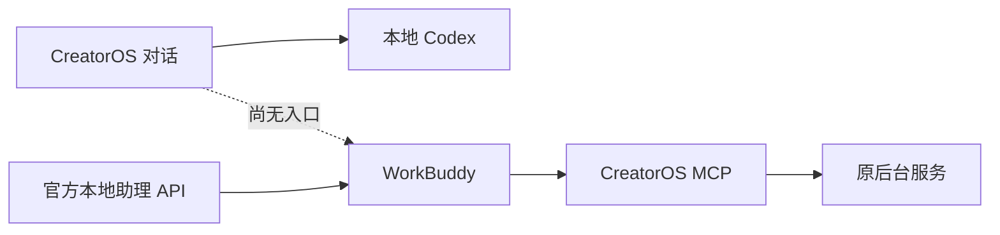

# WorkBuddy 客户端实际 AI 调用核对

## 当前结论

2026-10-04 用户明确要求客户端 AI 调用验证。本轮尚未发出 WorkBuddy AI 请求，真实回复及其 CreatorOS 工具调用均未验证。

现有 CreatorOS 应用内引擎仅支持 CreatorOS 与本地 Codex；WorkBuddy 交付的是外部 MCP 连接器。若用户指的是在 CreatorOS 内直接调用 WorkBuddy，当前实现缺少该入口，不能用连接器检查替代验收。已向用户确认具体调用方向。

## 本轮只读证据

- 引擎选择器 `frontend/src/features/copilot/assistant-engine-selector.tsx:13`–`:14` 只有 `pi`、`codex`；README 描述的是 WorkBuddy 对话调用 CreatorOS 工具。
- 本机 WorkBuddy 5.2.5 注册 `workbuddy` URL scheme。发布包 `main/index.js:23833` 处理窗口唤起、OAuth 回调及向 renderer 投递 URL；renderer 的 `handleDesktopOpenUrl:40331`、`applyDeepLinkView:4434` 处理安装、模型预选、任务导航和视图切换，未确认可发送测试消息并回读回复的 URL 入口。没有猜测参数、触发安装或把唤起成功当作 AI 成功。
- [官方第三方应用文档](https://open.workbuddy.cn/docs/third-party-app)明确：本地助理 API 驱动 PC Agent，须第三方应用通过审核并获得用户 OAuth 授权。[官方 OpenAPI](https://open.workbuddy.cn/docs/openapi)的状态读取、发消息、按本次 message_id 增量回读可组成真实调用验证。
- 仅检查五个显式 WORKBUDDY OAuth 环境变量的存在性，全部为 false；没有读取用户认证、历史消息或配置。这不能推出桌面端未登录。
- 当前提供的计算机使用工具关闭了原生桌面控制。没有通过其它自动化方式绕过此限制；也没有执行用户排除的 CodeBuddy。

来源哈希和环境存在性见 [observations.json](observations.json)。临时提取只来自已安装应用的发布代码，未迁入生产实现，未将发布源码提交到本仓库。

## 尚需的真实验收

若验收 WorkBuddy 客户端调用 CreatorOS：须从 WorkBuddy 发出测试提示，拿到真实 AI 回复，并将工具名、账户/项目 ID 和 MCP 后台回执相互核对。当前会话需要桌面操作入口，或已审批的独立 OpenAPI OAuth 授权才能自行触发；首次工具信任仍由本地用户决定。

若验收 CreatorOS 内直接调用 WorkBuddy：当前入口未实现，须先登记用户确认的契约变更并复用已有实现。本记录不是此入口的实现或通过凭据。

本轮未修改生产代码，未运行模型、采用候选或发布内容；没有新增 PASS。
