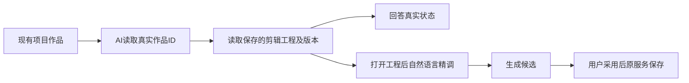

# 2026-10-09 AI 助手修复与新包验收记录

用户已授权本地合并 main、清理闲置 worktree、构建不备份、使用当前安装 App 验收。本次从 `3a60fafc4fd299d2a0d2efc403ee6a24691075de` 继续已准入 T1085–T1088，不推送、打 tag 或公开发布。任务状态仍按真实安装验收关闭，不能用下列隔离测试代签新包或全功能。

## 已验证的改动

- T1085：Pi 对不可重试工具错误比较同参时，使用宿主保存的真实绑定参数，不使用 SDK 占位参数或 `{}`。协议最终 30 PASS；原前端聊天三个文件完整 23 PASS。保留完整冻结目录、真实来源、候选采纳及幂等断言。独立实施复核 PASS。
- T1086：普通项目对话可经 `system.features → projects.outputs.list → outputs.production.editor.get` 发现并读取真实剪辑工程。保留精确旧 V1 协议，新任务用固定 V2；长工程续窗校验原 revision；没有真实编辑目标时不开放写入。合同聚焦 7 PASS，后端相关五文件 213 PASS / 3 原 skip。前端四种状态完整 4 PASS：纯组、组内账号、已登记账号的 legacy 提交入口，以及隔离初始化的迁移前旧账号。每例走真实 prepare、Worker、租约、账本、正式 owner 的七个只读工具回执，读取前后业务对象一致。
- T1087：密钥 fd 的 EOF 是结束，立即走原后备来源；EAGAIN 继续原有限等待，不改加密或用户数据。实际 closed pipe RED 保留，最终 EOF/延迟输入/后备/加密 38 PASS，消费端 11 PASS。新安装首读对照仍待做，不能把旧请求 231.782 秒全归因于 EOF。
- T1088：每条终态失败调用继续完整校验原 ledger digest、冻结定义和模型回执，再比较后端复原参数。新矩阵 116 PASS；旧截断恢复 9 PASS；补充两个文件 66 PASS；严格额外参数拒绝加强后定向 2 PASS / 58 筛选 skip。实际公共链证明目录只解析一次，外部 registry 改动不影响捕获快照，取消与退出后迟到模型响应不能写完成。独立实施最终 GO；这些是分次真实运行，不伪装成同一总用例数。

前后端、合同类型检查及物理/语义边界 exit0；物理边界保留原基线五条，不称清零。打包相关四文件 45 PASS。原始命令、exit、时间和日志 SHA 见 [证据索引](assistant-fixes-20261009-evidence.json)。

## 校准与保留失败

新前端夹具前两项卡顿是把带固定 operationRef 首行的真实展示当作纯 JSON；另一次把作品名称当成空文章初稿标题。现仅正确解包固定展示，并通过原 owner 建立和保存真实文章/图文夹具，不降低产品校验。所有失败日志保留。迁移前旧账号夹具只在隔离库初始化真实账号行；之后所有业务与 Worker 读取均经正式端口，前后实际 group/member 数为 0，执行与会话 groupId 仍为空。原业务写入合法的同账号 canonical legacy 标签不代表创建了组；本例不是历史迁移重演。

另有实际已登记账号旧 group=null 会话/稿件与执行冻结组不一致的兼容缺口，已登记 [T1089](../../features/t1089-legacy-frozen-source-read.md)，不放宽 owner 或迁移真实用户库。本次合法新来源成功不关闭这个问题。

完整合同仍有 43 FAIL / 370 PASS：原 42 个入口检查写死注册数 404，但真实为 420；原路由 allowlist 缺四个已存在 assistant/canvas 路由。实际比较 `index.ts / endpoints.ts / operations/*.ts` 共 44 个注册源与基点字节完全相同，证明 T1086 没有新增公共 ENDPOINTS，不冒称整体合同通过。完整超时 Gate exit1 保留原 27 条静态记录，动态 165 PASS，继续由 T1081 承接。

最后一次相邻五文件回归是 42 PASS / 5 FAIL，原四项 dispatcher 及五项截断兼容已恢复；剩余为 durable-chat-tool-ledger 的旧卡确认/length 断言，保留日志并核基点，不借本次三生产文件放宽卡或完成校验。完整 reconcile 本轮实际运行中，完成后补真实结果；既有 T1081/T1082/T1083 与全局来源评审欠债不代签全绿。

## 新包与验收边界

当前已安装包仍源自 3a60；本轮源码尚未打包安装。后续固定入口构建、DMG 校验、无备份安装、实际 HTTP 主页面完成加载、首个公开读取与真实 AI 只读回答均在独立目录 `/Users/zyongzhu/CreatorOS-local-acceptance/main-installed-20261008/assistant-fixes-20261009/` 留证。安装后重新核对原 neutral 项目视频工程 revision7 及三种稿件不变；保留旧错误回答，使用新只读意图，不重发原任务。

真实 Codex 引擎、原生逐页点击/拖拽、多平台真实扫码、自然语言精剪效果以及 T1062 剩余全功能矩阵仍按实际证据验收，不能用 scripted Pi 或准备阶段检查代签。原图401等待用户明确采用，没有重新生成或代保存。
