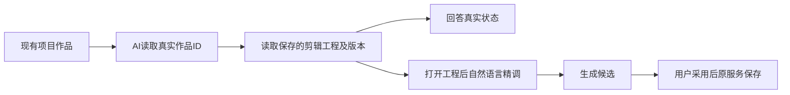

# 2026-10-09 AI 助手修复与新包验收记录

用户已授权本地合并 main、清理闲置 worktree、构建不备份、使用当前安装 App 验收。本次从 `3a60fafc4fd299d2a0d2efc403ee6a24691075de` 继续已准入 T1085–T1088，不推送、打 tag 或公开发布。本轮五项修复已取得隔离与新安装包适用证据；不能代签 T1062 全功能。

## 已验证的改动

- T1085：Pi 对不可重试工具错误比较同参时，使用宿主保存的真实绑定参数，不使用 SDK 占位参数或 `{}`。协议最终 30 PASS；原前端聊天三个文件完整 23 PASS。保留完整冻结目录、真实来源、候选采纳及幂等断言。独立实施复核 PASS。
- T1086：普通项目对话可经 `system.features → projects.outputs.list → outputs.production.editor.get` 发现并读取真实剪辑工程。保留精确旧 V1 协议，新任务用固定 V2；长工程续窗校验原 revision；没有真实编辑目标时不开放写入。合同聚焦 7 PASS，后端相关五文件 213 PASS / 3 原 skip。前端四种状态完整 4 PASS：纯组、组内账号、已登记账号的 legacy 提交入口，以及隔离初始化的迁移前旧账号。每例走真实 prepare、Worker、租约、账本、正式 owner 的七个只读工具回执，读取前后业务对象一致。
- T1087：密钥 fd 的 EOF 是结束，立即走原后备来源；EAGAIN 继续原有限等待，不改加密或用户数据。实际 closed pipe RED 保留，最终 EOF/延迟输入/后备/加密 38 PASS，消费端 11 PASS。新安装首个公开消息读取实测347毫秒；不能把旧请求231.782秒全归因于EOF。
- T1088：每条终态失败调用继续完整校验原 ledger digest、冻结定义和模型回执，再比较后端复原参数。新矩阵 116 PASS；旧截断恢复 9 PASS；补充两个文件 66 PASS；严格额外参数拒绝加强后定向 2 PASS / 58 筛选 skip。实际公共链证明目录只解析一次，外部 registry 改动不影响捕获快照，取消与退出后迟到模型响应不能写完成。独立实施最终 GO；这些是分次真实运行，不伪装成同一总用例数。

前后端、合同类型检查及物理/语义边界 exit0；物理边界保留原基线五条，不称清零。打包相关四文件 45 PASS。原始命令、exit、时间和日志 SHA 见 [证据索引](assistant-fixes-20261009-evidence.json)。

## 校准与保留失败

新前端夹具前两项卡顿是把带固定 operationRef 首行的真实展示当作纯 JSON；另一次把作品名称当成空文章初稿标题。现仅正确解包固定展示，并通过原 owner 建立和保存真实文章/图文夹具，不降低产品校验。所有失败日志保留。迁移前旧账号夹具只在隔离库初始化真实账号行；之后所有业务与 Worker 读取均经正式端口，前后实际 group/member 数为 0，执行与会话 groupId 仍为空。原业务写入合法的同账号 canonical legacy 标签不代表创建了组；本例不是历史迁移重演。

另有实际已登记账号旧 group=null 会话/稿件与执行冻结组不一致的兼容缺口，已登记 [T1089](../../features/t1089-legacy-frozen-source-read.md)，不放宽 owner 或迁移真实用户库。本次合法新来源成功不关闭这个问题。

完整合同仍有 43 FAIL / 370 PASS：原 42 个入口检查写死注册数 404，但真实为 420；原路由 allowlist 缺四个已存在 assistant/canvas 路由。实际比较 `index.ts / endpoints.ts / operations/*.ts` 共 44 个注册源与基点字节完全相同，证明 T1086 没有新增公共 ENDPOINTS，不冒称整体合同通过。完整超时 Gate exit1 保留原 27 条静态记录，动态 165 PASS，继续由 T1081 承接。

最后一次相邻五文件回归是 42 PASS / 5 FAIL，原四项 dispatcher 及五项截断兼容已恢复；剩余为 durable-chat-tool-ledger 的旧卡确认/length 断言。外置独立对照仅加载3a60的原completion与plan两个模块，两条源码SHA标记实际出现；原文件8例完整运行，3 PASS / 5 FAIL，五个失败名称、原卡确认拒绝及length断言与当前相同。此为两模块反事实对照，不冒称完整3a60 checkout回归，不借本次三生产文件放宽卡或完成校验。本轮完整 reconcile 已实际结束：exit1，42 error / 0 warning，耗时1116.008秒。保留全部原日志；既有 T1081/T1082/T1083、来源评审、历史教训及看板健康失败不代签全绿。

## 新包与实际安装验收

固定入口 `CREATOROS_LOCAL_SKIP_INSTALL=1 pnpm -C frontend desktop:package-local` 实际 exit0，耗时374.529秒。构建期间源码冻结于 main `ecb1de60c7adb31efe9068f0f11b6d69e1e4b9e0`，之后本文件/任务审计更新不代表重新构建。DMG：[CreatorOS-1.2.0.dmg](/Users/zyongzhu/Downloads/CreatorOS-1.2.0.dmg)，840293563字节，SHA256 `248f6053ebcca48ccf3d80e3f633034dd02cd0b57721908f723fedb8acd660b1`。hdiutil校验和通过；源App、只读挂载DMG、实际安装App四个关键成员摘要一致，deep/strict签名检查均exit0。本地ad-hoc签名，没有Apple公证，不是公开发布包。

已经无备份替换并启动 `/Applications/CreatorOS.app`，`backupCreated:false / dataReset:false`，用户数据与激活没有重置。首次启动日志实际包含SIDECAR_STARTUP_VERIFIED和HTTP MAIN_PAGE_LOAD_FINISHED，不把tauri启动壳加载当成首页；从open到观察时的上界约72秒，不声称精确冷启动耗时。退出后第一次普通open虽然返回0却没有目标Native进程，观察脚本136.352秒后仅停止自己的子进程，exit-15，原尝试没有通过且原因尚未定。之后独立open -n恢复启动，PID1964、实际HTTP首页加载完成；恢复成功不代签原尝试或两次普通重启PASS。日志原捕获前缀后续归档并校验原摘要，明确归档发生时间，未倒填历史证据。

新包在原中性项目发出一次新的只读意图，保留旧错误回答，实际Pi任务 `ai-task-7c910efd-143` succeeded。真实消息工具回执包含artifacts.list、projects.outputs.list、artifacts.versions.list、outputs.production.editor.get；回答正确读到原视频可编辑工程revision7，原主脚本v2、文章和图文标题一致。公开读取前后工程/主脚本/文章/图文DTO全部深等。首个公开消息读取347毫秒；原旧请求231.782秒保留，不仅据此把全部旧耗时归因于EOF。独立安装证据复核：[有界安装与助手读取](assistant-fixes-installed-review.md)，结论PASS_BOUNDED_INSTALLED_HTTP_AND_ASSISTANT_READ。

另12项公开读取真实exit0，单次307–801毫秒：平台能力、绑定能力、首页、项目分析、复盘、产物、作品组合、画布、原素材、AI任务、渲染列表、项目作品。返回空态按真实0/空记录，不编造内容，不代表原生页签点击速度。第一次验证脚本把describe顶层合同当成data失败发生在业务读取之前；原exit1保留，正确读取合同后单独记录成功。

## 新包实际粗剪导出

按用户此前明确采用的中性S1候选，导出原output119的revision7，不产生新语义候选或修改工程。新请求 `main-assistant-fixes-20261009-export-approved-r7` 唯一原任务 `ai-task-76b77d63-159`，渲染产物完成后正常awaiting_confirmation；经正确 `execution.tasks.confirm` 保存后succeeded，素材 `asset-76b77d63-222`。首次脚本错误地要求立即succeeded，之后误用通用ai.tasks.confirm实际HTTP409；原日志保留，没有重新渲染或重复任务。

沿公开assets.downloadUrl获取正式相对签名地址、解析实际Native日志中的本机origin后下载。第一下载脚本未处理相对地址失败，随后环境HTTP_PROXY误代理localhost返回502；使用本机直连ProxyHandler({})后HTTP200，不注入或绕过cookie/header/token。原片232847字节，SHA256 `e6c0f4e72741e8f37b369d9511311569df8ef6c4e07009f3c746c632fb0e2073`与原验收相同。新成片199098字节，SHA256 `a72af1826b27bc566fb7b839c4c0813aa3cc04bb0cde6164e1ec04f41f3e1558`，ffprobe确认H264/AAC、8.166667秒，ffmpeg完整解码exit0；工程DTO前后相等。低码率中性静态测试视频的质量warning没有阻断安全成片。独立复核：[有界公开读取与导出](assistant-fixes-read-export-review.md)，结论PASS_BOUNDED_PUBLIC_READ_AND_EXPORT。

相邻两模块基点对照独立复核：[局部历史源码对照](assistant-fixes-adjacent-baseline-review.md)。全部原始命令和失败仍留在外部验收目录，不把局部对照称为完整历史checkout或全局通过。

## 未完成的验收

真实Codex引擎、原生逐页点击/拖拽、多平台真实扫码、自然语言精剪效果，以及T1062剩余全功能矩阵仍待实际证据。原生窗口当前自动化通道不可用，已向用户询问首页实际可见状态，不能代填。T1089已确认旧账号入口的会话/两类稿件来源兼容缺口，待正式方案独评后修复。原图401仍等待用户明确采用，没有重新生成或代保存。完整reconcile的42项错误、合同43项失败、超时静态27项及相邻durable ledger五项均保留其有界归属，不宣布全功能全绿。
