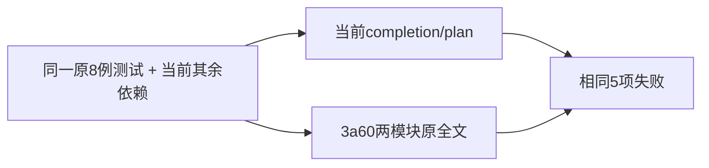

# T1088 相邻双模块基点对照独立复核

**结论：该双模块基点对照有效。可将这5个具体失败视为本次 completion/plan 两模块修改之外、在当前依赖环境下仍存在的失败；不能声称完整3a60 checkout已回归，也不能将相邻组写为全绿。** 恢复两模块原全文后，同一未改8例仍5 FAIL / 3 PASS，失败名称、错误及位置与当前最终相邻运行一致。

仅只读冻结源、harness、Git原blob和已有日志；本代理没有执行测试、业务、DB、模型、API或App，没有修改仓库、产品、测试、文档、脚本或旧报告，只按授权写本外部验收报告。当前冻结HEAD `ecb1de60c7adb31efe9068f0f11b6d69e1e4b9e0`，原取源ref `3a60fafc4fd299d2a0d2efc403ee6a24691075de`。

## 加载与字节真实性

实际读取 `manifest.json`、config、command、README、两份original全文字节、当前/原Git blob及日志，核对如下：

- original `chat-turn-completion.service.ts` 为16626 bytes、SHA `90139acc4f101b2a5435cf950df04acd7bf75558b268c0770da344f806eb7e07`，与 `git show 3a60...:该路径` **逐字节exact相同**。
- original `workbench-plan.service.ts` 为21696 bytes、SHA `ee509ea5f52cc19041ee7d7155f397452369ba68dcc8c940cc57e7a2ba9b3220`，与原Git blob **逐字节exact相同**。
- 原测试 `durable-chat-tool-ledger.test.ts` 与3a60逐字节相同，SHA `e098efe8d5a6c3420eb0c6c9d78bf1a8fecc47eb5c59c6014e57e8b1f2a512fa`。8种mode completed/unknown/approval/denied/empty/length/http429/repeat均保留，未按失败过滤、删断言或换fixture。
- config的 pre resolveId 将仅这两个模块入口转到original，并把快照中相对/裸导入沿原源码位置解析；load实际返回快照全文。checkBoundBytes在配置加载及buildStart核8个绑定文件，load又核两个original SHA，无正文重写或schema伪替换。
- **实际基点日志同时出现两个已加载标记**，模块路径、3a60 ref及上述两SHA exact匹配。四项卡片错误的stack还指向original completion快照，证明不是仅把“基点”写在元数据里而实际仍跑当前模块。
- manifest的6项sourceBindings baseline/current/snapshot hash与当前文件及原Git blob均已独立重算通过；config/command SHA亦匹配。两Worker文件 baseline/current不同是明确保留的当前依赖，不假装它们退回3a60。

manifest的 `PREPARED_NOT_RUN`、command `NOT_RUN` 和README“未执行”属于冻结准备材料；真实执行以新增log/json为权威。本报告不改这些历史字节，也不把准备状态本身解释成已运行。有效运行结论由双加载标记、argv、exit及8例真实终态共同提供。



## 真实运行与失败逐项比较

| 原mode | 当前最终相邻运行 | 双模块基点对照 | 判断 |
| --- | --- | --- | --- |
| completed | 聊天工具卡尚未确认 | 同一ConflictError | 相同失败 |
| approval | 聊天工具卡尚未确认 | 同一ConflictError | 相同失败 |
| denied | 聊天工具卡尚未确认 | 同一ConflictError | 相同失败 |
| repeat | 聊天工具卡尚未确认 | 同一ConflictError | 相同失败 |
| length | requests expected2 / received4 | expected2 / received4 | 同一断言失败 |
| unknown / empty / http429 | 该文件其余3例通过 | 其余3例通过 | 未筛除对照 |

四项卡片错误当前stack是completion `:72` / `:108`，基点stack是original `:71` / `:107`，只是新增import带来的行偏移。原完整diff证明assertCards正文及其调用没有被T1088更改。length失败均在未改测试 `:123` 的requests数量断言；该断言先于后面的completion.commitResult，不能归因于本次completion参数签名调用。两模块切回旧代码后失败完全保留，也没有变回首轮T1088的missing-resolver错误。

基点实际运行：

```text
pnpm -C backend exec vitest run src/integration/durable-chat-tool-ledger.test.ts --config /Users/zyongzhu/CreatorOS-local-acceptance/main-installed-20261008/t1085/t1088-adjacent-baseline-harness/vitest.baseline.config.mjs --retry=0 --no-file-parallelism --testTimeout=120000 --hookTimeout=120000
```

JSON exitCode **1**；开始 `2026-10-08T17:37:04.824205+00:00`、结束 `2026-10-08T17:37:34.365639+00:00`，elapsed29.541126秒；实际 **1文件失败，5 FAIL / 3 PASS（8）**。配置include仅原该文件；无case name筛选、无retry。

当前最终相邻运行 `t1088-adjacent-compat-final`实际包含T1026、durable model、durable tool、authority与dispatcher五文件，**5 FAIL / 42 PASS（47），4文件通过/1失败，exit1**。唯一失败文件为durable tool，其8例同样5 FAIL / 3 PASS。JSON开始 `2026-10-08T17:25:35.621854+00:00`，结束 `2026-10-08T17:27:25.974334+00:00`，elapsed110.351374秒。不能把整个最终组写成“8例运行”，也不能写47全绿。

两JSON的cwd/argv/exit/logSha已实际核对；本代理未重跑。命令CLI预算120000ms没有覆盖原测试显式15000ms case timeout与60000ms账本预算，这些旧fixture字节没有被改；不把CLI覆盖误说成全部旧预算已升级。外层1200秒是command准备要求，现JSON未单独提供外层执行上限字段；执行真实29秒结束，不宣称这个额外字段被运行器证实。

## 允许的归因与明确局限

本对照回答的仅是：**T1088 completion/plan这两处修改是否是上述5项失败出现的必要条件？不是。** 在保留同一当前其它依赖时，换回两模块原源码，5项仍同样失败；卡片门本身原来就存在，length断言还发生于completion之前。可据此把这5项移出该两模块修改的新增回归结论，作为关联既有失败保留，不重开T1088产品范围，不删除断言或放宽卡片门。

它不证明3a60完整软件在当时环境已经有这5项错误，也没有确诊剩余根因来自旧fixture、共享投影还是其它当前产品。特别 `chat-worker-run.ts` 与 `chat-pi-loop.ts` 仍是当前T1085改后字节；dispatcher与其它服务/依赖亦取当前树。不能把这项对照扩大成“T1088所有写集或所有相邻历史均不可能回归”，也不代签T1085/T1086、SDK版本历史、安装版、用户真实业务或模型。

因此：保留5个真实红，登记/沿用关联债务；仅在这个明确局部边界下，不以这5项阻断已通过的T1088 completion/plan实现复核。原最终GO及历轮报告不回填或改写，ROOT可将本报告作为新的补充证据。

## SHA绑定

以下均为本轮实际重采；验收根相对路径以本报告同目录t1085为根。

| 外部路径 | bytes | SHA256 |
| --- | ---: | --- |
| `t1088-adjacent-baseline-harness/manifest.json` | 4123 | `4cd0e3ba28d56cf4e783aa243f507e7d3af40895cf854ad6f0dc934f80e12fc0` |
| `t1088-adjacent-baseline-harness/vitest.baseline.config.mjs` | 5249 | `e38bd88d6942fa92862b36592b631ca8b24f58595bf856252b4db8d5cc53cc8e` |
| `t1088-adjacent-baseline-harness/command.json` | 1114 | `183b185340bc28267dd5c688800e9745d99ff6c29f1a538992140234ceb6eb9e` |
| `t1088-adjacent-baseline-harness/README.md` | 1090 | `42823363f382820cc543b418cba4b2589da5188d92f8dc84e11a654cbdc28ad3` |
| `t1088-adjacent-baseline-harness/original/backend/src/modules/ai/chat-turn-completion.service.ts` | 16626 | `90139acc4f101b2a5435cf950df04acd7bf75558b268c0770da344f806eb7e07` |
| `t1088-adjacent-baseline-harness/original/backend/src/modules/execution/workbench-plan.service.ts` | 21696 | `ee509ea5f52cc19041ee7d7155f397452369ba68dcc8c940cc57e7a2ba9b3220` |
| `t1088-adjacent-two-module-baseline.log` | 2745 | `91cb4f8f1d8c02565266a0bfc5cdf5b735586d33bd64b097c5e2c126e491b674` |
| `t1088-adjacent-two-module-baseline.json` | 737 | `b897f7220f84ffa40eb45d698e2a8d4e233f699a8d378f834f467492fb10df7c` |
| `t1088-adjacent-compat-final.log` | 1974 | `b75e079b3d66722b9faf5db6d0d988740e3b39e2afa94fbedcec21257c753bd3` |
| `t1088-adjacent-compat-final.json` | 816 | `d1f402345770ceb90499128a8b5d5e845b52757c4a74b69b5a7f276a7b4e3384` |

当前W源与实际Git基点比对：

| W相对路径 | currentSHA | 3a60SHA |
| --- | --- | --- |
| `backend/src/modules/ai/chat-turn-completion.service.ts` | `fa38950055f48e0a58c0eb78b99592a67c5d073467dc5213fb12c5983167fbec` | `90139acc4f101b2a5435cf950df04acd7bf75558b268c0770da344f806eb7e07` |
| `backend/src/modules/execution/workbench-plan.service.ts` | `bcfe5c718d0b277b178265e9e9812fdcb57f08fa758b7b6ffa91bf7d377fc48b` | `ee509ea5f52cc19041ee7d7155f397452369ba68dcc8c940cc57e7a2ba9b3220` |
| `backend/src/integration/durable-chat-tool-ledger.test.ts` | `e098efe8d5a6c3420eb0c6c9d78bf1a8fecc47eb5c59c6014e57e8b1f2a512fa` | `e098efe8d5a6c3420eb0c6c9d78bf1a8fecc47eb5c59c6014e57e8b1f2a512fa` |
| `backend/src/modules/ai/chat-receipt-projection.ts` | `28f5efc8db13e4014d4d4b9a7f54e784dc88f51660b9fd88c55060dedb51d3ee` | `28f5efc8db13e4014d4d4b9a7f54e784dc88f51660b9fd88c55060dedb51d3ee` |
| `ai-worker/src/execution/chat-worker-run.ts` | `969308d2f8a3e5e57134893b5d1a4aaa2e222749bba3562a8382fd35f7dfe5b3` | `440956e341527dbf83effcc5eccbefcfedd1151a695fd4480c3af230c9fde6a9` |
| `ai-worker/src/runtime/chat/chat-pi-loop.ts` | `4f26ac95534c041bd042d9d43d24feff13d64092f837c4b1435640eb25aba001` | `1bbde6d6fe9f126e4f10e518bf5dbb7d25a34f08b67c4bbebfd82e31d8f7da9c` |
