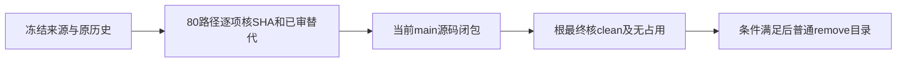

# T1062/T1080 当前来源闭包独立只读复核

结论：**PASS_BOUNDED_SOURCE_CLOSURE_CLEANUP_CONDITIONAL**。当前 `main` 为 `3d4444934a618542747dd9839a299c6d769adad1`，阶段 `4-build`。两来源的 80 条产品、测试及包路径全部有原语义或已审 main 替代；未发现未整合产品源码、清单外源码或未知产品差异。逐路径 source/current SHA、判断及读集在 [A_SOURCE_CLOSURE.json](A_SOURCE_CLOSURE.json)。这不是 Git 全合并、完整 Gate、包或安装签字。

| 来源功能 | 条数 | 当前实际结论 |
| --- | ---: | --- |
| canvas 微信原生报表闭包 | 56 | 46 与 source 逐字一致；3 保留已审 main 严格归属和现 operation；7 与原 CURRENT_PORT_DELTAS 精确一致，已有 T1162/T1167/T1168/T1169 复核 |
| canvas 旧 T1101 历史 | 6 | source293d 与原 b1f0cc54 相同；current 与原 T1124 独评 main7de72c56 相同，保留已审替代；旧 legacy 测试两份 main 均不存在 |
| chart 分析/调度/图表 | 12 | current 全部与 source454e9241 原字节相同，承接 T1127 已审当前移植 |
| chart 封面用途/图片页组 | 4 | current 全部匹配 T1149 最终独评 SHA，保留真实能力交集、用户选择、引用与旧任务保护 |
| chart 排期布局 | 2 | Dialog 逐字一致；planning 仅已审 DialogTrigger asChild 差异，匹配 T1136 SHA |

canvas 来源 `293d4e98d2cedbd04eebce16a62f921711ee8079` 相对共同基点 `d35f7d57ff952d306071eb40d34127956b067906` 的产品清单实际为 62，chart 来源 `454e9241a2adb107f3beb224914bc3273c063bee` 为 18，与原功能清单完全闭合。56 条原 PORT_MANIFEST 的 source SHA 全部读 Git 原对象核对，49 条仍与初始 port 相同；7 条变更全部由 CURRENT_PORT_DELTAS 覆盖，无未登记漂移。五条额外 contract envelope/验证路径也逐字匹配当前记录。T1140 picker 四个关键产品文件仍与其独评 SHA 相同；画布 editor 后续字节由 T1149 最终独评承接。

两来源具名分支仍实际指向原 HEAD，原 SPEC、独评、控制面及来源成功/失败的对象仍 Git 可达。source HEAD 不是当前 main 的祖先，本报告据逐路径受控移植确认语义闭包，不能冒称 Git 整分支合并。来源 BACKLOG/events/review-events/modules/reconcile/progress 等控制差异已识别为原历史，不复制为 main 状态，不拼接审计，也不继承来源真人或全局 PASS。原 T1159 初评 FAIL、原研究 UNKNOWN/0报告/2实验耗尽及暂停保持。

清理条件单独保留。此次以带绝对路径的 Git status 实读：

- `/Users/zyongzhu/.codex/worktrees/canvas-binding-fixes/Thirdspace-creator`：仅 `M orchestrator/.lessons-stats.json`，工作字节 SHA `32a3dc3233efb163e41b94f1073df7aff894908d330e64d2317bedba8a40d9f5`，目前不能直接普通 remove。
- `/Users/zyongzhu/.codex/worktrees/chart-cover-labels/Thirdspace-creator`：当前 clean。

根报告 20:44 两树没有进程 cwd 匹配；本独评未读取其原 lsof receipt，且该观察不替代删除瞬间重查。根须最终证明无占用、具名原分支/历史保留、无未提交项目字节遗漏，并先使 canvas 达到 clean；之后两树可按原 SPEC 普通移除目录，不 force、不删原分支。活跃 t188 与主目录保留。本会话没有改仓库、跑测试/服务/业务CLI/数据库/模型或删除工作树；只写此私有报告。
