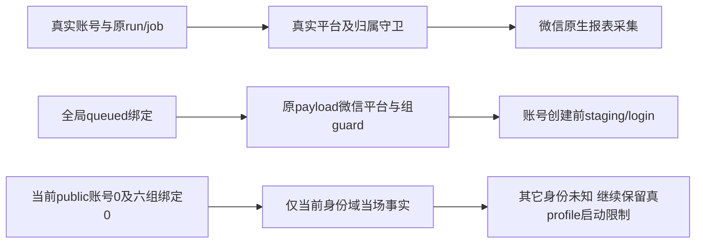

# T1062/T1080 真profile安装前微信执行边界独立只读复核

结论：**PASS_CURRENT_PUBLIC_IDENTITY_FACTS_REAL_PROFILE_STARTUP_NOT_ADMITTED**。当前 `3d4444934a618542747dd9839a299c6d769adad1` 的源码支持当前公开身份域限定判断，**不准入真实 profile 安装启动**。其它身份域未闭合，原 T1159 研究暂停和安装触发限制保留；离线构建、包内容及隔离启动可继续。本结论不签 AC-LIVE、完整 Gate、包、安装或模型。

当场最小公开证据：

| 观察 | 时间（UTC） | 完整性及实际值 |
| --- | --- | --- |
| accounts.list | 2026-10-09 20:32:28.699837 | listed=total=4；xiaohongshu1、douyin2、x1；微信0；六项public读取均exit0 |
| accountGroups.list | 2026-10-09 20:43:45.599251 | includeArchived=true；listed=total=6 |
| execution.tasks.list | 2026-10-09 20:46:06.007704 | 六组均显式group、kind=account_binding、完整分页且无status筛选；每组count=total=0，未终态0；六次exit0 |

三项动态 describe 的 effect=read，实际 description SHA 与 receipt 相同。账户最小摘要所记 raw SHA 与 accounts receipt 相同；组最小摘要所记 raw SHA 与组 receipt 相同。此次只读指定最小摘要、description、receipt，未读或独立重哈希原始 accounts/group/task 个人正文。当前 public user 的 0 不能外推数据库全部 user，也不是永久状态。

原生报表、startup bootstrap、periodic recoveryOnly、scheduled self.metrics、queued run 恢复都从真实账号读回 platform；原 run/job 的微信标签不足以触发微信。无信号恢复不抢原 scheduled owner，periodic 只恢复原 run，已耗尽 TASK_TIMEOUT 不恢复。平台/成员冻结值、原任务 owner/key/attempt/deadline、租约及 profile authority 守卫在浏览器前继续有效。孤立微信目录无自动扫描采集入口；现 account profile authority 重核真实 active 账号、user、platform 与 external ID。

仍须保留一条真实触发边界：`recoveryWake.account_binding` 启动会调用绑定 drain。queued 绑定的 platform 来自原任务 payload，它可在尚无 platform account 时先进入 staging/login，所以账号微信0自身不足以排除启动扫码。`claimNext` 不是只 claim 当前 CLI user；它会使用所 claim 任务的原 userId 执行。因此当前六组绑定0只排除当场当前公开身份域，其它身份队列仍 **UNKNOWN**。原 running/cancel_requested 绑定恢复只 discard/停止/失败或ack，不重新login。

`execution.tasks.list` 的 query 没有 groupId 字段；group 来自显式调用 ctx。带 `kind=account_binding` 才进入 V2 持久任务消费者；其 list 强制 workspace 并按 `ctx.userId + workspaceFilter` 过滤。无 group 时仅可用显式 legacy account scope，不能无范围列全 user，也不能把 saved 默认组选中当全用户。

旧 `groupId=null` 绑定无需额外 user 无范围列表才能排除 login：execute 将 accountId 固定为 null，第一步 `guard -> leases.withLease(admission) -> lockWorkspaceMembership -> requireWorkspace` 即失败，先于 createStaging/login。无效/归档/版本改变的非null组同样先拒绝。此代码证明的是不进入微信 login；不声称安装不会有清理或错误状态处理。

实际既有隔离日志已按 receipt 核原 SHA：backend 9文件109PASS/exit0/195.225s，frontend 6文件76PASS/exit0/79.145s。它们支持现调用链及隔离公共流程，不证明安装库全局队列为空，也不代签真人平台。来源研究仍为 researching、导航UNKNOWN、实际报告0、两实验用尽；当前public0不能当作 resume criteria 满足。

未来如依据public0继续审准入，须在安装前由根按原公开入口重读完整账号与显式全组队列，保分页/meta；还须闭合实际 profile 的其它身份域可执行任务未知，并满足原研究恢复/执行准入。不得新增开关、停其它合法任务、写库清队列或隐藏能力绕过本SPEC。本会话未操作真实App/CLI/DB/profile、未启动任何测试/服务/模型；实际读集 SHA 与范围详见 [B_NO_WECHAT_INSTALL_BOUNDARY.json](B_NO_WECHAT_INSTALL_BOUNDARY.json)。
