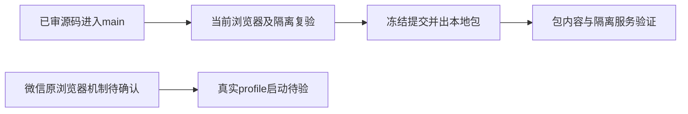

# 当前本地候选闭包与验收事实

产品源码已提交在3d444493；后续本提交只含控制和实际验证证据，源码与独立A的80路径及额外保护项一致。四份版本保持1.2.0，用户已授权本地无备份出包，无推送/tag/Release。

当前独立A来源闭包、现字节隔离服务测试、51组件/174 LED047、四项原Chrome正式taskctl验收均有真实收据。根实际检查共享7图、排期12图、素材20图；素材错误503和平台能力/模型mock范围明确，不把它们算真人平台/模型验证。两个闲置来源目录普通删除成功、原Git分支和152原证据保留，活跃主目录/main/t188继续保留。

本轮完整canonical实际971.517秒exit1/40ERROR保留原日志；LED052新增错误因缺显式隔离PG配置，T1172原公共链补验59用例通过。T1173仅机械闭合身份撞号/畸形字段，T1171无损归档后仍约58.1KB超过30KB硬阈值；五列缩减方案被独立拒绝且未实施。归档索引改变不能视为历史审核债消失，不称全局通过。

当前原生App仍旧d712130f。离线构建和真实包内容/隔离服务启动可做。T1159 AC-LIVE未验：来源微信首页0报告，原两实验用尽；独立B仅确认当前公开身份/组无微信记录，跨身份旧绑定恢复队列仍UNKNOWN，真实profile安装启动未准入。不得用新本地包生成冒称已替换或已真人验收。原T1135色彩、T1155中断、T1144清理等未知根因和原失败继续保留。

