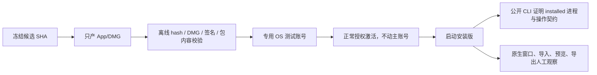

# T-1062 本地安装版逐功能验收入口与隔离方案审计（只读）

审计日期：2026-10-05。依据冻结源 `e8d79d4a`、`c5316506`，以及项目 `creatoros-cli` Skill 与公开 CLI 说明。本只读审计子任务没有安装、启动 CreatorOS，没有调用浏览器、模型、数据库或真实 API，没有读取用户密钥、激活码、连接文件、登录态或用户资料；这只是本子任务的执行边界，不缩减主任务已经获得的本地打包与逐功能实际验证授权。当前整合树正在修改，本文不把其中间状态当作运行证据。

## 结论

当前安装包能够做完整的离线产物校验，也能在启动后通过公开 CLI 证明“连接的是 installed 模式的当前桌面进程”，但冻结实现没有提供完整、受支持的 installed-app 隔离数据根。桌面壳按固定 bundle identifier `cloud.aitongban.creatoros` 计算 `appDataDir`，再强制把数据库、许可证、主密钥、登录态和日志放在该目录；启动时传入 `PGLITE_DATA_DIR`、`CREATOROS_DB_DIR` 或 auth 目录不能覆盖壳层的最终注入。媒体、执行工作区和 Whisper 缓存又默认落在当前用户的 `~/CreatorOS/...`，并不随 `appDataDir` 自动隔离。

因此，同一 OS 用户下直接安装并启动本包会复用现有 CreatorOS 数据与激活范围，不能作为“不会触碰真实库”的隔离验收。不得通过“重置工作区”、清除 `.license`、删除 `.auth`、改名真实资料目录或重置激活来制造干净环境。

可立即执行的安全路线分两段：

1. 在当前用户下只产包并完成离线校验，设置 `CREATOROS_LOCAL_SKIP_INSTALL=1`，避免 `desktop:package-local` 默认替换 `/Applications/CreatorOS.app` 并启动。
2. 安装版逐功能运行验收使用专用 OS 测试账号。该账号拥有独立 home、Application Support、CLI 连接目录和 `~/CreatorOS`；只用经用户授权的正常激活流程建立其许可证，不复制、删除或修改主账号激活文件。若没有可合法激活的测试账号，则安装版功能验收保持“待验”，不能用主账号真实数据顶替隔离证据。

单纯复制 App、从 DMG 直接打开、换安装路径或给 App 改文件名都不会改变 bundle identifier 与产品身份，也不能形成独立数据实例。发行构建还会忽略运行时 project key/弱验签覆盖，不能用开发环境变量绕过激活。



## 冻结实现中的真实路径与覆盖关系

| 数据面 | 冻结实现 | 能否仅靠启动环境隔离 |
| --- | --- | --- |
| PGlite | Rust 壳用 Tauri `app.path().app_data_dir()/db`，并向 sidecar 注入 `CREATOROS_DB_DIR` | 同一 bundle identifier、同一 OS 用户下不能用外部 `PGLITE_DATA_DIR` 稳定覆盖；壳注入的 `CREATOROS_DB_DIR` 是最终桌面路径 |
| 激活、机器主密钥 | `<appDataDir>/.license`、`<appDataDir>/.master-key`，发行构建内置 `projectKey=creatoros` 且强验签 | 不可清除、复制或伪造；必须保持真实产品身份，走正常授权流程 |
| 抖音/网站登录态 | `<appDataDir>/.auth/douyin` 与 `<appDataDir>/.auth/web`，由壳显式注入 | 同一 installed identity 下复用；不能把清登录态当隔离手段 |
| 日志 | `<appDataDir>/logs` | 随 appData；专用 OS 账号自然隔离 |
| CLI 连接 | macOS 为 `~/Library/Application Support/CreatorOS/<productRef>/cli`；凭据绑定当前 pid、packageId、launch nonce | 专用 OS 账号隔离；不得读取连接文件来绕过公开 CLI |
| 媒体 | 默认 `~/CreatorOS/media`，进程级 `CREATOROS_MEDIA_ROOT` 可覆盖 | 壳没有统一注入；若直接执行二进制可继承覆盖，但这仍不能解决 appData/激活隔离 |
| 执行工作区 | 默认 `~/CreatorOS/workspaces`，`CREATOROS_WORKSPACES_ROOT` 可覆盖 | 同上 |
| Whisper 模型缓存 | 默认 `~/CreatorOS/models/whisper`，`CREATOROS_WHISPER_CACHE_DIR` 可覆盖 | 同上；本只读审计未触发下载或调用，主任务可按已授权范围、明确费用与隔离环境实际验收 |

专用 OS 测试账号是现有冻结实现下唯一不要求改产品代码、同时覆盖全部这些默认 home 路径的完整隔离办法。它仍不自动获得激活资格；激活必须由用户已有授权和正式流程决定。

## 安全产包入口

冻结 `frontend/package.json` 的固定入口是：

```bash
CREATOROS_LOCAL_SKIP_INSTALL=1 pnpm -C frontend desktop:package-local
```

该入口仍会读取本机 `~/.creatoros/verdict-signing.key` 与 `verdict-public.key` 作为构建密钥，因此只应由已配置的构建环境执行；验收人员不应复制或展示这些文件。它会走 sidecar 构建、混淆/字节码、运行时冒烟、Tauri build，再把唯一 DMG 复制到当前用户 Downloads。`CREATOROS_LOCAL_SKIP_INSTALL=1` 只跳过最后的安装启动，不跳过构建 Gate。

不得遗漏该变量：默认收尾会先退出/杀掉同名 CreatorOS，再删除并替换 `/Applications/CreatorOS.app`，随后 `open` 启动，这会干扰现有实例并接入当前用户真实数据面。

## App 与 DMG 的离线验证命令模板

以下是验收时可执行的模板，本次审计没有运行。所有路径先替换为本轮实际产物绝对路径，结果与候选 SHA 一起保存。

```bash
shasum -a 256 /absolute/path/CreatorOS-1.2.0.dmg
hdiutil verify /absolute/path/CreatorOS-1.2.0.dmg

MOUNT_DIR="$(mktemp -d /tmp/creatoros-dmg.XXXXXX)"
hdiutil attach -readonly -nobrowse -mountpoint "$MOUNT_DIR" /absolute/path/CreatorOS-1.2.0.dmg
codesign --verify --deep --strict --verbose=2 "$MOUNT_DIR/CreatorOS.app"
codesign -d --verbose=4 "$MOUNT_DIR/CreatorOS.app"
plutil -p "$MOUNT_DIR/CreatorOS.app/Contents/Info.plist"
find "$MOUNT_DIR/CreatorOS.app/Contents" -maxdepth 3 -type f -print
hdiutil detach "$MOUNT_DIR"
rmdir "$MOUNT_DIR"
```

应记录：DMG SHA-256、`hdiutil verify`、App 的 `CFBundleIdentifier=cloud.aitongban.creatoros`、`CFBundleShortVersionString`、主可执行文件、`sidecar.tar.gz`、`THIRD_PARTY_NOTICES.md` 和 bundled sidecar 是否存在。`spctl -a -vv -t install` 可记录 Gatekeeper 结论，但本地包使用 ad-hoc 签名时被 Gatekeeper 拒绝并不等同于包损坏，也不能冒充 Developer ID/notarization 通过。

若需要核对挂载版与构建目录 App 是否同一候选，应对关键二进制和资源分别做 SHA-256；DMG 压缩封装本身不能用内部文件 hash 替代。

## 如何证明运行的是包内应用，而不是 8788 开发服务

运行阶段只能在专用 OS 测试账号进行。证据至少同时满足：

1. 从实际安装路径启动 App，记录主进程绝对可执行路径与 pid；不能只截图窗口。
2. `creatoros --version` 与 `creatoros help` 返回可解析 JSON 且 `ok:true`。
3. `creatoros status` 返回 `mode:"installed"`、真实 `pid`、`productId:"creatoros"` 与包内 `packageId`；`explicit-dev` 不合格。
4. 当前 shell 中不设置 `CREATOROS_BASE_URL`、`CREATOROS_EMAIL`、`CREATOROS_PASSWORD`、`CREATOROS_HANDSHAKE_TOKEN` 或 `CREATOROS_CLI_ACCESS_TOKEN`。这些是开发覆盖，存在时 CLI 会绕过 installed connection。
5. 用 OS 进程信息核对 CLI 返回 pid 对应安装路径的 CreatorOS 主进程；sidecar 应由该进程启动，监听随机 loopback 端口。固定 `http://127.0.0.1:8788` 或 `mode:"explicit-dev"` 只能证明开发服务。
6. 窗口加载与侧车启动日志应出现本轮启动的动态 loopback 地址和 `SIDECAR_STARTUP_VERIFIED`；日志只从专用测试账号的应用“导出诊断”能力取得，不读取主账号日志目录。

CLI 的 connection/credential 文件本身含启动级秘密，不能把文件内容纳入证据。公开 `creatoros status` 已提供所需身份摘要。

## 公开 CLI/API 可验证的范围

安装版启动且用户已正常开启“Codex 与 CLI 完整访问”后，按 Skill 的固定流程执行：

```text
creatoros --version
creatoros help
creatoros status
creatoros access status
creatoros operations list
creatoros operations describe <operation>
```

不能从源码静态清单假定安装版 operation；每个功能先从本轮安装版动态 `list/describe` 取得输入、输出、effect、确认策略和 contract version。CLI/API 可以验证：

- 安装版 sidecar 可达、完整访问状态与 installed 身份；
- 账号组、账号、项目、画布/模板、文章图文、作品组合、制作工程等已经公开为 contract operation 的列表、详情和真实 ID 归属；
- 只读状态、版本、任务状态与保存后 read-back；
- 需要写入的创建、保存、采用、撤销或任务提交，前提是验收数据属于专用测试账号，并带 `--apply`、稳定 idempotency key、显式 `--group`/`--account`，以及 operation policy 要求的 `--confirm-impact`；
- 异步调用只用原 `taskId` 做 `tasks get/wait`，不能因超时重提。

本只读审计子任务只设计并核对入口，因此没有执行模型、浏览器、数据库或真实 API。主任务已获本地打包和逐功能实际验证授权，可在隔离数据与测试夹具上运行数据库、浏览器及真实功能；模型调用须避免未知费用，对外发布仍不在授权内，真实账号资料也不得自动合并。缺少可用凭据、明确费用边界或隔离条件的项目如实记为待验，不把这些条件误写成需要重新批准整个验收流程。

CLI/API 不能单独证明：

- 原生窗口真实显示、窗口尺寸、导航、焦点、拖拽、文件选择器和系统权限弹窗；
- DMG 安装交互、Finder 布局、Gatekeeper 首开体验、Dock/菜单栏、退出后进程组清理；
- 视频/图片逐帧视觉正确、字幕与叠层是否错位、音画同步、变速保音高、预览播放；
- 导出对话框、用户选择路径、文件实际可播放、Finder 中的结果与应用回读一致；
- 浏览器登录、二维码、真实五平台采集和原生 WebView 行为；
- CLI 未公开的 UI-only 流程。

## 必须在原生 UI 中实际观察的验收项

在专用测试账号中逐项记录屏幕、输入文件 hash、结果文件 hash 和失败日志：

- 首启、激活状态读取、主窗口加载、导航与关闭重启；
- 空组、组切换、绑定管理与迁移预览的可见状态；
- 首页、总览、分析、复盘在 0 数据和失败状态下是否诚实；
- 项目、主脚本、文章/图文、案例、资产、无限画布、模板采用的交互和刷新恢复；
- 视频文件选择/拖拽、导入、转写状态、Skill 粗剪候选、影响对照、明确采用、同轨编辑、撤销重做、保存刷新、预览与真实 MP4 导出；
- 字幕/独立叠层受影响提示、未支持自动联动时的明确差异；
- 设置与模型配置的遮罩、保存回读和失败提示。主任务可在费用明确且使用隔离数据时按既有逐功能验收授权发起真实调用；费用不明时只验配置表面和错误边界，不发请求；
- 原生文件路径、预览、导出、外部打开与权限失败的真实反馈。

安装版测试必须使用专门准备的非私人媒体夹具。不得选择主账号照片、真实作品、登录态目录或现有 `~/CreatorOS/media` 中的资料。

## 不可自动代签的项目

- 用户对整体功能是否符合预期的最终验收；
- 真实模型、付费调用和实际输出质量；
- 抖音及其他平台的真实登录、授权、采集和发布；
- macOS Developer ID/notarization 或 Windows 签名，除非本轮产物确实具备对应签名并由系统工具通过；
- Windows 安装与原生行为，不能用 macOS DMG 结果替代；
- 未公开给 CLI 的原生交互和视觉体验；
- 任何缺少安装包 hash、候选 SHA、真实输入/输出或当场日志的历史口述结果。

## 给主会话验收表的状态建议

| 阶段 | 当前可执行性 | 允许写入的结论 |
| --- | --- | --- |
| 只产包 | 可执行 | 固定候选 SHA 下产物生成成功/失败 |
| DMG/App 离线校验 | 可执行 | hash、DMG 完整性、签名属性、包内容与版本 |
| 当前主账号安装启动 | 不应执行 | 会复用真实 appData、auth、激活及 `~/CreatorOS` 数据面 |
| 专用 OS 测试账号启动 | 条件可执行 | 需正常授权激活；不修改主账号数据与激活 |
| CLI 读/写验收 | 条件可执行 | 只按安装版动态 operation 与当前用户授权；写入限隔离夹具 |
| 模型/浏览器/平台/发布 | 本只读审计未执行；主任务按既有授权与边界实施 | 可在隔离环境验收浏览器、数据库和真实功能；模型调用避免费用不明，对外发布不执行，均不得以 mock、dev 8788 或静态审计代签 |
| 原生 UI/导出 | 需人工观察 | 当场安装版证据；CLI 成功不能替代 |

若主会话希望在同一 OS 用户下自动化一套完全隔离的 installed-app 实例，当前冻结实现缺少受支持入口。应先补一个由壳层统一解析、同时覆盖 appData、media、workspaces、model cache 与 CLI connection 的测试实例身份/数据根，并证明发行激活边界不被削弱；在此之前不要用环境变量拼凑成“已隔离”。
