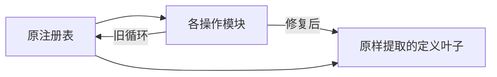

# T-1062 安装页面启动的合同初始化修复（实现范围）

原已批准SPEC cfbaf9不变。本记录落实用户已经授权的本地安装与逐功能验收，不是新产品方向、服务契约变更、规格复审或用户typed capability。当前处于BUILD：真实安装发现失败→有界实现独立评审→真实回归→干净提交→SHIP重新出包和安装验证。原18命令及历史失败保留。

## 当场失败

005141ef的本地DMG实际生成并安装，镜像/签名与277补充迁移资源逐字节通过；公开CLI status/full、账号和组列表均成功，各3项。安装浏览器tab3真实报 `ReferenceError: Cannot access ... before initialization`，位置是 `Module.creativeCanvasOperations`。首页没有可用功能，不能填写安装全绿。完整实际候选、包hash、PID、公开回执摘要及console错误只留用户私有 installed-client-contract-cycle-failure-actual-20261006/result.json。

源码endpoint注册表导入操作，操作又从注册表取得defineEndpoint，形成循环。原开发浏览器与Node根导入的成功不能代签经过构建和混淆的客户端。一次tsx诊断因工具不存在exit254，不是红测或产品失败证据。

## 最小待评审实现

将原HttpMethod/Endpoint/defineEndpoint定义原文提取为contract/src/endpoint-definition.ts叶子；endpoints.ts原路径重新导出同名定义，原ENDPOINTS对象、所有展开顺序和creativeCanvas的原重复展开保持。40个操作文件只把../endpoints定义导入改为../endpoint-definition，不改operation ID、路径、schema、权限、归属、模型、数据库或用户内容。新增真实先操作入口再注册表的初始化回归，覆盖所有40操作入口。精确43路径另列新substep；原integration592与迁移283不改。

此时仅方案，尚未改产品代码、未签测试或新包成功。独立Agent先只读核对循环、兼容导出和内部拆分范围，再执行原字节基线与修复回归；最终必须用新包真实页面公共入口检验，不能以孤立helper代替。

