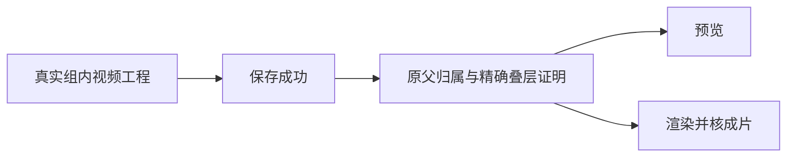

# T-1062 安装版纯组剪辑预览与渲染的叠层捕获归属落实

原已批准SPEC cfbaf9e80e6c8b005899c9be2f06d080e66cc119a14be381b721850a4fd36a1c不变。用户已经授权账号组内共享创作、空组可创作、本地安装及逐功能验收。本次Owner=agent仅落实既有行为，独立实施step installed-overlay-capture；不新开规格周期，不取得新的用户capability。本说明是原SPEC实现范围，不能替代原SPEC与BACKLOG。

## 当场失败与最小写集

实际安装228dd08a中，纯组无平台成员，真实父项目/output均归该组且accountId=null。公开源prepare/adopt、真实转录全文adopt、Skill候选及手工save/get成功；手工版本revision3可回读。公开editor.preview和editor.render均HTTP428：per-account operation ctx.accountId missing。渲染未创建任务，不能记作完成。真实私有回执保留，不用绑定假账号绕过。

contract已将preview/render逐项声明project-derived；两者在editorVersion2读取readEditorOverlayBindings，组合根接到productionOverlayCapture.readBindings。捕获scope、明细与写入仍requireAccountId，保存可选hook沿既有savepoint安全warn所以保存成功，预览与渲染却被反杀。schema已具group字段、nullable account及组索引，无需新迁移/API。

精确写集为production-overlay-capture.ts、既有production-native-public.integration.test.ts和本说明，共3路径。原integration592、migration283、bootstrap45、原18argv/顺序/预算/断言均原样保留。不改operation权限名单、真实平台账号动作、composition root、数据库历史、旧失效回执或其它file-binding服务。

## 真正父归属与现有协议

saved首先经同transaction真实production.getEditor授权，校验user→project→output→production父链，不以ctx或membership替代。再读取同user/editor.productionId/contentOutputId的真实productions行，取得实际groupId；ctx有group时必须与其相同，legacy仍按既有公共父scope允许null或真实grp_legacy账号。捕获写入groupId来自该实际父行；withWorkspaceWrite证明owner/active及锁，不证明ctx中的groupVersion/membershipVersion数值。两个既有可空版本字段缺少真实已验证值时保NULL，不据此授权，不推断当前成员版本，也不新增epoch校验算法。不得单独信ctx stamp、猜当前成员初始组、开放外国资料或改写旧version。

即使capture.bindings=[]，读取/写入都必须验证真实父production；空明细不是权限豁免。请求与明细按既有workspaceFilter、user、output、production、revision、planDigest和status精确读取，已读取记录的groupId与实际父group一致；request冻结版本不被新ctx版本覆盖，旧version nullable兼容只沿原明确null/initialgroup边界，新保存version必须与实际父一致；同组平台筛选不会隐藏共享捕获，legacy按原null/initialgroup规则。保留v1 schema及全部原owner request digest/plan digest/history binding source/机械媒体血缘/exact asset-file验证和唯一回执；缺捕获依原逻辑返回[]，腐坏证明与ownership继续拒绝，不能把428 catch成伪成功或跳过所有叠层验证。写入保存hook仍由原外层工作区/父锁/同transaction承载，保留可选捕获失败不反杀保存的行为。

## 待发生的真实验证

先新增公开ProductionTransport+真正capture保存hook/readBindings的隔离纯组save→preview/render回归，在原产品字节上执行并保存实际RED；不得mock readBindings返回[]冒充公共链。实施后原同一回归GREEN，覆盖纯组、同组另一账号筛选共享、legacy null/initialgroup、foreign user/group/account零写、归档只读及新写拒绝、原回执幂等、actual production与version/binding归属腐坏和digest拒绝。已有exact叠层/隐藏/继承/恢复/optional safe输出测试不删。

执行本step focused模块命令及现有video-material-owner/hooks回归，完整composite root公共链回归、backend typecheck、boundary/semantic检查、task-preflight精确3路径。既有backend typecheck两处旧T1018诊断必须保留，不以此说明签类型通过。原18及全局reconcile旧失败未被本step替换。最终独评绑定真实before/after、执行回执和commit，再重新冻结打包，安装同纯组公开preview/render并核实际MP4产物/原片摘要；未发生一律待验。

原801 snapshot包含native-public测试，原测试hash及历史18证据保留；不含capture源。该step另记两源before/after绑定；新测试源不复用旧18当场结果签绿，未来801重采只追加记录，原snapshot和历史审计不可覆盖。

当前仅范围候选，尚未实施或执行RED/GREEN、类型、出包、安装验证。独立评审后由ROOT正常落控制并生成pending队列、claim，再实施；不能在本说明填写虚构PASS。
