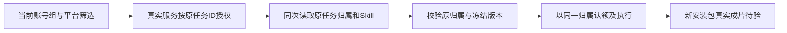

# T-1062 安装版渲染冻结归属修复现场记录

本轮修复安装版空组 render 已建任务、但因 Skill 的账号 NULL 与入口缺失属性不等而失败的问题。读取先由真实 AI service 的 requireTask 验证；执行使用该任务行创建时的冻结归属。平台筛选不改变任务原账号。当前记录仅为隔离源码与公共组合根验证，真实安装包、MP4 与用户验收由 ROOT 后续执行。

## 准入和修改边界

控制基线为 85f0a49fa748a62fba5f66a10cced508acfa5ce4，已准入的独立补充 SPEC 为 docs/features/t1062-installed-render-skill-owner.md。本轮仅修改 backend/src/modules/ai/ai.service.ts、frontend/src/server/persistence-client.ts、既有 production-editor.persistence-client.test.ts 和本说明。原 SPEC cfbaf9、原18/801/历史回执、collection 接口与业务闭包、public contract/DTO、schema、membership/admission、当前 App/真实库均不改。

AI service 新增 server-only sibling getTaskExecutionRuntime。同一次 requireTask 读取返回真实 row 的 owner 与 runtimeData；nullable 字段保持 NULL。旧 getTaskRuntimeData 的扁平返回和原消费者保持，无新增公开 operation、无任意 foreign 查询。

确定性 exec 分支新增冻结归属 runner，排除原 media.probe 和 agentic 分支。snapshot user/account/group 与真实 owner 核对；普通及显式组还核自有 group/version/memberVersion 字段、有效形状与真实冻结值。parse 的原 shape/大小守卫保留，但不把它误称为完整 epoch 校验。普通组 groupVersion 必须为实际正安全整数，纯组 membershipVersion=NULL 有真实字段并严格一致，缺失/undefined 不混成 NULL。

原 model authority pin/matches、Skill scope、任务 lease/claim、预算、幂等、exact-file 与素材物化门保持。claim、runExecutionTask、它使用的素材 service、失败结算都收到同一冻结 context。授权 owner 未取得前只保留读取失败，不猜 owner 或拿当前平台筛选去写任务。collection 仍走原 signal-only wrapper、原 caller claim 与原 caller 业务闭包，成对保持，不暗换其中一端。

legacy 兼容只在 noctxgroup、真实原 account、requireTask 实际授权的 NULL 或真实初始 grp_legacy 行内成立。旧缺 stamp 可读，已有 non-NULL 声明冲突拒绝，不复制当前成员版本或回填 snapshot。执行仍保留 no-explicit-group 原 account 解释；initialgroup membershipVersion=NULL 仍由原 admission 拒绝。显式 initialgroup 缺 stamp 拒绝，不套 legacy 别名。

## 测试隔离和证据口径

每例在初始化组合根前创建自己的临时 CREATOROS_WORKSPACES_ROOT，DATABASE_URL/PGLITE_DATA_DIR 为空、背景驱动关闭；dispose 完成后恢复环境，只清自身目录。命令使用已独评 exact-env 私有 helper run-render-owner-isolated-checks-20261006.py，单 test/hook 120 秒、maxWorkers1、retry0、无整套人为超时。完整 stdout/stderr、真实退出与前后 source SHA 均保存在私有 BASE。

公共 composite → production save/preview/render → execution →真实 AI service/Skill resolver/claim 使用实际实现。媒体 executor 与签名 URL 是明确夹具，只证明达到执行端口；manifest 保持 NULL，不能作为真实 MP4/素材下载或采用证据。隔离历史协议夹具仅改自有内存库内的真实 task 行，原账号父/owner 保持；腐坏注入仅在实际服务窄口授权读取后改变 runtimeData，真实 owner 与门卫不替换。

原业务案例的完整案例体与全部原断言逐字节相等，SHA256=0c714a89555839be66c0c260b8b8f7317babc8bb238f45265bca26f25a8ff643。必要 before/after 隔离 harness 与新的断言追加在既有测试文件；collection 原文件差异为空。

## 真实 RED 与首轮 GREEN

私有 BASE：/Users/zyongzhu/CreatorOS-local-acceptance/t1062-20261005-wm9zxxwl。现场源绑定目录：installed-render-owner-actual-il007tjj。

| 实际执行 | 真实结果 | 完整回执目录 | 限制 |
|---|---|---|---|
| 首次新增 root RED，原生产未改 | exit1，22例中21失败/1通过 | render-owner-check-root-0v_qz_jf | authority 注入当时未覆盖旧读取口，保留真实 fixture 缺口及等待；不是全部目标 bug 的 RED。 |
| 明确旧读取口与失败观察后 root RED，原生产未改 | exit1，25例中22失败/3通过 | render-owner-check-root-9ye3uiiv | omitted 原账号比较误拒、无 executor；腐坏族先被旧账号门拒，不能称已抵达其腐坏断言。显式 initialgroup 缺 stamp/legacy non-NULL 冲突仍走旧 executor，是负例真实 RED。 |
| 最小生产实现后 root GREEN | exit0，25/25通过 | render-owner-check-root-2rbns98p | 全部断言完成；executor 仍是明确夹具，不是安装或 MP4。 |

两次 RED 原生产 SHA：ai.service 3d9a5edbdfac24cb8323ad6b6d8d5a26ecaed7f6ea1facbb6561b2cd1dc58ee5、persistence-client b59cffa4d7848168efab2f47a6264275c22c88599b6d95b18533f120afac3a09。RED source-binding 是运行期间且生产未变的真实取样，不伪称先于命令；完整第二次 RED 测试字节另存 red-final-root-test.ts.txt。

GREEN root 实际命令前后源码完全相等：ai.service ddc30c9690f5ac652f6604522313c149139fdbe2d5096fdc9bf4d1eb3787ce1b；persistence-client af13c2b2c66a0244508354c4077818c6ffcc6384c93c84c132d6b30dc29589fb；root test e1800596d8675da18ad79074d0c8f2c7086425303b47600408ede69f1d76449d。green-root-binding.json 记录真实前后与退出。

25例包括原业务案例、omitted/null/member/legacy 四个真实公开生成族、同组平台回放及 foreign user/group/account 服务读取门、14个 snapshot 缺失/形状/归属/epoch 腐坏族、模型 authority 改变取消、legacy initialgroup 缺 member 版本原 admission 拒绝、legacy NULL 原解释执行且不回填、显式 initialgroup 缺 stamp拒绝、legacy 已有 non-NULL 组冲突拒绝。公开 DTO 不泄露 runtime/Skill，新 sibling 不在公开 ENDPOINTS；旧扁平 getter 返回保持。

同组平台筛选公开回放仅返回原 task，运行次数保持1；server-only 窄口真实返回原 account=NULL。这是公共读取与 owner port 证据。现行公共 API 没有跨 filter 重新 dispatch 入口，未增入口、未删 fingerprint；公共恢复执行仍待验，不能用该回放或 port 证据签恢复 PASS。

## 后续安装验收

真实失败 task111 与旧意图保留。ROOT 后续按采用后 fresh editor 当前 revision 和完整 plan 冻结新意图，再验证公开任务结果、精确成片 asset/file、下载、全解码、时长/音轨/帧边界。历史 revision3 的 7.5 秒不能作为新成片固定预期；用户已授权采用 s1 的当前计划须重新读取冻结。Whisper task128/word44/timingReceipt、原设置恢复和粗剪采用均由 ROOT 真实回执单列，不转成此处的 MP4、停顿识别或原生功能 PASS。

## 九项检查实际结果与保留的失败

正常准入绑定 helper 的检查名和真实 argv 均在各 receipt.json 中，不改 command、不屏蔽失败。以下完整目录均相对上方私有 BASE，每项另有 stdout.log/stderr.log 及 source binding。

| 检查 | 真实退出/结果 | 回执目录 |
|---|---|---|
| root，最终同等运行断言修正后的重跑 | exit0，25/25PASS | render-owner-check-root-ft8cool0 |
| backend：AI任务、native-public、素材owner/hooks | exit1，57PASS/6FAIL；后3文件均通过 | render-owner-check-backend-_ughhyo9 |
| material-root | exit0，1PASS | render-owner-check-material-root-_a8m49mg |
| model | exit0，3PASS | render-owner-check-model-k9yvv2ry |
| collection | exit0，4PASS | render-owner-check-collection-a7cxkg5r |
| backend-types | exit2，仅 native-public.test.ts(31,260) unknown→undefined | render-owner-check-backend-types-hfev5my4 |
| frontend-types 初次 | exit2，新增本测试:160 TS2367，不能签为旧债 | render-owner-check-frontend-types-cqn2g4k5 |
| frontend-types 修正后重跑 | exit0，next typegen + tsc 完整结束 | render-owner-check-frontend-types-yr451sqm |
| boundary | exit1，copilot/live-chat-session.ts 的 @ai-sdk/react 与 ai 两项范围外源失败 | render-owner-check-boundary-d9rrf6m6 |
| semantic | exit1，video-decisions-runner.ts 未调用 material.match Skill | render-owner-check-semantic-act96g8q |

backend 六红由 ROOT 在原生产基点85f0、相同 helper/相同4测试命令完整重跑证实：6FAIL/57PASS，六个失败名称与 OwnershipError「父资料已归组或不可写，请重新选择工作区」逐项相同。基点 receipt 为 render-owner-check-backend-_tdnt0wi/receipt.json，SHA256=07ffe868046a2793e15c29592a5eada0a89d5376c034f22a76713ec23301cbec；对比 checkpoint 为 render-owner-baseline-backend-six-failures-checkpoint.json，SHA256=7323329ec2b2198042428a68e940a64f766c1453f55b6bc9be1957ab9aec246a。四个测试文件与 workspace-write.ts 字节全等。只证实这六红是基点已有，不签全局绿。

新 TS2367 的唯一修正为将 impossibleliteral 类型联合比较写为 String(e.id) 的同等 runtime 精确比较，断言意图与结果不变。此前类型失败与初次25GREEN均保留，分别改名保存 first-frontend-types-binding.json/first-root-binding.json；新测试 SHA256=3290f58b9ed800aeadc913ca2d2fac473c00fd5fe6939e400823dbd3634fa244。由于测试字节变化，仅前端类型与本 root 重新执行；其余8项绑定先前测试e180字节，两份生产字节完全一致，其它实际回归文件未改，不冒称8项在3290上重跑。每次 source binding 均真实保存命令前后，不用新 hash重签历史。

旧 backend 类型错误所在文件未改；其余两个扫描失败源也未改。本轮不修范围外来源、不删失败、不扩大功能或控制范围。正常流程、最终独评、candidate commit和新安装包仍由 ROOT 顺序收口；当前工件不是全客户端验收完成。

最终 root 与 frontend-types 均实际 exit0，三个源码命令前后 SHA 全等。所有9检查均有实际结束回执；其中 backend、backend-types、boundary、semantic 的原红保持，上表不是全局绿色。实现记录至此冻结，独立评审与后续安装验收尚未代签。
