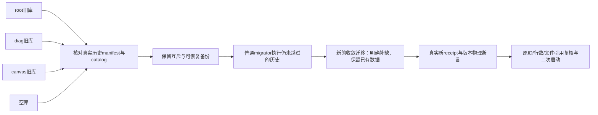

# T-1062 三谱系迁移收敛审计（只读，BUILD）

2026-10-05；已读取整合 SPEC 第三轮 PASS `fd99fea0bb12` 对应正文。只读取冻结对象 `125bc864` / `55a526d6` / `c5316506`、当前整合冲突及本地 Drizzle 源码；不修改产品、真实库、服务、控制面，不执行模型。唯一新增文件为本文。以下是静态分析与可执行隔离验收方案，未声称四基线已通过。

主结论：三份历史 SQL/tag/when 必须原文保存；简单拼 journal、改旧 when、统一加 IF NOT EXISTS、重放全部旧 SQL 或删掉谱系断言都不安全。应使用原时间排序的历史 union、三份冻结谱系 manifest、一个晚于所有历史的新版本收敛迁移，以及版本明确的迁移前/后 catalog 检查。收敛迁移只对具体缺失结构执行明确补缺，对已存在结构校验完整定义；首次账号组升级与已有组域的资料保持必须分开。

## 1. 冻结证据与 when 风险

| 来源 | journal 条数 | 分叉起点 | 最后历史 when |
| --- | ---: | --- | ---: |
| root `125bc864` | 123 | idx101 `0101_topic_rewrite_only`，1790761007000 | 1790942400020 (`0122_group_asset_tag_adoption`) |
| canvas `55a526d6` | 103 | idx101 `0101_creative_canvas`，1790553600000 | 1791043200000 (`0102_visual_template_library`) |
| diag `c5316506` | 128 | idx101 `0101_reporting_local_consent`，1790668800000 | 1790755200070 (`0127_publication_cover_requests`) |

三份 0000–0100 共 101 项 tag、when、SHA256 一致，逐文件比较没有 COMMON_DIFF。union 共 152 个不同历史身份（101共同 +22root +2canvas +27diag）。idx 是 journal 顺序，不是 migration 文件身份；若统一 journal 重新编排 idx，三份原 idx 仍需完整保留在来源 manifest，不改变旧 tag/SQL/when/hash。每个新收敛 migration 使用新 tag、新 when、新 SQL/hash，不改写任何历史 receipt。

准确的 Drizzle 0.36.4 实现证据：本地 `node_modules/.pnpm/drizzle-orm@0.36.4_.../node_modules/drizzle-orm/pg-core/dialect.js:44–67`，读取 `ORDER BY created_at DESC LIMIT 1`，只有 `Number(lastDbMigration.created_at) < migration.folderMillis` 才执行并记 receipt。它不依据 hash 查漏、不填较低 timestamp 缺口；同一轮循环拿的 lastDbMigration 是启动时读到的最高值。

| 旧 DB 基线 | union 普通 migrator 会执行的历史项 | 必然缺口 |
| --- | --- | --- |
| fresh | 从空历史执行全部 union，必须按原 when 正确排序以守依赖 | 历史 DDL 创建 account-only 新域，需要随后 group 适配；旧物理断言必须支持新版本 |
| root | canvas `0102_visual_template_library` 比 root 末尾晚，能执行；diag全低、canvas0101低 | reporting、平台采集、文章图文、results、组合、剪辑预约/版本等，以及canvas本体被跳过 |
| diag | root101及root组迁移、canvas模板能执行；canvas0101低 | diag125 已经补canvas；仍缺新增group新域适配 |
| canvas | 所有root/diag旧项比canvas最高值低 | root全部组迁移、topic workspace、全部diag建表/列/索引；diag125真实receipt不存在且不会自动出现 |

因此仅追加“新group字段迁移”也不够：canvas/root 可能连被 ALTER 的基础表都没有。新的收敛迁移必须先补依赖根与缺失表，再补后续列/约束，最后新域 group 适配；不能因为跳过原when，就假插原hash/time声称旧SQL执行过。

父会话提供的独立真实 PGlite 原SQL红证据已核读：`/tmp/t1062-migration-skip-probe-result.json` 与 `/tmp/t1062-migration-skip-probe.log`。原journal建基线后原when排序union，fresh/diag各184表且6个抽查域表存在；root137表，缺canvas/results/compositions/media requests；canvas130表，缺account_groups/results/compositions/media requests。与上述skip分析一致。此probe没有经过产品constructor、备份、完整约束/数据升级及安装版，只证明skip红问题；本子任务没有重复执行。



## 2. 逐 SQL 盘点

以下均是冻结 SQL 的实际内容，不按文件序号猜业务。`G` 表示新增 group_id、account_id 降为可空来源、scope索引与限定回填；不能将这些缩写理解为相同原SQL可统一循环重放。

### root 22项

| tag | 建表/列/约束与 DML | 收敛时处理 |
| --- | --- | --- |
| 0101_topic_rewrite_only | intelligence_transforms.positioning_version_id DROP NOT NULL | 仅检查/调整该列；不是diag reporting0101 |
| 0102_audience_task_workspace | topic_workspaces(user/account/version/config/receipts default `{}`/updated)，PK(user,account)；topic_proposal_feedback(id、user/account/project/task/proposal/proposition/title/angle/reason/note/positioning/request_hash/created)，scope index；CREATE无IF | 缺表按历史定义建，再升级group；已有root最终schema不能重建legacyPK |
| 0102_account_groups | groups(active/archived CHECK、version default1)、memberships(active部分唯一user/platform_account)、commands(user/key unique)；插grp_legacy和gm_legacy | 首次组升级才能做初始插入；已有组库严禁重播初始membership DML，见第4节 |
| 0103_group_projects | projects G；stamp_project_group trigger；legacy静态组回填 | 已组数据不改group；旧group首次按来源映射；新增项目仍由service明确stamp |
| 0104_group_knowledge_positioning | knowledge_items/folders、creator_profiles、positioning_statements/discovery_sessions G；creator_profiles(user,group)部分unique | 仅NULL且来源可证明；现有非NULL归属不覆盖 |
| 0107_group_resources | assets/uploads/search_documents/notifications G；resource_access_grants部分current unique；workspace_blob_objects(storage_key PK,user,group/account可空,expires) | 表、列、部分index完整验定义；storageKey与原媒体不动 |
| 0108_group_platform_facts | publications/metric/audience/retention/traffic/sync group、metric.native_platform、publication/ingestion版本；external_sources/ingestion account nullable且manual-only CHECK；父publication/project stamp；ingestion idempotency拆scope | CHECK/索引不只验同名；事实与freeze按真实父源，不从当前membership重映旧事实 |
| 0105_group_shared_domains | 15共享表 G；topic_workspaces DROP legacyPK；audience_signals.group；多scope唯一索引；shared stamp触发器 | root旧topic工作区已不是legacyPK；检查最终group+legacy部分unique，不能“修回”旧PK |
| 0106_group_tasks_intelligence | conversations/AI/exec/scheduled/intelligence各根 G，job_run.group；group/membership version；group attempt/idempotency、NULLS NOT DISTINCT分组唯一 | 冻结任务已有值保留；集合同名index predicate/NULLS属性必须核验 |
| 0110_group_migration_ledger | account_group_migrations(id,user,from/to,idempotency_key,input_hash,status,before_image/after_digest,timestamps)，user/idempotency_key unique | 缺表建；已有before_image及undo审计不改 |
| 0111_group_skill_overlays | overlay/version G；group owner/skill及revision unique | 保留overlay与version ID，原JSON不改 |
| 0109_group_calendar | entries/cadences account nullable、group；entries membership_version；active project unique拆legacy/group | 校验部分predicate；不能用旧account unique挡空组 |
| 0112_group_pending_assets | pending_document/generated_asset_commits G，legacy `grp_legacy_` NULL回填 | pending frozen输入保持；不按当前membership覆写 |
| 0114_legacy_shared_group_stamp | 通用legacy stamp函数；有project优先parent group，否则新INSERT读membership；条件安装已存在列的表trigger | 补trigger定义本身，不能执行它去全表重stamp历史 |
| 0115_group_grant_uses | resource_access_grant_uses FK grant、unique(grant,consumer_type,id)；record use函数；6个CREATE TRIGGER无DROP | 已有trigger不得无条件CREATE；原consumer/grant记录不改；最终函数要用0121定义 |
| 0113_group_research_sources | benchmark/source/works/trend/favorites/attributions G；identity index拆group/legacy；child stamp | 验真实partial index和父引用；没有证据的孤立资料保留 |
| 0117_group_project_derived | material_links group/account列、parent回填、workspace index；父project INSERT stamp | 子归属按已存在真实project，不猜当前账号 |
| 0119_group_transcription_knowledge_adoption | transcription_requests/knowledge_adoptions G；限定项目+AI冻结一致及知识结果回填；legacy/group unique，无IF的CREATE INDEX | 不能删限定JOIN或重写AI freeze；缺索引补，错定义fail明确诊断 |
| 0118_group_audience_facts | audience group从同user/account父publication校正；publication变更trigger | 冻结事实parent是依据；不用当前账号membership替代 |
| 0120_group_onboarding_state | PK(user,group)，origin fresh/existing CHECK、hidden=false/collapsed=true、completed_steps JSON数组CHECK | 空组偏好独立；不复制平台账号引导状态 |
| 0121_group_resource_grant_locks | 最终record_workspace_grant_use函数、validate grant函数及grant/segment/export触发器 | 必须保留最终锁/活资源/有效grant验证，不能回放0115旧函数覆盖它 |
| 0122_group_asset_tag_adoption | G及staticlegacy NULL回填；拆legacy/group proposal唯一索引无IF | 原proposal及digest不动；存在检查须包括索引完整定义 |

### canvas 2项

| tag | 建表列/关键约束 | 冲突及收敛 |
| --- | --- | --- |
| 0101_creative_canvas | creative_canvases(id,user/account NOT NULL,title,project nullable,document JSONB,revision int default1,timestamps/archive)；links(id,user/account,canvas/node,attempt UNIQUE,task nullable UNIQUE,input_revision/digest/json,reference file/checksum、result asset nullable,timestamps)；proposals(id,user/account,canvas,base_revision,operations JSON,status,applied revision/canvas nullable,created/expires)；3个owner/canvas index | 与diag125同物理定义，可去重执行身份不同的合法history；必须验类型、nullable、default、PK、unique与index table/columns，不靠CREATE IF NOT EXISTS假成功 |
| 0102_visual_template_library | favorites(id,user/account NOT NULL,snapshot JSONB,revision default1,created/updated/deleted)；receipts(id,user/account,attempt,digest,response nullable,created)，unique(user/account/attempt)；publication_revisions.visual_adoption_key/digest nullable，unique(publication,key) | 无同名diag表；later group适配必须同时修favorites与receipts，不能改既有visual adoption digest原值 |

### diag 27项

| tag | 建表/列/关键约束 | 具体注意 |
| --- | --- | --- |
| 0101_reporting_local_consent | reporting_consents PK(user,scope,account)，scope diagnostics/creator CHECK，account default空串、enabled false、epoch0；outbox(event PK,encrypted_payload/epoch/expire)，owner index；consent_changes PK(user,change) | 这里空account是既有报表user-scope协议，不能推广成创作假账号；原密文/epoch不可替换；同diag125相同定义 |
| 0102_publications_account_external_unique | DROP publications_external_ux；建user/account/platform/external部分unique | 全局旧unique必须解除，否则合法两个账号同externalId仍失败；不能回退为globalunique或删行去重 |
| 0103_platform_collection | bindings(account PK,identity/scopes/proof/expire)；runs(request unique/lease/generation/catalog fields)；pages(unique run/generation/pass/page)、catalog(account PK)；works(unique user/account/platform/external，legacy IDs)；tombstones(unique evidence)；account/work metric snapshots(unique真实source/window/evidence) | 平台事实NOT NULL account要保留；CREATE IF NOT EXISTS不会校正root其它来源已存在但列错的表 |
| 0104_platform_bind_attempts | bind_attempts(request user/platform/client unique、proof/status/expiry)、binding identity unique、run queued/running部分active unique；works.uncertain_visibility_at | 部分unique覆盖状态族不能删；表字段scopes nullable等需核验 |
| 0105_platform_legacy_backfill | conflicts(id、真实publication/reason unique)；按合法真实账号/项目 JOIN回填works/catalog/numeric metric；md5导出稳定ID，ON CONFLICT | 只能保留原事实过滤，不能把missing account/name转换成假账号/标题；运行条件见第4节 |
| 0106_platform_work_source_title | works.title nullable；无回填 | 旧标题缺失保持NULL，不从项目名制造来源标题 |
| 0107_wechat_articles | article_anchors outputPK/artifact unique、user/account/request unique；article_candidates id、project/output/artifact/user/account/base/method/brand/request/proposal | 全部真实父链；后group补scope，candidate input/proposal不改 |
| 0108_graphic_posts | outputs.target_platform nullable；graphic anchors outputPK、artifact、account/output、request uniques；text candidates真实base/version/value/source_refs default[] | 与其它schema已有target_platform需验类型default，不是只看列存在 |
| 0109_creative_results | results(id,user/account,project/output/type/platform/kind/status/candidate/task/base/rule/source refs/request/retry/error/timestamps)；bundles(id,user/account,project/output/items/request/created)；media_attempts(task唯一+request唯一) | 原bundles.output NOT NULL后由0117放开；迁移到最终不能错误恢复NOT NULL |
| 0110_article_text_candidates | id/project/output/artifact/user/account/base/kind/value/source_refs default[]/rule/applied/created；output index | 缺表按精确默认值建，group父归属 |
| 0111_publication_text_candidates | text candidates，result_anchors unique(user/account/output/platform)及publication unique；result_adoptions request unique | publication真实account边界与共享candidate group区分，不全删account |
| 0112_creative_result_target_section | results.target_section_id nullable | parent results缺失要先建 |
| 0113_publication_cover_file | revisions.cover_asset_file_id nullable | exact历史assetFile引用必须保留 |
| 0114_production_edit_versions | revision unique(production,revision)；request nullableunique；request_digest nullable、plan_digest/source/planJSON/created | 是0124复合FK依赖；不能先建绑定FK再补这个unique |
| 0115_production_render_requests | id/user/production/request/digest/revision/specJSON/attempt/task/asset/created；unique(production,request) | 冻结spec/attempt不重算 |
| 0116_output_creation_requests | output_create_requests unique(user/account/clientRequest)，project/output真实ID；anchors.request_digest nullable | 新group请求scope升级须保留旧digest协议 |
| 0117_conversion_reservations | bundles+conversion_context/target_creation_key；output nullable；pending CHECK；results+conversion_context/adoption_client_request_id | 4处无IF ADD COLUMN和无条件ADD CONSTRAINT，不可原SQL二次执行；CHECK语义必须核而不是见同名跳过 |
| 0118_execution_control_receipts | 无IF CREATE receipt(id,user/account/idempotency/request_digest/resultJSON/created)、unique | 已有表重放立刻失败；历史result不重新执行 |
| 0119_production_media_requests | 无IF CREATE(id,user/account/output/request/digest/kind/frozen_input/task/created)、scopeunique | 对恢复需要增加冻结group协议；原input bytes/digest保留 |
| 0120_moments_owner | 无IF anchors(id,user/account/project/artifact、artifact unique)、requests(id,user/account/request/digest/operation/params/input/target/version/status/error/created)、scope unique | 新group空账号仅新protocol允许，历史请求不能null伪造 |
| 0121_work_composition_owner | 无IF组合root、versions(unique composition/revision)、requests(scope unique、member reservationJSON/status) | 版本JSON/CAS/request原身份不改；versions父链和root scope一起核 |
| 0122_work_materials | 无IF associations(snapshot/rule_refs default[])、receipts(scope unique/snapshot)、dependencies(snapshot/material_target) | 子闭包/回执不能遗漏，不能只搬composition根 |
| 0123_work_reviews | report/confirmation/request有bigserial ordinal；report status/success CHECK；request operation/status/target/failure CHECK；attempt/task/call/scope uniques | 校验sequence default与全部CHECK；已存在报告ordinal不重编号 |
| 0124_production_file_bindings | 无IF 2绑定表；FK output、request；复合FK(production,revision)；scope/position uniques；revision>=1及digest格式CHECK | 父表unique必须先建立；exact文件+plan/source_commit digest证明不能丢；错误既有数据不“清洗”成pass |
| 0125_creative_canvas_lineage_merge | reporting三表+canvas三表，同上IF EXISTS定义 | 原SQL和真实125receipt保留；只代表当时6表account形态，不是今天全域收敛证明 |
| 0126_moments_model_candidates | 无IF candidates(id,user/account,moments FK cascade,root,recordJSON)及scopeindex | 先建anchors；候选记录不可改 |
| 0127_publication_cover_requests | 无IF request表；publication/revision FK cascade；scope unique；reserved/committed状态及result JSON/revision/time一致CHECK | 冻结c531已登记when，文件注释“未登记”不是事实；不能按注释当未上线然后改历史SQL |

## 3. 真正不可无条件重放的 DDL 与结构冲突

- root audience workspace 的无IF CREATE TABLE/INDEX；root0115六个无DROP CREATE TRIGGER；root0119四个无IF CREATE UNIQUE INDEX；root0106在DROP后的无IF index与0109active项目index虽脚本内有DROP，但不能依任意表名字删除未知结构。
- diag0117无IF ADD COLUMN/ADD CONSTRAINT；diag0118–0122无IF建表/索引；diag0124、0126、0127无IF建表/索引。这些已经存在时执行原SQL会失败，不是“DDL大多有IF就可批重播”。
- root0105会删除topic_workspaces legacyPK、改变多个unique predicate；最终catalog应验新的组unique/legacy部分unique。diag0117放开bundles.output null并添加pending CHECK；不能使用0109的初始NOT NULL定义来“修复”最终库。
- canvas三表与diag125定义一致，是重复来源定义而非需改名的两个业务表。reporting三表亦在diag0101/125重复。其它分支0102/0103等文件名数字重叠，tag不同，不能同编号合一。
- schema升级把canvas account降可空、加group后，会与原 `assertStructures` 里 `account_id nullable:false` 冲突。必须明确按旧版本/new convergence版本检查允许的目标形态，不通过删assertStructures来吞真实wrong-type/unique/index冲突。
- 需按 `pg_attribute`/information_schema的type/null/default，`pg_constraint`定义、`pg_index`唯一/有效/partial predicate/NULLS NOT DISTINCT/列顺序及table owner，`pg_trigger/pg_proc`最终函数定义比对。`CREATE INDEX IF NOT EXISTS`会跳过同名但错误表/列的索引；diag已有负测覆盖该情况，必须保留。

## 4. 数据污染风险：原 SQL 的 DML 不能跟 DDL 一起重播

### 初次group升级

只在经manifest/catalog确认尚无组域、旧账号前缀完整且备份完成的库，执行初始账号→`grp_legacy_${accountId}`一对一映射，以及对应初始membership。真实platform_account.id、project.id、storageKey不改。不能因缺历史receipt就断言没有做过组升级。

### 已有group域

root旧库已创建组、可能转组/归档/显式搬资料。root `0102_account_groups` 的两条初始INSERT不能为了补缺history重跑：即使ON CONFLICT保护既有同id行，缺少`gm_legacy_*`或已有转组通过其它membership ID记录时，重放可创建错误活跃legacy关系；partial unique只能挡住某些已有活跃关系，不能证明历史正确。

已有group域只校验/补物理结构，不插新的初始group或membership，不恢复原组active、不重置version、left_at、status，不覆盖已非NULL的project/asset/fact/task group。必须从真实parent派生新表依赖归属；独立旧画布/收藏可证明legacyorigin才归初始组，无法证明则保留待用户显式归组，绝不按当前membership猜。

### 各回填的适用条件

- rootG回填：缺group且初次组升级，用稳定legacyorigin或其真实parent；在已有组域不整表重复root0105的“当前membership”UPDATE，尤其account转组后的NULL孤立旧资料不能自动流到新组。
- root0118 audience事实：按同user/account父publication冻归属是确定性关系；保留原有合法非NULL历史事实，校正操作需要明确版本迁移证明，不能混作账号转组re-stamp。
- diag0105 legacy backfill：保留它的真实active account/user/platform/project一致性和numeric过滤、稳定md5 IDs、ON CONFLICT条件；只有该来源转换尚未执行且来源catalog匹配时，才在新迁移中明确标记这次转换并执行等价规则。已执行过的diag事实不因升级重复生成或用今天account状态改写。缺失数据不制造标题/账号/指标，既有不同scope重复external_id不删。
- 对新表/新字段空值补缺不要直接用`INSERT SELECT`重算历史result/task/model输入；冻结JSON、requestDigest、fileDigest、call/task ID、consent_epoch、密文都保留。task freeze移组需要SPEC明示rebind，不能就地改摘要。

逐原SQL的安全结论：不允许因低when被跳过而盲重播；新的迁移明确每条DDL catalogue precondition和DML transition precondition；原脚本仅在fresh普通历史链或其真实未升级原谱系按原when运行。所有兼容新执行留下新receipt，不插旧receipt。

## 5. 最小兼容收敛设计

1. 固定三份原journal和SQL hash manifest；主journal取共同前缀一次、其它历史tag保持原when按when排序（分叉文件不同tag不能覆盖）。若已经有未知future/hash/time/结构，原库零写拒绝，不“修正账本”。重复相同hash/time原receipt保留，不能当坏数据删掉。
2. `inspectCanvasMigrationLineage` 升为三谱系已知prefix验证：逐来源前缀与真实已执行身份判定，支持原diag的reporting/canvas/combined、root、完整canvas-template以及已执行新收敛；不能要求每个历史都是全union的连续前缀。仍检查共同0000–0100、账本字段类型、原6表存在结构与同名错误索引、未知历史拒绝。
3. 新migration when严格大于1791043200000，真实tag/SQL/hash注册；只用这个新receipt证明新兼容逻辑执行。catalog规划顺序：reporting/topic roots→platform基础/相关列/事实唯一→文章/图文/results及0117后置列CHECK→execution/production版本→media/组合/物料/reviews/filebinding/moments/cover→canvas/template→group域/新域归属与最终函数/trigger。依赖根据真实FK和父链，保持原DDL/default/check。
4. 条件补缺不是全面IF。缺表精确定义CREATE；已有表逐列检查type/null/default和约束；允许的老版本差异执行明确ALTER，未知差异在任何业务写前fail。新增CHECK先查旧行是否满足，失败保留原行报告ID；改unique先查冲突，不删行或合并ID。缺index创建；错同名index仅在manifest确认是明确旧版本后在新migration中精确DROP+CREATE，未知定义拒绝。
5. 首次group升级与已有group适配严格分支，保持root初始映射语义但不在已有group库再插membership。新域group采用真实parent或可证明legacyorigin；account可空不是假账号。所有老task/receipt/digest 保留，协议升版而非改原输入。
6. `assertCanvasMigrationConverged` 必须保留：原diag125 receipt可继续验证原结果；canvas/root跳过125时只能凭**新的收敛真实receipt**证明等价物理结构。断言仍检查6表PK/unique/default/check/index，并在新版扩展group/可空account预期；另加全新增域/FK/trigger/最终scope校验。旧125不伪造、不强行修改when，不把验证改为“存在任何table就行”。
7. `db.ts` PGlite顺序保留：实际打开→只读lineage preflight→必要完整可恢复备份→normal migrate+新convergence→版本assert→counts/ID/storageKey复核→返回。原root backup已有`account_groups`就返回null，新convergence会改变root已有库结构，建议新增“缺收敛receipt”备份触发，保留原group backup逻辑，不用`account_groups存在`作为所有整合升级免备份条件。
8. Postgres保留root同一连接 `pg_advisory_lock(1022,1)` 包住preflight/backup/migrate/assert/counts；诊断`inspect/assert`在此锁内调用。异常释放锁、关闭pool且真实上抛；不能择一覆盖成无backup的diag路径。PGlite持盘backup SHA/dump恢复、PG pg_dump格式/SHA/media manifest、verifyGroupUpgradeCounts全部保留。迁移异常不是库损坏，不quarantine或空库重建。
9. counts检查不能删。新增表的初始数据不在旧表count快照中；已有事实表若确有经SPEC批准的增量回填，单独记录new migration计划与可证明增量明细，不改成“after>=before”泛化宽松检查。原项目/媒体/候选/回执行数必须保持。

## 6. 四个隔离基线：可执行构建命令

以下只作为实施者执行方案，本子任务没有运行。先完成合并与新收敛/检查代码，固定候选SHA并安装其依赖。命令只使用`mktemp`路径和冻结Git SQL；`createDb({dataDir:...})`显式路径，屏蔽真实DATABASE_URL/PGLITE_DATA_DIR。不能把安装版正在用的库复制进测试，也不能运行无参数createDb。

### 6.1 导出三个完整历史migration目录与fresh目录

```bash
T1062_REPO=/Users/zyongzhu/.codex/worktrees/t1062-client-integration/Thirdspace-creator
T1062_FIXTURES=$(mktemp -d /tmp/t1062-migration-baselines.XXXXXX)
export T1062_REPO T1062_FIXTURES
mkdir -p "$T1062_FIXTURES/root" "$T1062_FIXTURES/diag" "$T1062_FIXTURES/canvas" "$T1062_FIXTURES/fresh"
git -C "$T1062_REPO" archive 125bc864 backend/drizzle | tar -x -C "$T1062_FIXTURES/root" --strip-components=2
git -C "$T1062_REPO" archive c5316506 backend/drizzle | tar -x -C "$T1062_FIXTURES/diag" --strip-components=2
git -C "$T1062_REPO" archive 55a526d6 backend/drizzle | tar -x -C "$T1062_FIXTURES/canvas" --strip-components=2
```

### 6.2 用真实原migrator建历史基线，seed只含隔离夹具

```bash
for T1062_BASELINE in fresh root diag canvas; do
  export T1062_BASELINE
  env -u DATABASE_URL -u PGLITE_DATA_DIR -u CREATOROS_DB_DIR pnpm -C "$T1062_REPO/backend" exec tsx -e '
  import {PGlite} from "@electric-sql/pglite";
  import {drizzle} from "drizzle-orm/pglite";
  import {migrate} from "drizzle-orm/pglite/migrator";
  import {mkdir,writeFile} from "node:fs/promises";
  import {join} from "node:path";
  (async()=>{
    const root=process.env.T1062_FIXTURES!,kind=process.env.T1062_BASELINE!;
    if(!root.startsWith("/tmp/t1062-migration-baselines."))throw Error("只允许隔离目录");
    const dataDir=join(root,kind,"db"),media=join(root,kind,"media");
    await mkdir(media,{recursive:true}); await writeFile(join(media,"fixture-original.mp4"),"fixture-exact-bytes");
    if(kind==="fresh")return;
    const client=new PGlite(dataDir); await client.waitReady;
    try{
      await migrate(drizzle(client),{migrationsFolder:join(root,kind)});
      const t="2026-10-05T00:00:00Z";
      await client.query("INSERT INTO platform_accounts(id,user_id,platform,account_handle,created_at,updated_at) VALUES ($1,$2,$3,$4,$5,$5)",["fixture-account","fixture-user","douyin","夹具账号",t]);
      const groups=(await client.query("SELECT 1 FROM information_schema.tables WHERE table_schema=$1 AND table_name=$2",["public","account_groups"])).rows;
      if(groups.length){
        await client.query("INSERT INTO account_groups(id,user_id,name,created_at,updated_at) VALUES ($1,$2,$3,$4,$4)",["grp_legacy_fixture-account","fixture-user","夹具初始组",t]);
        await client.query("INSERT INTO account_group_memberships(id,user_id,group_id,platform_account_id,joined_at) VALUES ($1,$2,$3,$4,$5)",["gm_legacy_fixture-account","fixture-user","grp_legacy_fixture-account","fixture-account",t]);
      }
      await client.query("INSERT INTO projects(id,user_id,account_id,title,creation_mode,status,current_stage,started_at,created_at,updated_at) VALUES ($1,$2,$3,$4,$5,$6,$7,$8,$8,$8)",["fixture-project","fixture-user","fixture-account","保留原项目","manual","active","script",t]);
      await client.query("INSERT INTO assets(id,user_id,account_id,asset_type,name,created_at,updated_at) VALUES ($1,$2,$3,$4,$5,$6,$6)",["fixture-asset","fixture-user","fixture-account","video","夹具原片",t]);
      await client.query("INSERT INTO asset_files(id,asset_id,version_number,storage_key,mime_type,file_size,created_at) VALUES ($1,$2,1,$3,$4,$5,$6)",["fixture-file","fixture-asset","fixture-original.mp4","video/mp4",19,t]);
      await client.query("INSERT INTO storage_configs(user_id,backend,root_path,created_at,updated_at) VALUES ($1,$2,$3,$4,$4)",["fixture-user","local",media,t]);
      const tables=(await client.query<{table_name:string}>("SELECT table_name FROM information_schema.tables WHERE table_schema=$1 AND table_type=$2 ORDER BY table_name",["public","BASE TABLE"])).rows;
      const counts:Record<string,number>={};
      for(const row of tables)counts[row.table_name]=Number((await client.query(`SELECT count(*) AS n FROM "${row.table_name.replaceAll("\"","\"\"")}"`)).rows[0].n);
      const history=(await client.query("SELECT hash,created_at FROM drizzle.__drizzle_migrations ORDER BY created_at,id")).rows;
      await writeFile(join(root,kind,"before.json"),JSON.stringify({counts,history,media},null,2));
    }finally{await client.close();}
  })();'
done
```

这是fresh/root/diag/canvas四个**完整冻结journal**基线，不能用diag101或删除journal后段代替diag，也不能用画布0101夹具代替已带模板0102的canvas最高when基线。现有旧测试的fresh/reporting/canvas/both只覆盖旧0101两分叉，不覆盖本四谱系。

### 6.3 运行候选公共createDb升级、保原history/ID/媒体与二次启动

```bash
for T1062_BASELINE in fresh root diag canvas; do
  export T1062_BASELINE
  env -u DATABASE_URL -u PGLITE_DATA_DIR -u CREATOROS_DB_DIR pnpm -C "$T1062_REPO/backend" exec tsx -e '
  import {readFile,writeFile} from "node:fs/promises";
  import {join} from "node:path";
  (async()=>{
    const root=process.env.T1062_FIXTURES!,kind=process.env.T1062_BASELINE!;
    if(!root.startsWith("/tmp/t1062-migration-baselines."))throw Error("只允许隔离目录");
    const {createDb}=await import(join(process.env.T1062_REPO!,"backend/src/db.ts"));
    let first:unknown;
    for(let n=0;n<2;n++){
      const opened=await createDb({dataDir:join(root,kind,"db")});
      try{
        const c=opened.client;
        const history=(await c.query("SELECT hash,created_at FROM drizzle.__drizzle_migrations ORDER BY created_at,id")).rows;
        const schema=(await c.query("SELECT table_name,column_name,udt_name,is_nullable,column_default FROM information_schema.columns WHERE table_schema=$1 ORDER BY table_name,column_name",["public"])).rows;
        if(kind!=="fresh"){
          const before=JSON.parse(await readFile(join(root,kind,"before.json"),"utf8"));
          for(const item of before.history)if(!history.some((r:any)=>r.hash===item.hash&&String(r.created_at)===String(item.created_at)))throw Error("历史receipt丢失");
          for(const [table,count]of Object.entries(before.counts)){
            const actual=Number((await c.query(`SELECT count(*) AS n FROM "${table.replaceAll("\"","\"\"")}"`)).rows[0].n);
            if(actual!==count)throw Error(`旧表计数变动 ${table}: ${count} -> ${actual}`);
          }
          const p=(await c.query("SELECT id,title FROM projects WHERE id=$1",["fixture-project"])).rows[0];
          if(p?.title!=="保留原项目")throw Error("原项目变化");
          const f=(await c.query("SELECT id,asset_id,storage_key FROM asset_files WHERE id=$1",["fixture-file"])).rows[0];
          if(f?.asset_id!=="fixture-asset"||f.storage_key!=="fixture-original.mp4")throw Error("原文件引用变化");
          if((await readFile(join(before.media,"fixture-original.mp4"),"utf8"))!=="fixture-exact-bytes")throw Error("原媒体字节变化");
        }
        const state={history,schema};
        if(n===0){first=state;await writeFile(join(root,kind,"after.json"),JSON.stringify(state,null,2));}
        else if(JSON.stringify(state)!==JSON.stringify(first))throw Error("二次启动不幂等");
      }finally{await opened.client.close();}
    }
  })();'
done
```

上述命令的完整schema比较还需收敛实现者加入所有PK/unique/check/FK/index predicate/trigger/proc快照，并比较四基线最终结构（按名称排序，不按physical列序）；本静态报告不把列快照当约束PASS。需再seed真实形状的画布link/proposal、授权密文、模板receipt、diag工程版本/绑定/粗剪ASR预约/组合版本，检查完整JSON/digest/ID及二次启动；上例只是可运行的基础构建/数据保护探针。

## 7. 原检查必须保留、补测与报告边界

保留并针对最终候选运行：

```bash
pnpm -C "$T1062_REPO/backend" exec vitest run src/group-upgrade-backup.integration.test.ts src/db.creative-canvas-lineage.test.ts src/db.migrate-error.test.ts src/db.driver.test.ts
pnpm -C "$T1062_REPO/backend" exec tsc --noEmit
```

- group backup原完整dump/SHA、恢复成功、counts减少失败、升级已有库不重复group备份语义不删；新增convergence备份是单独版本触发，不改写旧manifest。
- diag原未知hash、wrongtime、unknownfuture、revision类型不兼容、同名index错误归属负测、相同真实receipt重复保留、reporting空缺表合法恢复均保留并升级到多谱系。
- `db.creative-canvas-upgrade.test.ts` 会人为删除已记receipt的3个canvas表；root/template旧运行时补表 helper只能恢复到account形态，不能取代新收敛与group版本检查。这个场景要明确新版恢复权限和版本化repair路径：仅已证明空表丢失可从新schema补齐，不重放旧account schema、不恢复未知丢失行。不得简单删除测试或保留旁路手工DDL洗绿。
- 追加root转组历史：旧A→B会员left_at/version、组归档、已搬项目、NULL孤立旧画布。upgrade后活跃会员仍B、原旧项目/group值保持、NULL资料不自动归B；before/after membership行原值完整比较。另加缺gm_legacy但已有合法转组membership场景，证明兼容补缺不会插活跃legacy关系。
- 四基线再加部分升级中断、并发PG启动锁、catalog错误不改ledger/不quarantine/不丢数据；PG检查在专用隔离连接执行，绝不使用继承的真实DATABASE_URL。PGlite PASS不能冒充真实PG约束/互斥PASS。
- 当前仍在BUILD integration，没有进入packaging。只有最终提交候选四基线实测、原检查、完整约束与数据保护证据通过后，才进入本地包准备。本文没有执行这些命令，不替实施者或用户签验收。
