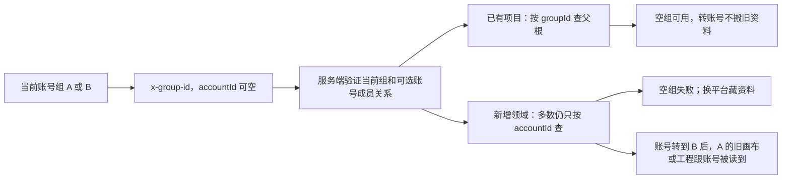

# T-1062 新增创作领域与账号组兼容审计（只读）

审计日期：2026-10-05。只读取 SPEC、代码、冻结 Git 对象；没有修改产品源、数据库、服务、真实账号、媒体或 ChatCut。本文不构成运行验收 PASS。

结论：账号组基线已提供正确的 group scope、组写锁与 membership 冻结，但画布/模板和诊断分支新增领域没有完整接上。单靠合并成功、旧 production 测试通过或请求头已带 `x-group-id`，不足以声明 T-1062 的画布、模板、作品组合及粗剪可在账号组工作区正常且隔离地运行。

## 依据与版本

- 任务 SPEC：`/Users/zyongzhu/Workbase/Thirdspace-creator/docs/features/t1062-consolidated-local-client-acceptance.md`。授权集成、提交、本地打包与逐项验证；没有授权自动合并真实账号数据。第 50–51 行要求组管理/迁移、画布模板、视频导入/转写/粗剪/采用/保存刷新/导出分别验收，缺证据必须待验。
- 账号组 SPEC：同根 `docs/features/t1022-account-group-workspace.md`，第 54、60–80、115–133 行。共享创作归属 `userId + groupId`；空组可创作；平台账号筛选不改变内容归属；旧 accountId 仅来源；转账号不搬旧内容；归档组只读；任务冻结创建时范围；资料搬组必须明确预览、闭包、digest 和可撤回边界。
- 账号组基线 `125bc864`；诊断 WIP 冻结 `c5316506`；模板冻结 `55a526d6`。当前整合树 `/Users/zyongzhu/.codex/worktrees/t1062-client-integration/Thirdspace-creator` 正在处理 merge。
- 模板/画布读取当前整合文件并与冻结来源对照；新增 creative-results/work-compositions/production 编辑路径采用 `git show c5316506:<path>`。不能将尚未落在整合磁盘的冻结模块说成当前已上线，也不能把本审计当作最终合并候选的测试回执。
- 流程 skill `product-to-code-orchestrator` 与主树 `.skill-version` 均为 3.27.2；阶段为 BUILD integration。此次子任务按父任务授权仅写本 `/tmp` 报告，不运行 taskctl/reconcile 或更改控制面。

## 大白话图

组是资料夹，账号是发布或采集身份。当前新增模块还在用发布身份当资料夹钥匙。

## 实际公共调用链

1. `frontend/src/lib/http-transport.ts` 的 `creatorApiHeaders` 发送当前 `x-group-id` 和可选 `x-account-id`；显式 FrozenWorkspaceScope 会先清旧 scope header 再填冻结值。组总览/空组请求合法地没有 accountId。
2. `frontend/src/app/api/v1/dispatch/route.ts` 经 operation registry、`resolveRequestContext` 到 composite transport。写请求严格校验 token；此路由没有替领域统一执行组归档写保护。
3. `frontend/src/lib/request-context.server.ts` 验真实账号 user ownership/active，再验组 ownership 和可选账号当前 membership，得到 groupVersion/membershipVersion。组 `get` 允许历史归档读取，因此 archived 组 ctx 仍可成立，领域写口必须自行拒写。
4. `frontend/src/server/persistence-client.ts:5411` 注入画布项目校验 `projectsService.getProject`、资产校验/预览 `assetsService`，生成经 chatTaskSubmissions→AI service。`:1860` 注入私有模板图片校验。transport 将 ctx 传入 service，没有凭空增加新的数据归属字段。
5. 诊断冻结树通过同一 persistence/composite 装配新增 creative-results、work-compositions、production editor/source/transcript/rough。它们的 account-only 查询不会因上游 ctx 有 groupId 而自动变成 group-aware。

## 必须复现或修复的具体失效链

### 1. 空组与组内平台切换：确定的可用性缺口

- `creative-canvas.service.ts:21–22,142,152–155` 严格 `requireAccountId`；画布表、生成 link、proposal 都是 NOT NULL accountId，没有 groupId。`frontend/src/features/creative-canvas/canvas-library.tsx:19` 更在请求前以 `readCurrentAccountId()` 阻断，提示“请先绑定或选择账号”。新空组不能列出、创建画布或读取生成能力。
- `assets/visual-template.service.ts:16,31,40,45` 的私有收藏 owner 是 user/account；默认 `scope=all` 会访问收藏，故空组默认列表失败。明确 `scope=builtin` 不调用 owner，内置公共目录可读，不能把该局部成功算完整收藏 PASS。
- `c5316506` 中 creative-results、conversion reservations、work-compositions/work-materials、production editor/media reservations 同样强制 account。`creativeCapabilities.list` contract 还要求 query.accountId。
- 组 A 同时有抖音账号 a 与公众号账号 b：a 下建立画布/收藏/候选/作品组合，切 b 后各 account 过滤隐藏同组创作；切“全部平台”使 accountId 为空又失败。项目父级即便 group-aware，也不能扩大 account-only 子表查询。

### 2. 账号转组：画布与私有模板内容泄漏链（同 user 跨 group）

前提：A/a 建画布 C，C 关联项目 P(A)，或保存私有模板 F；按合法流程把 a 转到 B，旧 P 按 SPEC 留 A。B+a 的 headerctx membership 现在合法。

- C owner 只匹配 user/a，因此 B 请求 `canvas.get/list` 读到 A 的 C。`visibleCanvas` 校验 P 被 root project service 拒绝后，仅把 `projectId` 变 null，仍返回完整 document。文本、提示词、节点、参考 ID 和模板快照会返回；它不是拒绝跨组画布。独立画布甚至没有项目校验。
- F 的收藏和 mutation receipt 仍按 user/a 查，所以 B 的 `assets.visualTemplates.list`、旧保存回执、`resolveRequirement` 能读 A 的私人收藏快照。保存重放先返回 account-only receipt，再做图片外部校验。
- 文件下载/图片 bytes 仍经 root asset/blob 归属或 grant 校验，本审计没有证明媒体字节一起泄漏。不能因为 blob 可能拒绝就忽略已经返回的 document/收藏内容，也不能夸大成任意跨用户泄漏。
- 修复方向：画布/私有模板自身持有不可随 membership 改变的 groupId；linkedProject 失效是关联状态问题，不能用“解绑显示”补救错误 owner。旧数据确定归属后按 group 授权，accountId 只保留来源。

### 3. 新 production editor 直接绕过 root 的 group-aware 父链

`c5316506:backend/src/modules/production/production-editor.repository.ts:26–34` 的 output join 只验 `projects.userId + projects.accountId`，没有 projects.groupId；`production.service.ts:245` editorFor 只传 userId/accountId。read/version/receipt/commit/reserveRender 都使用这条 owner 查询。

- P(A) 保留旧来源账号 a；a 转 B 后，B+a 读取 P 的 output 工程会通过这个 query，读取编辑方案/版本。commit 若 build 没有新增素材等其它 guard（如只删片段、改单纯参数），也可更新 A 的工程；不能依赖某个素材校验偶然拦截作为父授权。
- 新空组 P 的 accountId=null，则 editor 先被 `requireAccountId` 拒绝。
- root `production.repository.ts` 已按 group-aware 项目父根、`withWorkspaceParentWrite` 实施；这是旧 production 路径，不覆盖新的 `production-editor.repository`。集成必须把新 editor 的读取和写入接到同一个项目-derived owner protocol，不另留 account 授权分支。

### 4. creative-results 与 work-compositions：不要误判成和画布一样的全量泄漏

- creative-results 的 scopedResult 在 account 行过滤后调用 `deps.projects.getOutput(ctx,row.outputId)` 并验证 projectId；conversion bundle decode 也调用 assertProject。work-compositions.root 在 account 行读取后调用项目 owner port；work-members 对 output、article、graphic、moments 调真实原 owner service。
- 如果集成注入 root group-aware projects service，A 的旧父项目在 B 会被拒绝。这些父校验是真正有效的已有防线，不应为了改 scope 删除；availability、重复请求 scope、读写锁仍有缺口。
- 一个具体合并契约冲突：冻结诊断 `ProjectsService.getProject(ctx,id,forUpdate?)` 支持第三锁参；work-members 的 `assertProjectOwned(ctx,id,tx,true)` 依赖它。root 当前 `ProjectsService` 只有两参，impl `getProject:(ctx,id)=>repo.get(ctx,id)`。直接保留 root 签名会类型冲突，简单删第三参则失去声明的父锁。需要显式 tx 内项目锁/组写守卫 port，按 group→parent 稳定顺序，不把 `getProject` read 伪装成写锁。

### 5. 归档写口与迁移竞争：请求头校验不是写保护

- 画布 create/save/archive/propose/apply 的事务至多锁 canvas/proposal；私有模板 mutate 锁 receipt/favorite；新 editor 锁 output/project、production。上述本领域写口均未调用 root `assertWritableWorkspace/withWorkspaceWrite`。归档组 ctx 可成立，纯文本文档或无图片模板可在 archived 组写入。
- creative-results 状态/reservation/receipt 与 work selection/cancel/material receipts 的局部写也没有组写守卫。某些动作下游 artifact/adopt owner 会拦，但这不覆盖本领域的全部写集，更不等同于所有写口已安全。
- root 资料归组按 group→项目父根 FOR UPDATE；新增写只锁子项或没有组锁，不能保证在归组/归档事务等待后重读正确 group。仅在事务外 assertProject 后插入 account-only 回执，可能在项目已移动后继续提交旧范围。
- 采用 root `withWorkspaceWrite`（独立共享根）或 `withWorkspaceParentWrite`（项目依赖）在同一事务内护住全部写集。读 grant 不能给 root write。不要在每个 read 都加 active-group 限制，否则违反归档历史只读要求。

### 6. 异步预约/恢复没有独立冻结组范围

- `canvasGenerationLinks` 与 TaskInput.canvasOwner 只有 accountId；canvas service 直接 user/account 查询 aiTasks、executionTasks/result，恢复核对也是 account。root AI create 可能已正确冻结 group/membership，但本领域 reservation 无 group，且本领域 reservation 与下游 submit 不是同一事务。不能声称 AI core 的锁全缺；具体缺的是两者的归属契约/原预约对账。
- `production_media_requests` 只有 user/account/output/request/kind/frozenInput。sources 的 sourceId 身份摘要含 user/account；transcripts 的 scope/insert 甚至有 `ctx.accountId ?? ''`；rough reservation account-only。
- transcript/rough `recoverPending` 从行恢复 `ctx={userId,accountId,...}`，丢 groupId/groupVersion/membershipVersion；这会被 root legacy 适配拒绝恢复，或使旧原预约与新任务身份不符。不能按页面当前组或账号当前成员关系补 stamp。
- 需要冻结真实 group scope、项目 owner、可选平台 account/membership；创建/认领有关真实账号的任务经 root platform-account membership port 锁内冻结，执行前复核。纯组创作不必凭空绑定平台账号。任务/原输入 digest 不随资料迁移改写；迁移时按现有非终态阻挡策略处理，历史采纳明确重绑。

## 字段和 operation 最小适配清单

| 领域 | 真实数据字段/唯一键 | scope 与端口 |
| --- | --- | --- |
| creative canvas | creative_canvases.groupId 必需；accountId 可空来源；canvas_generation_links、canvas_agent_proposals 有 groupId 或通过 canvas 可靠继承，冻结预约加 scope；相关 user/account 索引改 user/group；TaskInput.canvasOwner 协议升版 | `canvas.capabilities/list/create/get/save/archive/node.generate/node.tasks/node.preview/agent.proposals/agent.apply` 按 group root；链接 project 同组；生成/采用走冻结及 parent write |
| 私有模板 | visual_template_favorites、visual_template_mutation_receipts.groupId；旧 accountId 仅来源；receipt 幂等 user/group/attemptId；保留 builtin ID/版本 | `assets.visualTemplates.list/save/remove` 私有 group；builtin catalogue 可 user 读；saved snapshot 解析也同组；引用经资产 port/grant |
| creative results/conversions | creative_results、creative_result_bundles、output_media_attempts groupId（可从项目根机械派生）；accountId 可空来源；request unique 改 user/group/clientRequestId；conversion pending output 仍必须冻结 project | `creativeCapabilities.list` 不再要求平台 account；`creativeResults.*`、`outputs.conversions.*` project-derived；reservation/receipt 写锁住项目父根；真实发布种类才另验 account |
| work compositions/materials | work_compositions、work_composition_requests、work_material_associations/receipts/dependencies groupId/可靠父链；accountId 可空来源；request unique user/group/requestId；versions 通过 composition | 全部 `workCompositions.*` project-derived，包括 get/list/version/history/request/basis/member reservation、selection/basis/member create/bind/cancel、canvasContext、materials attach/replace/detach、dependencies；显式 tx owner/parent-lock port |
| production | 新 editor RepoDeps/group ctx 不丢 groupId；所有 editor reads/writes project-derived；production_edit_versions/render_requests 可保持 production 父链，不必假造独立 accountId；production_media_requests 加冻结组 scope/版本、可选 account/membership | 编辑 get/save/apply/restore/versions/receipts/render；sources/transcripts/rough create/get/adopt/retry/recovery 同项目与原冻结范围；升级 fingerprint/digest 协议，不就地改老冻结输入 |
| frontend/registry | 当前 group readiness、group-key缓存/离开保护；canvas copy 改组内保存；frozen header scope完整 | `contract/src/workspace-operation-scope.ts` 为新增 operation 全量声明 user/group/project-derived/platform-account 范围；它目前只有 root旧操作，且声明不是 service授权。跟公共 dispatch/CLI/tool 路径一致验证 |

特别注意：`canvas.material.adopt` body 的 `groupId` 是画布视觉页面组 ID（visualGroups），不是账号组 ID。不得重用它作为工作区 groupId；账号组来自服务端 ctx，必要时对视觉页字段做不歧义的协议命名升级。

## 资料迁移不能只“把 accountId 换 groupId”

1. **schema 升级和业务搬组分别处理。** 新增表在 root 账号组 SQL 之后合入，旧迁移没有机会为其建 groupId/nullable account。必须追加真实 schema migration、约束、索引和兼容 adapter。不能创造假平台账号，也不能使用空字符串 accountId 填 NOT NULL。
2. **旧来源不能按今天的 membership 回填。** 已存在 projects/output 依赖行从真实父项目冻结组机械派生；独立旧画布/收藏按可证明的旧账号 legacy origin 一对一归属，保留旧 accountId。若已转组且找不到可靠来源/审计记录，则标记待归属并提供明确预览，不悄悄按当前组收走私人内容。
3. **root migration 有自动 discovery，但不代表闭包完备。** `group-migration.service.ts` 会发现有 id+project_id 的新表，把行加到 preview/images，因此 creative canvas/results/composition 等根行可能已计数。`reassign` 第188行只更新本来拥有 `group_id` 的行；account-only 表即使被计数也不改变 owner。不要声称“自动发现=迁移成功”。
4. **补显式子关系。** 项目闭包需要 canvas→canvas_generation_links/canvas_agent_proposals；composition→work_composition_versions/requests/material receipts/associations/dependencies；output→production_media_requests；production→production_edit_versions/render_requests。各项目归属根必须完整跟随，冻结任务保持原 scope，不能笼统搬 ai_tasks/execution_tasks。独立画布/收藏不在现有 selection body 中，明确决定独立选中搬组或保持来源组，不能靠扫当前账号全量暗搬。
5. **保留实体和文件。** asset/file IDs、storageKey、版本、原 request bytes/digest 保留；共同引用的原素材以 root resource-access-grant 明确授权目标组，不拷贝媒体或改路径。新画布模板 JSON 内 refs 与复合依赖纳入真实 ID 闭包校验；不据标题/账号昵称/字符串相似度做迁移判断。
6. **旧幂等输入须有协议版本。** 新字段/身份摘要增加 group 后，不能重写历史 model/ASR/rough冻结输入伪造相同回执。保留旧 request format 验证器、来源 scope mapping 和明确升级错误；新请求产生新协议冻输入，历史继续验证原摘要；显式搬组后的历史采用按 SPEC 做 rebind，不能以当前 group 恢复原任务。
7. **真实数据仅授权后依备份实施。** 本次只给方案；要执行真实 migration 必须按 SPEC 先离线备份、manifest/计数/blob校验、暂停领域写，原已发生数据和新空组资料不丢失。向前修复优先；不得为了打包绿色回退成 account-only schema。

## 最小真实验收路线（实施者在隔离数据执行，本次未执行）

- 一个测试 user 建 A、B、空组 E；A 绑 a/b 两平台，B 绑 c。经公共 dispatch 创建 A 的项目、独立/关联画布、收藏、候选、作品组合及原生视频工程。使用 group-only 和 A+a/A+b 读取，列表及 ID访问一致；E 在无 account 下完整保存/刷新，不能假造账号。内置模板和私有收藏分别验。
- a 按真实 group transfer 预览/版本锁转 B。A 旧资料继续可读，B+a 对旧 C/F/P工程及proposal/receipt/task adoption明确拒绝；P留A；asset preview/download/export也拒绝未授权引用。creative-results/work-compositions 保留父级拒绝的测试，不把可用性修复做成 owner 放宽。
- A 归档后所有新增 GET/history可只读；canvas save/propose/apply/archive、模板 save/remove、work selection/cancel/material receipt、editor save/apply/restore、source/transcript/rough新预约/采纳等公共写入口拒绝，且不能先留新 reservation 再错误返回。
- 并发两顺序验证：新增写先占group/parent锁时迁移/归档等待；迁移/归档先提交时旧ctx写重读后拒绝。账号相关任务创建/转组共用 membership port，创建先锁转组拒；转组先提交旧版本任务创建/副作用拒，新B请求可行。纯组任务 E 无账号仍可行。
- 真正 reserve→中断→重启 recovery：原 frozen group/parent/版本/精确文件字节保持，切页面 group不改变原任务；ASR/rough task身份与reservation对账；不按当前 membership restamp。只证明 mocks 的测试不能写成真实模型或安装包 PASS。
- 迁移 preview 必须展示上述子表计数/依赖与资源grant；apply 后 ID/版本/storageKey不变、全部领域从目标 group读、原 group拒写；重放幂等、缺依赖409、undo遇增量冲突不得覆盖。补独立画布/模板的明确选择证据。
- 最后针对最终冻结候选 SHA 在安装版做空组→画布/模板→组合→视频导入/转写/粗剪→采用→撤销→保存刷新→实际导出，并记录真实候选/包hash。此审计没有运行 UI、安装版、模型或数据库，因此这些仍是待验，不得把 static audit 写成 full PASS。

