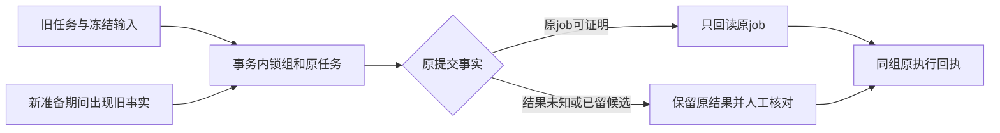

# T-1062 后端测试协议兼容只读审计

此次只读审计不修改产品/控制文件、不提交、不启动真实服务、不读真实DB/媒体/密钥。迁移收敛代理仍为唯一产品writer。审计主整合树：/Users/zyongzhu/.codex/worktrees/t1062-client-integration/Thirdspace-creator；类型输入为 `docs/verification/t1062/integrated-backend-typecheck.log`（SHA 696bdff0328e74c23561f4e1cf4235d0fa5092d9e3eedc721e77ef5dfd729e5b）。日志105条诊断全部位于22个测试文件；**这只描述编译报错位置，不证明生产合同正确，也不将它们一概记为旧债**。正式新版合同/API追踪按下表，未做完整22文件运行回归，校准后必须重跑原全部断言。

## 当场隔离证据

- 冻结候选根 `/Users/zyongzhu/.codex/worktrees/t1062-runtime-merge/Thirdspace-creator`，commit `a56dba58bc4d624c834f5ecda101787a545e769c`。没有源文件编辑。现有测试 `pnpm -C backend test src/modules/ai-runtime/asset-business-execution.service.test.ts` 当场 **2通过/5失败**，日志 `/tmp/t1062-asset-compat-audit-tests.log`。`createDb()` 无dataDir直接内存PGlite，无真实PG；执行时移除 DATABASE_URL/PGLITE_DATA_DIR（首轮旧测试命令移除DATABASE_URL，测试本身createDb不读env）。
- 当场合成组probe脚本 `/tmp/t1062-asset-compat-probe.mts`，结果 `/tmp/t1062-asset-compat-probe-result.json`。只调 service.prepare，模型规格为固定合成fixture，不启动Worker、不调用网络、不读真实媒体。
- probe揭示活动空组旧checkpoint恢复创建 execution 的 `groupId/accountId/groupVersion/membershipVersion` **全null**，二次prepare报“任务执行映射不一致，请先核对”；归档组首次prepare也创建了同类execution，二次才被正规authority拒绝。
- probe首轮脚本 import accountGroups 从总export错误而未运行，改为真实schema import后才得上述结果；首轮不算红权限证据。最终result保留当场真实输出，不补PASS。
- 四类 native现存源包/产物文件集/摘要/宏检查 `node frontend/scripts/verify-native-editors.mjs` **PASS（来源一致性）**，日志 `/tmp/t1062-native-baseline-verify.log`。NoteRelay5、Doocs395、快图7、OpenCut7个静态文件；这不代表组合同、独立新构建或真实浏览器验收。

## 资产五失败逐条分类与实际调用链

1. **checkpoint `{broken:true}`**：旧断言期待 `{legacy:true}`、不resolveSpec且execution=null，新API返回原task+持久execution并进入review。这一返回合同需校准，不能恢复“旧事实转新付费提交”。正确断言是 `assetLegacyRecovery.mode=review`、`unknown_result`、保留input/checkpoint/候选、不增加可提交call、不泄露token、原请求复读相同execution。但目前真实group归属/归档锁缺失，所以不能单靠改fixture称通过。
2. **retryOfTaskId='original'但parent行不存在**：新版 helper锁本task与原parent，缺parent拒绝OwnershipError是正确权限/来源边界。旧fixture需要创建真实同user、同workspace、同输入原任务再测合法retry；另原样保留缺parent、跨用户/组、原项目变动拒绝。不能放宽生产服务替不存在parent造事实。
3. **原generated_asset result**：新API把当前execution状态设succeeded、原AI task回到awaiting_confirmation，并保留result；与旧`execution=null`断言不同。应查实际候选ID/原结果/不再调用付费生成、不创建新结果以及复读采纳幂等。当前helper解析当前配置仅为诊断/安全原job fingerprint验证；不能把当前配置称历史已冻结模型身份。
4. **prepare期间配置await后新增旧checkpoint**：当前事务检测hasLegacy后直接throw（asset-business-execution.service.ts约104）。这是阻止重复提交的有效守卫，但恢复链缺安全分流：`recoverQueued` catch → `onFailure` → persistence-client.ts约6870 `aiService.markFailed(...素材任务准备未完成...)`。应在rollback后重新读原任务/输入/fingerprint/项目/checkpoint并进入专门原job/review恢复；若输入身份变了则明确拒绝且保留原账本，不能自动按新配置重提。startup不得把可review的未知提交统一标failed。安全恢复必须锁真实membership、原task以及保存原事实，不在正在运行外部提交的租约上抢权。
5. **recoverQueued(legacy,failed)**：新版为`recoverQueued(onFailure,shouldStop)`；旧failed mock async返回Promise被作为truthy shouldStop，因此循环根本未进入resolveSpec。测试校准第二参同步()=>stopping，覆盖prepare挂起后stop，迟到spec不落execution/无paidsubmit/不误触onFailure。实际persistence当前传两个正确参数，此项本身为fixture失配，仍需真取消回归。

真实生产修复路径：`backend/src/modules/ai-runtime/asset-legacy-recovery.service.ts`、`asset-business-execution.service.ts`（必要startup回调 `frontend/src/server/persistence-client.ts`）；对应原测试与 `backend/src/modules/execution/asset-worker-runtime.integration.test.ts`。helper import了requireWorkspace/assertWritableWorkspace但未使用；手工insert丢掉冻结group字段，未共用 `assertFrozenWorkspaceMembership`/`lockWorkspaceMembership`。参考 `backend/src/modules/execution/execution-authority.service.ts`：authority在同tx锁member并保存task.groupId/groupVersion/membershipVersion。修helper必须按真实任务冻结owner保存，不能用当前选中组覆盖；校验归档/readonly/member变更和历史original链，existing execution复用也要完整user/workspace/owner/kind匹配，不能只凭executionTaskId返回。使用统一锁顺序防转组交错，groupVersion存原冻结值。`execution-asset-result.service.ts`约62已禁止legacy创建新付费call，Worker仅以已存providerJob resume回读，必须保留这条红线。

所需新回归：活动空组/组内真账号旧checkpoint的组字段保存与复读；archived/readonly拒绝且零行新增；成员迁移期间冻结校验；合法原parent retry与缺/跨属parent拒绝；provider_job仅查询0POST、未知结果review无新submit；已有候选人工采纳；新准备期间checkpoint竞态走原review；停止后迟到不回写；startup不把原未知提交作普通配置错误failed。不得把新receipt当原历史付费使用量证明。

## 另一个真实生产协议缺口：Canvas工具

`backend/src/modules/ai-runtime/chat-canvas-tool-host.ts` resolve约18强制 `ctx.accountId`、只比restored.context.userId/accountId，无group。新版组workspace允许account=null，因此合法空组 canvas工具被拒绝；相同账号/null跨组选项也缺完整组合同检查。修复采用真实workspace key/冻结group上下文并依靠真实canvas service读写端口权限；group创作不要把平台筛选当owner。工具resolver需真实 `ExecutionRef` 而非伪造task，保留definitions digest、受信surface/selection单canvas定位、signal及执行tool ledger。6个少参测试校准必须同时测group-only成功、跨组拒绝、同组平台筛选不扩大、readonly/archive和迟到取消。不得仅加第4个空对象或cast使类型绿色。

## 105条类型诊断的精确分类

| 文件 | 条数 | 合同追踪与修复 |
|---|---:|---|
| `backend/src/modules/ai-runtime/asset-business-execution.service.test.ts` | 1 | recoverQueued 第二参已是 shouldStop()，旧 failed mock 返回 Promise 导致提前退出；校准调用签名但保留 stop/迟到不落库断言。五项运行失败另见下方，不能统一归fixture。 |
| `backend/src/modules/ai-runtime/chat-assembly.test.ts` | 2 | 2 个旧宿主 submit port 不属于只读 AssembleChatDeps；截图/网页能力现在经 Worker definition/execution 和 durable ports，需迁移 signal 断言至实际 Worker 公共链。不能重新把 AI/浏览器执行塞回准备层。 |
| `backend/src/modules/ai-runtime/chat-canvas-tool-host.test.ts` | 7 | 6 个 resolver 调用少真实 execution 参数（现在 ctx,input,execution,signal）；定义 JSONType 用 satisfies/解析正式工具 schema 消除 undefined，不能 unknown 双cast。另生产 resolve 拒绝空组且不比 group，必须先修协议。 |
| `backend/src/modules/ai-runtime/signal-quality.test.ts` | 1 | topic-task-adapter 文件已不存在；trendQualityFromDetail 无现存生产实现，不能造空文件恢复旧语义。把纯信源计数断言迁至当前实际读端口/模型输入；评论启发式若无现有调用仍需标出覆盖失效，不删整套断言。 |
| `backend/src/modules/ai-runtime/transcribe-runner.test.ts` | 7 | runTranscribe/TranscribeRunnerDeps 已移出 backend；backend 文件仅诊断类型/classifyTranscribeFailure。按 ai-worker/execution/transcribe-worker-run.ts + backend execution-transcribe-postprocess.service.ts 对应端口迁移原取流/图集/冷却/取消/部分成功断言，保留 failure classifier 独立覆盖。其余5条隐式any为失去旧类型的连带错误，不能裸加any。 |
| `backend/src/modules/ai/ai-media-probe-control.test.ts` | 3 | 3 条读取 row 可能不存在：显式 assert 存在后 toTaskDto；保留原状态/不泄露确定性生成数据断言。不是放宽 DTO 接受 undefined。 |
| `backend/src/modules/articles/articles.creative-adapter.test.ts` | 1 | 结构 sections fixture 缺 headingLevel；CandidateValue 已支持 ArticleCandidateProposal.proposedSections，不是生产缺 sections union。用 articleCandidateSection.parse 构造 normalized 输出。 |
| `backend/src/modules/articles/articles.integration.test.ts` | 14 | 14 条 headingLevel/default 输入输出混用；articleSection.default(2) 的 z.input 可省略，z.infer 输出必须有。经 schema parse 构造 fixture，保留旧文档省略字段公共调用能保存并读回2的专门回归，不把旧合法请求改成拒绝。 |
| `backend/src/modules/creative-results/conversion-source.integration.test.ts` | 2 | 2 条 articleSection fixture 同上；保持选区/版本/sourceAnchor冻结断言。 |
| `backend/src/modules/creative-results/output-conversions.integration.test.ts` | 1 | 1 条 articleSection fixture 同上；保持转换 CAS/旧digest和结果重放。 |
| `backend/src/modules/execution/asset-worker-runtime.integration.test.ts` | 1 | prepared.legacy 已无输出；断言真实 aiTaskId/executionTaskId，并查执行输入/零密钥/零旁路，保留 Worker429/回执丢失/原job续读能力。仅替换未定义 legacy 属性断言不代表恢复已验。 |
| `backend/src/modules/production/production-conversion-owner.test.ts` | 4 | 4 条数组索引 noUncheckedIndexedAccess；断言数量/存在再访问 scene/card，保留全部 extension/anchor/legacySnapshot/warnings。 |
| `backend/src/modules/production/production-precise-asr.integration.test.ts` | 1 | 1 条 transport.request 返回 unknown，先按 ENDPOINTS.applyProductionEditor.response 校验 envelope/data，保留词级剪除及真实时间映射断言。 |
| `backend/src/modules/production/production-video-material-hooks.test.ts` | 2 | 2 条输出型 image card.big/quote.tone 缺默认值；使用 productionPlanV2/overlay schema parse，仍测精确绑定/非目标内容不变。不能改正式 schema 默认或删除原文本card。 |
| `backend/src/modules/production/production-video-material-owner.test.ts` | 12 | 12 条中：moments fake 仍 get/getVersion，正式 WorkSourcePorts.moments 已 readVersion；conversion fake 缺 selectSavedSource，需真实明确 unavailable 函数而非 optional放宽；unknown transport按 endpoint response.parse；card union按kind收窄 file；ctx.accountId ?? null 对 nullable repository参数，不能虚构account。依旧需真实 owner/target/隐藏绑定/restore 全链回归。 |
| `backend/src/modules/publishing/visual-material-adoption.service.test.ts` | 33 | 33 条 adoptDraft 现在 PublicationRow|unassigned；account fixture已明确 ctx(a)，显式 helper assert("id" in result) 确认真目标，再保留 CAS/幂等/逐页导出断言；另增加 group-only unassigned 保留候选无假账号且无 publication 行、read-only/archive拒绝。不能全局把 union 去掉迎合测试。 |
| `backend/src/modules/review/work-reviews.service.test.ts` | 1 | 1 条 query.accountId optional string 不接null；legacy account fixture assert真account或省略undefined，组查询保留真实 group ctx。保留等待用户/继续同请求账本。 |
| `backend/src/modules/work-compositions/owner-materials.integration.test.ts` | 1 | 1 条 articleSection headingLevel输出fixture默认值；保留真实owner material权限和receipt。 |
| `backend/src/modules/work-compositions/work-canvas-context.integration.test.ts` | 6 | 6 条：conversion fake缺selectSavedSource；其余unknown public response先用work endpoint schema parse再断言。不能放宽选来源端口或把 null/unknown伪造成成功。 |
| `backend/src/modules/work-compositions/work-materials.integration.test.ts` | 1 | 1 条 conversion fake补必需selectSavedSource（实际不存在路径可明确throw）；若测试进入此端口则必须提供真实冻结source，不可空回执。 |
| `backend/src/modules/work-compositions/work-source.integration.test.ts` | 1 | 1 条 conversion fake同上；保留 source provenance与跨owner拒绝。 |
| `backend/src/modules/work-compositions/work-sources.transport.test.ts` | 3 | 3 条 articleSection headingLevel输入输出fixture同上；保留仅选实际section IDs与隐藏段落不泄漏。 |

`headingLevel`、`big`、`tone`均是schema default造成z.input与z.output差异，不应突然让旧合法公共请求失败。unknown transport响应/数组nullable的问题应以正式schema parse及存在检查保留断言。WorkSourcePorts新selectSavedSource/readVersion是来源与选区协议升级，fixture明确不可调用时可throw，但真实路径必须接实际owner端口。所有分类都只表示可行修复，不自动推断运行通过；article/production/work新域组权限仍需后续适配，与校准测试分开记录。

旧转写测试不能删除：原backend runTranscribe已明确移入 ai-worker/src/execution/transcribe-worker-run.ts；新run路径调用transcribe-asr-run和transcribe-postprocess-run，宿主端口执行原后处理保存。把冷却、图集、取消、部分失败、授权和源文件断言跨层迁移到真实公开调用图；只有classifier还留backend。旧signal质量的缺模块不能引入硬编码内容判断恢复绿灯，要确认新模型输入保留真实信源计数，再决定测试归属。

## 四原生编辑器未来修复边界

详细逐源文件、当前SHA、归档根、构建入口及全产物清单见 `/tmp/t1062-native-bundle-update-boundary.json`。这是未来串行写集建议，本轮没有产品编辑。

当前 `frontend/.../native-editor-contract.ts` 与快图归档`src/native-types.ts`、Doocs归档`apps/web/src/native-entry.ts`、OpenCut归档`apps/web/src/embedded/native-host.ts`、NoteRelay`reference-editors/noterelay/web/native.ts`四复制件均为accountId非空，owner没有group。Doocs原mount遍历校验accountId，OpenCut原mount也硬拒绝无account。快图/NoteRelay主要靠实例signal+epoch保证卸载，没有自动理解组；不要称四包已有组协议。

宿主Surface `isCurrent`和effect依赖仅account/output/sourceVersion/editor；不同组同account/null+同output/version没有失效，callbacks.current可已变成新组callback。late CSS/module/mount、ready/error/changed、request结果、importFile回执都要完整owner+epoch守卫。VideoWorkbench useNativeAccount只订阅CURRENT_ACCOUNT_KEY且在无account时直接不挂载；必须改实际group workspace订阅/门禁，空组不是缺权限。Doocs与NoteRelaysession key、Graphic mountVersion/pendingSave/local备份、native-source请求sessionStorage key、生产Transcript/Rough回调也需按真实group identity重置并保留原WIP/回执到原scope，不依赖mutable“当前ctx”。

`reference-editor-media.ts` upload跨createUpload→PUT→completeUpload→createMaterialLink，各client请求默认临时读取当前全局HTTP选择；只是await后alive检查不能防请求落新组。捕获原真实scope transport并在每步前/后校验epoch；同理Doocs图片hydrate/exportZIP、NoteRelay渲染/PNG/clipboard、Video save/acceptVersion/ASR/粗剪/导出状态更新和后台读回。后端仍在同事务检查真实group/member、readonly/archive和project/file归属；客户端owner字段不授予权限。

建议owner显式groupId:string|null、accountId:string|null，output/sourceVersion非空，至少真实group或legacy真account其一；group创作可account=null，同组切平台筛选不能重绑创作owner，不造actor账号。若加入user/权限版本必须来自真实会话合同，而不是包内假默认。四source合同和mount验证同时改，保留既有lease、requests、export冻结、慢图/音视频作业、portal、资源释放和安全降级。重新实际构建原native目录、重新归档source+patch、重新计算manifest/source/bundle/patch hash和graph；不手改minified native.js或仅更新SHA。Doocs395产物许多chunk在bundle入口改动后可能引用hash变化，须完整实际文件集。license/upstreamcommit保持真实来源，改组适配不伪造上游版本或历史验收PASS。

clone基线：快图 `/tmp/t1062-native-audit-sources/kuaitu`；Doocs `/tmp/t1062-native-audit-sources/doocs-md/doocs-md-native`；OpenCut `/tmp/t1062-native-audit-sources/opencut-classic`，从当前真实归档只读抽取（308/819/704文件项）。NoteRelay完整维护源在 `/Users/zyongzhu/.codex/worktrees/t1062-client-integration/Thirdspace-creator/reference-editors/noterelay`，后续实施前复制到独立clone；不得改此只读审计基线。按原锁独立安装实际依赖，不借主树node_modules冒充独立构建；OpenCut生产不能打开DOM fixture宏。未来至少两个独立clone真实构建hash对比+四编辑器旧异步回归，再真实浏览器验证空组打开、编辑、导入、保存、导出和切组迟到隔离。

## 验证限度与交接

本轮只运行资产业务原7例、额外两个合成组probe、native来源摘要验证；未跑22类完整回归、四包新构建或浏览器E2E。主整合tree持续有合法迁移writer，以上audit记录commit只用于定位只读观察，并非冻结其全树dirty状态。保留所有红证据；105诊断校准前后需完整类型检查和逐域聚焦公共链回归，不能删除断言或恢复旧旁路换绿。

## 追加：contract全套4失败与cover真实入口追踪

父在主整合树当场contract/ai-worker完整typecheck均exit0；contract全suite **317通过/4失败，60文件中56通过/4失败**，原日志 `/tmp/t1062-contract-tests-preflight.log`，本审计只读核实，不复写或冒充本代理重跑。

| 精确失败路径 | 判断与校准/生产修复 |
|---|---|
| `contract/tests/platform-capabilities.test.ts:182` | kuaishou手工create过去期待false，现schema成功；root已确认其仅unverified目标管理记录，DEC允许。校准kuaishou为合法manual，同时保留wechatOfficialAccount被旧manual协议拒绝和未验证目标不能binding/collection/publish。生产路径 `contract/src/resources/platform-capabilities.ts`、`contract/src/operations/platform-accounts.ts`、`backend/src/modules/platform-account/platform-account.service.ts` 的manual/create guard须一致，不能只把schema放宽；源码上一合并已保留root实际manual分支。再跑service真实target/unverified及identityVerified拒绝回归。 |
| `contract/tests/registry.test.ts:450` | 固定SPEC13快照少30注册路径（canvas13、production转换/转写/粗剪9、visual export1、intelligence enqueue1、redfox settings3、visual templates3）。不是直接删除快照/放宽允许所有endpoint；逐一关联现行独立PASS SPEC及真实dispatch owner，记录route+operation+workspace policy，更新合法集合并仍拒未声明/孤儿路由。 `contract/tests/registry.test.ts`、`contract/src/endpoints.ts`（当前真实ENDPOINTS汇总），scope治理尚须适配；源全套route声明不是跨组权限通过证据。 |
| `contract/tests/modules/assets.test.ts:7` | fixture缺sourceUrl。 `contract/src/resources/assets.ts:41`真实resource字段是string|null；`backend/src/modules/assets/assets.transport.ts:74`公开DTO已调用extractSourceUrl，从当前file.mediaMetadata读真实sourceUrl，无值null。校准合成无来源fixture为sourceUrl:null，另测合法sourceUrl投影；不捏造URL/删字段。此项有实际DTO接线支持，属于fixture字段漂移。 |
| `contract/tests/chat-worker.test.ts:44` | cover.generate现在确有真实纯事务提交链（下文）；旧断言“不能冒充已迁移”已不对应新合同。**有生产装配证据，但本轮没有当场cover专用公共gateway事务执行证据**，不能单靠映射或合同safeParse就报整条PASS。测试应将cover归受审纯提交列表，保留asset.generate/arbitrary.task/__proto__不能冒充及错effect/旧host/未启atomic拒绝，同时增加真实cover链回执丢失/回滚/并发/取消/组权限证明。 |

cover源调用图核实：

1. `frontend/src/server/prepare-chat-reply.ts:29`向当前真实准备器明确传 `atomicCoverGenerate:true`；`backend/src/modules/ai-runtime/chat-turn-preparation.ts`将其送入 `prepareChatToolDefinitions`；后者给cover当前冻结定义 `execution=host.task-submit`、version `chat-tools-atomic-cover-v1`、effect committed。`contract/src/internal/chat-task-submission.ts`映射真实子taskType cover.generate，`internal/chat-worker.ts`仍审查已注册映射/effect，非任意提交。
2. 实际根 `frontend/src/server/persistence-client.ts:6806/6813`调用 `composeChatProduction`并传 **aiService.prepareTaskCommit**，不是裸createTask/旧runCoverGenerate。`backend/src/modules/ai-runtime/chat-production-composition.ts:61`实际把cover ports接 `createChatTaskToolHost` → `chat-cover-task-host.ts`。该host比user/account/group、校验原ExecutionRef/context/工具definition digest，核对当前项目与input.projectId，读取当前稿scriptSnapshot；prepareTask只生成PreparedAiTaskCommit，不执行模型/不先写子任务。
3. `backend/src/modules/execution/execution-chat-task-submission.service.ts`取得真实copilot.assist父任务/lease/原started零tokens tool call，验证冻结execution/effect/最末model turn、permission再校验、同参未知不能重提；随后同一次 `leases.withLease(...admission...)` tx内 **prepared.task.commit(scope.tx,...真实parent binding)**，再把真实child.id写成功tool receipt。receipt失败回滚child；重复调用可回读同一已提交child。不是只贴transactional标签。
4. `backend/src/modules/ai/ai-task-commit.ts`构造同tx createAiService，子任务保留真实context并以hostTaskSubmission原parent binding冻结；AiService共用真实workspace/membership锁。 `backend/src/application/chat/preparation-tasks.ts:31`实际wakeChatCoverTask送 `wakeSubmittedTask(...cover.generate)`；`submitted-task-preparation.service.ts`支持cover并查真实parent回执/definition，`application/generation/task-wake.ts`恢复不降级到旧旁路。唤醒失败保留已提交事实，不能重建子task。

现有 `backend/src/integration/chat-task-atomic.test.ts`实际DB原子ACK/回滚/权限/并发测试fixture仅覆盖planning/material/review/publish，**没有cover variant**；`execution-cover-series.test.ts`属于封面下游生成context/降级，不证明此聊天公共gateway。故这条contract失败可判“真实实现支持的新合同需要校准+专用公共链缺验证”，不判纯旧snapshot债，也不判当前cover实际事务已全绿。下轮新增以真实chat-cover-task-host+AI task commit+父execution ledger为边界的合成DB回归：当前项目与原稿冻结/无项目拒绝、组空账号、跨组/readonly/archive拒绝、ACK丢失只一个child、receipt失败0child、权限准备后撤销、concurrent同参复用、无worker/model付费旁路、停止后迟到0新提交；模型外部调用一律fixture，不启动真实用户服务。

源码交付附加缺口：OpenCut仓内 `reference-editors/opencut-classic/native/rebuild-native.sh` 的verify/fixture分支引用其同目录 `verification/check-process-globals.ts` 与 `verification/dom-probe.ts`；现冻结来源仓/对应归档里均没有这两个文件。build入口和原测试源码存在，但此shell不能独立完成其声称的全部verify模式。后续先补齐真实来源的验证脚本（注明来源SHA）或用实际仓内 `frontend/scripts/verify-native-editors.mjs` 替代相应生产宏检查并明确DOM probe仍缺，不能假造不存在的verify-native-bundle.mjs命令或把原历史VERIFY文档当本轮执行。此发现列入JSON pending；本轮只做现存完整四包产物hash核验。
