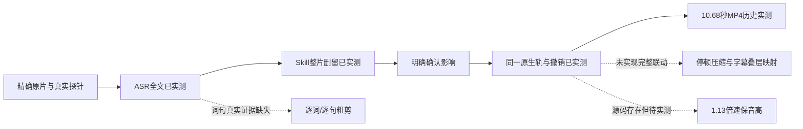

# T-1062 剪辑能力只读核对（2026-10-05）

本轮仅阅读代码、SPEC、历史证据与官方文档。没有访问正在使用的 ChatCut 实例，没有调用其项目/媒体工具，没有运行外部脚本，没有改变产品代码、真实数据库、工程或媒体。原生开源归档只解包到 `/tmp/t1062-rough-cut-native-readonly` 供阅读；未运行其中脚本。未发生新的 ASR、模型、CUA、导出或安装验收。

## 结论

诊断分支有“真实原片登记→ASR→可配置粗剪 Skill→用户明确采用→同一原生 OpenCut 时间轴→撤销/保存/导出”链路，并有 2026-10-03 真实模型整片删留与一次 MP4 导出的历史证据。它不能被称为已完整达到 ChatCut 式粗剪：真实词句时间码尚未成功验收；原生入口未接直接文字删视频面板；停顿压缩无现有模型目标；独立字幕/叠层/分离音轨不会随粗剪移动；原生变速与保音高源码存在但 1.13 倍速及全轨同步没有真实验收。T-850 父需求不能由 T-1046 的窄适配证明全部完成。

## 核对基线与整合提醒

任务权威：主树 `docs/features/t1062-consolidated-local-client-acceptance.md`；剪辑权威：诊断工作树 `docs/features/t850-visible-rough-cut-workbench.md` 与 `docs/features/t1046-native-ai-rough-cut.md`。已加载 product-to-code-orchestrator，技能/项目版本均 3.27.2；本子任务是 integration 阶段只读调研，不迁移控制面、不改 Gate。

诊断工作树：`/Users/zyongzhu/.codex/worktrees/user-diagnostics/Thirdspace-creator`，本轮读到 HEAD `bb00d580e2543dc886f145c13f686cf7dc50a4b8`。2026-10-05 本轮快照，主树 `/Users/zyongzhu/Workbase/Thirdspace-creator` 尚无下述四个文件，不能把诊断分支的能力直接算到本地包：

| 诊断文件 | SHA256 |
|---|---|
| ai-worker/src/prompt/templates/production-rough-cut.ts | 89d2e1dbbd492a3d31765191afe83fdb7ad6e5cff920e727c0d8f22954da24ed |
| backend/src/modules/production/production-native-rough.ts | 1d8252d8a09bd4a336961b78f7ba7ef0745f6a9b539f49e64a654ace97f6a9b4 |
| frontend/src/features/reference-editors/video-reference-workbench.tsx | 3bdae23d2c9daea4dc85b5cbdb00677f1f8d7636c6339c0ce7d7e0a08fccd89f |
| frontend/public/reference-editors/opencut-classic/native/native.js | f61b0939ff9a185861dbc7addee2c40ef1b3a0d71cfac81c31c41d1f43a50354 |

Whisper runtime 两树不一致：主树 `ef725b87529cc9e69b14642564f5f89c33943071b12372b04c75a2dfebff5dae`，诊断 `9b74ee8dd59b707dcffbcbc76020633841a269e9bbac8538107f189978519c52`。主会话集成中可能随后变化，冻结候选须重新核 hash 与 build，不能把本表作为完成后的状态。

## 能力与证据边界

| 能力 | 当前真实状态 | 限制及依据 |
|---|---|---|
| 原片登记/探针/精确文件 | 有服务和历史真实旅程 | source proof 冻结 assetFileId、digest、探针；不改原件。需本地包复验。 |
| ASR 全文 | 2026-10-03 公开流程真实 Whisper 成功 | `ui/real-asr-result.json` 明确 granularity=text；任务 ai-task-186c9f73-142。不能写词级通过。 |
| ASR 词句 | 合同及 UI 精度选项存在，严格降级 | 真实尾词 `[13.96,17.14]` 超过音频 14.3086875 秒，timing=null；没有裁切或按字数猜时间。buffer transfer 后 length=0 的实现缺陷已修，真实这条源仍降级。 |
| retakes/语义删留 | 可配置 Skill 对真实全文或 token 提候选 | 无文本匹配硬编码。真正只能采用整 clip 或可验证 tokens；仅全文的局部文字为 unlocated_text，只供复核。短语删留不能靠删整片替代。历史真实 MiniMax 验收的是整片删留，未证明自然保留最佳 retake 的词级效果。 |
| 同轨采用 | 历史真实单项/多项/继续采用通过 | 明确影响确认；完整 scene digest/CAS；实例ID避免同源误删；一次原生命令保留 Undo/Redo。 |
| 直接文字剪视频 | v2 有 ProductionTranscriptCutPanel；native宿主尚未接入该面板 | native `video-reference-workbench.tsx` 只装 TranscriptPanel 与 RoughCandidatePanel。候选可 token target，不等于 ChatCut 的文字选择+Delete。 |
| 停顿压缩 | 尚无完整自动压缩合同/目标 | ModelSuggestion target 仅 clip/tokens/unlocated_text，不含真实 silence range 或 retained duration。可手工按原片切点修剪；不能宣称 AI 已能按0.25秒压缩停顿。 |
| 变速与保音高 | 原生源码有真实 UI、预览与导出实现 | `retime.rate` 0.01–5；`maintainPitch` 默认 false；Speed 页“Change pitch”开关 checked=!maintainPitch。SoundTouchJS tempo=rate、pitch=1。需要关闭 Change pitch 才保音高。没有本任务1.13倍速成片听审证据。 |
| 倍速后的词级粗剪 | 局部自动采用明确受限 | backend `nativeRemovalRanges` 对 rate!=1、动画/effect/mask 局部目标 review_only；整clip删除仍合法。应先语义粗剪，再倍速。 |
| 字幕/叠层时间映射 | v2 有源实例映射；native保持独立项绝对时间 | T-1046 明确不猜 text 是 ASR 字幕。native主轨删除仅 ripple main，overlay/audio保原位置并展示影响；分离音轨没有 instance反向链接，不能凭同mediaId推关联。完整字幕来源锚/全轨映射属于T-850缺口。 |
| 撤销/重做/保存刷新 | 有历史真实操作；独立夹具覆盖重要负向 | Ctrl+Z 恢复两主轨片段，Ctrl+Shift+Z重做；刷新保存读回；未知ACK同请求不二次应用。夹具26项PASS不是CUA。 |
| 导出 | 一次10.68秒版本有真实MP4历史证据 | H.264 640×360 video 10.680s，AAC 10.750839s编码尾部；4.68秒最终再次导出未完成。导出当前scene，不是自动合并多scene。安装包、真实WebGPU/WebCodecs仍待验。 |
| 内置录制 | 未看到本轮CreatorOS粗剪宿主接入录制旅程 | 上传实录原片已在范围；ChatCut录制只能作为调研事实，不能宣称CreatorOS具备同样摄像/录屏录制。 |

历史真实证据集中于诊断树：`docs/research/evidence/t1046/verification.md`、`ui/real-asr-result.json`、`ui/multi-candidate-result.json`、`ui/multi-adopt-result.json`、`ui/final-clean-adopt-public.json`、`ui/actual-export-probe.json`、`ui/export-saved-plan.json`。`independent/t1046-independent-acceptance.md` 明确 ASR/供应商/host 使用 fixture 的边界。`docs/verification/t850-visible-rough-cut-workbench.md` 记录旧v2真实FFmpeg/HF音画顺序实验，不可替代原生3安装验收。

## 粗剪 Skill 与 runner 实际装配

这不是 ChatCut Skill 的直接移植，也不是磁盘 moonlit Skill 被运行：

1. `ai-worker/src/prompt/templates/production-rough-cut.ts` 是内置 `production.rough-cut` v2 PromptTemplate，requiredFacets=roughCutContext，输出严格 suggestions/summary。现提示包含不猜时间、不确定review、保持手改图层，缺少 ChatCut guide 的完整retake、false start、呼吸与上下文保留方法。
2. `backend/src/modules/production/production-rough-cut-reservation.ts` 冻结用户指令、真片段/源/转写、权威稿；create原 task `production.rough-cut.propose`，经既有 execution bind、有效 Skill snapshot 与调用账本。
3. `production-rough-cut-adapter.ts` 复用 StructuredBusinessAdapter，skillId=`production.rough-cut`、capability=`script.draft`；没有新增模型通道。
4. `frontend/src/server/persistence-client.ts` 装配 adapter，`ai-worker/src/execution/structured-business-schema.ts` 与 prompt registry 识别输出 schema；候选结算核 skill snapshot/owner/冻结摘要后由backend存候选，用户采用才写工程。
5. adapter 对 validation.status=partial 产生 `production_rough_cut_partial`，不能进入正常 `production_rough_cut` settlement 证明。不把 partial 记为完整可采用成功。

若目标是“像ChatCut一样粗剪”，可将已读 guide 的语义方法纳入现有可配置Skill，但方法增强不能填补 silence目标、native文字删除或字幕全轨映射的契约缺口。

## 依赖与安装实际要求

本轮只查看依赖/路径，没有安装。

- 两树 `ai-worker/node_modules/@xenova/transformers` 均存在；node、pnpm、bun、ffmpeg、ffprobe 在 PATH 可定位。存在路径不证明正式包装配通过。
- 本地ASR使用 `@xenova/transformers` 2.x（包声明 ^2.17.2）、onnxruntime-node/sharp 原生闭包、FFmpeg PCM解码；默认缓存 `~/CreatorOS/models/whisper`，可用 `CREATOROS_WHISPER_CACHE_DIR` 覆盖。首次权重惰性下载，离线机没有权重即不能推理。
- `frontend/scripts/desktop/build-sidecar.mjs` 有 transformers完整闭包、平台原生库、解析锚和真require/dlopen自检，静态ffmpeg/ffprobe装配。必须保留T1046的worker cwd resolver/detached修复并重建CJS，而不是仅合TypeScript。
- native静态bundle包含 OpenCut组件、opencut-wasm、MediaBunny、SoundTouchJS；安装用户不应为使用剪辑再安装Bun。重建源码归档的工具链/锁文件与第三方LICENSE都须保留。源码重建需Bun，前端运行需要真实WebGPU、WebCodecs、AudioContext/OfflineAudioContext（宿主支持仍需实测）。
- 报告归档 README 记录生产实锁依赖 MediaBunny 1.41.0、SoundTouchJS 0.3.0（SoundTouch LGPL-2.1）；存在许可清单。不擅自改依赖或下载替代引擎。
- 粗剪真实模型复用已配置 `script.draft` 凭据/Skill快照；没有凭据或费用边界不明时明确待验，手工编辑仍可继续。
- Moonlit真人Skill 1.1.2是方法与依赖契约：真人口播默认1.13倍保原声/音高；先保版本，再统一映射口播/中英字幕/B-roll/章节/音效；不能只加速预览或人声。它依赖当前 `video-editing`、素材/字幕及动画Skill，指定ChatCut时由ChatCut拥有时间线。本子任务没有调用它操作任何工程。

## 官方ChatCut对标事实（仅公开文档）

官方说明：文字选区删除会按词边界剪音视频并闭合该轨间隙，点击词定位；停顿控件可恢复源录制中实际存在的停顿，不能凭空造静音；字幕校字与删除字幕卡不等同删音视频。[Transcript and Captions](https://chatcut.io/docs/transcript-and-captions)

官方说AI可选择较好的重录、清重复/口癖、收紧长停顿；AI与文字编辑改变当前时间线并保留源媒体。[Talking Head Edit](https://chatcut.io/docs/talking-head-edit)

官方时间轴有分割/修边/复制/速度及可选ripple following，支持独立音轨；这些事实不证明当前CreatorOS可自动全轨跟随。[Timeline](https://chatcut.io/docs/timeline)

官方录制支持麦克风、摄像头、屏幕，停止后登记素材并放到开始播放头；本轮未实操。[Recording](https://chatcut.io/docs/recording)

官方区分近期Undo/Redo与命名Version恢复点。[Versions / Undo / Redo](https://chatcut.io/docs/versions-undo-redo)

本地 `~/.agents/skills/chatcut-talking-head-guide/SKILL.md` 补充方法：先语义剪A-roll锁定语音时钟，再字幕/B-roll/Motion Graphics；固定无意义犹豫声音可机械清理，retake/连接词必须语义判断；默认长于0.25s的停顿压到0.25s，呼吸与转折保留自然余量；不得把几次未完成片段拼成假完整句。当前CreatorOS提示不等同已采用整套方法。

## 最小真实验收路线

这是覆盖当前已实现能力的最小路线；通过后只能把这些项记PASS，不能以此裁掉T850范围。

1. 先整合并冻结诊断代码、合同/迁移、真实OpenCut源归档与静态bundle、Worker CJS；记录commit/hash/包SHA。运行原任务要求的contract/backend/frontend/LED047/boundary/orphan Gate，保留全局既有失败。
2. 在隔离账号/项目/媒体根和真实安装包中录入一份可丢弃口播测试视频（完整句、失败重录、长停顿、可听辨标记），不访问用户正在用的ChatCut或真实媒体根。保原文件hash/时长。
3. UI上传→登记exact source→主轨→保存→公开ASR。核task/execution/receipt/granularity。只有全文就记录全文成功、词句待验；找另一真实支持timing的合法供应商/源进行验证，不能用fixture或猜切点补PASS。
4. 先手工S分割为若干有意义片段，选择真实实例，指令保留完整最佳重录、删明确失败片段。真实Skill输出→逐项或多项勾选→核受影响项→明确采用。对照原片与结果持续听审，确认保留必要上下文，不仅检查时长减少。
5. 同源重复插入、独立文字/BGM及另一scene作为反例；采用只改选定实例/main。检验Undo/Redo→手工改→保存→刷新→原工程与来源仍读回。独立项不随剪动应写当前限制而非字幕同步通过。
6. 保存原速checkpoint后在原生Speed设置1.13、关闭Change pitch；回读实际retime={rate:1.13,maintainPitch:true}与duration/trim。导出当前scene，ffprobe核时长与AV轨，连续听审音高/切点；独立字幕/音效/B-roll需逐项核对，未同步不能写“1.13完整制作成功”。
7. 真实导出必须从正式产物回读MP4并检查首尾/删除区/重复源/画音同步/字幕。安装版900×600/1440工作台操作和真实WebGPU/WebCodecs支持留截图/录屏。用户确认单独记录。
8. 以下项必须保持未完成或先补合同/独立评审再实现：可验证词句真实旅程、native直接文字删视频、真实停顿压缩目标与源静音保留、native字幕来源锚与全轨时间重映射、倍速后合法局部粗剪、最终版本完整导出/本地包通过。没有用户接受风险或全部证据，不把T850/T1046/T1062写为全部完成。
