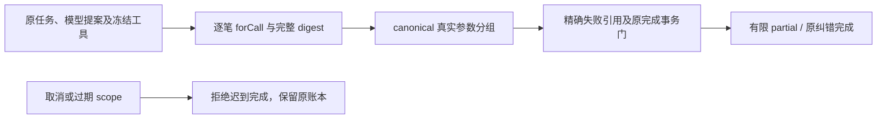

# T1088 终轮独立实施复核

**最终结论：GO，T1088 所审实施通过，没有未关闭的本次阻断项。** 当前真实绑定签名实现、旧合法纠错兼容、补充矩阵与新增 resolver 公共链已核；生产三文件没有在最后补证期间变化。此结论限定下表工作树字节和实际日志，不代签全局、安装版、真实付费模型或其它任务。

本轮仅只读源码、合同和既有运行证据，并写本外部报告；没有执行测试、DB、模型、API、构建或 App，没有修改源、SPEC、控制面及旧评审。首轮、Round 2、Round 3 均保留原始结论，不把后发生的结果回填为历史 PASS。

## 通过依据

实际修复已经把两个概念分开：每笔调用的完整 digest 证明原任务/模型提案/工具身份；真实 bound input 的 canonical 签名判断两次参数是否相同。跨回合完整 digest 不同是正常事实，仍逐笔核验，不为合并失败而删除身份检查。



静态读取确认：

- forCall 仍核原 operationKey、唯一 settled model/provider tool call、冻结 name/version/execution、原参数解析与各自 ledger inputDigest；dispatcher 另逐项核 frozen effect/version/execution，并检查当前 scope 的 abort。
- receipt toolCallId/name 必须与真实 bound 一致；有机械 validationOutcome 时，output 必须深等。业务签名只使用真实工具/执行位置/effect/input/errorCode，保 JSON 类型、对象键事实和数组顺序。
- 仍至少两笔、唯一终态组、原序精确 IDs；child、未 settled、不可确认、非 none/可重试等不能被当作同参终态授权。worker request没有新增可信参数入口。
- missing-resolver fast path仅在未请求 terminal IDs 且工具/错误码粗组不可能两笔重复时返回 null，保原普通完成；可能重复粗组缺 resolver 仍拒，不能用粗组证明同参。
- completion 原 owner/user/account/group、source/history/frozen input digest、lease/fence/deadline、完整 call/checkpoint、card/latest stop、partial notice/finish、消息/result 幂等与单事务门未放宽。Pi 参数恢复、旧计划保存及账本摘要生成不回退。

## 本次问题的关闭记录

### IMPL-001：首笔 eligible error误挡原正常完成——已关闭

原 T1026 公共截断恢复中，不同工具/错误码的孤立错误之后正确修复并 stop，却被新 missing-resolver门提前拒绝。原 5 个具体失败保留；修复后的未改原文件实际9 PASS。新矩阵同时验证 single-corrected/different-tool/different-code 直接 completion 无 resolver成功，可能重复粗组无 resolver拒绝。没有通过删旧成功断言、自动重发或伪造绑定关闭问题。

### IMPL-002：新增 resolver目录/生命周期公共链——已关闭

当前 `chat-workbench-plan.integration.test.ts` 中实际真实子进程/loopback provider旅程已补证：

- 原同参例的 `resolveTools` 包装原真实工具host，首次实际模型请求到达时将**外部返回对象**的 version改为 `external-mutated-after-resolve`；dispatcher已复制捕获目录，解析 exact1，仍由原两笔不同完整digest收口为partial。任务/消息/result/notice/finish、未写plan保持原断言。变更时点早于两笔工具，更充分证明工具执行与完成复用原目录，而不是只在完成阶段重取 registry。
- 原两轮 model/tool结算后，第三最终模型响应受控挂起。通过真实 persistent task command取消，`await host.stop()`确认原宿主及Worker收尾，再释放provider等待门。前4 settled ledger行与原snapshot深等，包括调用身份与用量；没有 assistant message/result/finish或终态notice。

这个取消证据证明真实 scope清理及取消后的provider响应不能完成。实际被关闭的连接会丢弃late响应，不能描述成“取消后仍有一个成功的stop被completion接收并拒绝”，也不声称逐分支运行私有 activeTools缺项 invoke。结合当前abort/lease代码与既有两笔missing-resolver拒绝，足以关闭本次公共生命周期要求，不需要新产品调试口或额外dispatcher源路径。

### IMPL-003：真实绑定矩阵与额外输入边界——已关闭本次必需覆盖

补充21例已实跑：对象键序相等、工具/码差异、冻结version/effect/execution漂移、机械output六字段篡改、整个terminal ID字段省略、跨task/user/group、普通无resolver完成与可能重复粗组无resolver拒绝。无需手填相同digest或假resolver。

最后两条 strict completion入口例现明确：额外 `tools` / `input` 到实际 service入口被strict schema拒绝；消息/result/status零完成写、stream events前后exact不变；随后合法原request真实partial完成、同请求回放相同、结果exact1与消息exact2。没有只测资源schema、删旧assert或把某一前置错误冒称目标分支覆盖。

原latest-root特定隔离反例及所有child/retryable/non-none族未新铺完整矩阵，作为测试局限保留；新代码静态保留原对应门，未发现具体放行路径，不继续把全部旧门复测当作新增阻断项。

## 实际运行证据：分别记录，不能相加冒充单轮

| 证据 | 实际结果 | 覆盖与边界 |
| --- | --- | --- |
| t1088-terminal-guard-matrix-first | 3文件，116 PASS，exit0 | 原三文件及21例矩阵；早于最后公共scope补证 |
| t1088-truncated-compat-green | 1文件，9 PASS，exit0 | 原未改T1026公共恢复兼容 |
| t1088-public-scope-green | 2文件，66 PASS，exit0 | completion + 公共Worker integration；目录快照与取消补证，strict入口初版 |
| t1088-strict-entry-final | 1文件，2 PASS / 58 filtered SKIP，exit0 | `-t worker额外` 定向重跑最后两个加强assert；不称60例全跑 |
| backend-type-release-candidate | typecheck exit0 | 最新补证源后的backend tsc |
| boundary-current / semantic-current | 各exit0 | boundary保持原基线5、无新增；semantic通过 |
| timeout-current | 整体exit1；静态27失败、动态165 PASS | 未升级成timeout整项PASS；静态失败没有指向本次三生产文件 |

公共scope实际 argv：

```text
pnpm -C backend exec vitest run src/modules/ai/chat-turn-completion.service.test.ts src/integration/chat-workbench-plan.integration.test.ts --retry=0 --no-file-parallelism --testTimeout=1200000 --hookTimeout=120000
```

最后strict实际 argv：

```text
pnpm -C backend exec vitest run src/modules/ai/chat-turn-completion.service.test.ts -t worker额外 --retry=0 --no-file-parallelism --testTimeout=1200000 --hookTimeout=120000
```

publicscope JSON：开始 `2026-10-08T17:14:49.680975+00:00`、结束 `2026-10-08T17:15:24.563088+00:00`，elapsed34.881685秒。strict JSON：开始 `2026-10-08T17:16:44.653613+00:00`、结束 `2026-10-08T17:17:07.755839+00:00`，elapsed23.101276秒。最新type JSON：开始 `2026-10-08T17:16:44.653263+00:00`、结束 `2026-10-08T17:17:46.020412+00:00`，elapsed61.366484秒。三个JSON的exit与logSHA均实际核对。

最后强化只增加测试assert，未改产品、fixture执行或其它case；已对两个发生变化的case定向运行并完成最新typecheck。因此不要求把全部未变化用例再重复运行，也不把筛选产生的58 skip误写成新增代码里的skip或完整绿。原RED、首轮95、116、66、2定向的时间顺序均保留。

## 全局与安装局限

- timeout静态27仍真实失败，动态165不能抵消它；boundary原基线5仍在。ROOT应依任务流程保留/登记已有债务，不将本报告用于伪造全局全绿。
- 首轮adjacent整轮另有durable/dispatcher错误，原失败保留，不由本次9T1026及66公共scope代签全部adjacent通过。它们未提供指向本次新签名逻辑的剩余具体漏洞，交关联任务诊断收尾，不无限扩大T1088源范围。
- 公共模型为本地中性确定性provider；证明SDK/Worker/账本/完成合同管线，不代称真实模型语义效果或用户业务数据成功。没有安装版、新版本重启或真机UI观察。
- 本结论不执行任务完成、提交、发布、reviewctl或版本控制面；只提供ROOT可用的独立实施结论及精确字节绑定。后续生产字节变化需新复核，不能沿用本GO。

## 当前源码与证据精确绑定

W=`/Users/zyongzhu/.codex/worktrees/t1062-client-integration/Thirdspace-creator`。以下为当前工作树；读取时HEAD `3a60fafc4fd299d2a0d2efc403ee6a24691075de`，不混用HEAD旧源码SHA。生产三文件与Round3全部exact一致。

| W相对路径 | bytes | SHA256 |
| --- | ---: | --- |
| `docs/features/t1088-terminal-receipt-signature.md` | 11996 | `0326ca44cb50c3712d452ba1c2036c2d2b47986b641d678c41e91cb951ed1e77` |
| `backend/src/modules/execution/workbench-plan.service.ts` | 23067 | `bcfe5c718d0b277b178265e9e9812fdcb57f08fa758b7b6ffa91bf7d377fc48b` |
| `backend/src/modules/ai/chat-turn-completion.service.ts` | 17001 | `fa38950055f48e0a58c0eb78b99592a67c5d073467dc5213fb12c5983167fbec` |
| `backend/src/modules/execution/model-worker-dispatcher.ts` | 54174 | `6285872c87035001c1cb3210873d39f718e6884e1db76238233f23137400eddb` |
| `backend/src/modules/execution/workbench-plan.service.test.ts` | 46919 | `0f47a530695cac467b3c78286b9ab23c4cffb8c31f278b5ce547d1a942952c3d` |
| `backend/src/modules/ai/chat-turn-completion.service.test.ts` | 44957 | `6a8447c44864e67c0a4eb768b748bd2285fbd250ff63f989989804701e983dee` |
| `backend/src/integration/chat-workbench-plan.integration.test.ts` | 33952 | `b63660a5d09d81cf22d7d4f98b09b80aac736f951d2e736e45217a39696c67e5` |
| `backend/src/modules/execution/agentic-tool-binding.ts` | 7007 | `aa396ac9b8eec023124da7c78cb7e4d78ef86534dae8701c693f41e1a7f2ccde` |

N验收根相对外部证据：

- `t1085/t1088-terminal-guard-matrix-first.log`：274 bytes，SHA256 `c664a0c114632487d4b68b622764f4f2fd84ca9abf53eff5997ef24a5bb5442d`。
- `t1085/t1088-terminal-guard-matrix-first.json`：708 bytes，SHA256 `d63751ed8e4685ccc618e1654598c6c03aea02ddf6f6f70f1faedad7f6d6b43a`。
- `t1085/t1088-truncated-compat-green.log`：270 bytes，SHA256 `35642630a78cce76b324352ea5b47280798680744e95f9ff8f369758672b190a`。
- `t1085/t1088-truncated-compat-green.json`：591 bytes，SHA256 `62bd65208a28d1db79cfb0cacde15baf866468b2393ee830a8a2d68b14396d2e`。
- `t1085/t1088-public-scope-green.log`：272 bytes，SHA256 `c35f638a2883fed10a7b8412b016dce5337edfce89109a6d4217739dd826395b`。
- `t1085/t1088-public-scope-green.json`：650 bytes，SHA256 `42a70294e4bf8bf15cb6764927d56271c7f72b331e6803ba9f827e30767db97d`。
- `t1085/t1088-strict-entry-final.log`：285 bytes，SHA256 `50bd0f496b712078499b7a5bca8c717d389328c47a2376be682a3af630adc7d1`。
- `t1085/t1088-strict-entry-final.json`：623 bytes，SHA256 `d2d8954b86a930075dbbfc6a7026fbc4c8747ebcf491c9ea957a8a42f4ed5c70`。
- `t1084/backend-type-release-candidate.log`：139 bytes，SHA256 `931327292db1bbff62320abd8dd57032ae19ad39b9e012d04233dc49d716637b`。
- `t1084/backend-type-release-candidate.json`：405 bytes，SHA256 `9d4c4c13686de68de59f66554c49c560a0a59676f7580e090d8642ace99f5848`。
- `t1084/boundary-current.log`：779 bytes，SHA256 `21063424253db0601ff571f39f0474072b3476d34ee10a8920361b20db642f24`。
- `t1084/boundary-current.json`：408 bytes，SHA256 `877e392feb6b72faa962d137f349096fa5d68d87e0b6090bf8184523a0760612`。
- `t1084/semantic-current.log`：86 bytes，SHA256 `b972b2b1d6a12435c4034d60290afc2db036e5e439f96cc3f617e5e78a476923`。
- `t1084/semantic-current.json`：418 bytes，SHA256 `67c1a0f6f8ebb63e03c73fed10bcd41043a91418f01138671e974096c1426a86`。
- `t1084/timeout-current.log`：11336 bytes，SHA256 `b739b5978cdb9698a982669253bf34292176ae6a76358d68d18f7d8eeae9730c`。
- `t1084/timeout-current.json`：401 bytes，SHA256 `c27fa8483619c8c6602e2b87ff284fa545ad355c0d348053c165e877c455bec2`。
