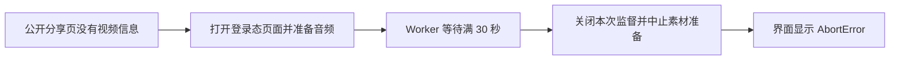

# T-1064 本机作品升级 AbortError 只读诊断

用户2026-10-06要求查看本机日志，解释截图中王温特“做数字人，你到底要不要花钱”作品卡片AbortError。范围为真实日志、安装版本与源码调用链核对；不重发升级/提取/模型任务，不改真实数据、激活或安装版，不将流水线取消检查误套到业务运行时。

## 已核实的证据

- 安装版 `/Applications/CreatorOS.app/Contents/Info.plist` 的产品版本和构建版本均为 `1.2.0`；CLI 已连接该安装版，完整访问已开启。
- 只读解密本机 `sidecar-2026-10-06.log.enc`：77 帧全部通过认证解密，没有截断。正式解密二进制在所检查的位置缺失；本次使用临时 Python 脚本，按仓库 `frontend/src-tauri/src/logging.rs` 的 X25519、HKDF-SHA256、AES-GCM 帧格式解密。私钥和明文日志均未写入仓库。
- 以下时间为北京时间，三轮日志均指向作品外部 ID `7693214050070596898`：

| 分享页回落登录态 | 素材准备失败 | 回落后的间隔 | 原执行任务 |
| --- | --- | --- | --- |
| 12:23:24.201 | 12:23:51.684 | 27.483 秒 | `execution-task-db19e969-419` |
| 12:24:44.707 | 12:25:12.901 | 28.194 秒 | `execution-task-db19e969-419` |
| 12:29:14.071 | 12:29:41.404 | 27.333 秒 | `execution-task-db19e969-580` |

分享页均报 `parseDouyinVideoUrl: 无法从 _ROUTER_DATA 中解析视频信息(item_list 为空)`；随后失败端口均为 `prepareTranscribeItem`，日志类别 `Error`、稳定码 `HOST_PORT_REJECTED`。该日志没有保留原始异常名称或栈，不能把它直接当作原始 AbortError 的完整证据。

## 安装版中的明确缺陷

读取正在运行的安装版资源 `runtime/1.2.0/sidecar/frontend/runtime/intelligence-transcript-worker.cjs`，发现宿主端口调用只有 `executeAgenticTool`、`acquireTranscribeProfile`、`acquireTranscribeChannel` 使用任务截止时间；`prepareTranscribeItem` 使用固定 30,000 毫秒等待，超时抛 `HOST_PORT_TIMEOUT`。源码对应 `ai-worker/src/execution/worker-runtime.ts`。

素材准备端口实际包含读取抖音视频来源、打开登录态浏览器、抽音及保存音频。`backend/src/modules/intelligence/intelligence-transcript-bridge.ts` 的监督关闭回调会 `controller.abort()`，中止仍在进行的素材准备；原素材错误保存在 `preparationError`，未进入模型时向外抛回。`transcript-runner.ts` 最终只保存异常的 `name` 作为错误提示，因此可能向卡片暴露裸 `AbortError`。安装版服务 chunk 也核对到该关闭及错误回抛逻辑。

## 隔离验证与判断边界

从实际安装版提取未经改写的 `createExecutionWorker` 函数，在临时 Node VM 中模拟宿主素材准备需 31 秒完成，心跳正常，任务总截止时间为 `null`。结果：30,003 毫秒抛 `HOST_PORT_TIMEOUT`，Worker 以 `failed` 结束。没有连接产品、启动浏览器、抽音、调用模型或重发真实任务。这证明安装版固定 30 秒上限可以误伤合法素材准备；不代替这条真实任务的完整事件轨迹。

**当前判断：现有日志的重复耗时、失败端口与安装版缺陷高度一致，最可能是素材准备的固定 30 秒宿主等待触发清理，继而显示 AbortError。** 分享页空列表只是触发回退的前因，不能据此断言作品已删除、用户登录失效或抖音风控。

2026-10-06 用户确认在“月明水清深”操作。随后通过公共 `intelligence.items.list` 和 `execution.tasks.list`，每条调用显式绑定 `acct-ae1a8346-9`，完成真实关联：截图标题、作者、发布时间、赞评论数均对应 `intelligence-item-db19e969-156`，其 `externalId` 为 `7693214050070596898`；两个失败任务的 `ownerId` 都指向该作品，状态 `failed`、错误码 `TRANSCRIBE_FAILED`、错误提示都为 `AbortError`。最新任务创建于 `2026-10-06T04:29:10.391Z`，更新终态于 `04:29:41.435Z`，总计 **31.044 秒**。公共查询亦显示作品长 374 秒。

初次无账号查询确实返回 HTTP_428；绑定账号后 `execution.tasks.get` 又返回 OwnershipError/ai.getTask not found，未绕过接口，改用已描述的公开列表接口获取原执行记录。两次失败读取未被算作验证成功。

账号、作品、原任务、时间、异常名、安装版源码及隔离复现现已形成一致证据链：**本次故障归因于耗时素材准备被 Worker 普通宿主端口固定30秒等待误伤，清理中止后暴露 AbortError。** 日志没有原始栈，不能声称捕获到了真实任务内部的 HOST_PORT_TIMEOUT 消息；该中间机制依据安装版代码及隔离复现确认，原任务耗时与之吻合。

修复应让这类耗时素材准备使用原任务允许的等待预算，同时保留用户取消和执行归属检查，并将真实失败原因转换为可理解的提示。本次未改运行代码、安装版或用户数据，也未声明问题已修复。只读诊断已完成，全系统超时盘点由用户新请求 T-1065 承接；T-1063 的远端推送/构建授权不受本次日志请求影响。
