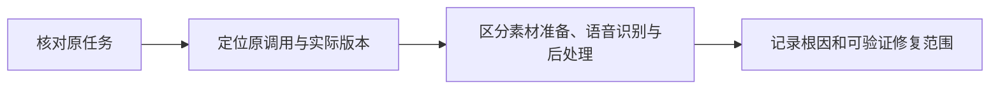
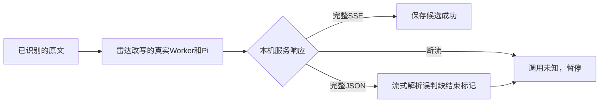

# T-1068 内容雷达转录结果未知诊断

用户2026-10-07反馈「执行结果尚未确认，请先核对原调用，不要重复生成」「服务尚未返回完整结果，任务已暂停，已完成内容保留」，错误码 MODEL_RESULT_UNKNOWN，要求判断高频转录失败能否根治。

用户随后明确「不要考虑哪个账号，复现问题即可」。据此解除真实账号选择前置，本轮改为隔离复现：内存数据库、虚构作品与已识别原文、localhost HTTP协议/断流服务、实际Worker及Pi模型调用链。证明可重复触发的机制，不把隔离故障冒充用户原任务根因。不修改生产行为、真实数据库或安装版。

本轮先核对原调用、安装版、公共任务状态及源码调用链；不重复生成、不重试模型、不改真实任务或用户数据。服务结果未知不能改写为成功或确定失败。确定根因后记录修复范围与验证条件，行为/契约变化另按项目评审流程执行。

诊断验收：保留真实查询结果与证据边界，区分音频识别、转录后处理和状态恢复；说明已核实、待验证与根治所需条件。

## 2026-10-07 本轮已核实

- Skill与项目流程版本均为3.27.4，无版本升级；context-plan路由为4-build，本轮仅诊断。research-gate audit实际通过，无未关闭研究门。
- 当前安装版产品版本1.2.0，公共CLI `--version/help/status/access status` 成功，installed连接及full访问正常；可见两个有效抖音账号「月明水清深」「第三空间」。尚未获本次账号/作品或原taskId，未按默认账号或最新任务猜选。
- 用户第一句在 `frontend/src/features/intelligence/topic-task-state.ts` 的 `topicTaskAttention` 中，消费者为文案生成卡片与 `use-topic-preview`；第二句在 `execution-worker-outcome.service.ts` 中，是通用unknown_result提示。二者不足以证明音频识别本身失败。
- 当前源码及安装运行目录的 `intelligence-transcript-worker.cjs` 均执行单资源ASR；安装文件没有MODEL_RESULT_UNKNOWN、逐字稿校正或Pi文本模型代码。通用 `execution-worker.cjs` 则同时包含MODEL_RESULT_UNKNOWN和逐字稿后处理。因此应先区分transcribe、ai_task、topic_preview、radar_project_upgrade及各步骤，不能拿一个错误码统一归因。
- `generationFailure` 只在没有输出且异常有明确HTTP 4xx/5xx或AI_CREDIT_EXHAUSTED时按拒绝分类，其他异常收口为MODEL_RESULT_UNKNOWN。此码表达结果不确定，不能据此推断额度、密钥、平台风控或超时。
- 通用转录工作流先ASR，再AI校正，最后保存产物；AI校正unknown_result会向任务层传播、暂停整条工作流。ASR已有回执的情况下，仍可能未完成最终产物保存。这是源码证实的故障影响路径，本次原任务是否命中尚未证明；直接雷达ASR不走该后处理路径。
- 使用临时Python按仓库日志加密格式只读解密本机最新三份日志：sidecar-2026-10-06-8/06-9/07，分别19/321/92帧，全部认证通过、无截断。未发现MODEL_RESULT_UNKNOWN、ai-model-stream或转录调用。07日志有node-cron错过调度警告；它不能证明本次模型暂停根因。开发者私钥与明文日志未进仓库。
- CodeGraph重新建立索引，并通过callers generationFailure核对模型调用装配；rg核对实际调用点。
- 实跑 `pnpm --filter @creatoros/ai-worker exec vitest run src/runtime/transcript-postprocess.test.ts src/execution/transcribe-postprocess-run.test.ts src/runtime/pi-provider-diagnostic.test.ts`：3文件、21测试通过。测试证明现有控制/回执行为，不代表真实供应商或安装版故障已修复。

## 根治判断与待证据

可修复的是本产品的错误归因、执行预算、原结果回读及可选后处理对可用结果的阻断；无法凭此错误码承诺外部服务永不断流。可验证的修复应做到：先保存/回读已经确认的原文；可选校正失败不丢失可用原文；未知调用继续保持真实未知及计费对账，不重新发起同一付费调用；对原任务按阶段和供应商状态记录脱敏诊断。若原任务实际是文案生成，则先修其原始模型调用和恢复路径，不能把语音识别回退当作解决方案。

尚缺本次明确账号与作品标题或原taskId，无法读取原执行并计算转录失败率、确定原调用是否还运行、已保存何种结果及失败原因。已通过对话询问，未重发生成、未恢复/改写真实任务、未覆盖安装版。本轮没有代码修复，也不标记根因已确认或问题已根治。

上段为首次诊断的历史证据边界。用户随后取消本轮原任务归因前置，以下按新授权完成隔离复现，不再因账号阻塞。

## 隔离复现结论

已通过实际源码链复现完全相同的 `MODEL_RESULT_UNKNOWN` 和「服务尚未返回完整结果，任务已暂停，已完成内容保留」。账号使用合成fixture；数据库为无dataDir的内存PGlite；模型使用实际Pi及SDK，只访问127.0.0.1上的HTTP故障服务。没有模拟或mock模型异常，也没有外部付费调用。

实际链路：`createExecutionWorker → generateIntelligenceInWorker(rewrite_only) → generateText → createDurableGenerationModel → modelFor/Pi → 本机HTTP → 后端ledger.settle → outcomes.recordFailure → tasks.get`。输入是合成已识别逐字稿和官方冻结Skill，不代表真实音频识别或用户原作品。

| 服务实际响应 | 请求次数 | 持久调用状态 | 持久任务状态 / 错误 |
| --- | --- | --- | --- |
| 正常SSE完整结束 | 1 | settled | succeeded，保存checkpoint和result |
| HTTP401明确拒绝 | 1 | rejected | waiting_user / auth_401 |
| HTTP429明确拒绝 | 1 | rejected | retry_wait / http_429 |
| HTTP503明确拒绝 | 1 | rejected | retry_wait / http_503 |
| 接收请求后连接断开 | 1 | unknown | unknown_result / MODEL_RESULT_UNKNOWN |
| HTTP200输出部分文字后断开 | 1 | unknown | unknown_result / MODEL_RESULT_UNKNOWN |
| HTTP200返回完整非流式Chat Completion JSON | 1 | unknown | unknown_result / MODEL_RESULT_UNKNOWN |

最后一项是确定可复现的协议兼容缺陷：服务已返回完整正文及 `finish_reason=stop`，客户端按SSE读取，诊断变成 `Stream ended without finish_reason`，丢失完整结果并把调用记录为unknown。它与前两项真正断流最终呈现同一码。所有unknown场景均核对同一任务无法被重新claim，HTTP请求次数仍为1，没有盲重发。待修复任务T-1069已登记。

另一个独立前置缺陷：实际 `runTranscriptPostprocessRuntime` 在自定义端点的text兼容模式下，裸 `jsonSchema` 未提供validator，返回 `applied:false`、完整原文及「结构化节点缺少 schema validator」，实际HTTP请求数为0。通用转录Worker丢弃这个返回值，继续请求保存端。保存端的生产源码要求可回放回执；没有任何模型调用时 `terminal` 返回null，`save` 抛错。隔离宿主按此保存前置规则拒绝，实际Worker与后端终态服务保存 `TRANSCRIPT_POSTPROCESS_RECEIPT_UNKNOWN`，原文仍没有最终artifact。此项默认节点与Worker/终态链为实际执行，作品/ASR回执及保存业务端口为受控fixture，不能冒充完整真实业务端口或安装版E2E。T-1070已登记，修复验收须补实际业务端口往返。直接雷达ASR不经过此后处理，不能混称同一故障。

## 复现与检查

- 复现源：`backend/src/modules/execution/radar-model-result-unknown.repro.test.ts`；保留正常响应、明确拒绝和真实断流对照，不修改生产逻辑。
- 命令：`T1068_REPRO_EVIDENCE="$PWD/docs/verification/t1068/reproduction-evidence.json" pnpm --dir backend exec vitest run src/modules/execution/radar-model-result-unknown.repro.test.ts --retry=0`。
- 最终执行8/8通过，Worker原期限120秒，独立外层测试180秒覆盖启动及清理余量，内存库初始化120秒，无测试自动重跑；证据见[t1068/reproduction-evidence.json](t1068/reproduction-evidence.json)与[t1068/reproduction.log](t1068/reproduction.log)。通过表示上述故障机制被重复观察并断言，不代表生产缺陷已经修复。
- 首次搭建复现时曾因fixture保存前置及Skill输入协议不全导致失败；已修正fixture，未将这些调试失败包装为修复生产代码的TDD红测。
- backend全局类型检查仍12项既有错误，最终没有本次复现文件报错；根因已有T-1018。boundary仍为基线5条加live-chat-session的2条既有SDK违规，已有T-1018/LED-003，不更新基线绕过。
- 收尾按要求运行 `pmem sync` 与完整 `reconcile`，实际仍为34错误/1告警，与前轮一致：历史评审回执、既有LED及边界等，已有T-916/T-1015/T-1018；日志见[t1068/reconcile.log](t1068/reconcile.log)。当前生产源码未变，不把隔离测试通过写成全局全绿。

本轮按用户「复现即可」完成源码机制复现；原用户任务的具体根因和真实失败率未测，安装版和真实数据未改。两项修复留在看板等待SPEC及独立评审，不自动重提未知模型调用，也不宣称已根治。
