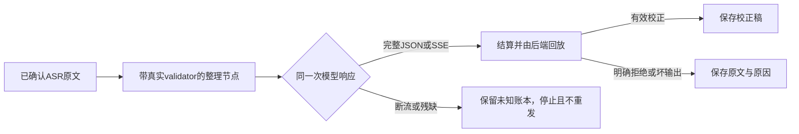

# T-1069/T-1070 修复与验收

2026-10-07，用户在隔离复现后要求修复根治。本轮修复的是已重复实证的代码缺陷；原用户作品故障率、外部供应商及安装版未假称验收。用户已取消账号前置，所有数据为合成，模型服务仅localhost。

## 已落实的结果

1. Pi同版本补丁只把本次HTTP的完整Chat Completion JSON转为原chunk消费者可读的格式；正文、reasoning、function工具及参数、responseId、finish_reason、真实usage保持，不重发请求。标准SSE和明确HTTP拒绝继续原路径。残缺JSON、缺结束事实、非法工具或已消费计数保持未知；原来支持的end结束码保持兼容，未消费usage扩展不反杀正文，缺用量不编造计量。
2. 逐字稿共享jsonSchema保留原wire schema与冻结模板摘要，增加严格Zod validator。Worker和后端无网络回放使用同一节点；后端依据原ASR、冻结请求与真实账本决定校正或原文降级，没有新增信任Worker正文的端口。生产后端保存守卫无需改动。
3. 实际业务端口跑过prepare/reserve/start/settle/save/read和恢复，覆盖正常SSE、完整JSON、明确拒绝、坏格式、保真失败、缺模型、预算不足，以及断流/取消/deadline/旧fence/伪造请求。后处理未知仍不能保存或重发，已确认ASR回执保留。
4. 正式build产物execution-worker.cjs已经经真实子进程IPC调用上述service，保存逐字稿artifact并从业务读口取回全文、完成原任务。source/SSE与bundle/JSON均有实跑。媒体与ASR输入为合成，不冒充真实平台取流或付费ASR。

## 当场证据与边界

- SPEC独立首轮审查：T-1069 REV:020bbb5c97fa；T-1070 REV:5b690995d15b。全新上下文同模型homogeneous如实记录，未冒称cross-model。DEC-T1069-1070保存既有授权和契约选择，用户无须再确认同一范围。
- RED：协议6失败/8通过；真实后处理9失败/1通过，故障为完整JSON误报未知及schema validator缺失。日志red.log和../t1070/red.log。
- 初次补齐validator后真实后处理9通过，JSON仍1失败；最终补丁到位后协议19项通过的扩展回归见worker-regression-final.log（其他41通过，另1既有回放断言失败）。
- 原T-1068链回归8/8通过：完整JSON如今settled/succeeded并保存checkpoint/result；真正断流仍unknown_result。结果JSON见worker-regression-evidence.json。原复现SSE没有usage只可证明单调用；本轮多作品用例补真实合成usage回执，避免真实账本因未知计量阻止后续调用，未放宽生产守卫。
- 后端相关4文件53通过（其中新集成12项）；新增正式bundle/source公共旅程2项通过（1项为上述source重复，不累加成新用例），见../t1070/backend-regression.log、bundle-journey.log。最终LED-054自包含构建与回归命令实际通过：协议19、原复现8、后端集成13，共40项，见guard-final.log。
- 补丁持久化与交付：pnpm patchedDependencies同版本，锁文件仅6个补丁hash位置改变；无无关eslint peer变动。offline frozen install实际成功，干净Pi包重新应用完整补丁后四个消费者文件与当前依赖逐字节一致，当前SHA绑定patch-verification.json；build-final.log通过。不是只修改node_modules。
- ai-worker与contract类型检查通过；backend仍12项既有错误，无本轮新文件错误。boundary仍基线5加live-chat-session的2项既有SDK违规，不更新baseline；orphan 0错误/100告警；超时门0失败。
- generation-replay.test.ts原旧断言期望1个坏输出即failed，真实默认节点有格式修复预算，得到next-request。当前与HEAD归档基线均9/10通过，原node/replay源码与测试未改；实际后处理用完原修复预算后保存原文的公共链已通过。根因保留T-1018，不改不相关断言或把全局检查写成全绿。
- 独立只读实现审查及增量复核无新问题，实跑初版34项通过；bundle和usage/end收口同范围。早期补丁验证摘要已被最新干净应用证据替换，历史中间失败日志保留。

## Gate结果

13-tdd：通过，当场RED→GREEN；14-integration：源码实际业务service与正式构建IPC的artifact写后读回通过。12/15b：现有端口形状/权限/数据归属不变，contract类型通过。frontend/UI gate不适用（无界面改动），看板UI验收列按taskctl契约记为—，业务验收证据留在本报告。boundary全局既有失败保留T-1018；orphan通过并保留既有告警。LED-054进入项目防复发门。完整reconcile已执行，LED-054通过，全局仍34错误/1告警。与T-1068日志逐项比较：新增错误0、消失错误0；根因仍归T-916/T-1015/T-1018，不把历史评审回执、边界、LED欠债伪称本轮全绿。其后防复发命令加入显式Worker构建，当前配置的完整命令再次实际执行，40项通过；本轮两个任务验收范围均已满足。

收尾的progress推进首次被复杂度门阻止：过宽runtime写集合误含未改的工具链文件，报告IPC与锁文件已有runtime标记尚未按任务绑定。已把写集合收窄到实际文件，并按DEC-T1069-1070登记复用既有Worker/锁文件的准确hash；没有新增runtime或IPC机制，没有关闭门。

源码修复与本地构建生效；本轮没有覆盖已安装1.2.0运行目录，没有恢复/改写未知真实任务，没有push或发布。
