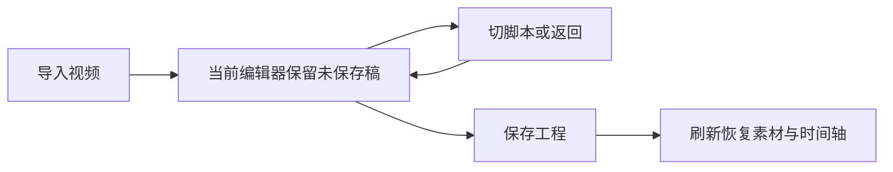

# T-1069 当前真实验收记录

2026-10-07，本地整合工作树 `codex/t1062-integrated-client`，基点5f6ab1bb；当前源码尚未冻结成安装候选。隔离PGlite、登录态和中性媒体运行，没有修改用户原始素材、激活或当前安装客户端。

## Tab 丢稿根因与修复

实际公共旅程先成功导入两个视频并加入时间轴，切脚本/浏览器返回后原 native root `isConnected=false`，真实产品RED保存在私有验收根 `t1069-tests/media-tab-layout-red` 和 `media-tab-public-name-edit.log`。不是素材物理删除。AppShell 的 contentFill 分支改变外层 React 树，导致活会话卸载。

用户紧邻具体两文件及单个新评审周期问题回复“继续”，DEC-106901消费一次，完整独评后正式cycle2 round1 PASS[REV:19bad8ef6f93]。原113路径保留，新增AppShell及其回归共115；不借用父任务扩范围。实际 ScrollArea 双向切模式回归2RED→2GREEN；固定树、只改变外层直接 viewport/wrapper/scrollbar CSS，不修改共享 ScrollArea。实现静态独评通过，公共/安装证据分别记录。

实际公共浏览器 `t1069-media-tab-session.spec.ts`：两个本地视频导入、第一段加入时间轴、工程名本地修改、切脚本隐藏/返回原DOM、正式revision未自动改变、保存revision1、刷新后完整服务端工程深等和两个媒体卡保持。1通过，测试19.0秒/整次47.0秒，日志 `t1069-tests/media-tab-stable-shell-current.log`。截图已实际查看并保存 `t1069-tests/media-tab-stable-shell-green`。不是安装版验收。

中性H264/AAC原视频SHA e6c0f4e72741e8f37b369d9511311569df8ef6c4e07009f3c746c632fb0e2073，每文件232847字节、14.924854秒。同一批两份从选择文件到卡片可操作分别2521/2739毫秒；相同内容按现原资产去重合同共用exact file、mediaId保留各实例。未做旧版同机器对照及大视频测量，不据此声称加速倍数。

## 素材选择器

实际公共140张真实解码的中性PNG、24条分页/全库搜索/后页目标/另一组空结果、模板本人照片精确选择、重新打开改候选后取消保持原选择：实际浏览器通过。1366与1024截图由root查看及独立oil-ui-pro视觉评审，无必修视觉问题。9项共享picker/preview/hook及2项session registry回归已通过；后续完整23文件发现的旧mock夹具已改为当前实际workspace port，原行为断言保留，涉及4文件24项全部通过。

追加CSS zoom=2截图虽然测试的按钮toBeVisible通过，实际root看图发现弹窗被裁切：不能将该测试通过写成200%视觉通过。此证据为CSS zoom，不是浏览器原生缩放；真实200%及全部13入口逐个任务走查仍待验。

## 其他验证与诚实限制

绑定公开组合5项、真实native绑定stage10项、后端组事务/取消/授权、worker signal停止和组UI回归已通过。fixture浏览器驱动不代签实际用户扫码。新入口包含小红书/快手已装配阶段，用户扫码仍待完成。

native 19生命周期控制、16资源和42DOM探针，实际类型与构建已通过；原归档705成员、完整patch零fuzz重建对照均通过。当前两个公开patch别名已同步。真实浏览器MP4导出与完整解码正在验证，不预签PASS。

frontend标准tsc因并发开发写入留下损坏.next/dev/types失败；完整原文件保存在私有 `t1069-tests/corrupted-next-dev-types`，用官方next typegen重新生成后标准tsc实际exit0。没有修改tsconfig/过滤业务源。

全局boundary既有copilot AI SDK两项与semantic video-decisions-runner既有红仍保留；MAIN缺少tools/timeout-policy/verify.mjs，实际MODULE_NOT_FOUND保留，不能借另一checkout命令代签。完整reconcile、安装候选、真实客户端逐功能、MP4完整解码和大视频分段性能仍待完成。

当前 AppShell/source session 与 LED-047 合并公共回归：11文件170项通过，日志 `t1069-tests/led047-and-shell-current.log`，保留默认超时政策和原行为断言。

实际公共视频旅程增加同一工程刷新后的真实浏览器 MP4 导出与服务端revision递增，1通过47.5秒/全次1.2分钟，日志 `media-tab-export-current.log`。输出322649字节，H264 1920×1080视频14.9秒、AAC音频15.000091秒；ffmpeg全文件解码实际exit0，volumedetect非静音。成片保存在私有 `t1069-tests/media-tab-export-green`。不是原生安装版验收、用户内容或全功能PASS。

窄屏复核使用683×450有效CSS视口（1366×900在200%缩放时的reflow尺寸），实际弹窗与确认按钮四边均位于视口内，截图已经root查看；仍不冒充浏览器原生200%缩放。第一次立即读boundingBox失败是resize尚未提交布局，保留原失败；改为等待原同一边界条件稳定（没有放宽条件）后公共140图库/模板确认取消旅程1通过26.2秒/全次51.1秒，日志 `picker-reflow-settled-current.log`。没有因此修改产品CSS。CSS zoom=2的旧裁切仅是错误缩放模拟证据，不能与有效reflow或原生缩放混为一谈。

提交前完整git diff --check实际返回2：统一patch上下文空白以及Vite生成native.js中已有模板字面空白被标记；手写产品/测试/控制文档路径检查0。生成bundle保持与实际构建字节精确相同，patch保持零fuzz重建，不通过删字符串内空白制造绿色。此差异记录保留，不代签完整diff检查通过。

公共模板选择追加键盘Enter打开、Esc关闭、取消与Esc后焦点返回原字段、原精确值保持；实际1通过26.2秒/全次52.7秒，日志picker-keyboard-reflow-current.log。
