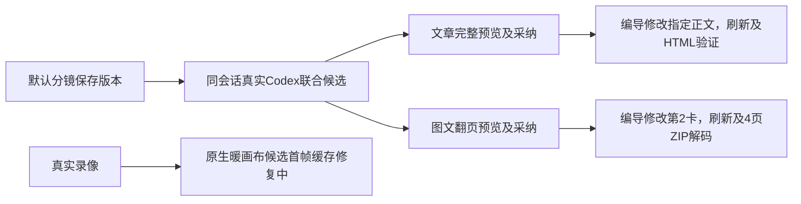

# T-1070 当前实际验收

用户明确：脚本一键生成文章和图文，不自动生成视频初稿；三类作品经同一个右侧编导持续精调。当前已真实完成默认分镜联合生成、文章与图文单字段精调及原生导出；视频暖画布首帧问题已通过一次原事件研究查到GPU纹理缓存，修复和最终真机包仍在继续。原失败不覆盖、不以fixture替真模型，不据此关闭整个任务。

| 实际链/检查 | 本轮结果 | 证据 |
| --- | --- | --- |
| 默认分镜严格保存及同会话后续Codex联合生成 | 原script artifactversion-57da6418-28精确公开读回；唯一模型POST source71/execution7eef成功，两候选完整预览、分别CAS、刷新恢复；5章/5卡完整typed候选与两原owner当前正文深等 | default-structured-history-real-chain.json；BASE/real-ui-creation-structured-history-fixed-result.json |
| 文章指定段落自然语言精调 | 唯一POST source146/af530350，v232→v244；preview前后owner未写，UI采纳后当前textarea与exact/current/刷新全文一致；实际HTML7865B原生浏览器解码正文/标题/小标题一致 | text-refinement-acceptance.json，原85件证据hash清单 |
| 图文第2卡自然语言精调 | 唯一POST source309/06f208ab，v286→v318；仅指定body变化，卡片ID与其它字段保真；宽屏4页预览、UI采纳/刷新全文一致；实际ZIP4张1242×1658 PNG解码并逐页看图 | text-refinement-acceptance.json |
| Codex原工具历史适配 | 当场SDK真实两回合RED2FAIL6PASS；最终三suite28PASS、workerbuild/types0；完整字段保序标历史、错角色/空ID/直接多媒体/未知仍拒绝，动态权限及原预算不变 | codex-history-implementation-closure.json |
| 候选恢复与素材mtime | provider刷新target=null时已加载真实output定位，错误owner不进入；原生mount UUID防counter重置碰撞，真实owner/全部前值守门；原UNKNOWN采纳重用旧body/key，不被旧revision反杀；原File mtime从saved descriptor恢复，bytes/name/type保真，未豁免mtime | root-recovered-editor-red.log / root-recovered-native-red.log / root-recovered-media-mtime-red.log → root-recovered-media-mtime-green.log（38PASS） |
| 真实滚动/弹窗/200% | 独立1366×900与1280×720滚动/正文及整卡/键盘Esc与focus通过；私有Chrome真实tabs.setZoom(2)，683×512且DPR2，send可达、无横溢，不用CSS缩放代签 | current-visual-host-closure.json；BASE/t1070-ui/actual-zoom-after-preview-result.json |
| 本任务完整frontend要求 | 30files201PASS，类型exit0 | root-final-required-front.log / root-final-front-types.log |
| LED-047交互回归 | 8files162PASS | root-led047-current-final.log |
| backend必要公共组合fixture | 5files13PASS，不代签真供应商；真实供应商另外由上述页面链验证 | root-final-required-backend.log |
| contract新native/work DTO及旧production合同 | 实际三files11PASS | root-final-required-contract.log |
| 原生旧frame-cache race窄修及交付 | 前producer47tests313assertions、709源重建/双build及six families通过；实际同React warm首帧仍0，这项不代签视频整链 | native-browser-frame-closure-attempt3.json |

旧166进入waiting_user/unsupported，未admission且原期限已过；保原ID/失败，不清历史、不续期。修复后source71是明确的一次新测试，沿同一conversation已有工具历史，非自动重发未知付费任务。测试脚本的selector、选区、chatContext路径及跨HTML标签raw-text断言错误单独保旧FAIL后纠正，不改产品洗绿。

## 保留的全局欠债与待验

- boundary仍7违规（基线5及未改live-chat-session旧2 SDK），semantic旧video-decisions-runner缺material.match；orphan0error/100warning。旧2 backend Redfox断言、旧全局类型问题不在本精确99；不把本任务回归描述为全仓全绿。
- MAIN不存在tools/timeout-policy/verify.mjs，规定命令当场MODULE_NOT_FOUND；不使用另一checkout结果冒充MAIN通过，继续登记原T-1018全局欠债。
- 实际旧native新bundle暖首帧source0，期望source1秒/frame24；原工程revision4/6秒仍深等，未CAS，未启动新模型。root-cause.json原trace证明decoder实际1而GPU identity-only cache仍0；七精确archive成员内部timestamp版本传播独评GO，修复后必须再沿真实React原candidate97预览/首帧/CAS/Undo/保存切Tab/刷新/AV导出。已知AAC尾79–91ms为原encoderminor，完整decode与原声RMS均正常，不能把音频描述为精确5.000秒。
- 本地安装包及安装版验收仍待完成。当前App的未保存状态尚无新确认，本轮将使用已授权CREATOROS_LOCAL_SKIP_INSTALL=1固定入口先出包，不强制替换/关闭。

本文件是当前当场证据索引，不替代SPEC/BACKLOG/Gate或最终用户验收。
