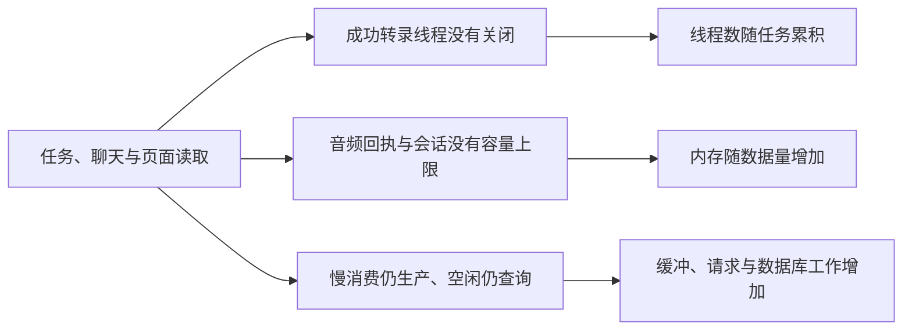

# T-1071 资源浪费与内存泄漏排查报告

## 结论

已复现 **8 项资源缺陷**。最值得先修的是：本地 Whisper 转录成功后遗留线程、宿主在任务结束前保留全部音频回执、聊天响应忽略消费速度，以及窗口保存所有访问过的聊天会话。

大白话：有些活儿已经干完，装着模型的线程却没有关；有些音频已经交给 Worker，宿主还一直留着副本；慢网时系统继续往缓冲里塞数据；页面也会为已经完成的任务反复查询。这些问题的机制和释放时机不同，不能全部混称为“永远释放不了的内存”。

本轮是诊断，**产品运行代码和安装版均未修改**。隔离脚本的 PASS 表示成功复现问题，不表示问题已修复。

## 基线和证据边界

- 排查日期：2026-10-07（北京时间）。源码起始 HEAD：`7e93ca3b4c122cb78293a3dee73a62879f2bd7a2`。文件摘要见 `source-anchors.json`。
- 技能与项目 vendored 版本均为 `product-to-code-orchestrator 3.27.4`。本任务范围只读产品源码与本机进程；诊断脚本使用合成数据、临时目录和自己的子进程/线程。
- 没有访问真实账号、数据库、音频或模型；没有重发真实任务，也没有下载本地模型。
- 前端验证用实际 hook/组件和 SDK，jsdom、合成 API、虚拟时间。后端 SSE/cron 验证将完整生产文件转译后执行，仅数据端口与调度器为合成桩。IPC 验证实际 supervisor 与隔离子进程。Whisper 验证实际 provider 与真实 `worker_threads`，替换模型推理为轻量回执桩。
- 未执行安装版长时间堆快照、真实 HTTP 慢网、真实大库压力、真实模型推理或 Windows 真机资源观测；不据此声称系统已经全面无泄漏。

## 已复现的缺陷

### F-01 本地转录成功后遗留 Whisper 线程

创建链：`ai-worker/src/execution/transcribe-worker-run.ts:18` 每个任务创建 registry → `transcribe-asr-registry.ts:8` 新建 Whisper adapter → `runtime/multimodal-whisper-local.ts:692` 新建 provider。dispatcher 在 `backend/src/modules/execution/model-worker-dispatcher.ts:378` 创建固定 supervisors，并在 `:465` 复用它们执行后续任务。

provider 正常成功会在 `multimodal-whisper-local.ts:653` 移除 abort 监听。任务最终 `worker-runtime.ts:292` 调用 abort 时，已经无法触发关闭；provider 只在取消在途推理时 `:650` terminate，没有正常关闭接口。因此它不是“整个任务结束后自然随进程回收”的单任务资源。

连续创建 3 个实际 provider，注入真实轻量线程，逐次成功再 abort：存活线程 **1 → 2 → 3**，自动 terminate 调用一直为 **0**。补核时 provider、pipeline、signal 均离开函数作用域，探针仅保存 Worker 的 WeakRef，跨事件循环执行两次 GC 后仍为 **1 → 2 → 3**，排除了探针强引用导致的保留。探针 finally 主动终止自己的全部线程，确认剩余 **0**。

证据：`worker/whisper-provider.ndjson`、`worker/whisper-verification-weakref.ndjson`、`worker/whisper-provider-probe.mjs`。这证明成功路径的线程生命周期缺口；真实模型重复驻留的容量尚未测量。建议把 registry/provider 放到整个执行 Worker 的可复用生命周期，或提供明确 close 并等待退出；不能破坏取消推理的停止屏障。

### F-02 宿主保留所有已完成 IPC 回复，音频在整个任务期间累计

`backend/src/modules/execution/worker-supervisor.ts:28` 的 replies Map 在 `:137` 保存每个完成的回复，只到 `clearRun()`（`:52`）才清空。真实 `readTranscribeAudio` 返回完整 bytes：`ai-worker/src/execution/transcribe-worker-run.ts:24` / `transcribe-asr-run.ts:21` → `model-worker-dispatcher.ts:192` → `execution-transcribe-audio.service.ts:37`。

实际 supervisor 接收 100 个合成音频回复，每个 512 KiB。经过 GC，25/50/75/100 条 Buffer 仍全部存活，累计 **12.5 / 25 / 37.5 / 50 MiB**；external 从 **3.39 MiB 增到 53.42 MiB**。两个独立运行一致。任务停止并 clearRun 后，Buffer 存活数回到 **0**，external 约 **3.42 MiB**。

证据：`worker/run1.ndjson`、`worker/run2.ndjson`。这是任务结束前缺少容量限制的历史回执保留；没有证明结束后还泄漏。心跳和流批次也使用此缓存，continuous 执行的积累窗口更长。建议有界回执缓存或小型持久引用，保留同请求 ID 幂等，不以清空全部在途回执解决。

### F-03 聊天 SSE 没有背压，缓冲随全部事件字节增长

公开链：`frontend/src/app/api/chat/route.ts:602` → `persistence-client.ts:5401` → `backend/src/modules/ai-runtime/chat-production-runtime.ts:21` → `execution-stream.service.ts:159`。`frontend/src/server/chat-execution-stream.ts:14` 的 start 持续 enqueue，不按消费者取走数据的速度等待；订阅有历史下一页时在 `execution-stream.service.ts:176` 立即续读。

不读取响应体时，500 / 1,000 / 2,000 个 32 KiB 合成事件仍全部被生产。ArrayBuffer 分别增加 **16,412,575 / 32,825,075 / 65,650,075 B**，约 **15.65 / 31.30 / 62.61 MiB**。取消并 GC 后全部回到同一基线 **23,663 B**。

证据：`backend-sse-500.json`、`backend-sse-1000.json`、`backend-sse-2000.json`。属于响应缓冲堆积，没有证明永久泄漏。生产聊天还有 48 次调用、1,000,000 tokens 和 600,000 ms 的上游预算；合成样本不代表某次真实聊天曾达到 62.61 MiB，也不表示业务无限生成。建议让流按 pull/背压分页读取并有独立字节策略；关闭订阅只释放连接，保持持久任务和历史结果。

### F-04 聊天窗口会话缓存没有淘汰，保留全部 scope 的消息和闭包

`frontend/src/features/copilot/live-chat-session.ts:14` 的模块 Map 在 `:33` 添加会话，没有 delete、容量上限或过期清理。key 为 owner + scope（`ai-copilot-content.tsx:793`）；`:1069` 还向会话保存 transport 和恢复回调。

创建 100 个不同项目 scope，各写入约 64 Ki 字符的完成消息，局部引用释放后回访：**100 份全部仍在，共 6,553,890 字符**。这是实际容器的无界保留证据，**没有物理 heap 的数值测量**。

跨页不断在途回复是已确认的产品目的。建议只淘汰已完成、无观察者的会话，设数量/字节上限，回访读服务端历史；保留 submitted/streaming/待授权会话和账号隔离，不能粗暴在切页时停止合法任务。

### F-05 审核报告慢请求叠加，同一稿面两个消费点放大

`frontend/src/features/draft-workbench/use-latest-script-review.ts:57` / `:64` 的定时器与焦点事件没有在途互斥。真实消费点是 `script-review-gate.tsx:147`、`:671`，同一项目各挂一份 hook。

32 秒虚拟时间、请求未返回时，实际两份 hook 共发起 **8 次读取，最大 8 个在途**；卸载后定时器停止，但仍有 8 个已发请求在途。卸载有 abandoned 防回写，不能把它误写成卸载后仍继续起定时器。`http-transport.ts:148` 当前未提供只读请求取消信号。

建议共享同项目读取并限制单在途，可见恢复只补一次；必要时把取消只读请求传到公共 transport，不能仅改 helper 后宣称公共链路恢复。

### F-06 升级队列空闲或全已完成仍反复读全部历史页

`frontend/src/features/intelligence/use-project-upgrade-queue.ts:53` / `:62` 每 3 秒从第一页扫历史；真实 `intelligence-workbench-api.ts:16` 未按在途状态过滤。

30 秒虚拟时间：空队列仍 **11 次请求**；250 条全 succeeded 历史，每次扫描 3 页，共 **33 次请求**。该 hook 已有 reading/disposed 防重叠和晚回写防护，问题是空闲重复工作。建议初次恢复完整历史，后续主要观察在途任务并在空闲时停止或降低频率，保留跨窗口任务发现和历史可见性。

### F-07 已成功整稿卡恢复历史后仍轮询，界面显示进行中

`frontend/src/features/copilot/chat-script-draft-card.tsx:151` 的观察循环只处理 awaiting_confirmation、failed、cancelled（`:222`），漏 succeeded。`contract/src/primitives.ts:100` 确认 succeeded 是真实状态，后端 confirm 也会写入该状态；不是非法夹具造成的假阳性。真实卡片消费者在 `ai-copilot-content.tsx:2533`。

重挂实际组件，API 每次返回 succeeded，6 分钟虚拟窗口内仍 **90 次查询**；界面 phase 仍 running，最后显示观察暂停。建议成功终态恢复为已完成并立即停观察，不改原任务 ID、不重新提交。thesis/publish-package 等同类卡存在静态相似分支，尚未逐个复现。

### F-08 自动化后台分钟调度没有在途限制

公开装配：`frontend/src/server/persistence-client.ts:5727` → `backend/src/application/scheduling/automation.ts:180` → `backend/src/modules/ai-runtime/automation-driver.ts:355`。cron 回调 fire-and-forget，慢 tick 期间仍起下一轮。

真实 start/tick 搭配合成 cron 和慢业务端口，人工触发 10 次分钟回调：**active = peak = 10**；释放后 active 回到 **0**。这是模拟回调，没有等待真实 10 分钟，也没有查询真实库。持久任务的幂等/租约并不阻止这些重复扫描、对账和查询。建议限制在途并合并唤醒，同时保持到期任务恢复和独立持久 Worker 执行。

## 静态风险，尚未实测为泄漏

| 路径 | 机制与边界 | 后续验证 |
| --- | --- | --- |
| `automation-driver.ts:355`；`persistence-client.ts:4155`、`:4915` | cron handle 丢弃、AI sweep timer 未进入持久层停止路径；进程退出会释放，仅 stop/dispose 未证明释放 | 重复 start/stop，验证停止后不继续扫描、DB 关闭后无回调，不能靠 unref 当清理 |
| `backend/src/modules/intelligence/source-sync-runner.ts:187` | 每 25 秒向未完成 heartbeat Promise 链追加回调，退出还等待整链 | 合成挂起 heartbeat 与取消，验证最多一个在途及结算/释放 |
| `backend/src/application/queries/group-workspace.ts:22`、`dashboard.ts:34` | 组总览重复读项目、输出与最多 10 万发布，筛选主要在内存 | 隔离大数据集测扫描次数、峰值和响应；保持全部历史与真实 0/空 |
| `backend/src/modules/production/material-export.ts:543`、`:555`、`:84` | 全部素材字节和最终 ZIP 同时驻留，concat 又分配整包 | 隔离大素材导出，测峰值和可流式化；属于峰值风险，不是已证实泄漏 |
| `backend/src/application/collection/self.ts:44`；`frontend/src/components/resources/asset-preview-url.ts:29` | 小缓存仅访问同 key 时过期替换，历史 key 没有全局容量清理 | 重复创建/删除账号与访问素材。素材缓存只存普通签名 URL 字符串，不是 objectURL 或视频字节 |
| `frontend/src/features/intelligence/intelligence-workbench.tsx:673` | 拖动窗口监听只在 pointerup 清理，拖动中卸载可能保留闭包 | 拖动中切页与丢失 pointerup 验证 |
| `backend/src/modules/execution/video-render/executor.ts:592` | 取消只杀 HyperFrames 根并等根退出，未在本路径证明 Chromium/FFmpeg 后代退出 | 隔离自建进程树测试；不能按进程名字扫杀其它用户进程 |
| `ai-worker/src/runtime/multimodal-whisper-local.ts:357` | PCM 全量积累、拼接和对齐可能多份复制；1 小时 16 kHz Float32 原始 PCM 约 219.7 MiB | 合成流和真实消费者峰值测量，不能把正常解码峰值叫泄漏 |
| `ai-worker/src/runtime/browser/shared-read-browser-session.ts:125` | retired 借用者到整个共享 context 结束才清理页面/popup监听，有迟到 popup 归属目的 | 长读与连续短读交错；缩减保留时不能破坏归属安全 |

## 已核对的正常保护和释放

- 当前自动化页面 `automations-island.tsx:1249` 的运行历史/步骤是请求完成后再定时，带 active 防切对象回写；`:1620` 的列表有 inFlight、隐藏暂停和恢复刷新。**T-979 文档描述的旧 setInterval 漏洞不能作为当前缺陷证据**。全 jobs 并发扫描仍是未测效率项。
- 页面读取缓存已限制 128 项、16 MiB、单项 2 MiB；知识搜索限制 64 个频率键、批量 8 条和一个后台批次，并有 stop。
- Worker pending 在回执/取消/超时/断连时删除；completed 与 executionHandles 均有 256 上限。不是所有 Map 都泄漏。
- 浏览器 context、启动中 context、研究读取存在显式跟踪与关闭；未据此保证所有浏览器状态组合都安全。
- 前端 blob 导出/预览有 revokeObjectURL，图表 observer 有 disconnect，桌面授权桥有异步退订防卸载晚到。未发现自建 AudioContext/MediaRecorder 路径，媒体解码器未做真机检查。
- 数据库正常 dispose 会 pool.end/client.close，recovery-wake 对 lane 去重并 abort/clearInterval。
- macOS 原生 sidecar 停止模块使用自身新建进程组测试，**12/12 通过**，覆盖根退出、后代停止、自然退出回收、析构、并发停止和身份不符拒绝信号。测试没有启动真实桌面；Windows Job Object 本轮只有源码核对。

## 本机资源采样

120 秒内采样 5 次，识别到 **15 个 creatoros-server 进程**，参数安全分类确认均为外部 Codex/ChatGPT 启动的 MCP 桥。总 RSS 从 **147.61 MiB 降至 146.27 MiB**，末四次约相同，CPU 显示 0.0%。未识别到正在运行的 CreatorOS 桌面主程序/Next sidecar，也没有把不明 WebKit 进程归给 CreatorOS。

证据：`process-samples.json`、`process-roles.json`。这两分钟不支持这些桥正在持续泄漏的结论；15 个连接进程的数量由外部客户端会话管理，不能仅凭名称判断是桌面重复启动。

## 验证与交付状态

- 前端隔离复现：4/4 通过，归档脚本改为仓库相对入口后再次验证 4/4；虚拟时间不冒充真机长观察。
- IPC：两次独立运行都证明 50 MiB 回执保留及 clearRun 后释放；Whisper 真实轻量线程明确由探针 finally 全部回收。
- SSE：三档合成样本、取消后释放；cron：10 次人工调度叠加及最终释放。原始输出保留，不以 RSS 不回落推断泄漏。
- 原生 sidecar：实际模块隔离测试 12/12。
- 公共产品代码无修改，因此没有修复后的 Red→Green、性能收益、安装版生效或正式发布结论。
- 项目收尾见 [收尾记录](closure.md)：完整 reconcile 仍为 34 错误、1 告警，与 T-1069 逐项一致，新增 0；既有全局失败保留 T-916/T-1015/T-1018 归属，不包装成全绿。本任务治理 preflight 通过。

修复建议已按根因登记到 BACKLOG 的 `T-1071-*` 后续任务。正式实现前补对应 SPEC 和必要独立评审；保持原任务幂等、跨页回复、账号隔离、两分钟执行下限、历史数据及安全降级能力。
