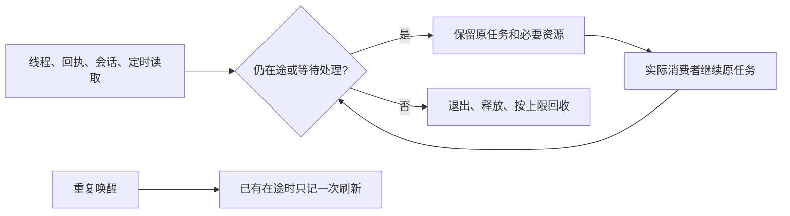

# T-1073 资源缺陷修复与验证

本轮修复 T-1071 实际复现的8个根因。8处修复源码已整合并本地提交，适用验证和最终全局对账已完成。本轮未安装、打包、推送或发布，未访问真实账号、用户数据库、媒体或模型；原诊断记录保留。

大白话：工作仍在进行或需要用户处理时保留必要资源；真正结束后关闭线程、释放用过的回执并回收闲置会话。页面与后台的同一项读取最多只跑一份。

| 根因 | 原缺陷证据 | 修复后的实际观测 |
| --- | --- | --- |
| Whisper 转录成功后线程未退出 | 连续成功后线程 1→2→3 | 实际转录入口连续3次成功、失败及取消，自己的真实轻量回执线程均退出；每次 closeCalls=1 |
| 宿主攒着已消费音频回执 | 100份512KiB音频保留50MiB | 新私有协议下，任务仍运行，串行及较早心跳挂起的逆序并发均保留0份已消费Buffer；8MiB单份合法音频完整传递 |
| 聊天响应提前读完整历史 | 2000×32KiB合成事件传输字节驻留62.61MiB | 无消费者产生0个事件、ArrayBuffer增量0；暂停只留当前有限页；真实本地HTTP恢复后512个64KiB事件不丢不重 |
| 完成会话与预览无界缓存 | 完成scope积累引用 | 100个完成scope后闲置数≤16、消息估算≤4MiB；挂载、在途、审批与结构化待处理状态受保护；预览≤256项且有到期回收 |
| 同项目两处稿面审核叠加读取 | 32秒慢窗口多份在途 | 实际双消费者、focus及慢请求共用一份；隐藏暂停，切scope/卸载不回写旧结果 |
| Radar 空闲反复扫描全部历史 | 30秒11次扫描/33次分页 | 250条历史首次完整读取，空闲停止高频扫描；可见时60秒内发现外部新增原任务，在途唤醒只补一次 |
| succeeded 任务卡重挂仍观察 | 6分钟反复90/90/180次 | 整稿、thesis及发布物料实际卡恢复成功态后只读一次，不新建任务 |
| 后台慢调度与心跳叠加、停止不完整 | 十次唤醒并行，心跳串出旧间隔队列 | 调度与心跳 peak=1，重复唤醒只合并一次；真实根dispose后cron关闭、timer=0，已发出的请求守原归属退出 |

私有回执协议双向协商 `consumed-v1`，用单调序列、水位和紧凑区间释放字节并拒绝旧请求重放。在途重复请求仍只 invoke 一次。未协商的旧宿主/Worker保留旧协议到原run结束；旧协议历史保留未冒称消失。没有新增音频上限、截断结果、删除历史、重发任务或续期deadline。

独立复核曾发现“无审批卡的 waiting_user 被错误当成闲置”缺口。主响应流沿现有 SDK message-metadata 通道传递真实 executionTaskId/status，先于 error/abort；会话保护按结构化状态及原任务身份判断。错误文字不参与判断，成功/失败/取消可以解除保护。运行中的暂时无事件页仍继续订阅，finish metadata由SDK深合并保留。

## 验证记录

各分区在修改生产代码前保留正确行为 RED，随后同用例 GREEN；原输出、合成资源计数与边界限制见 [Worker](worker/REPORT.md)、[前端](frontend/README.md)、[后台](backend/REPORT.md)、[响应流](stream/README.md)。有限执行预算保留两分钟下限，取消不需要等两分钟。实际数据库请求缺取消端口时，只能停止等待或在原请求返回后退出，未声称物理中断IO。

实际浏览器验证了三种成功卡、历史恢复/切组隔离、慢审核单在途、外部新增原任务及1024宽布局无横向溢出，见 [浏览器证据](browser/README.md)。浏览器用实际组件和合成HTTP回执；两次截图接口均超时，没有截图或像素验收PASS。正式安装版、真实模型容量、长期桌面RSS/堆快照未运行。

整合后的生命周期聚合回归301/301通过：私有契约7、Worker83、后端62、前端121、根服务/响应流28。该入口仅设置单测和hook各120秒预算，没有整套执行watchdog。前端、Worker、contract及后端生产源码类型检查退出0；后端全量含历史测试仍12条，与隔离基线逐行一致，见typecheck-backend-comparison.json。前端整合后的完整reconcile34错误/1告警，与T1071逐行相同，无新增，见reconcile-frontend-comparison.json；后台整合后完整对账也逐行相同，见reconcile-backend-comparison.json。新增LED-055后的最终完整对账仍为34错误/1告警，与修复前逐行一致，无新增或消失，见reconcile-final-comparison.json。全局exit1按原范围外根因保留，不能冒称全绿。全局既有34错误/1告警与后端12条历史测试类型错误归 T-916 / T-1015 / T-1018；不会以扩大基线或伪造全绿销账。原排查的导出峰值、大库总览、渲染后代及其它静态风险不属于这8处修复结论。

实际持久服务→SDK→缓存两项整合用例获独立复跑23/23通过。停止先返回真实cancel_requested并释放当前turn的本地关联，不写cancelled；最后由原worker/attempt的acknowledgeControl确认取消。旧停止回执不能中断新turn或新scope。

调用证据纠正：后台治理首个命令缺少write-set而exit2，第二个错误使用逗号拼接多个路径而未匹配文件，不能作为PASS。随后逐个重复--write-set核验真实9个声明路径退出0，原误调用日志与governance-invocation-correction.json保留。Worker完整对账曾误用concise模式丢失29条明细，保留缺失，不能从那份日志补拍精确比较；之后前端完整输出另作当场逐行比较。

生命周期入口首轮实际301项通过，但内存测试会按旧设计覆写分区观测JSON。新观测另存主目录ipc-memory-integrated-serial/parallel-observation.json，候选原字节按HEAD还原；聚合入口在backend组前快照，finally将本次实际观测打印到门日志并恢复历史文件。测试失败仍令最终exit1，没有修改断言或生产代码；改过入口后重新执行完整301项，结果以led055-preserved-final.log为准。

本地源码整合提交：Worker `8590fa5a9a6a6a3d7a840c0d77fac3785564cc1d`、前端 `9c7be793fbd3e323bdaf41a0460e6397c87d6db0`、后台 `a3d9db286a52b825c77eec29abb55e7618d23b84`、持久响应流 `f7f80bb0fdb11c8a232f1c52df89a85f83da1143`。三个最终候选在共同基线上隔离校验后逐个整合，candidate-validation.json记录路径与身份，控制文件由主线程维护。

实际主环境门：timeout-final.log退出0，覆盖静态/实际SDK、公共Worker、持久入队/claim、原任务观察和CLI预算；LED-047/049在前端及后台完整reconcile中均guard holds。boundary-final.log仍7条对5条旧基线，新增标记是修复前就存在的live-chat-session两处SDK导入，与T1071完全相同，未扩基线；orphan-final.log退出0但保留100个历史警告，不写成无警告。

最终收尾：先实际pmem sync，再完整reconcile。LED-055/047/049/053全部guard holds；本轮适用门与源代码验证已完成，34项全局失败继续由T-916/T-1015/T-1018承接。自己的三个受管工作树已确认归档，浏览器仅结束本轮TaskSpace4（keep=[]），不关闭用户其它页面。其它会话T-1072及既有lesson telemetry未并入本提交。
