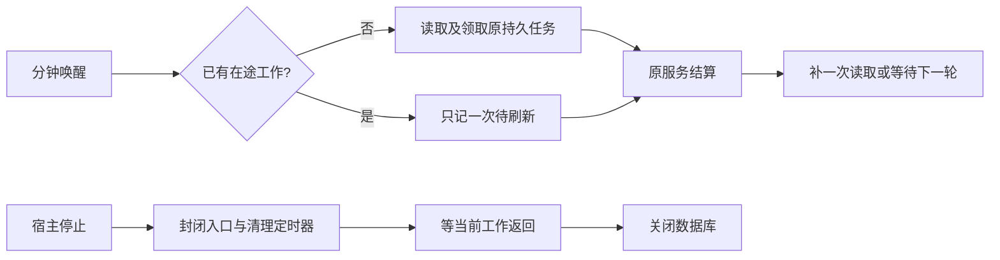

# T-1073 后台调度修复证据

2026-10-08。本候选只覆盖 FR-008 / T-1071-scheduler。基线 `e56cd2735774762908d59022aad265554849972a`，隔离分支 `codex/t1073-backend`；没有修改主树、任务控制面、真实账号、媒体或安装版，没有推送。

慢调度现在只占一个在途槽；其间的重复唤醒只记一次刷新，当前任务结束后再补一次。宿主停止先封闭入口、停止 cron 和周期清扫，再等待已经发出的工作返回，最后关闭数据库。已经排队的持久任务继续使用原 ID、attempt 和 lease/fence，完成与失败结果仍由原服务结算。



## 当场 RED 与同测 GREEN

- `tdd-red-backend.log`：新增正确行为用例失败 5 项；调度慢窗口仍重叠，没有可停止句柄；单个心跳挂起跨 10 个间隔后释放，旧实现补发 10 次；父取消被挂起心跳卡住。原有 27 项通过。
- `tdd-red-lifecycle.log`：首轮根装配用例的清理重复 close 掩盖了断言，保留原记录，不用它证明产品缺陷。
- `tdd-red-lifecycle-cleanup-corrected.log`：修正夹具清理后，在根装配尚未接入停止句柄时，真实 dispose 的 cron stop 次数为 0，正确行为断言失败。
- `tdd-green-backend-first.log`：首次实现仍有“微任务启动前的合并唤醒被清空”的缺陷；同一用例识别，已修正。该记录不是 PASS。
- `tdd-green-backend-final.log`：后台 3 文件 39 项通过。
- `tdd-green-lifecycle-final.log`：真实持久根装配、既有 browser disposer 与聊天事件协议回归，共 3 文件 7 项通过。

核心命令（在对应 package 目录运行）：

```bash
pnpm exec vitest run src/modules/ai-runtime/automation-driver.test.ts src/modules/intelligence/source-sync-runner.test.ts src/application/scheduling/automation.test.ts --testTimeout 120000 --hookTimeout 120000
pnpm exec vitest run src/server/persistence-client.lifecycle.test.ts src/server/browser-host-dispose.test.ts src/server/chat-execution-stream.test.ts --testTimeout 120000 --hookTimeout 120000 --retry 0
```

## 实际公共消费者与观测

| 消费链 | 当场数据 | 夹具与限制 |
| --- | --- | --- |
| `startAutomationDriver` → 真实 `runAutomationDriverTick` | 10 次唤醒，慢读取 active=1、peak=1；完成后总读取 3 次，含启动、慢读取、一次合并刷新 | cron 端口保存真实回调并人工触发；业务慢端口为受控 Promise。未等待真实 10 个分钟 |
| 同一 driver → 真实 `createPersistentTaskService` | 2 份原排队任务都成功；handler peak=1；原 ID 保留、attempt 均为 1、leaseOwner 清空 | 全新内存 PGlite；合成调度作业，不调用真实平台 |
| `runIntelligenceSourceTask` → 真实任务/情报 service | 心跳挂起跨 250,000 ms 虚拟间隔，成功、取消、心跳失败均 calls=1、peak=1、释放后 pending=0；取消保持 cancelled；失败禁止迟到写入，恢复沿原 ID 成功到 attempt=2 | 心跳等待由合成服务端口门闩控制，随后调用真实租约校验。该用例冻结 service 的逻辑时间以隔离队列问题；既有动态时间 95 秒续租、取消/暂停/失租、原 run 恢复用例也通过 |
| `getIdentityService` → 真实 persistence 根装配 → 全局 dispose → 真实 scheduling 装配/driver 与 DB dispose | 停止前 sweep=2，停止后人工触发 10 次及推进 5 小时虚拟时钟仍 sweep=2；cron stop=1、destroy=1，timer=0 | 内存 PGlite；浏览器目录指向全新临时目录；Worker 路径显式不可用；cron 为合成调度端口。没有启动浏览器或模型 |

这些值取自测试直接写出的 JSON witness，原始行与聚焦结果均保存在日志；保存时只规整末尾空白，汇总见 `evidence.json`。不把本轮说成安装版真机验收或长期 RSS/堆快照验证。

心跳跳过旧间隔，不保留 Promise 链；显式取消可停止等待心跳并通过原服务确认原租约终态。已经发送的 DB 请求没有取消端口，不能声称被物理中断；迟到调用仍按原 worker/attempt/status 校验，取消后不会复活任务。宿主停止（cancelOnAbort=false）保留等待单个心跳和真实适配器退出的屏障。没有新建任务或重置绝对 deadline，也没有新增更短的执行预算。

## 类型与门

- `frontend` 全量 `pnpm exec tsc --noEmit`：exit 0，`typecheck-frontend.log`。
- `backend` 生产源码检查：exit 0，使用本目录 `tsconfig-source.json`，输出 `typecheck-backend-source-final.log`。首次隔离配置缺 Node typeRoots 的失败也保留。
- `backend` 全量含历史测试检查：exit 2，`typecheck-backend-final.log` 有 12 条错误，全部位于未修改的历史测试；本轮文件没有类型错误。首轮本轮测试的两个隐式 any 已修复，原日志保留，不宣称全量全绿。
- `node tools/timeout-policy/verify.mjs`：完整执行，exit 1。静态 check 扫描 1,746 文件无失败；Node 规则/实际 CLI、contract 5、worker 20、backend 34、frontend 66 与末尾 Node 5 项通过。唯一未通过分组为隔离树 `mcp-server` 缺 node_modules，`vitest: command not found`；未安装下载或冒充通过，需主会话整合环境重跑。
- `git diff --check`：通过。全局 boundary/orphan/reconcile 与控制面推进归主会话，本候选不声明通过。

本候选没有修复静态报告中的大库总览、素材 ZIP 单次峰值、历史账号小缓存或其它分区的生命周期问题。
