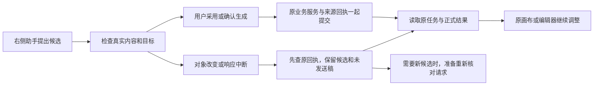

# T-1074 当前验证记录

更新时间：2026-10-08。任务仍在逐项验收中；本轮新本地包已生成并安装，公开CLI已连接，新安装版真实Pi画布创建/采纳/读回已通过，但未代签用户验收或两引擎全功能矩阵。早期未提交源基线 `fbb861d433eae12b5824709916a669c7a0400aa5` 保留；产品实现提交 `cacf4d26`，本包冻结源 `74883948432b87f73ea464fb029bf2f5554ac47f`，下文分别绑定历史测试、包和安装证据。

工具先读取原账号组的真实对象，模型只提出候选；用户采用后，原业务服务保存正式结果，并在同一事务记录原来源回执。生成和扫码沿原任务观察，不因刷新重发。

## 当场发生的确定性验证

下面是隔离数据库、宿主或组件测试，不能解释为真实模型、安装版或全功能验收。命令、开始/结束时间、实际子进程 exitCode 和原日志均在本机验收目录 `t1074-tests`；哈希按现存日志重新读取核对，没有补记历史 PASS。

| 记录 | exitCode | 覆盖与限制 | 原日志 SHA256 |
| --- | --- | --- | --- |
| canvas-core-current | 0 | 原画布操作、AI owner、工具装配与来源host；132通过，1真实跳过 | `1f7c9ee28e924ecb0ed8935e9ae7d4fac78b9ab1475d4df0065eefdccb1f2b83` |
| canvas-generation-public-final | 0 | 原聊天来源→正式确认→同事务link/task/receipt→asset.prepare；11通过，模型配置为确定性夹具 | `9462655fc6fc95ae42185d563c69688d2e0e3445b75c33d46beb18d20388459f` |
| system-public-expanded-current | 0 | 公共生成及原manual；46通过/1跳过，含attach/receipt跨冻结期限回滚与新admission不得落旧checkpoint路径 | `747dce95bc968fe8ee2232c1cfdaf713e26e8f649da9a8c8ba8ad614937876ee` |
| derived-best-effort-red | 1 | 已提交正式保存后索引派生失败的真实红测；1失败/18未运行 | `893cc2659254e4160480e9ffebb79325ccc57c2a1c24b90fdde0421e8d9ae917` |
| owner-effects-and-tags-current | 0 | 原派生best-effort及大小写/下划线素材ID排序，原标签owner；27通过 | `2d2e022c5e39e44a4c65fe3be0e969abc27f6c8f31c05a16174226f4c3b65686` |
| system-owner-eleven-current-dto | 0 | 28通过；11类动作已有原host/账本→正式采用transport→原owner保存及读回证据；不等于19类全验收 | `3ae1ef505b1a3041ea139ef60bf8de1bbb22c2f7fc1d41eaa7c9b17d6c562594` |
| system-work-owner-public | 0 | 40通过；增加脚本/文章/图文公共采用、正式读回、旧版本保持、跨用户拒绝、手工保存冲突及receipt失败同行回滚 | `3998c1bf3104901bbb1576c24824b57ce5858e3d4755b7e8bfa7f8e6afe2b791` |
| system-workflows-public-first | 1 | 47通过/1失败；发布准备测试误假定原output状态active，实际原owner为drafting；改为与采用前实际output深等，不改变产品状态规则，不记为产品RED | `26334f4c55e0090fcf6f21970a67e922d33afd75e79a6938ffc80632342cbb52` |
| system-nineteen-basic-public | 0 | 52通过；19类基本公共采用与原owner读回。扫码仅预约queued，不运行扫码供应商；选题并发与有父雷达仍未验 | `384895ff6ac8d240faf96b8cc86139a17da04589165e32dd73457b03c785360c` |
| owner-cas-expanded-recheck | 0 | 原偏好/定位/调度并发与CAS；10通过，27未运行 | `2fb9dc02c338128c9791d5bd148bc632c12566c4494908dd2b3e8c590a78ff3c` |
| binding-reservation-current | 0 | 原绑定持久预约、提交后唤醒；27通过，不证明实际扫码平台成功 | `377ef4d641658955db9c1d86eabced4c9f304bed8e8ea0304c8c915e0709a8bf` |
| assistant-source-host-current | 0 | 原来源、采用、两类host与装配；136通过 | `e54e63e506c1e981fdf615c2f0e24fedcbaf8ff46cee1c164da46dd87dd87f38` |
| mcp-discovery-current | 0 | 原MCP SDK与能力发现；39通过 | `e8941e7dd82947f1629543c1800f7a3b84ce543831ea77eb45b63571d1ce45e3` |
| copilot-display-current | 0 | 当前原Copilot、工具trace及outcome展示；31通过 | `e35d0efb0312e047e3dd073c01f27ade5e47d059c5ef7fd1d7584c1baf68e070` |
| copilot-details-consumer-current | 0 | 中文详情更新后重跑真实Copilot消费者/trace/outcome；31通过 | `21aa6cc28ee2518cc89faa8bfe7b8667409bdd131474e6b1ee1e8e9b07206fba` |
| led047-card-details-current | 0 | 原LED-047规定8文件回归，retry=0，167通过；保留测试环境localStorage/navigation告警，不当成真实浏览器导航证据 | `46b1da508f8075e0205f50c4fe084d3afa89e795a6b652fd76049017f3a6f204` |
| assistant-card-recovery-red | 1 | 冲突入口、完成焦点、生图内部字段暴露的真实红测；3失败/10未运行 | `b997087acfab402d7ae6c03bf37b30a9e4c0c0c76241e2324fb2a68707a23a32` |
| assistant-cards-status-recheck | 0 | 候选卡、工具结果、原workspace scope；24通过，含原四字段、回执恢复、冲突后不盲重发、精确文件、日历原页码合同及键盘焦点 | `9682c0baf6f506fae0bed6c6b211907545d4c7b93f51cce434d6b7cc0d5e20d3` |
| assistant-action-details-red | 1 | 中文正文/事实、原文对照、排期目标与偏好字段的真实RED；3失败/4通过/13未运行。原卡展示请求JSON，无法按业务内容核对 | `5b4016acff0e85b4952baac1b50a0b0ce5714238f0b325fa5e1b7b11908e32d2` |
| assistant-action-details-final | 0 | 27通过；19类动作改为中文字段与正文预览，保留展开后渲染。文章待确认事实、脚本前后文、日期/平台/账号和偏好前后值验证；预览不发写请求 | `7c67b85e06fc758b1c1e25acfa321cc32b857d7736515b33dfeba57b056b6cc4` |
| assistant-cards-types-recheck | 2 | 当前前端类型仍失败：4正式API尚缺原scope表登记及其CLI消费者派生错误；卡片自身最新类型错误已修复 | `5f9f1fb847907113ca717271315180941fad8320ddc3235b021c078bcbed92c3` |
| system-owner-eleven-types-recheck | 2 | 当前后端类型仍失败：scope缺项及两个范围外测试错误；本轮公共测试的DTO类型错误已修复 | `5000fd1d510fda022ba842ba541cf436533512860ed49bdc61040ddb1e82e40d` |
| assistant-action-details-types | 2 | 中间类型检查还发现选题来源映射缺idea/favorites；该映射按原合同补齐，并真实重跑下行，不删除原来源枚举 | `17993512ed11f3d04013a9ca21fef1a2f924d4f7344242fa258430c5afcf6339` |
| assistant-action-details-types-final | 2 | 前端类型仍红于4个正式API原scope登记及CLI派生；最新候选卡没有独立类型错误 | `20e7b151882744edb5441342877953e280bbcc160528a055d4ee8e40c29b311e` |
| system-nineteen-basic-types | 2 | 19类公共测试扩展后的最新后端类型；仍是原scope缺项/CLI与两范围外测试错误，没有本轮公共测试新增类型错误 | `c27707dd1e12ede12304b8d3bd2677739d84c937e421e70a3739757399e7eff5` |
| current-boundary | 1 | 全局7项仍红：基线5项与live-chat-session两项R2。该文件与HEAD字节一致，不能把整门签为通过 | `6b23ce459cd49f9f78d9a4185f9bceaa53c27b96d14e64f2fdf1a0422b6e6985` |

当前19类动作均有原host/执行账本→正式采用transport→原owner的基本读回与同source回放样例，最新该文件52测试通过。新增脚本精确保留CRLF/emoji/前后文，文章/图文旧版本不变；先手工保存拒绝旧候选，receipt失败与正式版本同行回滚。发布准备只创建draft并保持原output深等；日历保留明确null或真实平台目标，已有新计划拒绝旧候选；绑定只预约原实例queued任务，未生成成员、不运行扫码，失败不唤醒。

19类基本样例不等于19类全部验收。下文补充已完成选题行锁、有父雷达纯读及实际PG两连接竞态；确定性模型结果仍不证明真实Pi/Codex表现。

新生成公共链固定父任务绝对期限；父剩90秒、准备耗时15秒时，只剩75秒。配置、attach与receipt等待跨期限实际回滚；新admission不沿旧默认预算恢复。提交后wake失败可以查原receipt，刷新不续期或重建任务。后续公开动作测试又验证单个搜索索引失败仍保留正式保存、回执及其它派生。

边界两条live-chat-session报警和范围外类型失败的两个测试文件均与HEAD字节一致，核对记录在 `t1074-tests/unchanged-baseline-files.json`；这里只证明本轮没有修改它们，完整项目类型/边界门仍未通过。

## 浏览器与独立组件走查

运行私有 `t1074-cards-ui` HTTP夹具，使用当前产品组件、原typed client、原tokens/Button/CreationWorkspace；neutral纸船SVG为固定界面素材，不是模型生成证明。采用和确认增加1.5秒确定性等待，仅用于等待期间键盘移焦点检查，不修改产品期限。

- 实际1366×900和1024×900查看了布局、中文换行、展开详情、采用/中断/冲突/生图状态；未发现卡片明显裁切。生图详情移除内部请求JSON，展示创作设置；生成结果统一为待保留状态，真实入口明确为“打开原画布”。
- 实际Enter/Space展开与采用；响应丢失先查原receipt，同夹具采用仅一次。409状态也能查原receipt；查不到仍保留冲突，不恢复旧采用按钮。准备重新核对只追加到原输入框，保留原未发送文字，不自动发送。
- 生图只读原link/task/input/attempt匹配的精确assetFile，然后展示文件；错来源不请求下载地址。刷新只增加material/task/file读取，不增加确认生成。原任务最新失败优先于较早文件快照，失败显示警示并保留原回执/核对入口，不显示绿色生成完成；只在实际queued/running显示执行动画。
- 独立任务走查初次发现冲突无恢复动作、JSON暴露与焦点丢失；两次整改复查确认冲突可继续、确认/刷新后焦点在结果状态、等待期间移到输入框后完成不抢焦点。共3次该夹具走查，到此停止，未操作真实App。
- 独立静态视觉评审一轮及整改复查：原品牌方向保留；生成重复状态和错误承诺入口已修正；第二次收到的冲突图版本落后，主会话随后重新实际查看并保存最新版，未追认成独立最新版PASS。不评分，不捏造得分。
- 浏览器200%缩放尚未得到证据；先前快捷键未改变DOM宽度或dpr，原误命名截图已改为 `canvas-conflict-1024-zoom-attempt-unchanged.jpg`，不能标成200%。
- 本轮在同一1366视口实际保留文章JSON基线，然后改为中文全文、事实状态和配图要求。新详情区域有可访问名称/焦点，实际End键能滚动至事实与配图；1024窗口实测scrollHeight442/clientHeight318/scrollTop123.5。排期同时呈现日期和小红书账号，实际pageWidth1024，无整页横溢出。操作记录只有receipt读取，未点采用、不伪造新业务保存。最新局部细节由主会话查看，未追加独立视觉轮次，私有页面不代签正式页面或安装版。
- 私有Vite首次从夹具目录启动导致Tailwind未扫描产品组件，早期`article-json-before-1366.jpg`样式不完整；切回原frontend工作目录后重新保存并查看`article-json-styled-before-1366.jpg`，比较只用后者。热更新会重置私有App状态；重新选文章与展开后完成实际键盘证据，不当成生产切页问题。

当前实际查看的本机图片：

| 图片 | 内容 |
| --- | --- |
| `t1074-cards-ui/generation-final-current-1366.jpg` | 中文设置、单一待保留状态、原文件预览及原画布入口 |
| `t1074-cards-ui/canvas-conflict-recovery-current-1024.jpg` | 新冲突提示、核对原回执/准备重新核对、未发送原稿保留 |
| `t1074-cards-ui/canvas-ready-1366-v3.jpg` | 原画布候选缩略布局，标题与节点类型可读 |
| `t1074-cards-ui/generation-failure-current-1366.jpg` | 原任务失败优先展示，原文件可查看，回执及原画布入口保留 |
| `t1074-cards-ui/article-json-styled-before-1366.jpg` | 本轮有完整原样式的JSON详情基线 |
| `t1074-cards-ui/article-facts-keyboard-1366.jpg` | 新中文文章正文、待确认事实/配图要求；键盘焦点与滚动实际可见 |
| `t1074-cards-ui/calendar-details-current-1366.jpg` | 日期、目标平台/账号及采用影响同时可核对 |
| `t1074-cards-ui/calendar-details-current-1024.jpg` | 1024实际全文画面，未横向溢出 |
| `t1074-cards-ui/article-facts-keyboard-1024.jpg` | 窄窗口中文全文/事实/配图和原未发送输入；详情键盘可滚动 |

## 尚未完成

- 9个必要原文件的补充独立复核已获用户明确授权并通过 `PASS[REV:b19144c34cab]`，相关实现与当场验证见下节；原总体任务继续。
- 19类动作完整并发/撤权/异常矩阵、两引擎真实模型矩阵、视频7类调整和文章/图文持续微调的新证据。已有19类基本公共读回与中文详情；素材标签在来源中没有名称时仍只能显示真实素材引用，不能虚构可识别标题。
- 正式页面1366/1024/200%、原生桌面逐功能验收；当前只有隔离组件视觉及交互。
- 最新复杂度条目重绑、独立实现复核、源码冻结、提交、本地打包及安装验收。
- 全局既有对账37错误/1告警、后端两个范围外测试类型错误、7条边界报警和MAIN缺timeout-policy verify文件保留。前端、contract、worker、mcp最新类型已通过；不借另一checkout、旧安装包或夹具宣称全绿。

## 补充复核前的发现与范围（历史记录）

只读独评发现：选题立项采用前比较没有候选行锁；雷达父分类观察调用原workspace读取，会初始化分类与恢复任务。原业务service需要各补一个窄端口，并各补回归；这些端口不增加新用户功能或AI权限。另两项原best-effort派生与协议ID排序在既审应用root内修复，不新增写集。

当时拟补入的9个文件如下；本段保留复核前状态。用户随后已明确授权一次补充复核，决策与审核事件见 `DEC-106902` 和下节，不把此前通用“继续”追认成该授权。

| 变更ID | 精确文件 | 可评审结果与验证 |
| --- | --- | --- |
| T1074-CONSUMER-SCOPE | `contract/src/workspace-operation-scope.ts` | 将4个已审正式来源API登记为原组作用域；原operation穷举与组隔离回归，消除实际类型错误 |
| T1074-EDITOR-ADOPTION | `frontend/src/features/draft-workbench/draft-chat-request.tsx`、`frontend/src/features/draft-workbench/draft-chat-request.test.tsx`、`frontend/src/features/copilot/chat-work-editor-card.tsx`、`frontend/src/features/copilot/chat-work-editor-card.test.tsx` | 当前编辑器的采用桥接仍经原候选机制；保留未保存稿件、目标epoch和刷新，避免用新保存卡绕过本地编辑 |
| T1074-CANDIDATE-LOCK | `backend/src/modules/candidate/candidate.service.ts`、`backend/src/modules/candidate/candidate.service.test.ts` | 原Candidate owner增加tx内只读SELECT FOR UPDATE端口，保留user与workspace过滤、原DTO；应用root锁读比较后仍调用原promote；验证已变候选拒绝、真实并发等待、事务回滚 |
| T1074-RADAR-PURE-READ | `backend/src/modules/intelligence/intelligence.service.ts`、`backend/src/modules/intelligence/intelligence.service.test.ts` | 原Intelligence owner窄纯读分类归属端口，不初始化/迁移/恢复；没有parent直接返回null；有parent核归属/未归档，原createCollection复核，验证prepare前后业务数据不变 |

历史准入要求：仅上表4个变更ID/9个文件补一次独立复核，不重置旧轮次、不扩大目录。已用用户明确答复登记 `DEC-106902` 并经原审核工具记录cycle 2 round 1；旧3轮和原缺失证据完整保留，不再重复请求同一授权。

## 用户授权的9文件接入及当前验证

原话“同意这9个文件补一次独立复核”已登记并消费一次；当前SPEC SHA `c33f1a6a06bcb5a4782abda16153c0877654f707a733612d3773060e251ed411`，独立复核 `PASS[REV:b19144c34cab]`。四API已登记原组范围；当前文章/图文编辑器沿原两参数采用口完成source-only正式保存、精确版本读回和本地保护；选题采用在真实tx锁读后走原promote；雷达parent纯读不初始化/迁移/恢复，采用在tx中锁父分类复核后走原createCollection。

| 记录 | exitCode | 实际结果与范围 | 日志SHA256 |
| --- | --- | --- | --- |
| editor-protection-red | 1 | 匹配脏稿仍采用/等待换编辑器误报同步的RED，2失败；旧配置retry=2已如实留档 | `ed4a1e8948c371f0ca32115b669d14454d35650a4ea70ec320308438b45066f3` |
| owner-narrow-ports-red | 1 | 原owner缺窄锁读/纯读端口，2失败 | `14a9ba62eb8b43584c33f8aa146d45bb3eca2b7351cda62be3442b4db976f090` |
| owner-narrow-ports-green | 0 | 两个原owner完整单测60通过 | `fd0c10499de8c238fbd016a48b023bed187073df75c1f0513187f4e3e711285e` |
| nine-public-full-pg | 1 | 57通过/2失败：新验收夹具会话project=null，原产品归属校验正确拒绝，不记为产品RED | `51d76a0a97e84d9a05afbe2eef16b22a0c0f3fdbeb51e984b3f46bbecb0bab3c` |
| nine-public-full-pg-fixed | 0 | 实际私有PG全59通过、无skip；含三项独立Pool/真实Lock观测及receipt回滚，不使用用户数据库 | `c6cc4e0c3eca836d6f1b153890abb6d6eb7c54a97396f335cb95b6820556da31` |
| editor-dirty-message-red | 1 | 1失败：界面丢失原本地冲突说明 | `c8b1c62d81f02fe0cc7f4e6f6f8360d684627ad8e67782bf7d1c8175aa90e470` |
| editor-adopted-status-red | 1 | 1失败：保存后仍显示等待采用 | `3cd88b553b64d46b9cc875e177382c1a4a959e82b7ee888c0adfd2a5f80a76a5` |
| editor-adoption-ui-final | 0 | 原编辑器/卡片/Copilot/trace/outcome 67通过，retry=0；匹配编辑器正式source-only保存、dirty拒绝、等待换页/新输入保护、原receipt恢复 | `e4e31057bf4cc1a3047f507340be38f86b42630c1b6781729935781d84e93c22` |
| nine-led047-current | 0 | 8文件167通过，retry=0；实际导航见浏览器，不以jsdom告警冒签 | `bd765bc8d4114fb3cb7b46d31434ad475d02f446ef83acc718e281265d999ab0` |
| editor-adoption-types-final | 0 | 最新前端含新增测试类型exit0 | `e3b0c44298fc1c149afbf4c8996fb92427ae41e4649b934ca495991b7852b855` |
| scope-contract-mcp-types | 0 | contract与mcp两包类型exit0，四API原group登记及派生穷举通过 | `f8b0c8e346dac576a9526eeb7be9ebd931a5c055fdd109160cf26912dcbc00f5` |
| worker-types-current | 0 | worker类型exit0 | `f7e0274cdcecda48497f193a594347fce2e14a12f0cadab4ba3a707690fa4ead` |
| nine-backend-types-final | 2 | 中间类型exit2含新增fixture.document.title联合错误和原2历史错误，原日志保留 | `3aa84ac7a89b69d9108f4520c5fbee1ebc77f909ea84db790ad81180d7dc5d34` |
| nine-backend-types-rechecked | 2 | 新增联合类型已修复；exit2仅原platform-bind:173、production-native-public:31两个未改测试错误 | `2a66e93c4a02b999e2e6360a16084c5d412f5645c4e1cd69a0bc3883c0aa5e04` |
| boundary-nine-current | 1 | exit1/7条，日志SHA与旧current-boundary完全相同，未改live-chat-session | `6b23ce459cd49f9f78d9a4185f9bceaa53c27b96d14e64f2fdf1a0422b6e6985` |
| timeout-policy-current | 1 | exit1/MODULE_NOT_FOUND；MAIN仍缺规定verify入口，无借用或造PASS | `9ba8029f31e215297c3e8e6aa03c0f61cf3c58c079380fdb5ab9749a9c6bed38` |

浏览器使用当前原组件/Provider/typed client的私有HTTP夹具实际检查：1366未保存标题与具体提示保留，记录仅receipt读；1024保存等待中新增标题，正式source采用仅一次，原精确版本读回，标题和当前输入焦点保留，显示已保存未覆盖输入。画面已实际查看：`t1074-cards-ui/nine-dirty-current-1366.png`、`nine-new-input-preserved-1024.png`。这不证明模型、真实后台或安装版UI；200%和原生逐项仍未签。九文件有界独立实现复查已PASS，报告见[nine-consumers-implementation-review.md](nine-consumers-implementation-review.md)，原Intelligence机制已按当前源摘要重绑，旧历史保留。核心总体实现后续复核已PASS，见末节保留的原FAIL与修复链；基础实现不等于总体验收完成。

## 核心分页独评发现及当场修复
核心只读实现审查初次FAIL仅发现CORE-001：知识及同族原transport全量返回，新system.read未按query.pageSize裁切，且允许100。原FAIL/真实复现保留；只修改既审新合同/root及原测试，不修改原手工owner/transport，不增加权限。新wrapper最多50条，四全量族沿原page切页，原分页结果不二次offset裁切；没有真实总数的三族如实为null，nextInput保留原request并继续下一页；有效meta随实际页归一化。

| 记录 | exitCode | 实际结果与范围 | 日志SHA256 |
| --- | --- | --- | --- |
| read-pagination-contract-red | 1 | 真实产品RED：pageSize100被接受，1失败 | `2702f73004179aaa7ee4c4d2a7fe55f56f228759835dcf6ce742822fcce5df17` |
| read-pagination-public-red | 1 | 真实知识/项目原全量分页RED，两页返回全3条，2失败 | `f0e89e42d7866efe853a25369cc99a97d8fa85195fbb2cfabd12bb7fa7522bdd` |
| read-pagination-families-green | 1 | 中间夹具计数失败：artifact原owner自动初版加3次成为4；产品未改 | `9682097ba455aab2b88a5f807cd491f34347247506cec4a49c7b36d6f9bd4096` |
| read-pagination-contract-families | 1 | 测试误写原scheduledJobs query limit/offset，原严格合同正确拒绝；按实际assets.search字段补正，不是产品RED | `f33b3620b00c65a86ec180e1dddc11ee847f9df50b748bc96d90f48e5dec9e5a` |
| read-pagination-families-fixtures-corrected | 0 | 7项真实host/model协议fixture/账本/原owner读取通过，其余59为过滤；四全量族和三原分页族 | `096f98f91fc58f9de077edb86e7321085b53ac4623a82d0cf2bca815732a2ff6` |
| read-pagination-contract-final | 0 | 4项合同通过，实际pageSize/limit最多50且原分页字段保留 | `b6b49572abb6976f35b965c3832e10084d18f63e559259f5997cb29252502bdb` |
| core-pagination-public-final | 0 | 实际私有PG完整66项通过，无skip；3个两连接锁竞态，19动作保存/回滚/原编辑器，7分页族 | `b9010ce54d00745f3035e47606dcb2566d74682d8f3765308ae11ad68cdc0352` |
| core-source-host-final | 0 | 来源/采用/host/定义/装配/工具权限176项7文件通过；协议fixture不代签真实模型 | `b89d2f80fd07a6fc4940773df090c006bae23ffc333fdcde66044c93db93d428` |
| core-pagination-backend-types | 2 | 中间新增测试transport/host类型错误及原2历史错误，如实保留 | `02c58daeea13f6f35a038adad030a17d1d2c4817d90421a94bd532a9a8d74484` |
| core-pagination-backend-types-final | 2 | 中间类型修正遗漏transport替换，未签绿 | `75772b7acab2e499ef1ad8f58a34e1703c29a6a1e05506a36a0cf603de097778` |
| core-pagination-backend-types-rechecked | 2 | 最新exit2仅原platform-bind:173与production-native-public:31两个未改测试错误；无本轮新增类型错误 | `2a66e93c4a02b999e2e6360a16084c5d412f5645c4e1cd69a0bc3883c0aa5e04` |
| core-contract-mcp-worker-final | 0 | 三个包类型检查exit0 | `488cc1c67f78abbfa7410d06dc718259db84e6d39a9fd9298b39e7bd64252c4e` |
| core-pagination-frontend-types | 0 | 前端最新类型exit0 | `e3b0c44298fc1c149afbf4c8996fb92427ae41e4649b934ca495991b7852b855` |
| core-orphan-current | 0 | 孤儿链扫描0错误100警告，未签SHIP | `ee3224654cf1b13b1bcd3948dd942050a0435380b5b2a84bbb61e9058d056b0e` |
| core-semantic-current | 1 | 保留原video-decisions-runner缺material.match失败，不修改原语义规则 | `7cbfa9443346edf9491b83ddb83b954cb1f8df6829a641b2362813753644e2f7` |

原9文件独立复查的9个产品/测试文件保持原SHA；其报告引用的辅助root/test旧SHA属于分页修复前历史，最新核心复核链另绑定当前源，不改写旧PASS或独评原FAIL。最新完整PG66和来源host176通过，仍不代表两引擎真实模型、原生UI或新安装版通过。

临时组件浏览器1024视口已实际reset并关闭私有tab，私有Vite主动结束；用户的原页未替换。

核心实现独立复核链已PASS，见[当前报告](core-implementation-review.md)。原35源中仅root/合同/测试发生已复核分页修复，其余32源逐一SHA不变；原FAIL和独立Knowledge重放均在机器报告内保留。

源码已于`cacf4d26`提交，本轮完整reconcile实际exit1/37错误1告警（运行2026-10-08T02:52:54.201184+00:00至2026-10-08T03:03:26.752715+00:00，log SHA `ff95de5787927c16835d0101ec144e975f066133317a455d69dfd96ce84cc3e0`）。与`t1070-diagnosis/root-prefreeze-reconcile.log`原ERROR集合相同=true；新增0/消失0，原欠债保留，不将本任务或整仓完成。当时四打包基本检查实际44通过；随后冻结打包与安装实际结果见下节，不将先前时间点追记成安装PASS。

## 新冻结本地包、实际安装与Pi画布创建

固定入口 `pnpm -C frontend desktop:package-local` 在干净冻结源 `74883948` 上实际exit0；未改产品或打包入口消除失败，版本仍1.2.0。规范安装包 `/Users/zyongzhu/Downloads/CreatorOS-1.2.0.dmg`，667348058字节，SHA256 `05f950d1e7fc8cf08cad12e798e2d4197628bb3911387d0df2b8057e63fd6ba2`。44基本测试、hdiutil verify、镜像/构建App深严格签名均exit0；全7应用文件镜像一致，后端791资源逐项匹配冻结源码。这是本地ad-hoc包，未经Apple公证。只读DMG已实际detach0。

旧Native37432退出后残留37873仍有数据文件占用，TERM与INT各实际观察120秒均未退出，随后重新核实际PID/启动时间/cwd/executable，仅对37873强制停止；不发进程组或广泛pkill，不宣称flush。旧15个共享工具PID快照过期，按新实际11身份及每个完整25项txt/REG映射，仅重绑两个字面快照；原新PID、写FD、身份变化、缺文件等拒绝规则不变。独评发现安装adapter路径字面漏替换，在任何安装前纠正并复核PASS；原finding和初SHA保留。

新鲜五根目录及偏好文件备份 `offline-backup-real-provenance-journal-ga2fk7hb` 实际9步全exit0，最终闭包SHA `16718645a5ffd173cbad77acd7d16945962ae99e48c76acb5535f6cafe2f4abf`；强停不等于安全落盘，闭包也不替代业务读回。原安装机制12步全exit0（含再次闭包、占用、镜像、前后签名和open），旧App通过rename保留；没有恢复/重置用户数据或激活。Native81735/sidecar81983已实际运行，首次展开36943项约1696MiB，公开status最终connected/full。初期CONNECTION_STALE按真实记录保留，未当成访问关闭或另行授权。

当前安装版动态目录409项，原405无删除，新增四项正式来源API；compact返回20项并有真实后续页。完整5组/3账号数组、原中性工程revision6、文章current233和图文current258，与上一安装实际记录data深等；原工程preview8.16秒无警告。原已获用户采用的成片重新按公开下载URL在已核新Native服务origin解析，HTTP200、199098字节与原SHA `a72af1826b27bc566fb7b839c4c0813aa3cc04bb0cde6164e1ec04f41f3e1558` 完全一致，ffprobe及全解码exit0；这是旧产物保持，不是本轮新渲染。

在已授权的中性组101/项目104创建验收会话147，公开消息151产生唯一task152/execution153。首次confirm-impact误传group ID，真实409在guard前拒绝；纠正为实际会话ID，沿同一幂等key成功，不为获取PASS重发模型任务。任务actualEngine=pi、completeness=completed；实际三个system.read读取原画布能力/列表/项目，随后canvas.create.propose生成“脚本到多载体创作”3个文字节点/2条连线的完整候选。采用前receipt=null/只有原1画布；正式canvas.create.adopt保存画布 `66690ab6-9ac3-4bfe-8ffa-4569a4a1b4dd` revision1，document完整等于候选。正式get与receipt准确读回；不同gateway key同source重复采用返回完全同一结果，列表只从1变2；跨组receipt与篡改candidateDigest分别真实409拒绝。所有操作走公开CLI与原来源/owner，没有直接写库。

[机器结果](result.json)绑定本机`t1074-installed/bounded-acceptance-index.json`及36项当场证据；完整备份状态、最初失败、强停限制均保留。该链只证明当前安装版Pi画布创建及公开正式采纳/读回；原生界面按钮不是本次调用入口，原生可见首页仍待用户反馈。Codex右栏、画布节点生成/放置、七类自然语言视频操作、文章图文持续精调、两引擎全功能矩阵及200%原生操作仍待验；不将T1074、T1070、T1071或T1062完成。

本轮有界安装/公开实测证据另经独立只读复核PASS，报告`t1074-installed/independent-bounded-evidence-review.json`，SHA256 `513bf0ed2132ae3ea6e8a21e6fa4e59bcf825990286875df41cc7a57f0674817`；只签实际安装、Pi画布来源采纳和读回范围，不代签原生可见体验或完整任务。
