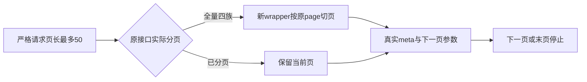
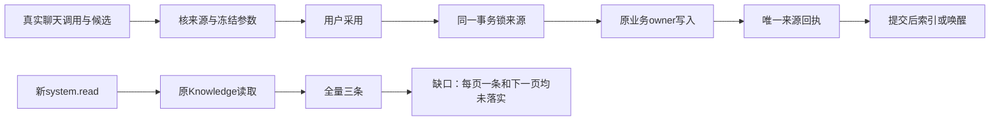

# 核心独立实现复核链

原核心评审FAIL保留；唯一必修CORE-001经同一独立会话复核PASS关闭，原核心35文件的其余32个SHA不变。当前源绑定与原文记录见[机器报告](core-implementation-review.json)。这是同模型独立会话弱门，不是新的SPEC周期，不代签模型、安装版或整体任务。

# CORE-001 分页修复最终独立复核

结论：**PASS，CORE-001 在当前四个绑定文件上已关闭，没有其它已知未修的核心必修项**。这是原问题的实现修复复查，未开启新的 SPEC 周期。原 [FAIL 报告](implementation.md)、[机器记录](implementation.json)、[原复现输出](system-read-pagination-probe.log) 及夹具错误日志全部保留；先前复核版本保存在 [recheck.before-final-files.md](recheck.before-final-files.md)。

大白话：助手每次读 1 条现在只得到 1 条，用返回的下一页参数能够读到全部 3 条；最后一页停止。原来已经分页的接口保留原页，原来没有全库总数的接口如实显示未知总数。

已只读核对两个产品文件和两个测试文件的最终内容及 SHA，见 [recheck.json](recheck.json)。[读取合同](/Users/zyongzhu/.codex/worktrees/t1062-client-integration/Thirdspace-creator/contract/src/resources/assistant-system.ts:49) 同时限制 pageSize/limit≤50；[Assistant root](/Users/zyongzhu/.codex/worktrees/t1062-client-integration/Thirdspace-creator/backend/src/application/chat/assistant-system-root.ts:280) 对四全量族切页、已分页页不重复全局 offset、三个本页总数族回传 null、nextInput 保留原 request 与筛选并推进页码、meta 与有效页一致。产品两文件自原独立探针通过后 SHA 均未变化。

独立 Knowledge owner→transport→root 探针通过：三页 `[1,1,1]`、3 个不同 ID、nextOffset `1/2/null`、最终 nextInput 为空、pageSize100 拒绝；8 字 UTF16 window 续读能够精确拼回完整原页。运行前后产品 SHA 稳定，见 [独立输出](pagination-recheck-final-probe.log) 与 [运行记录](pagination-recheck-final-probe.json)。本探针使用独立 PGlite，没有调用真实模型或安装版数据。

最终主会话日志已核对实际 hash 与退出码：

| 记录 | 实际终态 | 本复核确认的范围 |
| --- | --- | --- |
| core-pagination-public-final | exit0，66 PASS，无 skip | 四全量族第 2 页/空页及原 API 兼容，candidate 原分页，publication/revision 无真总数续页；含三项实际 PG 两连接锁用例 |
| read-pagination-contract-final | exit0，4 PASS | pageSize/limit 上限与原严格字段形态 |
| core-pagination-backend-types-rechecked | exit2，仅两处原历史测试错误 | 当前四绑定文件无类型错误；全 backend 类型仍非 PASS |
| core-pagination-frontend-types | exit0 | frontend 类型检查 |

原核心评审绑定的 35 个文件中 32 个 SHA 保持不变，变化仅为本问题的合同、root 和对应集成测试。原审只发现 CORE-001 一项必修，本次已关闭；来源不可伪造、旧来源、同来源唯一回执与原业务同行事务、提交后派生、撤权、未知不重发、稳定生成 attempt/绝对期限、19 owner 与生产工厂没有其它已知未修项。这里承接原审证据与限度，未将原 UNKNOWN 提升为 PASS。

最终测试的 transport outcome 经真实 schema 解析、续读使用原 frozen host reader 的实际结果，body:undefined 与 unknown 类型消费修正只涉及测试文件。先前 artifact 自动初版夹具计数失败与缺 body 类型失败记录保留，没有改原 owner 来迎合测试。完整 66 项是已核实的主会话运行记录，不冒充本复核独立重跑；model/tool 账本采用确定性协议 fixture，不代表真实供应商模型。

没有修改产品、控制面或安装版数据。9 文件补充范围仍由对应独立评审负责；真实模型、UI、安装版、全局 Gate/reconcile 与 T-1074 整体验收仍由主会话分别完成。

## 原始核心FAIL报告（原文保留）

# T-1074 核心独立实现评审

结论：**FAIL**。发现 1 项可当场复现的必修问题；来源、采用事务、原owner装配和生图期限部分未发现其它必修缺陷。这个结论只覆盖下面绑定的未提交源码范围，不代签 T-1074 整体目标。

审查根为 `/Users/zyongzhu/.codex/worktrees/t1062-client-integration/Thirdspace-creator`，HEAD `fbb861d433eae12b5824709916a669c7a0400aa5`。本候选仍为 dirty；逐文件 SHA256 见 [implementation.json](implementation.json)。已读取任务SPEC与物理架构，product-to-code-orchestrator/项目版本同为3.28.0，阶段为BUILD收尾独立实现评审。只写指定私有目录，没有修改产品代码、BACKLOG或控制面。

大白话：AI先提出可检查候选，用户采用后，原功能保存与来源回执一起成功或一起回滚；生图沿同一原任务和绝对期限恢复。当前新读取工具的知识分页漏接，用户让助手“每次看一条、继续下一页”，仍得到同三条完整记录。

## 必修 CORE-001：system.read 没有落实已审列表分页与 50 条上限

- `contract/src/resources/assistant-system.ts:49` 仅收紧原 `query.limit`，原 `paginationQuery.pageSize` 仍接受100。
- `backend/src/application/chat/assistant-system-root.ts:285` 只有 `endpoint.query` 不存在时才截页。`knowledge.list` 有query。
- 原 `knowledge.transport.ts:131–134` 实际返回全部knowledge items，只把请求page/pageSize放进meta。新wrapper因而对整库序列化，且nextOffset为空。

真实隔离复现用了 `createDb()` 独立PGlite、原Knowledge owner/transport和新Assistant root。创建3条知识；请求page=1,pageSize=1且outer limit=1，返回3条，complete=true,nextOffset=null；page=2仍返回同3条。新schema接受pageSize=100。这违反SPEC§3“页长最多50”及按分页继续读取的已确认行为。旧transport是原行为；本次引入的新工具必须适配它，不能以旧行为为理由声称新分页已完成。

证据：[私有探针](system-read-pagination-probe.mts)、[输出](system-read-pagination-probe.log)、[运行记录](system-read-pagination-probe.json)，实际exit0。建议在已准入的新schema/root按原分页族落实≤50和真实下一页，对实际返回整表的原列表做wrapper适配，保留原手工API语义；补3条每页1条、51条边界、下一页和正文窗口的真实owner回归。这不需要扩大AI权限或增加产品门。

## 核对通过与限度

| 核对项 | 结论 | 实际依据 |
| --- | --- | --- |
| 来源不可伪造、成功proposal、旧来源、同参reuse | PASS | 静态Pi claim/AgenticToolBinding与ACP真实父回合、schema/inputDigest/digest核对；独立25测试 |
| 来源锁、业务与唯一receipt同行、rollback/replay、归档组拒绝 | PASS | 独立25测试，包含真实receipt INSERT触发失败后完整画布回滚与后续编辑保留 |
| 全19动作真实owner与生产工厂 | PASS | 逐分支和forStore静态核对；引用既有52/59公共owner运行记录，hash均匹配 |
| Canvas创建、生图稳定attempt与绝对deadline | PASS | root→原Canvas→原AI→assetBusiness静态完整链；确认只入原task/link/receipt同行，commit后wake；既有132PASS/1skip及59公共链记录 |
| 派生commit后/扫码单实例 | PASS | searchUpsert/editDelta延后、派生best-effort不反杀保存；binding预约与原单实例wake分离 |
| Pi/Codex冻结目录与原消息重放 | PASS | 两公开入口装配前传实际引擎，共享政策且服务执行核frozen；重放先返回旧绑定；引用136既有记录 |
| 新system.read分页 | FAIL | 上述隔离真实owner复现 |
| 整套生产bundle动态启动、真实模型/UI/安装版 | UNKNOWN | 本范围没有执行，不用确定性fixture代替 |

本次仅独立重跑 `chat-proposal-source.service.test.ts` 与 `assistant-action-adoption.integration.test.ts`：**25 PASS**，8.4秒，详见 [日志](independent-source-adoption.log) 与 [记录](independent-source-adoption.json)。PGlite的并行请求不被标成真实PG两连接锁证据。主会话提供的six运行记录已核日志hash和摘要：136 PASS；Canvas132 PASS/1skip；CAS10 PASS/27过滤skip；binding27 PASS；19基本动作52 PASS；公共PG59 PASS。它们在JSON中明确记作引用，未假称本次重跑或真实模型。

9文件补充scope/本地编辑器dirty/候选锁/Radar纯读由另一独立评审负责；这里只检查受影响root调用。未触碰当前安装版数据、未付费生成、未跑全量Gate、未替代全局类型/reconcile和用户验收。第一版私有探针有harness导入错误，已保留原错误记录；修正schema入口后才发生上述有效复现，导入错误不记产品RED。

修复CORE-001后可按变更SHA复核；此报告不允许把既有通过记录用于覆盖本次具体失败。
