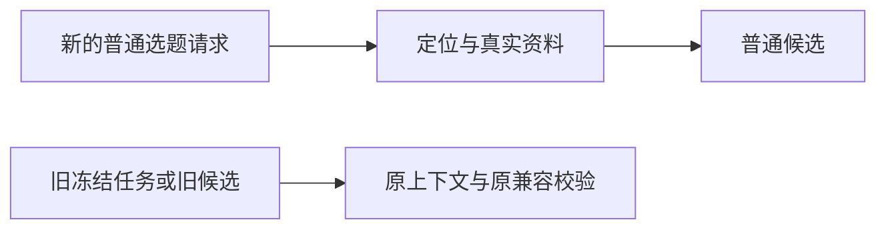

# T-1074 独立实现复核

复核日期：2026-10-09。依据已通过的 `docs/features/t1074-remove-topic-grid.md`，只读检查当前工作区差异、必要调用方和现有测试日志；未修改产品代码或看板，未运行真实用户任务、外部模型或安装版。T-1075设计不在本次范围。

结论：在本次要求检查的实现范围内，未发现具体遗漏。新生成停止默认消费九宫格，历史数据与已冻结任务保留兼容。此结论不代表全局Gate全部通过，也不代表真实供应商或安装版验收通过。

## 实现与SPEC对照

| 要求 | 只读核查结果 |
|---|---|
| 移除九宫格入口及专用界面 | `topics-page.tsx`删除工作区import与渲染，`audience-task-workspace.tsx`及其专用组件测试删除。`frontend/src`已无工作区组件引用或原生成/配置入口，普通四依据、候选池、雷达入口仍保留。历史候选的`AudienceTaskDetail`仍在候选详情中展示，符合历史结果保留要求。 |
| 新聊天、手动、每日任务不默认读网格 | `prepareTopicGenerateContext`删除`deps.topicWorkspace.getContext`调用及`audienceTaskContext`装配。聊天准备、普通持久adapter和每日adapter都调用该公共准备函数；客户端输入不能通过该函数重新注入工作区。新增测试使用两侧非空历史网格，检查聊天、四依据与daily均不调用读取端口。 |
| 新普通候选不受网格配对门槛约束 | 模板v8明确无工作区时不要求网格版本、格子ID或配对。worker仅在冻结输入带`audienceTaskContext`时执行观众网格公开查询规划；新准备输入没有该字段。候选投影同样仅在带该冻结字段时执行`assessAudienceTask`，普通路径不会因缺配对降为研究。 |
| 保留旧冻结worker | `topicGenerateFrozenSchema`仍接受可选旧上下文；worker原查询规划、材料隔离与来源回执分支未删除。模板仅对明确提供工作区的旧任务保留原网格语义，候选投影仍使用旧冻结上下文进行审读。 |
| 保留旧候选、历史配置与防伪 | 工作区service、兼容接口、表及数据未改动。旧候选详情仍可展示；候选立项仍调用`workspace.assertCurrent`；持久采纳仍对`originalAudienceItems`核对原审读内容，保留防伪、版本及归属规则。本次diff没有改写旧结果、删除数据或重发任务代码。 |

## 已有证据与限制

本轮读取日志并检查相关测试源码，没有重新运行测试。主执行者提供了对应实跑命令的测试文件范围；日志使用简洁reporter，只给汇总计数，以下不冒称每个具体用例都单独打印了PASS。

| 证据 | 日志结果与实际边界 |
|---|---|
| `green-backend.log` | 4文件、25/25通过。对应topic-business-adapter、daily-topic-business-adapter、daily-topic-completion.service和topic-workspace测试。源码中包含新任务不读网格、真实上下文准备/投影、历史工作区读写/隔离、持久反馈回读及旧定位版本重审检查。 |
| `green-frontend.log` | 3文件、42/42通过。对应topics-interactions、topics-supply和topics-audience-signals测试，包含页面无工作区与无九宫格文案断言。 |
| `worker.log` | 2文件、31/31通过。对应topic-worker-pipeline和topic-node测试。worker测试中保留显式旧上下文的公开查询、私人材料隔离与真实读取回执分支。 |
| `browser.log`及`browser-regression.cjs` | 记录1366/1024页面无入口、四个普通生成链接保留，以及非空历史配置保存/回读一致。该脚本未调用生成供应商，不能作为真实模型生成或旧候选立项E2E证据。 |
| `frontend-typecheck.log` | 文件无输出，单凭空文件不能独立证明命令退出码。主执行者另提供本轮工具执行记录中的实际exit 0，本轮按该命令结果记录通过，不把空日志本身当作证据。 |
| `frontend-lint.log` | 0 errors、6 warnings；不记录为零警告。 |
| `orphan.log` | 0 errors、100 warnings，扫描结论clean；不记录为零警告。 |
| `boundary.log` | 当前文件明确FAIL：`frontend/src/features/copilot/live-chat-session.ts`引入`@ai-sdk/react`及`ai`两项新增违规。该文件不在T-1074实现diff中，需由主执行者按任务范围和既有欠债规则处理；本次复核不将其写成PASS。 |
| `reconcile.log` | 复核时未见有效完成结论，不能据此宣布全局reconcile通过。 |

补充只读核实`legacy-adoption.log`：2文件、11/11通过。主执行者的对应命令包含`backend/src/integration/topic-candidate-adoption.test.ts`和`backend/src/integration/daily-topic-completion.test.ts`。源码覆盖旧来源键保留人工编辑、真实mapped候选采纳与重放、冻结basis/归属校验、公开confirm事务，以及每日提交/回滚/配额。它支持旧普通采纳与冻结提交兼容，不代表完整双九宫格旧任务到采纳/立项或真实供应商E2E通过。

## 正式journey门适用性补核

对T-1074将验收列误填的`待验`更正为`—`适用，理由是本任务交付既有能力退役和受影响区域回归：删除专用入口及其默认消费，不新增页面、不交付页面组改版、不新增或重构保留的主流程。已审SPEC明确要求页面/交互回归和普通入口保留；这些实际验收不能随列值更正删除。

这项判断不是“没有contract就免验收”。`product-to-code-orchestrator/templates/BACKLOG_TEMPLATE.md`要求“UI/桌面页面组为待验”；若实际范围变为页面组交付，该规则仍应执行。`gates/06-page-spec-gate.md`要求“新页面使用frontend-journey-contract/v2”。本任务既不新增页面，也未绑定正式旅程合同。`gates/_GATE_EVIDENCE.md`明确“未激活的条件不产生缺失工件义务”，同时要求说明局部测试、模拟和真实旅程的不同证明范围。

仓库`orchestrator/process/taskctl.mjs:257-278`提供`—`的非正式journey完成路径，但在文档已链接`frontend-journey-contract`时明确拒绝该路径。本轮已审T-1074 SPEC没有该合同块；更正只能表达当前退役任务的验收分类，不能改变已绑定旅程的义务，也不能声称取得正式`PASS:<hash>`收据。

主执行者应在最终REPORT保留1366/1024隔离浏览器的实际结果、历史配置回读和聚焦生成/兼容回归，并注明没有正式frontend journey receipt。正式安装版、真实供应商与完整旧九宫格端到端旅程未验；既有全局boundary/reconcile失败仍须如实记录并按项目规则处理。此次分类更正不使这些证据自动转为PASS。
