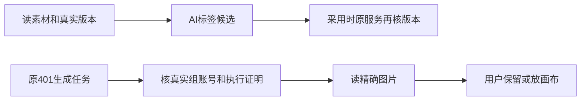

# T-1075 当前验证

更新时间2026-10-08；源码修复已完成，安装恢复待验，任务保持🔨。

素材标签沿原assets.get读取真实内容，再由原标签服务prepare提供真实tagTarget，并重读完整DTO拒绝并发变化；pending和未装配标签入口保持原读取。纯组生图证明按真实组、用户及NULL/实际账号精确核对，原call、receipt、checksum、历史文件校验保留。两者都不直接采纳AI内容。

实际TDD红测5失败；窄适配合法无文件素材的中间失败、夹具范围/类型与错误命令路径全部保留。最终5文件87 PASS、0 skip，原私有PostgreSQL两连接竞态真实运行，随后停止夹具。前端真实tsc与contract通过，后端只剩原2测试错误。隔离链验证了原公共transport、真实对象字节提交、pending→原confirm→confirmed、当前文件替换后仍精确读历史结果，以及跨组/用户/账号/空串拒绝。标签观察零业务写，同source幂等，旧版本标签候选拒绝。

安装版仍是74883948：真实Pi391标签失败、原401生成图pending/unverifiable，PNG已实际下载/完整解码/目视，未确认、未放画布、未重发生图。只有新包下恢复原401/原link并验证真实标签候选采纳后，才能完成本任务。独立实施复核和当前准确摘要见result.json；所有原日志保存在本机t1074-tests。
