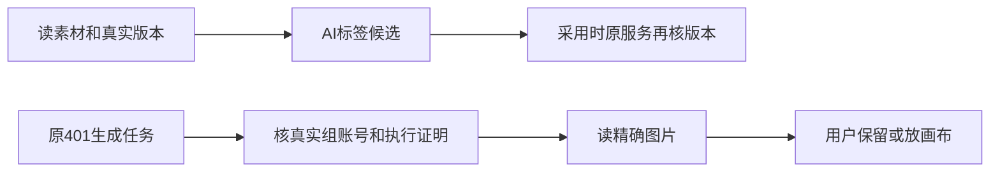

# T-1075 当前验证

更新时间2026-10-08；新b640已实际备份安装，真实Pi标签采纳/读回与原401证明通过；原图保留404仍待修，任务保持🔨。历史快照和最新状态分别保留。

素材标签沿原assets.get读取真实内容，再由原标签服务prepare提供真实tagTarget，并重读完整DTO拒绝并发变化；pending和未装配标签入口保持原读取。纯组生图证明按真实组、用户及NULL/实际账号精确核对，原call、receipt、checksum、历史文件校验保留。两者都不直接采纳AI内容。

实际TDD红测5失败；窄适配合法无文件素材的中间失败、夹具范围/类型与错误命令路径全部保留。最终5文件87 PASS、0 skip，原私有PostgreSQL两连接竞态真实运行，随后停止夹具。前端真实tsc与contract通过，后端只剩原2测试错误。隔离链验证了原公共transport、真实对象字节提交、pending→原confirm→confirmed、当前文件替换后仍精确读历史结果，以及跨组/用户/账号/空串拒绝。标签观察零业务写，同source幂等，旧版本标签候选拒绝。

安装版仍是74883948：真实Pi391标签失败、原401生成图pending/unverifiable，PNG已实际下载/完整解码/目视，未确认、未放画布、未重发生图。只有新包下恢复原401/原link并验证真实标签候选采纳后，才能完成本任务。独立实施复核和当前准确摘要见result.json；所有原日志保存在本机t1074-tests。

冻结提交`b64061ab6bee213c939bf97ad19f423c7090a5ef`的新DMG已实际构建并核镜像/签名，44基本测试通过，SHA`7060b1732a433148ce722df7b0e6f2f18de971f11cebb9a5d8a77d71efb3543d`。完整7文件与留存构建App一致，791后台资源仅核数量，原逐raw.ts源码观察失败保留，不追记为逐源码hash通过。本地ad-hoc/未公证。

安装适配独立PASS报告SHA`8fdcefb632755765cb80a9ea926e3bc8e2eaf73faa00ddafebd9e9ad389b753f`只签5处字面变更、原机制不变和真实制品；不能签新鲜备份或安装。当前可用磁盘不足约6.7GiB完整备份加stage/首次展开，新鲜备份、stage和替换均未执行。原748 App核完整镜像后已恢复启动，CLI connected/full，401实际重启读回仍pending。请求补足本机空间或已挂载APFS备份目的地，不删用户数据/历史备份、不改原备份引擎；T1075安装版复验尚未关闭。

相关的旧748公共手工视频链独立复核PASS，报告SHA`d9022948b29845d3e5b1efd9abc650288d30214bd5b8d0a06400b3e12bff646c`、506引用、0个未闭合限定问题；只作旧安装版兼容性证据，不能关闭本任务的391标签/401证明缺陷。05:50 UTC再次公开status exit0，空间约5.76GiB、需至少10GiB总可用空间；完整备份/stage/新b640安装均未开始，两个缺陷安装复验仍待验。

用户随后明确授权清理旧包/垃圾；T1076已实际删除16个旧DMG并正常卸载6镜像，净释放约9.48GiB，可用约15.13GiB。最新两份b640包、当前App、全部备份和原验收日志保留，公共CLI full；此前磁盘不足是历史快照，当前空间前置已满足，但尚不能写成新鲜备份或安装PASS。详见[清理证据](../t1076/CURRENT_VALIDATION.md)。

## 新b640实际安装与公开复验（最新状态）

用户授权清理16个旧DMG后，原完整备份范围保持不变。旧PID/inode观察过期导致的初次备份失败保留；只将当前3个同源SDK进程和原25条只读映射的身份/文件元数据作字面重绑定，验证函数、路径集、原三个备份引擎和拒绝规则未改变，独立复核PASS。新鲜备份`offline-backup-real-provenance-journal-ruurw1ca`的9步实际全部exit0；完整五根目录、偏好文件与闭包已核。随后stage完整7文件镜像、12步安装/签名/启动全部exit0，旧App保留在安装记录目录，未恢复或重置用户数据。

当前安装源码为`b64061ab6bee213c939bf97ad19f423c7090a5ef`，Native82283/公开服务子进程82477；实际启动日志已验证、公开CLI connected/full。原生可见首页没有代签；启动日志中的config_sync 502仍保留。15类公开读取本轮15/15通过，中位0.54秒、P95 0.85秒、最大0.87秒，这是API观察，不是页面切换时延。剪辑output133当前rev5的完整DTO与安装前深等。

原生图401/原link证明已由unverifiable恢复为available；下载原1024×1024 PNG，1824488字节、SHA`0ccdb849e106162ef260901f93da5904872a3680417b075c42202027bf54374f`，完整解码exit0。没有重发生图。原`ai.tasks.confirm`保留操作实际404“项目不存在”，原execution facade读取也404；最终原task读取仍awaiting_confirmation，尚未确认或放画布。`canvas.generation.confirm`用于授权新生成，不能拿来冒充保存原图，未调用。

真实Pi沿原对话的新续任务170实际复制系统观察到的素材标签版本，产生Source4候选；`ai.assistantActions.adopt`正式采纳后返回tag185/addedCount1，`taxonomy.entityTags.listForEntity`精确读回“中性验收”。这是新续候选，旧失败391保留。回复混入此前取消要求、功能目录空过滤未恢复、根据缺DTO字段推断无标签及暴露版本摘要仍是模型表达/发现欠缺，未签全面可用。

最新实际证据在本机`t1074-installed/t1075-b640-installed-observation.json`及其SHA索引，具体路径/摘要见本目录result.json。T1074/T1075/T1062仍保持进行中，不把限定公开链通过写成原生、自然语言七类剪辑或全功能完成。清理后约15.13GiB是备份前快照；新鲜备份及安装已占用空间，当前空间见最新观察。此前旧包的SHA/日志及独评保留，旧DMG文件已按T1076明确授权删除，不能再声称其文件仍可复核。
