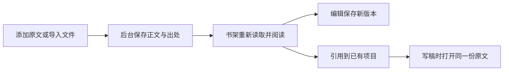

# T-1075｜01资料书架交付验收

用户选择01资料书架，并要求真实读取和写入。默认知识库已接成「资料目录 → 资料列表 → 完整原文」，保存采访或笔记后，可以重载阅读、编辑新版本、整理文件夹，再引用到已有项目。项目打开同一份知识正文；导入保留真实原文件、出处和assetId。关系图、经验、标签与IP课保留在次级入口。

实现提交：53c52138（读写及引用）、b79c4ab3（阅读换行与小屏目录）、945272b1（移动后关闭菜单）、a030dab7（浏览器故障注入处理同步）。最后一项只改测试，真实产品代码对应前述提交。未推送或更新安装版。

## 真实数据链

- 手动保存完整正文、类型、出处与文件夹；保存后回读真实ID，重载后逐字核对版本正文。
- 编辑追加版本，旧版本保留；移动文件夹后继续编辑可用。归档有确认，原条目及项目引用仍保留。
- 原文件实际PUT、上传完成、知识保存、签名GET均经过真实公开链；本轮真实导入为Markdown，无模型调用。
- 项目引用写后读取，同一资料重复引用只有一条边；稿面点击知识卡实际读取原文。
- 当前knowledge.list全量metadata回包使用合法pageSize=100单次读取；超过200份未被截断。项目引用是真分页，102条全部读取、卡片每页12条，最早引用仍能打开。
- 保存成功但列表读取断网，表单改为重读已保存ID，不再次创建；文件夹和修订也保留写回执。手动提交和导入同步互斥。编辑/引用/归档绑定打开弹窗时的ID，浏览器返回不会把A草稿写到B。
- 切组事件立即卸载旧正文和输入，旧scope请求冻结客户端、晚到响应不覆盖新scope；后台拒绝另一组/未知文件夹和另一组原文件，拒绝时无新知识落库。
- 元数据主读取失败显示错误；文件夹及项目实体部分读取失败保留已读内容并提供重试，不伪装空库。

## 已发生的检查

| 检查 | 当场结果 / 证据 |
|---|---|
| 实现前红测 | tdd-frontend-red.log（模块未实现）、tdd-ammo-red.log（完整引用读侧未实现）、tdd-backend-red.log（悬空/越界folder原本可落库）；不补拍历史红测 |
| 实际浏览器红测 | journey-move-red-context.md / journey-move-red.png：菜单移动后仍打开，后续编辑不可访问；随后修复并固定版本GREEN。该轮剩余运行被中断，不写整轮PASS |
| 前端聚焦 | frontend-final.log：5文件31项通过 |
| 知识旧入口兼容 | knowledge-compat.log：课程、知识页面、图谱与归档数据，4文件24项通过 |
| 后台真实持久知识 | backend-green.log：service/acceptance/contract，3文件44项通过 |
| 固定版本浏览器 | journey-final.log：1366×900和1024×768两条完整旅程通过，含207份资料/102条项目引用、原文件GET、错误恢复、返回/重载/重复和切组清理 |
| LED-047 | led047.log：8文件157项通过；同页入口与导入沿既有预算 |
| 超时公共门 | timeout-final.log：通过；正执行/请求/探针保留至少120秒，外层覆盖完整旅程 |
| 前端类型 / lint | typecheck-final.log退出0；lint-visual-final.log无错误；lint-final.log保留已有canonical client测试/SSR默认入口告警，实际路由传请求scope client |
| 后端全量类型 | backend-typecheck-comparison.json：当前与a3aa81d1 CompilerHost基线均15个诊断，无新增；既有欠债归T-1018，不写全量类型全绿 |
| boundary / orphan | boundary-final.log保留同此前7条违规（含同2条live-chat SDK基线外违规）；本任务无新增。orphan-final.log：0错误、100既有告警 |
| 独立SPEC复审 | PASS[REV:0bcfd3f3218a]，2项minor关闭；原审核与复查证据边界见spec-review-recheck.json |
| 独立代码复核 | code-review.md：本轮6项发现已修复；后续菜单问题由实际旅程发现和回归验证 |
| 视觉 / 任务走查 | 3轮独立评分8.3→8.5→9.0，停止迭代；task-walk.md完成真实保存/重载/移动后编辑/项目原文，取消/Esc焦点修复后复查通过 |
| 正式前端合同 | FRONTEND_VALIDATION.md，9个后置条件和6类状态，绑定a030dab7及不可变实际可见文案；frontend-report-validate.log已通过，实际执行回执由taskctl完成事件归档 |

视觉调整：标题回到项目字号；更多操作用既有菜单；反馈放到稳定底部；阅读保留原文换行和段落节奏；中文标题均衡换行；390目录可折叠。删去重复的未选择原文说明。保留原文旁编辑/引用就近操作。第三轮剩余差距是选中态重复信号、空态重复引导和390多资料时正文进入仍晚，属于可继续精修项；正式最低1024窗口无明显碰撞/裁切。切分类清空选择沿已确认clear策略保留，首次移动在更多菜单中是一项次级整理操作。

独立200%检查使用683×450 CSS viewport和DPR2等效布局模拟，内部滚动可到取消/保存；未冒称真实桌面缩放按钮。正式合同只把两个桌面视口作为通过依据。

## 验收边界

所有数据写入隔离临时数据库/本地媒体目录，不是生产库或真实安装版。MD真实导入已验证，PDF/DOCX的模型抽取、AI提炼语义、供应商及生产存量资料未实跑；原持久任务和候选确认门未改。没有运行/复制外部开源仓库，交互借鉴的调研来源保留在RESEARCH.md。

完整reconcile实际退出1，35项错误/1告警：此前34项逐条相同，额外LED-055本次汇总失败；同一源码单独执行该门的26文件301项全部通过。失败原因未定位，已登记现有T-1018根因任务，不能推定为并发或内存问题，也不以重跑覆盖原失败。见reconcile-comparison.json及led055-isolated.log。本任务自身真实读写、UI及资源门已通过，不写全局全绿；taskctl已再次实际执行相同浏览器命令，完成事件记录verification_executed=true、代码提交a030dab7和输出指纹；正式完成回执见task-complete.log与orchestrator/events.ndjson。

原始终端日志完整字节保存在对应`.log.raw.gz`，SHA登记于raw-log-archives.json；可读`.log`只清理尾空白和多余空行，断言及结果未改写。
