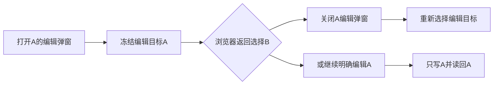

# T-1075 独立代码复核

2026-10-09，第二轮复核。只读审查当前工作树，仅更新本审查文件；不修改源码、看板或审计。已读 BACKLOG、SPEC、PAGE_SPEC、项目记忆、产品流程 3.29.0 与物理架构。范围是资料书架、详情/导入复用、项目用料读侧及知识创建的文件夹/原文件校验。

本记录只报告有代码依据的缺陷。未重新运行浏览器旅程、完整类型检查或安装版测试，不把主会话尚未完成的测试记为失败；“代码修复已核对”不等于浏览器验收通过。

## 最终代码结论

本次发现的六条缺陷均已核对代码修复，当前无开放的明确代码缺陷。结论限定为本次审查范围，不代替最终 Gate 与真实浏览器证据。

## 历史导航改变实体弹窗目标：已关闭

第二轮发现：open("edit") 只记录正文，saveEdit 使用 URL 当下的 selected.id；编辑 A 时浏览器返回到 B，会把 A 的草稿创建为 B 的新版本。

当前修复已核对：open 实体弹窗保存 modalTarget；saveEdit 的创建、成功回执重读均使用 modalTarget.id；项目引用和归档同样使用冻结目标，归档文案显示该目标标题。requested 改变时关闭未提交的实体弹窗；在途锁期间继续原 ID 的请求，历史导航不会改变已发出动作的对象。后续再打开编辑会清除旧修订回执并填入新目标正文。

E2E 源码已增加编辑 A 草稿→Back→弹窗关闭→核对 B 仍只有原版本→Forward 的回归路径。本审查只核对该测试代码，不冒称已执行通过。

## 首轮四个发现的代码修复复核

| 首轮发现 | 当前代码修复 | 复核结果 |
|---|---|---|
| 切组期间旧草稿可能写入新组 | 路由传 scope，KnowledgeLibrary 创建冻结 scope 的 client；切组事件令 wrapper 失效、卸载 workspace；该 client 传给详情、原文件链接、导入及提取轮询 | 原发现已关闭；请求不再读取新组作为旧草稿的归属，旧 workspace 与子详情的晚到回写由卸载清理阻止 |
| 移动后编辑持续禁用 | move 不再 setLoaded(null)；详情 key 同时绑定 selected.currentRevisionId，版本变动实际触发重读 | 原发现已关闭；移动不改变正文时保留可编辑的已读内容 |
| 写成功、读失败后重试再次创建 | savedId / savedFolderId / savedRevisionId 保留成功回执；重试走同一 ID 读回分支，已提交输入锁定，按钮说明“重新读取” | 原发现已关闭；代码已区分写失败与读侧恢复，弹窗目标绑定增量亦已修复 |
| 父手动保存和子导入可并行 | 父 run 检查同步 lock/importing；子导入先同步调用 onBusyChange(true) 取得互斥能力，再设置自身 importLock；input/按钮/确认/drop 调用链守外部 disabled 和自身锁 | 原发现已关闭；未见两个正常提交入口同时取得锁的路径 |

## 项目用料错误恢复增量

第二轮初读发现 resolveAmmo 的逐实体读取失败仍被 catch/null 隐藏，已即时反馈。当前代码已增加 failedEntities 与 onReadError 汇总，成功条目仍保留，部分失败显示警告及“重新读取项目资料”；分页主读失败同样有可见错误，AmmoDrawer 在空集合伴随 readError 时仍挂载恢复入口。该增量发现已按当前代码关闭，不因一个失效资源让整区 hard-fail。

## 数据契约与审查边界

knowledge.list 的现有 transport 确实返回完整集合；书架合法请求 pageSize=100、未假分页或截断。项目及 materialLinks 是真分页，readPagedRows 按 100 条逐页读取并检查重复 ID。文件夹引用校验在知识创建事务内，原文件经 assets service 读取并检查 active；现有下载 URL、blob 授权与显式 grant 读守卫均有实际消费者。

以上只说明代码路径已核对，未推定原文件真实 GET、共享资源旅程、最终类型/lint、供应商、生产数据或安装版验收已完成。全部审查发现已关闭；最终旅程与 Gate 证据仍由主会话取得。
