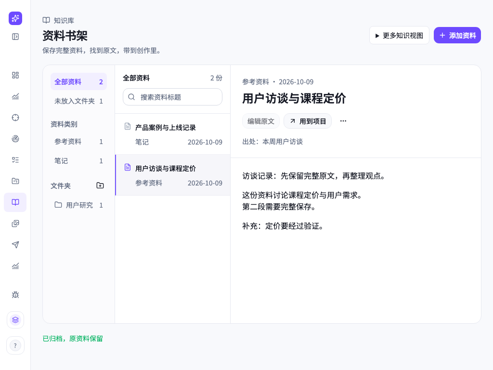

# T1075 独立视觉评审 · 第 1 轮

评审日期：2026-10-09。范围：用户选定的「01 资料书架」正式页面，目录/分类 → 资料列表 → 完整原文；保存、编辑、文件夹和项目引用属于任务约束。仅查看当前五张截图和设计规范，未读取源码、制作历史或其他评分，未操作页面。

依据：项目内 `oil-ui-pro` 0.10.0 及其 `references/visual-review.md`，以及 `docs/features/t1022-account-group-workspace/UI_RULES.md`。这是新页面的独立视觉评分；功能任务走查由主会话另行完成。

**当前评分：8.3 / 10。** 骨架、阅读顺序和品牌一致性已经成立；距离优秀知识管理工具的差距，主要是操作语法不够完整、少量重复信息和状态间的空间稳定性。没有看到正文碰撞、窄窗裁切或主动作竞争等严重构图问题。评分只代表所见画面的完成度，不代表保存、导入或引用成功。

## 画面要成为什么

它是高频使用的资料管理与阅读工作区：把资料放好、找到原文，再将原文带进创作。冷静的紫色选中态、淡画布、三栏结构符合这个品类；没有为了“书架”意象增加无用装饰，方向正确。

可参照的品类包括 Apple Notes、Obsidian 和 Notion：前两类突出目录、对象和当前正文的连续关系，后一类强调内容与操作的上下文关系。这些只是成熟工具的常见组织方式参照，本轮未调取它们的现行页面作逐像素对比。当前画面没有明显复制某一家；CreatorOS 的全局侧栏与紫色选择态形成了自己的产品语法。这个品类的记忆点应集中在“选中资料便能安心读完整原文”，不需要补营销式主视觉。

优秀团队会保留现有三栏，将操作控件做得更一致，让状态原地出现，并减少解释性文字，让资料成为主要内容。

## 最大差距与必要调整

### 1. 原文的更多操作不够像一个完整控件

- **位置**：`final-1366.png`、`final-1024.png`、`error-1024.png`、`import-1024.png` 的正文标题下，“用到项目”右侧。
- **观察**：一个小三角在上、省略号在下，和旁边两个完整的胶囊按钮不在同一视觉基线上；其可见范围也明显小于邻近按钮。看起来像两个残留符号，而不是一个稳定的更多菜单入口。
- **影响**：真实资料管理需要用户找到移动、删除等管理动作。这处控件要求猜测，削弱了当前对象与操作的关系。属于必要可用性修正，不是换风格的偏好。
- **建议**：使用项目现有的更多菜单组件，将省略号放入与同行按钮同高的单个按钮；去掉三角。保持同一基线与间距，并提供清楚的可访问名称。不能由截图断言当前点击范围或名称已经有问题，需真实走查核对。
- **验证**：1024 与 1366 均看得到一个清楚的入口；键盘可聚焦、打开、退出并回到触发位置；主会话核对菜单动作真实有效。

### 2. 全页标题与状态占用偏多，资料进入工作区偏晚

- **位置**：所有截图的页面头部；正常状态截图额外出现绿色“已归档，原资料保留”。
- **观察**：页面标题的视觉字号约 32px，明显大于规范的 24px 页面标题。标题、用途说明、绿色状态组成三层头部，使正常态工作区从约 y=183 开始；空态、错误态与导入态从约 y=143 开始。工作区之间因此有约 40px 的垂直差异。
- **影响**：高频工具的第一对象被向下推，状态出现时工作区位置不稳定。绿色文字离触发对象较远，也不能一眼看出是哪一份资料的结果。
- **建议**：页面标题回到既有 24px token。将结果反馈放在相关操作或资料区域的稳定位置，或使用现有不挤占布局的反馈组件；保留有价值的结果文字，不长期占据全页头部。不要以此删除用户需要的反馈。
- **验证**：同视口比较正常、空、错误、导入后的工作区起点；确认状态变化不推动列表和正文。确切字号与反馈时序须主会话核对，截图只能支持视觉判断。

### 3. 空状态出现两份“如何开始”的说明

- **位置**：`empty-1366.png` 中间栏“书架还是空的”区与右侧“把资料留在书架里”区。
- **观察**：两处都在说明添加资料后的用途；中间栏已有“添加第一份资料”，页面右上已有唯一紫色主动作“添加资料”。右侧大面积空白又重复一遍引导，视觉焦点分散。
- **影响**：初次使用的阅读顺序拖长，主角变成解释界面的文案，而不是添加后会出现的对象关系。
- **建议**：中间栏保留空状态和中性的添加入口；右栏改为简短的“添加资料后，在这里阅读原文”，或只保留图标与一句说明。保留唯一紫色主动作“添加资料”，不把空态入口也升级成第二个紫色动作。
- **验证**：第一次使用时，能够立即辨认下一步；一屏不重复讲述同一功能。该项是有依据的减法建议，不是核心功能阻断。

## 密度与响应式

- 1366 正常态显示 2 份资料；1024 正常态同样显示 2 份，导入态显示 3 份。首条列表对象约从 y=284 开始，资料标题和日期在同一行组内，列表标题与资料正文清楚分开。
- 每个资料行约 85px，当前内容量下便于辨认。空白主要来自真实对象少、原文短，不能靠添加虚假资料或无用卡片填满。暂不建议为了“丰满”改变密度；应补足真实长标题、多条资料和长原文证据后再判断。
- 全局侧栏在 1024 下折叠为图标栏，三栏内容仍完整，没有观察到横向裁切。窄窗正文还有约 470px 可读区域；中文正文看起来处于 14–16px 范围。
- 紫色基本用于唯一主动作、导航和当前选择，面积克制；画布、正文与次文符合项目既有语法。未见渐变、发光或无意义的嵌套卡片。
- “编辑原文”和“用到项目”紧邻当前标题，距离合理。“添加资料”处于稳定的页面右上角，符合全库新增动作。原文件的“查看原文件”位于导入资料的头部，容易关联到当前对象。

## 可以直接删掉或缩短的文字

1. 空态右栏的“添加笔记、文章和逐字稿，保存后就能阅读和用于写稿。”与页面用途说明重复，可缩为“添加资料后，在这里阅读原文”。
2. 资料元信息里的“已保存资料”对每次打开都没有额外判别力；可保留资料类别，只有状态发生变化时再显示相关反馈。若真实流程需要区分草稿与已保存，则保留，并由主会话说明其必要性。

不建议删除“出处”、资料类别、日期、真实计数、网络错误原因或重试入口，这些有助于判断对象与恢复任务。

## 看得见的细节瑕疵

| 位置 | 观察 | 调整与验证 |
| --- | --- | --- |
| 原文更多入口 | 三角与省略号上下叠放，未与同行按钮对齐 | 统一为单个按钮，检查基线、点击与键盘行为 |
| 页面大标题 | 视觉上超过 24px 规范 | 回到既有页面标题 token，复看标题与原文标题的层级 |
| 错误截图底部 | 红色 `1 Issue` 开发浮层叠在个人身份区域；其他截图有黑色 `N` 浮层 | 最终验收截图去掉开发工具浮层，真实产品显示不应遮住导航；它不能证明产品自身出错 |
| 空态侧栏底部 | 账号组仍显示“载入账号组…”而主体已展示空库 | 核对这是独立加载阶段还是最终稳定状态；若仍在加载，不将本图当成组上下文稳定后的空状态证据 |

列表行分隔、日期右对齐、正文边界和主要按钮基线总体整齐，没有为了凑数另列圆角或阴影问题。

## 状态与功能边界

- 错误在正文读取位置展示，并保留目录与列表，以及明确的“重新读取正文”入口，这是好的局部恢复表达。截图中“编辑原文”变灰，但“用到项目”仍可用；需要主会话核对在正文不可读时引用是否有合法路径以及反馈是否清楚，不能据此直接判为功能缺陷。
- 空态真实显示 0，没有编造资料。导入图显示文件名、文件导入类别、原文件入口和正文；只能证明这些元素可见，不能证明文件保存或读取成功。
- 未查看加载态、权限态、部分失败、长文件名、多资料、长原文、编辑表单、添加弹层、文件夹操作或项目引用结果；未验证 200% 缩放、滚动区、Tab/Enter/Esc、焦点返回、实际控件点击范围或可访问名称。
- 本轮未做真实任务走查，也未执行文字删除或细节修改，只交付评审意见。无多个候选方向，因此没有横向雷同比较；没有动效材料，因此未评审动态记忆点。

**结论**：保留资料书架方向与三栏骨架。先修更多菜单的可辨认性，随后稳定头部和反馈位置、收紧空状态文字；再补长内容与真实操作证据。当前画面可以清楚读懂任务，但尚不能用这五张截图确认所有必要功能可用。
