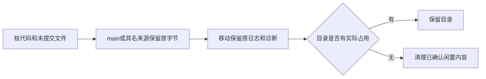

# T1080 独立只读清理复核

记录时间：2026-10-10T08:53:56.374388+00:00。当前 main：`03e73b5aa33da1268fda6770994d7c0bf807437e`。

本轮只读取 Git 状态、目录与文件名、大小、源文件哈希、App 公开元数据及进程 cwd/打开文件。没有删除、停止进程、修改 Git、读取凭据/数据库/媒体或向其他桌面会话发消息；唯一写入是本报告。依据任务 SPEC、AGENTS 与 `product-to-code-orchestrator` 3.29.0 执行，阶段为 BUILD。

清理要同时做到：代码留在 Git 中、原始证据留下、实际正在用的目录不动。当前 main 和 ambient 保留；微信研究树有真实运行服务，保留；t188 只有在脏项目文件入 Git、原始诊断移动保留及占用复核后才具备清理条件。



## 注册工作区

当场 `git worktree list --porcelain` 为 4 树。逐一核 `.git` 指针，都归属 `/Users/zyongzhu/Workbase/Thirdspace-creator/.git`。`.codex/worktrees` 的一、二层目录另发现两处没有 `.git` 的遗留源码壳，见下节；没有额外同仓库 Git 入口。

|路径|HEAD|状态|实际占用与允许条件|
|---|---|---|---|
|`/Users/zyongzhu/Workbase/Thirdspace-creator`|`45ff5ff5e6676d32be38c834660bab88c238a2ba`|0 项：0 tracked、0 untracked|主 Git 仓库、当前聊天 cwd；保留。忽略目录含 .auth、既有 backups 与原日志。|
|`/Users/zyongzhu/.codex/worktrees/t1062-client-integration/Thirdspace-creator`|`03e73b5aa33da1268fda6770994d7c0bf807437e`|235 项：235 tracked、0 untracked|唯一 main 整合/构建目录；保留至交付及以后正常开发，不能清空当前 target。|
|`/Users/zyongzhu/.codex/worktrees/t188-completion-creator/Thirdspace-creator`|`430cc8cff8b730950623b5d97c725a05a257a904`|268 项：17 tracked、251 untracked|本轮首次展开为 268 项（17 tracked、251 untracked）；当场未见持续进程引用。须项目改动提交与保留、下述诊断原字节移走后，由根会话再次核所属会话与占用才可普通 remove。|
|`/Users/zyongzhu/.codex/worktrees/wechat-stats-evidence/Thirdspace-creator`|`a3bc947d4bcb70be5c14f11ff56639a54b184b31`|0 项：0 tracked、0 untracked|运行研究服务；保留、不关闭。源码与日志也需保留。|

08:46 UTC 的进程证据：微信 PID `45377` cwd 为树根，PID `45425` 与 `45431` cwd 为 `frontend`；`45431` 是 `next-server (v16.2.9)`、PPID `45425`，监听 `127.0.0.1:31410`，打开 `.next/dev/cache/turbopack` 文件。三者均运行约 3 小时 44 分钟。OS 路径没有出现 `space20` 字样，这不足以认定该浏览器研究空间已关闭；服务占用已经足够裁定保留。

ambient 08:46 UTC 有 73 个 cwd 引用，包括 Codex 与多个 Python/node/MCP 进程。不能从进程名称推定可结束；它是当前聊天的主仓库，全部保留。main 还存在根会话/审计的短时 Git/Python 操作，构建目录无论当场是否有构建进程都保留。t188 未见 cwd/打开文件引用，只能证明采样瞬间没有 OS 文件占用，不能据此代签其他聊天已退出。

## 未注册的遗留源码

两个源文件首次核验均不等于当前 main，且其 Git blob 不在 `git rev-list --objects --all` 或 `main` 的可达对象中。根会话已表示会先把原字节纳入具名历史来源，保留为历史候选，再核无占用并删壳；不能用其旧实现覆盖当前功能。

- `/Users/zyongzhu/.codex/worktrees/101d/Thirdspace-creator/docs/assets/orchestrator-loop.html`：37810 字节；SHA256 `681c732a6d127c644e16597a692d533f2bac01419b3daec718e925097ff98891`；Git blob `a2fe39e4cc5580fd66a10eac328df9b5e3dadd96`；本报告最新核验可达任意分支：False。
- `/Users/zyongzhu/.codex/worktrees/Thirdspace-creator/frontend/src/features/article/doocs-article-editor.tsx`：11124 字节；SHA256 `23934f349877f19daad6fa06b6cd1153650e5b1b4d736ccdef91e0de6547aac9`；Git blob `85165a5670169534ef2674bc16c86ef38a5a825a`；本报告最新核验可达任意分支：False。

另有 10 个真正空 wrapper；当前路径与占用在下面 manifest。可在根会话确认归属且清理瞬间仍为空、无引用后用 `rmdir` 删除。`creator-canvas` 只有零字节 `.codex-worktree-name`，当场无引用；可核清其旧名称标记归属后清掉。ambient 的 `.worktrees` 只有 `.DS_Store`，不是 Git 工作树且处于保留主目录内，不需要为此扩大清理。

## t188 原始证据保留与可再生内容

Git 忽略文件总数 238514；排除依赖/缓存/构建目录后的忽略文件 8124。`docs` 必须保留 170 个原始文件：`docs/verification/t1072` 143、`t208` 20、`t210` 7。扩展名计数为 `{".log": 166, "<none>": 1, ".enc": 2, ".bin": 1}`，其中加密/二进制诊断也保留，不读内容。

`.t1072-baseline-diagnostic` 是既有、没有 `.git` 的诊断基线。非再生文件 7947 个，含 1879 份 `.log`、93 份 `.gz`、35 份 `.mp4`，以及原源码/账本/截图/媒体与基线文档。不能把整个忽略目录当缓存删掉。按根会话授权将原文件移动到受保护私有验收目录，记录原路径、目标路径及哈希；移动后的诊断仍需可定位，不能销掉历史失败。

`node_modules`、`.next`、Tauri `target*`、`.turbo`、明确生成的 `dist/build`、`.codegraph` 生成索引、`next-env.d.ts` 与 Tauri `gen/schemas` 属于可再生候选。仅在无占用、源码已保留、确认目录内没有用户媒体/原诊断后清理；保留的 main target 与活跃微信 `.next` 不在本轮删除范围。

微信树还存在两份 Git 忽略原日志：`docs/verification/t1110/dom-correction-typecheck-20261010.log` 与 `dom-correction-worker-full-20261010.log`。当前保留树自然保留它们；未来清理必须先移动原证据。

## 安装包与已安装 App

按文件名及 App `CFBundleIdentifier` 识别 `/Applications`、用户 `Applications`、`Downloads`、`Desktop`；另递归检查四工作区的 `src-tauri/target*` 包装范围。没有发现其他 CreatorOS EXE/DMG/App 副本。当前只有：

|路径|实际识别|保留/清理条件|
|---|---|---|
|`/Applications/CreatorOS.app`|1.2.0；`cloud.aitongban.creatoros`；约 829820 KiB；PID `46836` 正在运行且 cwd `/`|当前已安装 App 必须保留。新包核验后沿已有安装授权替换，不能当旧副本直接删。|
|`/Users/zyongzhu/Downloads/CreatorOS-1.2.0.dmg`|841223134 字节；SHA256 `d91079d6542407a6f5c3232f35cd815cfaff259c51fa9e40e5ccf030eb10a1d1`|当前可用 DMG 保留至新包通过制品核验；新包成功后可删除上一包。|
|`/Users/zyongzhu/.codex/worktrees/t1062-client-integration/Thirdspace-creator/frontend/src-tauri/target/release-fast/bundle/dmg/CreatorOS_1.2.0_aarch64.dmg`|同一字节长度、同一 `d91079d6…` SHA256|现有构建制品；当前 main 打包期间不作为空闲旧工作区删除。|
|`/Users/zyongzhu/.codex/worktrees/t1062-client-integration/Thirdspace-creator/frontend/src-tauri/target/release-fast/bundle/macos/CreatorOS.app`|1.2.0；同 bundle ID；约 829820 KiB|现有构建 App；当前 main 保留，新包成功后按构建产物管理。|

两个 DMG 的 SHA256 当场分别读取并完全一致；`hdiutil info` 没有 CreatorOS 镜像挂载。哈希期间的短时 Perl 引用属于本审计读取，不表示额外服务器。

## 清理 manifest

该 manifest 只记录路径、数量、类别、Git 及进程证据，不包含凭据、数据库内容或用户媒体内容。根会话执行移动/删除后应在原任务记录实际回执，并重新核状态/占用；本只读报告不代签清理已经完成。

```json
{
  "schema": "t1080-independent-cleanup-audit@1",
  "snapshotUtc": "2026-10-10T08:53:56.374388+00:00",
  "mainHead": "03e73b5aa33da1268fda6770994d7c0bf807437e",
  "registeredWorktrees": [
    {
      "path": "/Users/zyongzhu/Workbase/Thirdspace-creator",
      "head": "45ff5ff5e6676d32be38c834660bab88c238a2ba",
      "branch": "codex/t1062-account-group-snapshot",
      "statusCount": 0,
      "trackedChanges": [],
      "untrackedFileCount": 0,
      "headAncestorOfMain": false
    },
    {
      "path": "/Users/zyongzhu/.codex/worktrees/t1062-client-integration/Thirdspace-creator",
      "head": "03e73b5aa33da1268fda6770994d7c0bf807437e",
      "branch": "main",
      "statusCount": 235,
      "trackedChanges": [
        "M  ai-worker/src/prompt/templates/topic-generate.ts",
        "M  backend/src/application/knowledge.ts",
        "M  backend/src/modules/ai-runtime/topic-business-adapter.test.ts",
        "M  backend/src/modules/ai-runtime/topic-business-adapter.ts",
        "M  backend/src/modules/knowledge/knowledge.acceptance.test.ts",
        "M  backend/src/modules/knowledge/knowledge.contract.test.ts",
        "M  backend/src/modules/knowledge/knowledge.repository.ts",
        "M  backend/src/modules/knowledge/knowledge.service.test.ts",
        "M  backend/src/modules/knowledge/knowledge.service.ts",
        "A  docs/features/t1074-remove-topic-grid.md",
        "A  docs/features/t1074-remove-topic-grid.review.md",
        "A  docs/features/t1075-knowledge-redesign.md",
        "A  docs/features/t1075-knowledge-redesign.review.md",
        "A  docs/features/t1075-knowledge-redesign/PAGE_SPEC.md",
        "A  docs/features/t1075-knowledge-redesign/RESEARCH.md",
        "A  docs/features/t1075-knowledge-redesign/candidates.tsx",
        "A  docs/features/t1075-knowledge-redesign/images/a.png",
        "A  docs/features/t1075-knowledge-redesign/images/b.png",
        "A  docs/features/t1075-knowledge-redesign/images/baseline.png",
        "A  docs/features/t1075-knowledge-redesign/manifest.json",
        "A  docs/features/t1075-knowledge-redesign/preview-route.tsx",
        "A  docs/features/t1075-knowledge-redesign/style-explorer.html",
        "A  docs/verification/local-cleanup-20261009-result.json",
        "A  docs/verification/local-cleanup-20261009.md",
        "A  docs/verification/t1074/REPORT.md",
        "A  docs/verification/t1074/after-1024.png",
        "A  docs/verification/t1074/after-1366.png",
        "A  docs/verification/t1074/boundary.log",
        "A  docs/verification/t1074/browser-regression.cjs",
        "A  docs/verification/t1074/browser.log",
        "A  docs/verification/t1074/frontend-lint.log",
        "A  docs/verification/t1074/frontend-typecheck-final.log",
        "A  docs/verification/t1074/frontend-typecheck.log",
        "A  docs/verification/t1074/green-backend.log",
        "A  docs/verification/t1074/green-frontend.log",
        "A  docs/verification/t1074/implementation-review.md",
        "A  docs/verification/t1074/legacy-adoption.log",
        "A  docs/verification/t1074/orphan.log",
        "A  docs/verification/t1074/pmem-sync-final.log",
        "A  docs/verification/t1074/pmem-sync.log",
        "A  docs/verification/t1074/reconcile-comparison.json",
        "A  docs/verification/t1074/reconcile.log",
        "A  docs/verification/t1074/red-frontend.log",
        "A  docs/verification/t1074/red.log",
        "A  docs/verification/t1074/route-typegen.log",
        "A  docs/verification/t1074/spec-review.json",
        "A  docs/verification/t1074/worker.log",
        "A  docs/verification/t1075/DESIGN_REVIEW.md",
        "A  docs/verification/t1075/FRONTEND_VALIDATION.md",
        "A  docs/verification/t1075/VERIFICATION.md",
        "A  docs/verification/t1075/backend-contract-final.log",
        "A  docs/verification/t1075/backend-contract-final.log.raw.gz",
        "A  docs/verification/t1075/backend-final.log",
        "A  docs/verification/t1075/backend-final.log.raw.gz",
        "A  docs/verification/t1075/backend-green.log",
        "A  docs/verification/t1075/backend-green.log.raw.gz",
        "A  docs/verification/t1075/backend-typecheck-baseline.log",
        "A  docs/verification/t1075/backend-typecheck-baseline.log.raw.gz",
        "A  docs/verification/t1075/backend-typecheck-comparison.json",
        "A  docs/verification/t1075/backend-typecheck.log",
        "A  docs/verification/t1075/backend-typecheck.log.raw.gz",
        "A  docs/verification/t1075/baseline-empty.png",
        "A  docs/verification/t1075/baseline.png",
        "A  docs/verification/t1075/boundary-comparison.json",
        "A  docs/verification/t1075/boundary-final.log",
        "A  docs/verification/t1075/boundary-final.log.raw.gz",
        "A  docs/verification/t1075/boundary.log",
        "A  docs/verification/t1075/boundary.log.raw.gz",
        "A  docs/verification/t1075/candidate-a-1024.png",
        "A  docs/verification/t1075/candidate-a-390.png",
        "A  docs/verification/t1075/candidate-a.png",
        "A  docs/verification/t1075/candidate-b-1024.png",
        "A  docs/verification/t1075/candidate-b-390.png",
        "A  docs/verification/t1075/candidate-b.png",
        "A  docs/verification/t1075/candidates.log",
        "A  docs/verification/t1075/capture-baseline.cjs",
        "A  docs/verification/t1075/capture-candidates.cjs",
        "A  docs/verification/t1075/code-review.md",
        "A  docs/verification/t1075/context-compile-final.log",
        "A  docs/verification/t1075/context-compile-final.log.raw.gz",
        "A  docs/verification/t1075/context-compile.log",
        "A  docs/verification/t1075/context-compile.log.raw.gz",
        "A  docs/verification/t1075/empty-1024.png",
        "A  docs/verification/t1075/empty-1366.png",
        "A  docs/verification/t1075/error-1024.png",
        "A  docs/verification/t1075/error-1366.png",
        "A  docs/verification/t1075/explorer.log",
        "A  docs/verification/t1075/explorer.png",
        "A  docs/verification/t1075/extreme-390.png",
        "A  docs/verification/t1075/final-1024.png",
        "A  docs/verification/t1075/final-1366.png",
        "A  docs/verification/t1075/format.log",
        "A  docs/verification/t1075/format.log.raw.gz",
        "A  docs/verification/t1075/frontend-final.log",
        "A  docs/verification/t1075/frontend-final.log.raw.gz",
        "A  docs/verification/t1075/frontend-green.log",
        "A  docs/verification/t1075/frontend-green.log.raw.gz",
        "A  docs/verification/t1075/frontend-receipt-audit-before-complete.log",
        "A  docs/verification/t1075/frontend-receipt-audit-before-complete.log.raw.gz",
        "A  docs/verification/t1075/frontend-receipt-audit-final.log",
        "A  docs/verification/t1075/frontend-receipt-audit-final.log.raw.gz",
        "A  docs/verification/t1075/frontend-report-validate.log",
        "A  docs/verification/t1075/frontend-report-validate.log.raw.gz",
        "A  docs/verification/t1075/import-1024.png",
        "A  docs/verification/t1075/import-1366.png",
        "A  docs/verification/t1075/journey-before-visual-fix.log",
        "A  docs/verification/t1075/journey-before-visual-fix.log.raw.gz",
        "A  docs/verification/t1075/journey-final.log",
        "A  docs/verification/t1075/journey-final.log.raw.gz",
        "A  docs/verification/t1075/journey-first.log",
        "A  docs/verification/t1075/journey-first.log.raw.gz",
        "A  docs/verification/t1075/journey-move-red-context.md",
        "A  docs/verification/t1075/journey-move-red.log",
        "A  docs/verification/t1075/journey-move-red.log.raw.gz",
        "A  docs/verification/t1075/journey-move-red.png",
        "A  docs/verification/t1075/journey-observations-bound.json",
        "A  docs/verification/t1075/journey-observations.json",
        "A  docs/verification/t1075/journey-route-race.log",
        "A  docs/verification/t1075/journey-route-race.log.raw.gz",
        "A  docs/verification/t1075/journey-second.log",
        "A  docs/verification/t1075/journey-second.log.raw.gz",
        "A  docs/verification/t1075/journey-third.log",
        "A  docs/verification/t1075/journey-third.log.raw.gz",
        "A  docs/verification/t1075/knowledge-compat.log",
        "A  docs/verification/t1075/knowledge-compat.log.raw.gz",
        "A  docs/verification/t1075/large-collection-1366.png",
        "A  docs/verification/t1075/led047.log",
        "A  docs/verification/t1075/led047.log.raw.gz",
        "A  docs/verification/t1075/led055-isolated.log",
        "A  docs/verification/t1075/led055-isolated.log.raw.gz",
        "A  docs/verification/t1075/lint-final.log",
        "A  docs/verification/t1075/lint-final.log.raw.gz",
        "A  docs/verification/t1075/lint-visual-final.log",
        "A  docs/verification/t1075/lint-visual-final.log.raw.gz",
        "A  docs/verification/t1075/lint.log",
        "A  docs/verification/t1075/lint.log.raw.gz",
        "A  docs/verification/t1075/long-title-1024.png",
        "A  docs/verification/t1075/long-title-1366.png",
        "A  docs/verification/t1075/orphan-final.log",
        "A  docs/verification/t1075/orphan-final.log.raw.gz",
        "A  docs/verification/t1075/orphan.log",
        "A  docs/verification/t1075/orphan.log.raw.gz",
        "A  docs/verification/t1075/pmem-sync-after-complete.log",
        "A  docs/verification/t1075/pmem-sync-after-complete.log.raw.gz",
        "A  docs/verification/t1075/pmem-sync.log",
        "A  docs/verification/t1075/pmem-sync.log.raw.gz",
        "A  docs/verification/t1075/preview-server.log",
        "A  docs/verification/t1075/preview-server.log.raw.gz",
        "A  docs/verification/t1075/progress-final.log",
        "A  docs/verification/t1075/progress-final.log.raw.gz",
        "A  docs/verification/t1075/raw-log-archives.json",
        "A  docs/verification/t1075/reader-1024.png",
        "A  docs/verification/t1075/reader-1366.png",
        "A  docs/verification/t1075/reconcile-comparison.json",
        "A  docs/verification/t1075/reconcile.log",
        "A  docs/verification/t1075/reconcile.log.raw.gz",
        "A  docs/verification/t1075/reference-1024.png",
        "A  docs/verification/t1075/reference-1366.png",
        "A  docs/verification/t1075/review-recheck.log",
        "A  docs/verification/t1075/review-recheck.log.raw.gz",
        "A  docs/verification/t1075/run-journey.mjs",
        "A  docs/verification/t1075/selection-1024.png",
        "A  docs/verification/t1075/selection-1366.png",
        "A  docs/verification/t1075/spec-review-implementation.json",
        "A  docs/verification/t1075/spec-review-recheck.json",
        "A  docs/verification/t1075/start-preview.mjs",
        "A  docs/verification/t1075/task-complete.log",
        "A  docs/verification/t1075/task-complete.log.raw.gz",
        "A  docs/verification/t1075/task-walk.md",
        "A  docs/verification/t1075/tdd-ammo-red.log",
        "A  docs/verification/t1075/tdd-ammo-red.log.raw.gz",
        "A  docs/verification/t1075/tdd-backend-red.log",
        "A  docs/verification/t1075/tdd-backend-red.log.raw.gz",
        "A  docs/verification/t1075/tdd-frontend-red.log",
        "A  docs/verification/t1075/tdd-frontend-red.log.raw.gz",
        "A  docs/verification/t1075/timeout-final.log",
        "A  docs/verification/t1075/timeout-final.log.raw.gz",
        "A  docs/verification/t1075/timeout.log",
        "A  docs/verification/t1075/timeout.log.raw.gz",
        "A  docs/verification/t1075/typecheck-final.log",
        "A  docs/verification/t1075/typecheck-final.log.raw.gz",
        "A  docs/verification/t1075/typecheck.log",
        "A  docs/verification/t1075/typecheck.log.raw.gz",
        "A  docs/verification/t1075/typegen.log",
        "A  docs/verification/t1075/typegen.log.raw.gz",
        "A  docs/verification/t1075/verify-explorer.cjs",
        "A  docs/verification/t1075/visible-copy-bound.json",
        "A  docs/verification/t1075/visible-copy.json",
        "A  docs/verification/t1075/visual-review-round1.md",
        "A  docs/verification/t1075/visual-review-round2.md",
        "A  docs/verification/t1075/visual-review-round3.md",
        "A  docs/verification/t1075/walk-01-empty.png",
        "A  docs/verification/t1075/walk-02-reloaded-original.png",
        "A  docs/verification/t1075/walk-03-folder-edited.png",
        "A  docs/verification/t1075/walk-04-project-setup.png",
        "A  docs/verification/t1075/walk-05-project-picker.png",
        "A  docs/verification/t1075/walk-06-project-original.png",
        "A  docs/verification/t1075/walk-07-1024.png",
        "A  docs/verification/t1075/walk-08-1024-edit.png",
        "A  docs/verification/t1075/walk-09-200-percent.png",
        "A  docs/verification/t1075/walk-10-200-percent-edit.png",
        "A  docs/verification/t1075/walk-11-390.png",
        "A  docs/verification/t1075/walk-12-390-edit.png",
        "A  docs/verification/t1075/walk-13-final-1366.png",
        "A  docs/verification/t1075/walk-14-200-percent-scrolled.png",
        "A  docs/verification/t1080/current-20261010/source-primary-control/BACKLOG.md",
        "A  docs/verification/t1080/current-20261010/source-primary-control/PROJECT.md",
        "A  docs/verification/t1080/current-20261010/source-primary-control/docs/verification/t1074/spec-review-recheck.json",
        "A  docs/verification/t1080/current-20261010/source-primary-control/orchestrator/.lessons-stats.json",
        "A  docs/verification/t1080/current-20261010/source-primary-control/orchestrator/DECISION_LOG.md",
        "A  docs/verification/t1080/current-20261010/source-primary-control/orchestrator/context/T-1075.md",
        "A  docs/verification/t1080/current-20261010/source-primary-control/orchestrator/events.ndjson",
        "A  docs/verification/t1080/current-20261010/source-primary-control/orchestrator/process/modules.config.json",
        "A  docs/verification/t1080/current-20261010/source-primary-control/orchestrator/process/reconcile.config.json",
        "A  docs/verification/t1080/current-20261010/source-primary-control/orchestrator/progress.json",
        "A  docs/verification/t1080/current-20261010/source-primary-control/orchestrator/review-events.ndjson",
        "M  frontend/src/app/(creator)/knowledge/page.tsx",
        "M  frontend/src/features/draft-workbench/ammo-card-list.tsx",
        "A  frontend/src/features/draft-workbench/draft-workbench-data.test.ts",
        "M  frontend/src/features/draft-workbench/draft-workbench-data.ts",
        "M  frontend/src/features/draft-workbench/draft-workbench-page.tsx",
        "M  frontend/src/features/knowledge/knowledge-detail-preview.tsx",
        "M  frontend/src/features/knowledge/knowledge-dump-zone.tsx",
        "A  frontend/src/features/knowledge/knowledge-library-data.test.ts",
        "A  frontend/src/features/knowledge/knowledge-library-data.ts",
        "A  frontend/src/features/knowledge/knowledge-library.tsx",
        "D  frontend/src/features/topics/audience-task-workspace.test.tsx",
        "D  frontend/src/features/topics/audience-task-workspace.tsx",
        "M  frontend/src/features/topics/topics-interactions.test.tsx",
        "M  frontend/src/features/topics/topics-page.tsx",
        "M  frontend/src/server/persistence-client.ts",
        "M  frontend/tests/e2e/audience-task-topics.spec.ts",
        "A  frontend/tests/e2e/knowledge-library.spec.ts",
        "M  orchestrator/ARTIFACT_MANIFEST.yaml",
        "M  orchestrator/process/modules.config.json"
      ],
      "untrackedFileCount": 0,
      "headAncestorOfMain": true
    },
    {
      "path": "/Users/zyongzhu/.codex/worktrees/t188-completion-creator/Thirdspace-creator",
      "head": "430cc8cff8b730950623b5d97c725a05a257a904",
      "branch": "codex/t188-completion-integration",
      "statusCount": 268,
      "trackedChanges": [
        " M BACKLOG.md",
        " M PROJECT.md",
        " M docs/features/t1072-owned-devices.md",
        " M docs/superpowers/specs/2026-09-04-agent-runtime-refactor.md",
        " M docs/superpowers/specs/2026-09-04-agent-runtime-refactor.review.md",
        " M docs/verification/t1072/integration/ENGINE.md",
        " M docs/verification/t1072/integration/TEST_ENGINEERING_RECOVERY.md",
        " M orchestrator/.lessons-stats.json",
        " M orchestrator/ARTIFACT_MANIFEST.yaml",
        " M orchestrator/CHANGE_IMPACT.md",
        " M orchestrator/DECISION_LOG.md",
        " M orchestrator/ID_REGISTRY.md",
        " M orchestrator/context/T-915.md",
        " M orchestrator/events.ndjson",
        " M orchestrator/process/modules.config.json",
        " M orchestrator/progress.json",
        " M orchestrator/review-events.ndjson"
      ],
      "untrackedFileCount": 251,
      "headAncestorOfMain": false
    },
    {
      "path": "/Users/zyongzhu/.codex/worktrees/wechat-stats-evidence/Thirdspace-creator",
      "head": "a3bc947d4bcb70be5c14f11ff56639a54b184b31",
      "branch": "codex/t1110-wechat-evidence-continuation",
      "statusCount": 0,
      "trackedChanges": [],
      "untrackedFileCount": 0,
      "headAncestorOfMain": false
    }
  ],
  "retention": [
    {
      "root": "/Users/zyongzhu/.codex/worktrees/t188-completion-creator/Thirdspace-creator/docs/verification/t1072",
      "ignoredFileCount": 143,
      "reason": "原始诊断、RED/GREEN、失败与类型日志；包括加密/二进制诊断，不读取内容"
    },
    {
      "root": "/Users/zyongzhu/.codex/worktrees/t188-completion-creator/Thirdspace-creator/docs/verification/t208",
      "ignoredFileCount": 20,
      "reason": "原始验证日志"
    },
    {
      "root": "/Users/zyongzhu/.codex/worktrees/t188-completion-creator/Thirdspace-creator/docs/verification/t210",
      "ignoredFileCount": 7,
      "reason": "原始验证日志"
    },
    {
      "root": "/Users/zyongzhu/.codex/worktrees/t188-completion-creator/Thirdspace-creator/.t1072-baseline-diagnostic",
      "nonGeneratedIgnoredFileCount": 7947,
      "topCounts": {
        ".t1072-baseline-diagnostic/.agent-packets": 6,
        ".t1072-baseline-diagnostic/.agents": 88,
        ".t1072-baseline-diagnostic/.claude": 6,
        ".t1072-baseline-diagnostic/.codex": 6,
        ".t1072-baseline-diagnostic/.creatoros-base-auth-new.png": 1,
        ".t1072-baseline-diagnostic/.creatoros-base-auth.png": 1,
        ".t1072-baseline-diagnostic/.env.example": 1,
        ".t1072-baseline-diagnostic/.github": 6,
        ".t1072-baseline-diagnostic/.gitignore": 1,
        ".t1072-baseline-diagnostic/.node-version": 1,
        ".t1072-baseline-diagnostic/.nvmrc": 1,
        ".t1072-baseline-diagnostic/AGENTS.md": 1,
        ".t1072-baseline-diagnostic/BACKLOG-archive.md": 1,
        ".t1072-baseline-diagnostic/BACKLOG-details.md": 1,
        ".t1072-baseline-diagnostic/BACKLOG.md": 1,
        ".t1072-baseline-diagnostic/CLAUDE.md": 1,
        ".t1072-baseline-diagnostic/INTEGRATION_REPORT.md": 1,
        ".t1072-baseline-diagnostic/LICENSE": 1,
        ".t1072-baseline-diagnostic/PROJECT.md": 1,
        ".t1072-baseline-diagnostic/PROJECT_CONTEXT.md": 1,
        ".t1072-baseline-diagnostic/README.md": 1,
        ".t1072-baseline-diagnostic/RELEASE_REVIEW.md": 1,
        ".t1072-baseline-diagnostic/__artifacts__": 6,
        ".t1072-baseline-diagnostic/ai-worker": 324,
        ".t1072-baseline-diagnostic/backend": 1309,
        ".t1072-baseline-diagnostic/channel-partners": 11,
        ".t1072-baseline-diagnostic/contract": 158,
        ".t1072-baseline-diagnostic/docker-compose.yml": 1,
        ".t1072-baseline-diagnostic/docs": 3604,
        ".t1072-baseline-diagnostic/frontend": 1423,
        ".t1072-baseline-diagnostic/mcp-server": 22,
        ".t1072-baseline-diagnostic/orchestrator": 688,
        ".t1072-baseline-diagnostic/output": 147,
        ".t1072-baseline-diagnostic/outputs": 2,
        ".t1072-baseline-diagnostic/package.json": 1,
        ".t1072-baseline-diagnostic/patches": 2,
        ".t1072-baseline-diagnostic/pnpm-lock.yaml": 1,
        ".t1072-baseline-diagnostic/pnpm-workspace.yaml": 1,
        ".t1072-baseline-diagnostic/skills-lock.json": 1,
        ".t1072-baseline-diagnostic/tmp": 14,
        ".t1072-baseline-diagnostic/tools": 48,
        ".t1072-baseline-diagnostic/ui": 17,
        ".t1072-baseline-diagnostic/video-promo": 24,
        ".t1072-baseline-diagnostic/website": 14
      },
      "extensionCounts": {
        ".md": 1223,
        ".yaml": 9,
        "<none>": 20,
        ".py": 16,
        ".json": 598,
        ".txt": 14,
        ".wav": 11,
        ".CodePilot": 1,
        ".png": 582,
        ".jsx": 5,
        ".css": 10,
        ".jpg": 219,
        ".mjs": 243,
        ".js": 2,
        ".html": 83,
        ".sh": 23,
        ".example": 1,
        ".yml": 7,
        ".ts": 2184,
        ".sql": 123,
        ".snap": 1,
        ".svg": 7,
        ".pptx": 3,
        ".log": 1879,
        ".ndjson": 23,
        ".gz": 93,
        ".csv": 3,
        ".sha256": 4,
        ".mts": 10,
        ".cjs": 10,
        ".tsx": 449,
        ".icns": 3,
        ".ico": 3,
        ".pem": 1,
        ".lock": 1,
        ".toml": 13,
        ".rs": 17,
        ".plist": 2,
        ".xml": 2,
        ".nsh": 1,
        ".jsonl": 1,
        ".mp4": 35,
        ".diff": 1,
        ".pdf": 2,
        ".zip": 1,
        ".patch": 2,
        ".ps1": 3,
        ".cs": 1,
        ".csproj": 1,
        ".conf": 1
      },
      "reason": "既有诊断基线、原日志、原工件、源码快照与媒体；应移动保留原字节，不新做副本"
    },
    {
      "root": "/Users/zyongzhu/.codex/worktrees/wechat-stats-evidence/Thirdspace-creator/docs/verification/t1110",
      "exactIgnoredFiles": [
        "dom-correction-typecheck-20261010.log",
        "dom-correction-worker-full-20261010.log"
      ],
      "reason": "原日志且工作区仍被服务占用"
    },
    {
      "root": "/Users/zyongzhu/Workbase/Thirdspace-creator/.auth",
      "reason": "浏览器登录数据，不读取、不清理"
    },
    {
      "root": "/Users/zyongzhu/Workbase/Thirdspace-creator/backups",
      "reason": "既有回滚/备份，不清理"
    },
    {
      "root": "/Users/zyongzhu/.codex/creatoros-verification",
      "reason": "私有验收、真实失败与本轮原始证据，不清理"
    }
  ],
  "recreatableCandidates": {
    "generatedPathSegments": [
      ".next",
      ".turbo",
      "build",
      "dist",
      "node_modules",
      "release-fast",
      "target",
      "target-release"
    ],
    "t188IgnoredGeneratedFileCount": 230390,
    "additionalPaths": [
      "/Users/zyongzhu/.codex/worktrees/t188-completion-creator/Thirdspace-creator/.codegraph",
      "/Users/zyongzhu/.codex/worktrees/t188-completion-creator/Thirdspace-creator/frontend/next-env.d.ts",
      "/Users/zyongzhu/.codex/worktrees/t188-completion-creator/Thirdspace-creator/frontend/src-tauri/gen/schemas"
    ],
    "conditions": [
      "所属源码与项目改动已保留",
      "不是实际用户媒体/诊断日志/激活/登录数据",
      "清理瞬间再次无 cwd 与打开文件占用",
      "仅清已确认目录，不按 node/MCP 名称批量停进程"
    ]
  },
  "emptyWrappers": [
    {
      "path": "/Users/zyongzhu/.codex/worktrees/t1005-file-plan-proof",
      "exists": true,
      "empty": true,
      "referencePids": []
    },
    {
      "path": "/Users/zyongzhu/.codex/worktrees/t1005-plan-recovery",
      "exists": true,
      "empty": true,
      "referencePids": []
    },
    {
      "path": "/Users/zyongzhu/.codex/worktrees/t1006-progress",
      "exists": true,
      "empty": true,
      "referencePids": []
    },
    {
      "path": "/Users/zyongzhu/.codex/worktrees/t1007-command",
      "exists": true,
      "empty": true,
      "referencePids": []
    },
    {
      "path": "/Users/zyongzhu/.codex/worktrees/t1007-ipc",
      "exists": true,
      "empty": true,
      "referencePids": []
    },
    {
      "path": "/Users/zyongzhu/.codex/worktrees/t1007-windows",
      "exists": true,
      "empty": true,
      "referencePids": []
    },
    {
      "path": "/Users/zyongzhu/.codex/worktrees/t1007-windows-command",
      "exists": true,
      "empty": true,
      "referencePids": []
    },
    {
      "path": "/Users/zyongzhu/.codex/worktrees/t1009-html-export-chain",
      "exists": true,
      "empty": true,
      "referencePids": []
    },
    {
      "path": "/Users/zyongzhu/.codex/worktrees/t1009-relative-assets",
      "exists": true,
      "empty": true,
      "referencePids": []
    },
    {
      "path": "/Users/zyongzhu/.codex/worktrees/t188-creator-devices",
      "exists": true,
      "empty": true,
      "referencePids": []
    }
  ],
  "orphanSourceFiles": [
    {
      "path": "/Users/zyongzhu/.codex/worktrees/101d/Thirdspace-creator/docs/assets/orchestrator-loop.html",
      "bytes": 37810,
      "sha256": "681c732a6d127c644e16597a692d533f2bac01419b3daec718e925097ff98891",
      "gitBlob": "a2fe39e4cc5580fd66a10eac328df9b5e3dadd96",
      "reachableFromAnyBranch": false
    },
    {
      "path": "/Users/zyongzhu/.codex/worktrees/Thirdspace-creator/frontend/src/features/article/doocs-article-editor.tsx",
      "bytes": 11124,
      "sha256": "23934f349877f19daad6fa06b6cd1153650e5b1b4d736ccdef91e0de6547aac9",
      "gitBlob": "85165a5670169534ef2674bc16c86ef38a5a825a",
      "reachableFromAnyBranch": false
    }
  ],
  "processReferences": {
    "/Users/zyongzhu/.codex/worktrees/t1062-client-integration/Thirdspace-creator": [],
    "/Users/zyongzhu/.codex/worktrees/t188-completion-creator/Thirdspace-creator": [],
    "/Users/zyongzhu/.codex/worktrees/wechat-stats-evidence/Thirdspace-creator": [
      {
        "pid": 45377,
        "command": "node",
        "cwd": "/Users/zyongzhu/.codex/worktrees/wechat-stats-evidence/Thirdspace-creator",
        "referenceCount": 1,
        "examplePaths": [
          "/Users/zyongzhu/.codex/worktrees/wechat-stats-evidence/Thirdspace-creator"
        ]
      },
      {
        "pid": 45425,
        "command": "node",
        "cwd": "/Users/zyongzhu/.codex/worktrees/wechat-stats-evidence/Thirdspace-creator/frontend",
        "referenceCount": 1,
        "examplePaths": [
          "/Users/zyongzhu/.codex/worktrees/wechat-stats-evidence/Thirdspace-creator/frontend"
        ]
      },
      {
        "pid": 45431,
        "command": "node",
        "cwd": "/Users/zyongzhu/.codex/worktrees/wechat-stats-evidence/Thirdspace-creator/frontend",
        "referenceCount": 29,
        "examplePaths": [
          "/Users/zyongzhu/.codex/worktrees/wechat-stats-evidence/Thirdspace-creator/frontend",
          "/Users/zyongzhu/.codex/worktrees/wechat-stats-evidence/Thirdspace-creator/frontend/.next/dev/cache/turbopack/f37fad94/00000026.meta",
          "/Users/zyongzhu/.codex/worktrees/wechat-stats-evidence/Thirdspace-creator/frontend/.next/dev/cache/turbopack/f37fad94/00000118.meta"
        ]
      }
    ],
    "/Users/zyongzhu/.codex/worktrees/t1005-file-plan-proof": [],
    "/Users/zyongzhu/.codex/worktrees/t1005-plan-recovery": [],
    "/Users/zyongzhu/.codex/worktrees/t1006-progress": [],
    "/Users/zyongzhu/.codex/worktrees/t1007-command": [],
    "/Users/zyongzhu/.codex/worktrees/t1007-ipc": [],
    "/Users/zyongzhu/.codex/worktrees/t1007-windows": [],
    "/Users/zyongzhu/.codex/worktrees/t1007-windows-command": [],
    "/Users/zyongzhu/.codex/worktrees/t1009-html-export-chain": [],
    "/Users/zyongzhu/.codex/worktrees/t1009-relative-assets": [],
    "/Users/zyongzhu/.codex/worktrees/t188-creator-devices": [],
    "/Users/zyongzhu/.codex/worktrees/101d/Thirdspace-creator": [],
    "/Users/zyongzhu/.codex/worktrees/Thirdspace-creator": [],
    "/Users/zyongzhu/.codex/worktrees/creator-canvas": [],
    "/Applications/CreatorOS.app": [
      {
        "pid": 46836,
        "command": "CreatorOS",
        "cwd": null,
        "referenceCount": 1,
        "examplePaths": [
          "/Applications/CreatorOS.app/Contents/MacOS/CreatorOS"
        ]
      }
    ]
  },
  "ambientProcessSummary": {
    "count": 73,
    "pidsByCommand": {
      "ChatCut": [
        27084,
        33931,
        33968,
        33978,
        43343,
        47733,
        61484,
        62877,
        62886,
        79738
      ],
      "Python": [
        4183,
        4208,
        7203,
        27090,
        33851,
        79735,
        88421,
        88424,
        88426,
        88430
      ],
      "codex": [
        62647,
        65437
      ],
      "codex-code-mode-host": [
        66233
      ],
      "creatoros-server": [
        27083,
        33932,
        33964,
        33974,
        43344,
        46493,
        47732,
        61466,
        78032,
        79740
      ],
      "node": [
        6534,
        27092,
        33933,
        33989,
        42083,
        42090,
        47729,
        61465,
        78029,
        79733
      ],
      "node_repl": [
        6533,
        6540,
        27091,
        27140,
        33934,
        33987,
        34009,
        34035,
        42084,
        42089,
        42098,
        42099,
        47727,
        47785,
        61485,
        61491,
        78030,
        78036,
        79747,
        79780
      ],
      "python3.12": [
        27089,
        33938,
        33966,
        33977,
        43342,
        47728,
        61467,
        62876,
        62887,
        79732
      ]
    }
  }
}
```
