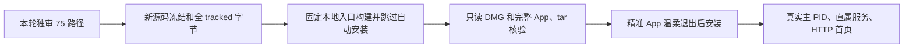

# T1080 私有打包验收脚本独立只读复核

结论：**PASS_STATIC_SCRIPT_REVIEW_ONLY**，本次源码审查未发现需要修复的缺陷。此结论只签下面五个固定 SHA 的脚本及其组合流程；包是否真实产出、安装和启动是否成功，须由根任务当场执行与真实记录证明。

审查时间：2026-10-10T10:00:16.373919+00:00。审查时 main HEAD：`b5d256c8287807f5a8d2115030b3672b54ba9c2b`。审查者为独立源码复核 agent；未执行或导入五个脚本，未执行冻结、构建、安装、客户端启动、平台或数据库操作。仅阅读全文、对源码进行 AST 语法解析、计算 SHA、读取已有记录，写入本私有报告与配套 readset。未修改 canonical 工作树、Git 或原 `source-final-*` 两个工件。

大白话：先确定“审过的源码没有变”，再确定“按固定命令构建的包就是这个包”，最后安装已核完整 App，并用真实主进程和 HTTP 首页证明它启动。每段只签自己实际观察到的结果。

| 全文审查脚本 | SHA-256 |
| --- | --- |
| [package-freeze-source-current.py](/Users/zyongzhu/.codex/creatoros-verification/t1080-final-20261010/package-freeze-source-current.py) | `d111026216e15802a49189f614328de9f9a7a5d289d323ac2cec9aa6b8226482` |
| [package_acceptance_common.py](/Users/zyongzhu/.codex/creatoros-verification/t1080-final-20261010/package_acceptance_common.py) | `82f8ad9eaff3c912af2ac40917172ef06acf29c995bb6ce3f32baedcdcf71899` |
| [offline-package-inspect.py](/Users/zyongzhu/.codex/creatoros-verification/t1080-final-20261010/offline-package-inspect.py) | `bf728852eba9e15c38426fd935af52d664ba455467186c688676a4dba5222d6a` |
| [install.py](/Users/zyongzhu/.codex/creatoros-verification/t1080-final-20261010/install-current/install.py) | `4fc1e482c95aecb44685ef818fc6e72d114bb5de8cb480b17e82d238571c138b` |
| [probe-startup-v2.py](/Users/zyongzhu/.codex/creatoros-verification/t1080-final-20261010/install-current/probe-startup-v2.py) | `fabac819e0afa1edb1a2caa672eace1709c0ddccc7b3127bda1556d8cd30aa60` |

## 准入链和复核依据

1. **源码冻结（freeze 行9–16、41–90、97–180）**。固定 BASE `4ecded9fab02e9bbccb9428629cc87fc1aa0741f`、本轮审头 `b5d256c8287807f5a8d2115030b3672b54ba9c2b`、独审 readset SHA `6b2e44ae17a3bdd813fc1e1faaea94a7264702fa6a7b6258c2e195798dd504c9` 与报告 SHA `5f5992365119ee418b04c71afe4b22d5d15cae36d49a6632b956cf6c5c190685`。固定10项 scope、75路径与2个删除 null；重复路径、遗漏/增加范围、两个绑定数组不等、HEAD/blob/工作字节漂移都会拒绝。旧 `4b10` 至本轮 BASE 必须祖先且产品零差异，只允许列明文档/审计控制，旧 readset 未借用来签本轮增量。审头之后也必须祖先、产品 scope 零差异、其余仅列明文档/控制。旧配对缺口 T1197 保留独立记录，未伪称进入当前产品。
2. **密钥规则与 fixture（freeze 行16–21、82–95、108–115、137–178）**。五条强规则的字面 bytes 与 SHA `66ed467110439515e601945904bd07ee603726e7165877939b5f3c05ef021891` 的旧冻结脚本逐条相同。只豁免三条固定路径的完整文件 SHA、blob OID 和全部 matches；不存在泛化 synthetic 例外。Git batch 逐 blob 复算 OID，扫描范围与计数相等，扫描后引用/干净状态及所有 tracked 字节重新核。`--self-test` 不产冻结授权；`--scan-only` 的收据不允许构建。
3. **固定本地构建（common 行32–54）**。必须是干净 main、真实当前 HEAD、可构建的新冻结收据、四份版本1.2.0，全部 tracked 集合与冻结字节一致。构建记录必须成功、cwd 为本轮 canonical repo、命令精确为 `env CREATOROS_LOCAL_SKIP_INSTALL=1 pnpm -C frontend desktop:package-local`，开始时间晚于冻结、结束晚于开始，原构建日志 SHA 相等。无备份入口、推送、tag 或 Release。五脚本须按准备说明顺序以本表固定字节执行，使用私有新收据和不覆盖的日志。
4. **包和完整运行时（offline 行7–43；common 行56–77）**。只读挂载前先核 DMG 与当轮 attestation 的当前 source HEAD、唯一 artifact SHA、构建 bundle 中原 DMG 字节一致；外壳二进制等于 attestation 与当前 builtApp，完整 mounted App 树等于完整 builtApp 树。运行时 tar 同时等于 DMG 内、builtApp 内及 canonical tar。签名要求严格验证且明确 ad-hoc、未公证。tar 不解包，只读流扫描，拒绝绝对/父级路径；固定七个浏览器、server、迁移、验签密钥和 execution-worker 节点必须为普通文件，SHA 等于本轮当前 sidecar 路径。成功证据要求只读 mount、detach成功以及核验期间 DMG/attestation/source未变；后续 install/probe 再核当前 frozen tracked、固定构建日志、DMG、attestation、builtApp完整树和shell/tar。
5. **准确安装与数据边界（install 行8–47）**。目标固定 `/Applications/CreatorOS.app`，目标与父目录禁 symlink；现有 App 必须对应 bundle identity。只把已核完整新 App 复制到唯一当前 PID 暂存路径，先核 metadata、完整树、签名，再对精确原生 executable 路径定位的进程请求 App 温和 quit。未退出会失败，不用 force kill。替换前复核旧目标未变、源与暂存完整树仍相等；只删除准确 App bundle 并替换，不复制旧 App、不备份 AppDB、不触及用户数据目录。安装后核完整树与签名，捕获本轮新日志和真实主 PID；安装收据明确未代签 HTTP 首页。
6. **真实启动（probe 行7–67）**。安装收据绑定新冻结 SHA、离线证明 SHA、当前 source HEAD 和 DMG SHA；再次核安装外壳与 tar。日志必须出现 loopback `MAIN_PAGE_LOAD_FINISHED http://…:port/` 首页，`tauri://localhost` splash 不通过。公开 `status.pid` 是本轮新原生主 PID，必须在安装记录和当前准确 executable 枚举内。HTTP 同端口监听者必须是该主 PID 的直属孩子；用 macOS `libproc.proc_pidpath` 核 kernel executable 等于当前1.2.0 runtime的 `creatoros-server`。不以 Next 可变 `process.title` 拒绝或放行。运行时 stamp 必须等于新安装 tar SHA，公开 status/access 只读探针必须真实成功；启动 markers 如失败信息原样保留，未强制洗为全功能通过。

## 已有执行证据与结论边界

根任务的 [fixture 负控原记录](/Users/zyongzhu/.codex/creatoros-verification/t1080-final-20261010/freeze-negative-fixtures.json) exit0，原 [日志](/Users/zyongzhu/.codex/creatoros-verification/t1080-final-20261010/freeze-negative-fixtures.log) SHA `f8158d47087c1e7c4d748c73d24eefbdd8715b3150b66b5bc1273a42487e599a`；实际输出三份精确 fixture 接受、18个未知/改变负控拒绝、五条原规则保留。独评只读取并核对该记录及 log SHA，未自行执行这些负控；这个结果不签普通源码冻结或构建。

本报告不是 DMG/安装/启动实际 PASS，不代签屏幕眼验、全部历史功能、完整真人链路、平台研究、发布或用户最终验收。原75路径源码审查结论及两个固定 SHA 保持不变；T1197 仍为旧配对功能未进入当前产品的单列缺口。安装/自然启动允许 App 自己的正常初始化；脚本自身没有 AppDB 备份、模型业务请求或业务写入调用，`userDataTouched` 只表示脚本未主动操作数据，不表示启动绝无任何应用内初始化写入。

配套私有绑定：[/Users/zyongzhu/.codex/creatoros-verification/t1080-final-20261010/packaging-acceptance-scripts-independent-readset.json](/Users/zyongzhu/.codex/creatoros-verification/t1080-final-20261010/packaging-acceptance-scripts-independent-readset.json)。五脚本或绑定输入若有变化，这份静态结论不自动延伸至新字节。
