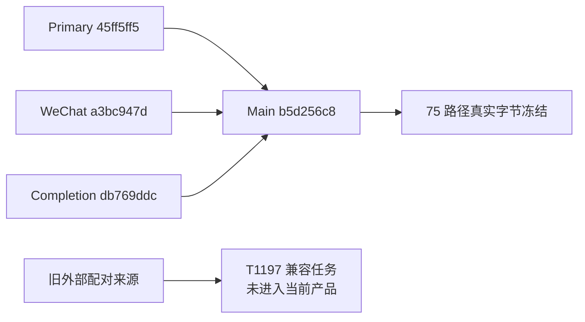

# T-1080 最终整合源码独立复核

结论：`PASS_SOURCE_AND_RECORDED_TESTS_ONLY`。本轮当前三份来源的产品增量已真正进入主线；本轮源码发现已修复，未留未处理的当前范围源码发现。旧外部配对功能仍未进入当前产品，另列 **T-1197**，不能声称所有旧功能已实现。

基线：`4ecded9fab02e9bbccb9428629cc87fc1aa0741f`。审头：`b5d256c8287807f5a8d2115030b3672b54ba9c2b`。按实际提交及当前工作树读取，75 个范围增删路径、2 个删除；每个文件的提交原字节、工作树原字节与 SHA256 一致。完整 read-set：`source-final-readset.json`，SHA256 `6b2e44ae17a3bdd813fc1e1faaea94a7264702fa6a7b6258c2e195798dd504c9`。`bindings` 与 `sourcePaths` 数组精确相同，删除为 null；范围以 --no-renames 的双点 diff 精确枚举，不用三点 diff 或来源保留提交代称功能整合。

四个当前注册 worktree HEAD（含main）均当场由 merge-base --is-ancestor 验证为审头祖先：45ff5ff5、a3bc947d、db769ddc、b5d256c8。C普通合并父为679548cd和db769ddc。全143本地分支初次79非祖先/49补丁等价/30有+均已在 `source-audit-independent.md`逐头判别；30头实际剩余旧功能缺口仅外部配对。WIP冲突组合、T915 worker迁移、T983四任务和Windows/ASR后续替代均使用实际主线源码/可达对应提交/SPEC证明，未借旧39头回执。

产品保留核对：primary page100素材/知识库读取及部分错误完整吸收，保主线visualNote、video类型、currentRevision、updatedAt真实物料、owner/CAS；WeChat5 worker文件与最新源精确相同，UI只来源扫码块且保T1169当前组回焦；C21产品和配套测试/guard精确候选在实际提交匹配，followup7精确组合匹配。共同验证48个候选路径SHA一致。HTTP lab完整来源SHA dafa16fb56893e4d13d59262202dfc5c89ba04e7cd202e2af3f69569fbe40613；暂停研究3工具仅保原源，不执行或标研究完成。

独评修复：v1不能用main通用receipt恢复赢家绕过真实转写域；私有绑定/原回放前置、main通用其它业务guard顺序不变，两种真实generic旧receipt的v1拒绝/零变及legacy回放有覆盖。HTTP验证文件补齐中间ACK/capsule/journal/失效归档/TLS修复；main严格safeParse+完整JSONB回执深等值不降为source弱比较。semantic门保main真实worker/material.match/full/adjustment/public检查7反例并补source21CLI反例。legacy peer保a9四源码锚与28f原始锁，实际95节点完整transitive/optional/peer snapshots和package metadata相同，blob/传递/optional/integrity篡改拒绝，不能只改当前锁hash冒充冻结。

相关真实回执已读取且校验logSHA：primary backend56/front31；WeChat worker126/front86/backend2套；C contract35、修复重跑backend100通过/2跳过、frontend95、runner23；semantic28；frontend/backend/worker类型检查root报告均0（backend/front wrapper已读）；LED047 174；packaging4套45；原生设备隔离模块17。首次backend2失败/front4失败/类型失败与Rust首次wrapper缺脚本原记录保持，重跑不覆盖历史。本reviewer没有运行数据库、服务、模型、真人平台、安装版或WindowsE2E。full reconcile仍在root真实运行，未代签其结果。

T1197来源授权：7d2087a8原T1018 SPEC第5行用户授权、FR-EA-04第56–85行与DEC-AGENT-1018第7–15行。未覆盖27路径及原约束精列于完整审计；当前fullCLI不等价窄grant，历史SQL在installed-external lineage保留不等价接入功能。需要当前组级scope、真实owner、短凭据CAS/revision/撤销、拒绝高影响/采纳、绝不回落fullCLI和0101迁移收敛的兼容实现及验证。该旧功能缺口与本轮当前源码PASS分别记录。

冻结后root仅文档/控制收尾；复验必须：审头可达新HEAD、这10 scopePaths内审头至新HEAD差异为0、全read-set HEAD与工作树bytes精确一致；任何新增产品路径或SHA改变都需新独评绑定。旧t1191原3精确合成fixture及18负控仍只签旧基线，不能替本轮read-set。
