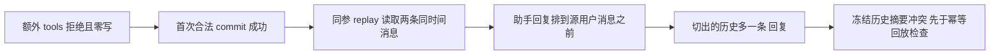

# T1090 / T1089 完成回执回放的有界诊断

结论：**已确认 b75eb8 原源码在相同依赖、全新合成 PGlite 上复现同一回放缺陷**，不是仅凭源码推测的“既有欠债”。本轮 T1089 的 0130 变更不是该失败发生的必要条件。问题仍未修复；本报告不签 T1089 全部 Gate、真实 PostgreSQL、安装版或全功能完成。

实际对照以 `b75eb8dad4aa4953f15ead5ff259bbec3af05071` 的完整 backend Git archive 为原基线，没有新建 worktree。其 journal 为104项，正常 `createDb()` 从归档自身 `backend/drizzle` 建全新合成库，未加载0130。复用当前 node_modules（PGlite 0.2.17、Vitest 4.1.8），因此这是同依赖源码反事实对照，不是对历史安装包的复验。

原8文件扩大回归为131 PASS / 1 FAIL；root再次原60例为59 PASS / 1 FAIL。外部未改原断言的基线60例实际59 PASS / 1 FAIL，exit1，16.389秒；外部仅加日志的诊断60例也59 PASS / 1 FAIL，exit1，15.179秒。全部 retry0、test/hook180000ms、独立外层1200秒。完整 argv、开始/终态、退出码及日志绑定见对应 JSON。没有把任何失败追记为PASS，也未重跑整个8文件集。

首次归档路径安全检查误拒 tar 中唯一顶层 `backend` 目录，退出1、未启动测试；纠正的是外部提取检查，历史事实保留在 provenance。wrapper先做源码字节核对，实际 Vitest 首轮时间为2026-10-08 19:06:01.713Z–19:06:18.104Z，不能把更早的准备时间算作测试执行。

公开包自引用探针 `createRequire(baseline/backend/package.json).resolve('@creatoros/backend')` 返回归档的 `backend/src/index.ts`。Vite只读 transform 审计在两个执行中均记录382个外部 backend 源路径、0个当前 W/backend 源路径；若读当前 W/backend/src 就直接拒绝。共享 contract 的233个追踪文件、ai-worker的520个追踪文件均与 b75eb8 逐字相同，两个包 `git diff --exit-code b75eb8` 均0，无未追踪文件；实际加载156个 contract、133个 ai-worker 源路径的逐文件SHA见 loaded-source-bindings。provenance中初始 `worker:0` 是错误目录名的空列表，不能作为 Worker 同源证据；实际证据是其独立 `ai-worker:520` 字段和 loaded-source-bindings。

诊断只在另一份外部归档添加 console 阶段日志，以及原来源冲突处打印已经读取的数组/摘要。移除这些日志后，service和test与原基线全文逐字一致：没有新查询、排序变更、参数/预算变更、删除或放宽断言。

确认的失败位置与机制：

1. `T1088 commitResult严格拒绝worker额外 'tools' 且零完成写` 的额外字段拒绝、零完成写和流事件不变检查均已走过。服务入口仍先用严格 `commitChatResult.parse(raw)`。
2. 后续**首次合法 commit** 已真实返回 `outcome:partial`，结果 `chat:ai-task-fb616a65-df0c-4d51-99fa-6fbea32efd55`、消息 `chat:ai-msg-204`。
3. **第二次相同参数 replay** 在来源检查失败。原SQL只 `ORDER BY createdAt`；实际两行均 `2026-09-05T22:00:00.000Z`，返回顺序为 `assistant chat:ai-msg-204`、`user ai-msg-204`。
4. 冻结历史ID仅 `['ai-msg-204']`；按 sourceIndex切出的当前历史却为 `['chat:ai-msg-204','ai-msg-204']`。冻结摘要 `ac4a11fbb7cfb58d6b593549f66b8b93d5060f958f86b17284fe3f653e48a1cb`，实际摘要 `584c1c3d1a64cb20eb5f6d8a9e30980c43e251b1b1e9bd2d60d24876a83426ae`。
5. `chat-turn-completion.service.ts:34–38` 的来源校验先抛“会话来源已变化”；后续 existing receipt 回放分支尚未进入。并非额外 `tools` 被接受，也非终态规则在首次合法提交失败。

这证明同时间戳、这套原60例上下文下真实存在的来源回放问题，不证明所有输入族都会失败。未单独改变索引/扫描计划寻找数据库内部排序算法原因；不能声称 PostgreSQL运行库、当前App或线上任务已发生相同顺序。没有模型、网络、用户库操作，没有启动/停止App或ownedPG，没有修改仓库任何文件、Git、任务事件或正式审核状态。

建议把此准确RED留给已登记的T1090。正式修复需要同时保留旧冻结 `historyMessageIds/historyDigest`、原消息/任务ID、原回执真实性和所有归属/内容篡改拒绝，覆盖首次提交、原同参回放、同毫秒多轮及旧冻结历史。不能只移动fixture时钟、删除replay断言来洗绿；也不建议直接加任意ID排序当成已完整修复，因为可能重新排列已冻结旧历史。精确产品方案仍需SPEC和独评，本报告没有实施候选或修复PASS。

源文件绑定（基线与当前的关系只限下列读取字节）：

| 路径 | b75eb8 SHA256 | 与当前关系 |
|---|---|---|
| `backend/src/modules/ai/chat-turn-completion.service.ts` | `fa38950055f48e0a58c0eb78b99592a67c5d073467dc5213fb12c5983167fbec` | 逐字一致 |
| `backend/src/modules/ai/chat-turn-completion.service.test.ts` | `6a8447c44864e67c0a4eb768b748bd2285fbd250ff63f989989804701e983dee` | 逐字一致 |
| `backend/src/modules/execution/workbench-plan.service.ts` | `bcfe5c718d0b277b178265e9e9812fdcb57f08fa758b7b6ffa91bf7d377fc48b` | 逐字一致 |
| `backend/src/modules/ai/chat-turn-submission.service.ts` | `cb3b9c8d4f9c8a9f84175ba80e123ac1e8002256f9cba15988427ef6ffa56b3a` | 逐字一致 |
| `backend/src/modules/ai/ai.repository.ts` | `5c3e9906f4e1e5460d314225d8be497f7e1447cf880bfe4ead9db623e2f97b48` | 逐字一致 |

证据绑定（相对路径均在本外部目录，全部原FAIL保留）：

| 文件 | SHA256 |
|---|---|
| [ownership-recovery-regression.json](ownership-recovery-regression.json) | `4884d5129211fdf3ac1e04849c852584ae366be885da32168c817d3d69df3752` |
| [ownership-recovery-regression.log](ownership-recovery-regression.log) | `0bc45a96ae5d99520dbb3aa2f6f3a1272ea6ee25c1b8b9877ea7a74c11d1a570` |
| [completion-regression-recheck.json](completion-regression-recheck.json) | `54a091c9ffded8620b96c69dd6b65b388cf4ecf23e6b0d1576bb69692b94a33e` |
| [completion-regression-recheck.log](completion-regression-recheck.log) | `59e8f5391da430b3860d8d85e1422007b4130476c56a5709e30fb224090b2f9e` |
| [completion-baseline-b75eb8-backend.tar](completion-baseline-b75eb8-backend.tar) | `a7ad06bc67b435c33422cc2cbc3fa3f4278417f5029596aa00a88374697a76cd` |
| [completion-baseline-provenance.json](completion-baseline-provenance.json) | `7129bdfc9531825075e3056bebb243b95a1043f027ead5c4c10fae9e1bd82a67` |
| [completion-baseline-loaded-source-bindings.json](completion-baseline-loaded-source-bindings.json) | `efa85f57f5e4ff1c1d733834dad102ef3b8417914ad856e37f451107fe9bd7dd` |
| [completion-baseline-original60.json](completion-baseline-original60.json) | `682aae74646ff33a38654e50dcd450086ab0c2e569cefeaf1d95df2dde442272` |
| [completion-baseline-original60.log](completion-baseline-original60.log) | `abd7b17d4b77cac748b19a0e82803e5465120b1fd0f97d85e19f5c4b46b98e9a` |
| [completion-baseline-vite-source-trace.jsonl](completion-baseline-vite-source-trace.jsonl) | `bb2cdc89b5981cf467e6c7ed7ff2269b89a7c0fc6ec0ab1a3716e685e0f20efa` |
| [completion-baseline-instrumented-manifest.json](completion-baseline-instrumented-manifest.json) | `e789065997a4ec4568be85ac7b5629977d8b47bc4edaf3db7996b393fabebd98` |
| [completion-baseline-instrumented60.json](completion-baseline-instrumented60.json) | `8627c75bb2121e6c650175e067f5edb91e6b902ecf679c7ef40f8a3949e7f7c2` |
| [completion-baseline-instrumented60.log](completion-baseline-instrumented60.log) | `b4f496d53c031061efe2e42c96e18868e4070a1d903cc430252b2a98bf6c8f29` |
| [completion-baseline-instrumented-vite-source-trace.jsonl](completion-baseline-instrumented-vite-source-trace.jsonl) | `de00c1052ec77e7ab1bbd4c4a328b9b645fca2ffc0fd313362df271163fe22fd` |
