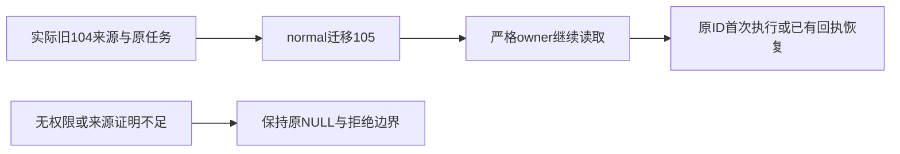

# T1089 当前验证

三处来源归属修复只改会话、文章anchor和图文anchor的group_id；原正文、版本、消息、任务冻结输入和回执不变。生产写集为0130 SQL、journal追加和convergence固定身份三个文件，五个实现/测试文件的精确字节与实际命令见[evidence.json](evidence.json)。

已发生的TDD：旧104真实公开resolver/dispatch创建来源RED失败；normal104升级RED失败。只有确实跑过的用例记录为RED，不补拍其它历史场景。旧SQL候选的14项GREEN不能代签最终SQL；最终SQL cc25已重新完成31 PASS/0 skip。真实隔离PG包括原Article/Graphic创建、原显式归组、source表/行冲突、freeze后转组、错误DDL反例40P01、父INSERT稳定性、两种多组反向参数及取消回滚后下一次normal迁移。

- 最终新backend文件：31 PASS，实际exit0；旧迁移3文件36 PASS，实际exit0。
- 新frontend文件：4 PASS/0 skip，实际exit0。原T1086四种scope文件未改，4 PASS/0 skip。
- 三旧任务族用真实WorkerSupervisor子进程、PGlite和本地SSE协议，保留原ID/payload/digest/正文。原不可准入族升级后首次执行；已有settled回执两族升级后回放，模型/handler计数2→2、1→1，零新增。
- backend/frontend typecheck均实际exit0；boundary/semantic/orphan实际exit0，boundary保留原baseline事项。
- 扩展8文件归属/恢复回归实际131 PASS/1 FAIL；原T1088 completion额外tools用例再跑60例仍59 PASS/1 FAIL。原失败保留，根因登记[T1090](../../features/t1090-chat-completion-replay-diagnosis.md)，b75真实backend归档对照原60例同59 PASS/同1 FAIL，加载审计确认没有当前backend源，合同233/worker520追踪文件与b75逐字相同。这是既有失败的有限对照，根因定位仍在T1090继续；不能签全部相关测试通过。

独立实施静态/聚焦审查见[IMPLEMENTATION_REVIEW.md](IMPLEMENTATION_REVIEW.md)。本轮完整reconcile实际exit1，42错误/0告警，stdout SHA与前轮完全相同；原全局欠债明确保留。新包已安装并实测，见下文。最终独立复核允许完成T1089自身范围，不代签T1062原生UI、Codex、平台登录或全功能。

## 新包与实际安装验收

main产品提交 `6e4689b3180f91189110208267708ad72b03ae64`；45项打包基础检查实际通过，固定入口本地构建实际exit0（431.168秒）。DMG：`/Users/zyongzhu/Downloads/CreatorOS-1.2.0.dmg`，840237701字节，SHA256 `7a618520bfd5321b2f5d93873f9b7fb1759feab9c23ce2d1e0d0cd1390e1476f`。hdiutil verify与构建/挂载App deep/strict codesign实际通过，本地ad-hoc、未公证。归档内0130精确SQL SHA cc25已读取核对，4关键包文件及实际安装文件字节一致。

温和退出原App后替换 `/Applications/CreatorOS.app`，未强杀、备份或重置；新PID26888，原生日志确认真实HTTP首页 `http://127.0.0.1:60314/` 加载完成。时间为实际观察里程碑，不伪称精确冷启动或看到原生窗口。

首验收probe忘传workspace而被公开accounts.create明确HTTP428；原失败/CLI输出均保留，inventory确认没有新账号。按用户原已选月明账号仅作为新中性账号登记ctx后，使用新scope/key进行正式验收。后续全部绑定本次新account137、真实canonical组、项目143、会话157/global160、文章163/图文177，不改变bootstrap账号或其真实内容/登录。

正式公开验收实际exit0（47.244秒）；原消息193→唯一task194/execution195，实际Pi模型成功。三次真实system.read为 projects.outputs.list、articles.get、graphicPosts.get，全部complete，均返回真实初始空稿v1与实际版本ID。文章/图文DTO前后深等，没有采纳/生成/渲染/发布。此包验证新合法写入与真实组读取；不冒称人工更新旧用户库、非空稿生成、Codex、平台扫码或逐个原生点击。

最终独立复核见[INSTALLED_REVIEW.md](INSTALLED_REVIEW.md)，相邻旧回放根因见[ADJACENT_REPLAY_DIAGNOSIS.md](ADJACENT_REPLAY_DIAGNOSIS.md)。只停本轮自建55422隔离PG，当前App与其它会话保持运行。

2026-10-09实际收尾：pmem sync→taskctl complete T-1089→pmem sync均exit0，审计事件与命令记录已绑定evidence.json；任务完成仅限本SPEC，完整reconcile42错误与T1090仍保留。
