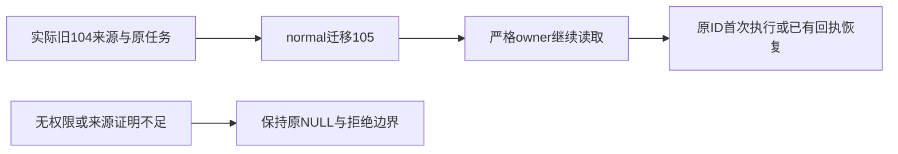

# T1089 当前验证

三处来源归属修复只改会话、文章anchor和图文anchor的group_id；原正文、版本、消息、任务冻结输入和回执不变。生产写集为0130 SQL、journal追加和convergence固定身份三个文件，五个实现/测试文件的精确字节与实际命令见[evidence.json](evidence.json)。

已发生的TDD：旧104真实公开resolver/dispatch创建来源RED失败；normal104升级RED失败。只有确实跑过的用例记录为RED，不补拍其它历史场景。旧SQL候选的14项GREEN不能代签最终SQL；最终SQL cc25已重新完成31 PASS/0 skip。真实隔离PG包括原Article/Graphic创建、原显式归组、source表/行冲突、freeze后转组、错误DDL反例40P01、父INSERT稳定性、两种多组反向参数及取消回滚后下一次normal迁移。

- 最终新backend文件：31 PASS，实际exit0；旧迁移3文件36 PASS，实际exit0。
- 新frontend文件：4 PASS/0 skip，实际exit0。原T1086四种scope文件未改，4 PASS/0 skip。
- 三旧任务族用真实WorkerSupervisor子进程、PGlite和本地SSE协议，保留原ID/payload/digest/正文。原不可准入族升级后首次执行；已有settled回执两族升级后回放，模型/handler计数2→2、1→1，零新增。
- backend/frontend typecheck均实际exit0；boundary/semantic/orphan实际exit0，boundary保留原baseline事项。
- 扩展8文件归属/恢复回归实际131 PASS/1 FAIL；原T1088 completion额外tools用例再跑60例仍59 PASS/1 FAIL。原失败保留，根因登记[T1090](../../features/t1090-chat-completion-replay-diagnosis.md)，b75真实backend归档对照原60例同59 PASS/同1 FAIL，加载审计确认没有当前backend源，合同233/worker520追踪文件与b75逐字相同。这是既有失败的有限对照，根因定位仍在T1090继续；不能签全部相关测试通过。

独立实施静态/聚焦审查见[IMPLEMENTATION_REVIEW.md](IMPLEMENTATION_REVIEW.md)。完整reconcile与新包安装复验尚未完成；本任务仍进行中，不代签T1062原生UI、Codex、真实模型或全功能。

