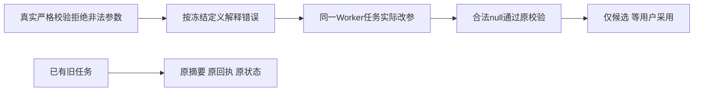

# T1095 当前源码修复与有限验证

用户要求问题及时建task修复；本轮沿main串行推进，不备份构建，不修改旧任务。正式SPEC独评 PASS[REV:b3b9dda4753e]，真实原回执核查与有限实施独评的哈希见 evidence.json。

三处产品改动：新聊天提交冻结内部纠错格式版本；原binding严格校验失败时按冻结schema说明类型/必填/允许null/收到的类型；新机械helper不补参数或编版本ID。旧标记缺失继续原错误文本与摘要公式，新任务重复同参仍走原收口。工具/Skill/公共请求/采纳权限/预算不改。

大白话：AI先知道具体哪一项错了，再在原任务里改参数，成功后才能称候选就绪。

## 当场证据

| 验证 | 实际结果 | 证明范围 |
|---|---|---|
| 原公开提交新增测试 RED | 1 FAIL / 27 PASS | 新格式标记确实缺失；未伪造历史失败 |
| 初次Worker RED | FAIL，nextId夹具未注入 | 夹具准备错，不算产品行为RED |
| 补齐夹具后Worker RED | FAIL，retry_wait 未成功 | 没有具体HTTP错误记录，不补拍根因 |
| 首次GREEN | 35 PASS / 1 FAIL | 实际4轮纠错与候选已发生，最后payload期望未考虑原服务补modelIdentity；不算全通过 |
| 校准合法identity冻结后focused | 36 PASS | helper/原提交/真实Pi Worker机械纠错；不代签供应商或真实两稿 |
| 最终正式相关行为命令 | 7 files / 121 PASS，exit0 | 包含新旧格式reserve/start/settle/回放、原完成链、重复收口、取消/未知保护 |
| backend与Worker类型、Worker构建 | exit0 | 真实严格schema解析测试定义，无类型旁路 |
| boundary/semantic/orphan/diff | exit0 | 没有新架构或语义越界 |
| timeout-policy总门 | exit1 | 完整27项与T1084逐项相同，新增/消除均0，保留T1081 |
| pmem sync | exit0 | 同步当前任务；不代替看板或Gate |

最终旧格式集成通过原submit保存一套中性资料，仅在隔离库去掉新标记模拟更新前格式；真实模型账本绑定→预留→启动→结算→新实例回放保持原错误与inputDigest，改写已结算recovery被拒。没有修改用户历史或假称旧真实task被迁移。

完整reconcile本轮实际1032.66秒、exit1，42错误/0告警。与上一轮日志逐字一致，SHA256均为5a7dc597bbef244902c857fc708f2a8e4fbfe10583fb9d46624d709b7079ea5a，新增/消除均0；保留原全局欠债，不签全绿。源码有限复查 PASS_LOCAL_CANDIDATE_WITH_RETAINED_GLOBAL_FAILURES 只允许进入既有授权的本地候选冻结，不代表安装、真实Pi或任务完成。

当前安装版仍是e71022ff产品源码；新包和真实供应商两稿候选待后续当场验证。原task200保持partial/原ID/原回执，未重发或采用。T1096原15失败、T1097新发现资料与审读接线缺口均保留，不标全功能通过。
