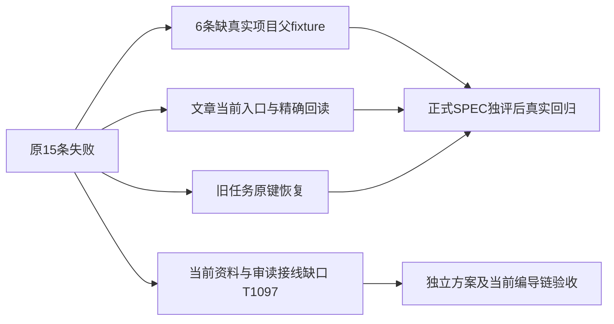

# T1096 旧相关回归的只读根因补核

原15失败记录保留：文章9、AI任务父资料6；原770037同名同因复现。本轮没有修改这两个测试文件或生产路径，没有为它们运行新的GREEN或标完成。

任务六例：空白createDb后引用project-1，但beforeEach和初始化都没插这个真实父资料，查询为0行，现归属门正确拒绝。当前和770037原test/repository/workspace-write字节相同。最小测试校准可补同user-a/acct-a、groupId:null的真实项目fixture，原19项全断言、预算和守卫不改；仍须正式SPEC及独评后实施，不由静态结论代签合法项目全族。

文章九例不能统一改按钮名。旧单文章generate无UI调用，但历史article-task原键还能恢复旧候选、字段选择与旧新事实比较。排版、手写保存、脚本填空元数据有当前真实入口。手写保存的旧fixture返回v2却读回v1旧文档，必须校准精确版本回读而不是删除错误或最后按钮断言。Brief缺失不挡手写；当前生成须沿真实确认脚本联合入口，不能用添加段落按钮代替生成。

写作身份/精确文档选择只接不可触达旧generate；当前联合候选整篇保存没有旧事实比较或旧元数据勾选的等价证明。这些当前产品接线和审读问题已登记T1097，不靠旧任务恢复或checkbox测试宣称新链支持。

两份外部只读报告（目录0700、文件0600）：

- TASK_PARENT_DIAGNOSIS.md SHA256 ab3582db6974ced7c71d961616a6ea91fee501bcd8b241808526d8b4020020e1
- ARTICLE_PATH_DIAGNOSIS.md SHA256 1af64170c2c36632cc47e8a08afef5c011b9a71d805c4a3a2aac12282b023e60

路径均在 `/Users/zyongzhu/CreatorOS-local-acceptance/main-installed-20261008/t1096/`。只读报告不代签测试、GUI、真实模型或安装验收。
