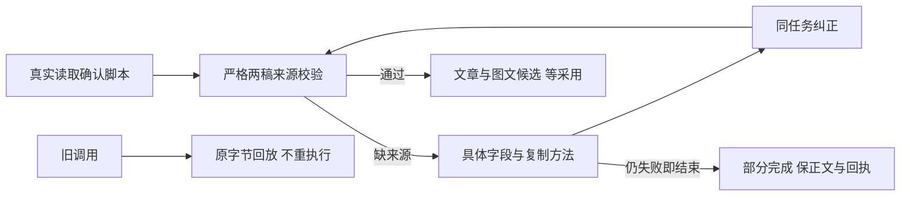

# T1099 验证记录

## 当前安装与真实Pi结果（2026-10-09）

main源码070287的新1.2.0 DMG已构建、核验并无备份安装。包840412331字节，SHA256 `36669fdff1539c57b545c3bb4ff7b598f98a3863873ed877ed3b32b7f2a641f8`，本地ad-hoc、未公证。实际构建exit0/584.145秒；hdiutil、源/挂载签名、4安装成员、9运行时修复成员及0130迁移实际匹配。

第一次展开失败另立T1102，原失败/日志与观察器退出记录均保留，根因UNKNOWN；同一安装包只正常重启一次后完整展开37646项，实际HTTP首页61596、CLI与启动sentinel恢复。11原任务、4业务DTO和两旧会话逐字对照通过；公开22读取21正常及原裸定位404/页面空profile。无原生页面逐项点击或视觉验收证据，外部浏览器403保护未绕过。

唯一新Pi修复验收task `ai-task-c4504fa1-272` 最终partial/completeness=partial，read成功但三个propose都缺图文，零候选，原稿不变。candidateVerified=false，未采用、不重新提交。已登记T1103，T1099用taskctl真实block，T1095仍待完整候选；T1103隔离实验为完整分片3 PASS、截断5族3 PASS/2 FAIL，不能据此替真实供应商签通过。T1104另修确定的启动错误链诊断丢失，不代表T1102根因或安装生效。

以下保留安装前的原始验证历史，历史“当前App仍68dff/待出包”等描述只对应当时观测；最新安装状态以本节和evidence.json的installedVerification为准。

## 安装前源码与测试历史

用户要求有问题建task及时修复，按已授权本地主线继续。正式规格 PASS[REV:b5aa667d8485]；8产品源码只修安全业务拒绝回执、可信新格式及末次失败真实状态，不放宽来源、版本或权限，不写候选到正式稿。

大白话：AI知道哪一项来源缺失，能在同一任务纠正；尚无交付而最后工具仍失败时显示部分完成。

实际RED 12FAIL/53PASS；首次GREEN 64PASS/1FAIL是隔离context期望写成user而真实执行source=ai；类型初验错误也仅新夹具定义，纠正后类型通过。首次真实Worker夹具误解析原Pi operationRef前缀而3FAIL，保原失败；按实际协议修正后真实Worker全3PASS。原扩展core回归282PASS/2FAIL登记T1100，保原断言明确旧冻结格式后正式17文件291PASS（含completion原60+新增1）。最后补验真实旧调用结算后翻转隔离标记，原端口逐字回放且拒绝覆写，Worker3PASS。以上协议夹具不代供应商或安装版。

Worker协议70PASS/3文件、前端partial消费者11PASS、backend/Worker类型、Worker构建、boundary/semantic/orphan/diff exit0。完整超时27失败与T1095逐项相同，新增/消除0，保留T1081。8源码独评无必修产品finding，最终marker回放证据补复核中。完整reconcile、main提交、新包与真实Pi仍待当场核验；未标全功能或本任务完成。当前App仍68dff，旧task200/222原状态与回执不修改，不采用新候选。所有实际命令及日志哈希见evidence.json与本机t1099原始证据。

最终17文件291PASS、类型与marker回放均实际通过；补变体独评PASS。完整reconcile实际1297.015秒exit1，42错误/0告警，和T1095日志逐字一致（SHA256=5a7dc597bbef244902c857fc708f2a8e4fbfe10583fb9d46624d709b7079ea5a），无新增/消除。安装前公开对照11原任务、4业务DTO、两原会话消息结果一致。额外公开22读取中21正常，定位裸接口按原约定404、页面接口profile=null；5平台scope与未知指标/空趋势正确。初汇总脚本变量复用造成TypeError，原exit1及所有原读取响应保留，纠正后矩阵exit0。外部Chrome受桌面来源保护403，未绕保护；原生UI操作仍未代签。准备提交本地main并无备份打包，真实供应商Pi仍待验证。
