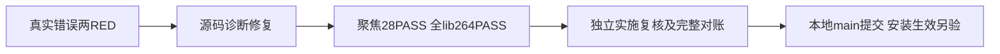

# T1104 当前源码验证

已独立SPEC PASS，原runtime基线21 PASS；实际tar冲突与坏gzip新增测试在旧实现真实21 PASS/2 FAIL。最小修复后聚焦28 PASS；最终精确源码全lib264 PASS/12原ignored，未代签Windows实机。只有lib.rs产品文件，原全部测试/成功切换/其它源码逐字不变，真实kind/source/get_ref/errno与清理结果保留，错误链有界。

大白话：解压失败终于能留真正原因，清理失败如实显示。原首次失败原因仍未知，此修复尚未装进当前App。

边界/语义/orphan/diff实际exit0。完整reconcile运行中；原42/超时27有历史证据，此处暂不报当前对账结果、不complete。当前App仍070287可用，同包一次重启恢复事实不作为新修复生效；T1102根因和T1103 Pi候选均保留未完成。全命令及SHA见evidence.json，本机原失败和原始日志保留。

独立实施复核已实际PASS_LIMITED_IMPLEMENTATION、0 findings，源508a5063及原始命令/日志均独立核对。仅源码准入，本任务仍待完整reconcile终态；没有对根因、包/安装、Pi或父任务代签。
