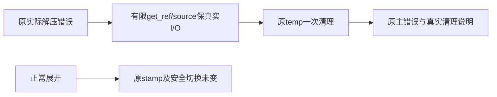

# T1104 独立实施复核

结论：**PASS，限定当前唯一`lib.rs`的源码实现；0 findings。** 符合已PASS SPEC，未发现本范围必修问题。完整reconcile仍在途，不能签整体Gate全绿、task complete、当前App生效、新包/安装或真实Pi验收。

大白话：现在错误会保留真正的系统原因，临时清理结果也如实显示；解压怎样成功、怎样拒绝、怎样保护旧运行时都没有改变。首次启动究竟为什么失败仍未知。

- 实际审查时间：2026-10-09T04:09:06.425158+00:00
- 基准main：`070287024a99fdf810a03d0ff39a9c944a9775e7`。
- 当前唯一产品/测试文件 SHA256：`508a50632893f27970eb1fab0fef04d53c87255891b5b0bc1af4b60ab2ad2e29`。
- SPEC SHA256：`4816c4dc9909837419b73061a0a6e5ff6687aef142c5caf8cbdfcc4c366830f9`；正式前置review receipt `055e0175f519`，未改SPEC。
- 机器报告：`IMPLEMENTATION_REVIEW.json`，SHA256 `ceee82c76559296e31550275a213aeeb80f90de0d00c0926b8a3d6f994ef852c`。
- 本次仅只读检索与内存字节比对。未写仓库/测试/控制面，未执行新测试、App、进程操作、DB/业务/模型/网络或构建；只写这两个外部报告。

## 源码与边界

1. `format_sidecar_io_error`在错误转String前保外层及每个真实io::Error的kind/raw_os_error，io包装优先get_ref，其它错误沿source；for循环最多8次。每条原消息按chars取1024，再明确附截断和机械元信息；循环或更深链有8层截断标记。顶层raw_os_error=None不会替代内层Some码。函数不递归、不读取文件/env/秘密，不按文字作错误分类或重试决策。
2. 打开归档、读取归档/条目、unpack_in均使用上述诊断。原安全路径检查、成功结果、迭代、进度和stamp不改变；格式化不创建新业务分支。
3. 清理helper只有一次`remove_dir_all(temp)`。原unpack失败、缺入口、写stamp失败三个互斥位置各调用一次；主错误分别继续返回Err，清理失败附链而非掩盖主错误，成功才称“已清理”。开头原best-effort清理和promote失败原清理没有扩大范围或改变策略。
4. 独立内存移除两个helper和7个新增测试，再逆转7处已审错误/清理替换，结果全字节等于070287原Git blob，SHA为`b85d52ffce43dd10f3e6e82c242b9987ee0820ee5100abdc17f02e0d81f335eb`。因此原所有测试和范围外源码逐字保留；没有依赖、runtime指针、旧dest、promote/rollback、Windows安全fallback、完整性、凭据或生产预算改动。该证明独立于root的binding布尔值，未操作文件或Git状态。

## 实际RED/GREEN与测试真实性

原runtime基线实际21 PASS。RED相同Cargo argv真实21 PASS/2 FAIL，失败输出明确是原碰撞`failed to unpack`和坏gzip`invalid gzip header`缺I/O诊断；不是编译/脚手架错误，原日志保留。首次证据目录未创建的wrapper失败仍单独保存，cargo未启动，不冒称产品RED。

新增7例已审：嵌套io原生码序列化、Unicode/循环界限、真实清理成功、真实非目录清理拒绝、真实tar越界拒绝、实际中途目录/普通文件碰撞及坏gzip读取。全部使用本例temp目录与原std/tar/gzip，没有用户媒体/库/凭据、网络或付费模型。碰撞码取本平台真实remove_file(directory)错误；合成28只验证诊断，不声称真实ENOSPC当场重现。真实清理失败例按标准库原函数先取得Err并核相同码、原文件仍在，未以mock清理成功冒签。

碰撞/坏gzip例核旧server.js与stamp字节不变、当前temp清理；越界例核外部文件与旧runtime保留。原正常展开/同版本复用/损坏重建/安全切换原断言完全保留。修复后runtime28 PASS；最终恢复范围外rustfmt字节之后全lib真实264 PASS、0 FAIL、12原ignored，实际wrapper138.005秒（suite131.00秒）。本机目标不覆盖cfg(windows)真实占用用例，ignored保留不改成通过。

三门卫/diff原实际exit0，日志与receipt SHA独立重算一致。**完整reconcile读取时尚无terminal receipt，保持PENDING**；不对正在增长的log签最终SHA，不改变原42/timeout27或范围外失败状态。本实施结论不能替代root等待终态和按真实范围处置。

## 实际证据绑定

每个receipt含实际argv/cwd/起止/exit；本次未复跑任何命令。

| 记录 | exit | log SHA256 | receipt SHA256 |
| --- | --- | --- | --- |
| `runtime-baseline` | 0 | `049a48238a7b0022a57ea379dfe92ab48381e13a76358b0757d5655c5afabd57` | `040d11d8b029607bfde1156117cdbafbc3d08087939967eed7226c4d3f34a55f` |
| `runtime-red` | 101 | `401a0312f908575130fa3b273efd7f2d65df3702870d4dde519e1e9317b22780` | `1c25de55f46302de110f4c4b9517b0cfee8e9acbb881e0ef5b182950bf2020bc` |
| `runtime-green` | 0 | `be8c56a9f98385b47d8706c29f4c9a96b094fbf4dce00e5f4861154237a9b8c0` | `50fc5a591e9160ad2201c938f1f91a3a2622a6366bb3e84eee302435942e77ad` |
| `lib-regression` | 0 | `20e2949d559cade555ce9ef6454e509ab861b0bfefa9ccc31b62c43bc567cc70` | `c1e0c2ebdd3f54cbd0bad7ae85ca2a3351fe5c6b588064e2cdd43e82864045a9` |
| `boundary` | 0 | `21063424253db0601ff571f39f0474072b3476d34ee10a8920361b20db642f24` | `ee85ef1b224320b732f27f7b98623d0738e85f990e4a7dd775a8d5d4424b4153` |
| `semantic` | 0 | `b972b2b1d6a12435c4034d60290afc2db036e5e439f96cc3f617e5e78a476923` | `7784fdc40b18207083b29dc1a719d20d028f471435aa5066456fa94b8d891fd8` |
| `orphan` | 0 | `ee3224654cf1b13b1bcd3948dd942050a0435380b5b2a84bbb61e9058d056b0e` | `d3aaa3bc7fdcaef383667cd5f613f04a8bf10056f7c34fde631a963b85b533ce` |
| `diff` | 0 | `e3b0c44298fc1c149afbf4c8996fb92427ae41e4649b934ca495991b7852b855` | `d605ab3b56b301ef68e29c3d8b23b46ac166336f7adb9e9d7536d31e6f29fce2` |

| 源码/规格/配置 | SHA256 |
| --- | --- |
| `docs/features/t1104-runtime-extraction-error-chain.md` | `4816c4dc9909837419b73061a0a6e5ff6687aef142c5caf8cbdfcc4c366830f9` |
| `docs/features/t1104-runtime-extraction-error-chain.review.md` | `f17fc706939c7f355019da605da9d175c72a7b9260090d211c06d7d08553a077` |
| `frontend/src-tauri/src/lib.rs` | `508a50632893f27970eb1fab0fef04d53c87255891b5b0bc1af4b60ab2ad2e29` |
| `frontend/src-tauri/Cargo.toml` | `6fc6b92e179df84c1e597dd18b4829d921c005a292c14831b86fb15f6ebc766f` |
| `frontend/src-tauri/Cargo.lock` | `1f28d0b8440de395647f3852516a8a4acb913db7a290645a1fa84e8d8a1dcd6f` |
| `orchestrator/process/modules.config.json` | `00f64db5c8b56de2eac287681b33b452d48d7c943beae0f5a11090f1c6d3d9d6` |
| `orchestrator/process/reconcile.config.json` | `a2c053a86a919f401ff6f73c74598cff9e5df37be9316e864897b8e3855800af` |

| 其它实际来源记录 | SHA256 |
| --- | --- |
| `final-source-binding.json` | `179048f475ea4faea75958b05a31d10779ac06a59576343e430de62bfe80a69e` |
| `red-source-binding.json` | `6deca70d36f7424f59d6d79d36f8360b2cbab709f2bf96f009bef74d1cc1ea82` |
| `baseline-wrapper-preparation-failure.json` | `cde7fe80306a3b54f1935d9d27f364ce7c219589b0a82488c1a708078576780d` |

当前可继续等待完整reconcile终态并据真实证据收尾源码候选；本修复尚未装入当前070287 App。T1102首次原因UNKNOWN、T1103/Pi272原partial及父T1062完整验收均不由本报告关闭。
