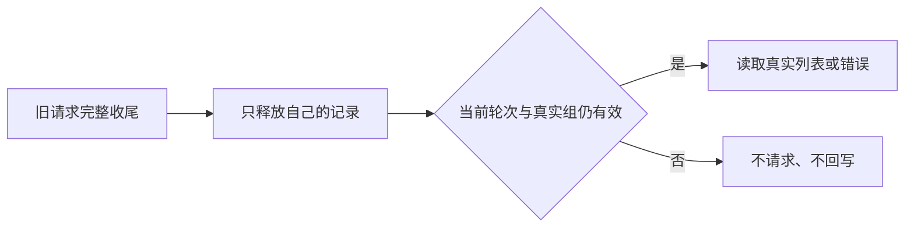

# T1105 独立实施与有限体验复核

结论：**PASS（限定当前实施与已发生的隔离旅程）**，未发现必修源码问题，0 findings。不是全局 Gate、安装版或父任务完成签名。当前观察 HEAD `d35f7d57ff952d306071eb40d34127956b067906`；候选尚未提交，原实施基点为 `d35f7d57ff952d306071eb40d34127956b067906`。

旧读取结束后，新轮次重新取得真实结果；只剩仍有效的排队者可以发请求。

独立核查确认：读取记录同时保存 epoch 和 Promise，同轮次复用；跨轮次等待旧 Promise 的 finally 结束，回调保留原 ticket；发 HTTP 前保留 alive/epoch/真实当前组检查，过期和卸载不发送、不回写，旧请求只能释放自己的记录。挂载清除旧 scope 的列表、影响与消息。原 action 至 JSX 整段与 d35f7d57 基点逐字相同，因此权限、预览/撤销/删除、digest/版本、foreground/busy 和控件布局未被修改。原 6 例测试正文也逐字保留，reconcile 仅增加 `shared-resource-lifecycle:e2e` 一个键。

| 已发生证据 | 独立核验结果 |
|---|---|
| StrictMode 合法隔离探针 | 6 PASS/1 FAIL；前两次 0 test 加载失败不是 RED |
| unit-red-reset | 8 PASS/4 行为 FAIL，10.333 秒，exit1 |
| unit-green | 同 argv，12 PASS，3.563 秒，exit0 |
| browser-red（原名保留） | **公共基线 PASS，未复现 spinner**，143.226 秒，exit0 |
| browser-green | 同旅程通过，48.486 秒，exit0；实际 journey.log 1 PASS |
| frontend typecheck | `next typegen && tsc --noEmit`，108.165 秒，exit0 |
| LED047 | 8 文件174 PASS，32.186 秒，exit0 |

第一次 unit-red 的 6 PASS/6 FAIL 仍保存，其中后4个失败受残留 `mockImplementationOnce` 污染；不把它们算有效产品 RED。每个新增测试清除该队列后，真正4个行为失败为：StrictMode终态、旧请求完成后当前组重读、过期队列只留最后组、未进入的组以权限错误结束加载。

公共旅程正常读取走正式 dispatch、隔离临时 PGlite 和 Chrome，数据库 URL 清空且不复用现有服务；测试网络策略阻断外网。它实际覆盖空态、键盘重读、刷新、后退、一次明确500错误及恢复、1366×900/900×900。错误500是显式响应替身，不能冒称真实服务故障；组件单测则是合成请求替身。两层证据都不能代签安装版或真实用户共享授权写操作。

已实际 `view_image` 查看3张面板截图：正常为空列表，错误显示“验收读取失败”，窄窗恢复为空态；重读控件可见，文案与页面基线一致，未见明显裁断或挤压。这些是面板裁图，不假称整屏视觉验收。

正式 SPEC 原句要求公共页面 RED，但原版公共旅程实际 PASS。现已通过唯一文字修订与 DEC-T1105-EVIDENCE 如实区分“公共基线 PASS”和“组件真实 RED”。独立逆换后的全文 SHA 精确恢复初审 `c1a7a32d35237826a6fa4b15af25e58c4bf60cc1b150bf98512056844d695fc0`，功能、权限、写集、预算和旅程/Gate 均不变。窄复审 PASS 见 `SPEC_RECHECK.md` 与 `SPEC_RECHECK_INPUT.json`，不补拍浏览器失败。

当前产品 SHA256 `92705c667ef8efa7dcbf7b918f7a2beb171c6699151d88feb9292d863b3539be`；测试 `e31131d31b9eadeb1076f6cbf22c22ad93fc454353aeea38520860b684aa675a`；e2e `6b02091c6facb108242a08af65f9dff12a97ef66465f6a2e29d0ba84e11413fc`；runner `8880616240beef9d117b21ae5bb03d427be578b068f72cd019a3f038ab85cafe`；新 SPEC `4a49467fc9eb340708f845f3f14634bec4a9e8cfbb531c7f76aba2ebbe71d072`。runner 已使用实际 test-results 的 `e2e-shared-resource-` 前缀收集3张PNG，本次按当前字节绑定。全部引用的原始回执、日志、配置与PNG的 SHA256 见 `IMPLEMENTATION_REVIEW.json`，回执记录的日志 SHA 均与实际文件相同。

三门卫虽由主会话报告 exit0，本报告截止未读到其完整回执，仍不独立签；完整 reconcile 终态和安装尚未验。本评审未运行新测试、业务、模型、App或数据库，未修改仓库。其余 T1101 等共享 dirty 路径不属于本限定签名，T1062全功能与Pi272等父状态均保留。后续字节变化须重绑。
