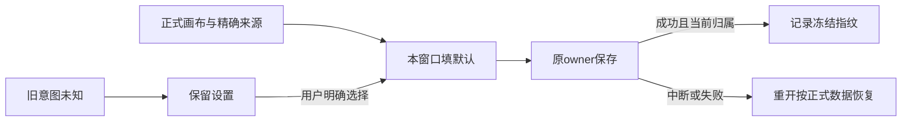

# T1108 限定实施独立复核

**PASS_LIMITED，findings=[]。** SPEC SHA256 `eb800589add497ec7e7815a4dc9e38a63e4fe79ecc3245da84ac36cf4e83e6b7`。最终旅程来源 `072ad4d6927a2133c444068db1d61940c799f494`；落盘观察HEAD `0e1c0ffc98bfeccf8c89bdb6bfe9e353047f7648`，两者三条T1108源无差异。不宣称全仓clean。结论只覆盖唯一画布产品、原组件追加与最终公共Chrome旅程，不签新安装、全局Gate、真实供应商生成或父任务完成。

产品把本挂载Set与持久标记分开。仅原owner保存成功且epoch/归属核对通过，才用该轮冻结的document/resolved/legacy快照记标记；载入先读正式画布，再核edge和目标模式/exact asset/file机械指纹。原手选与已保存空值保留，失败或迟到保存不预记完成。旧flat数组保守保留抑制，明确按“使用连线参考”才复用原来源；无原图保留设置并反馈，不确认候选、不提交生成。原CAS/owner/生成锁/未知结果逻辑未弱化。

原17例正文与188c逐字一致。实际RED同argv 19 PASS / 4 FAIL，修复后23 PASS / 0 FAIL，retry=0。新增覆盖失败重开、保存空引用、旧标记显式恢复、原图不可用、跨scope迟到回执、新指纹不匹配。RED日志SHA `f5f29b656fcf30e576fb87c5ee2e1a8b7c04e285cedbc45a3ca192ac783daad9`，GREEN `ced2b7dca0408377a955e767615bc58368776d5c70b6133ac3c5ccab000c7b23`。

最终公共Chrome真实2 PASS / 0 FAIL / 0 SKIP，2026-10-09 05:48:31.354Z–05:49:59.036Z，87.681秒。核actual receipt、归档源、last-run及完整journey SHA `c98e08c936dc24e001d6f363130ebc120e13fda2b03880ecf138ac298eb5517c`。一次精确file autosave明确中断后重载，正式GET精确读回；准备legacy前真实“画布库”导航完成saveNow，待实际卡片可见再GET当前revision，避免夹具与旧页autosave并发。恢复按钮经过正常/窄窗及键盘Enter；随后再次真实返回画布库、卡片重开，GET exact asset/file且confirm/submissions仍0。原生成锁、重生成确认、图库和三平台扫码断言保留。两个HTTP poll 360秒覆盖共享HTTP120秒，普通正观察至少120秒、每例外层7200000ms，生产期限未变。

本次三个截图已实际查看且与归档逐字相同：正常1366×900、窄窗900×900中原连线详情区、说明与outline次要按钮清楚可用；中断图显示保存失败，图片不当保存成功证据。可见文案只采真实按钮父连线区，避开动态历史时间戳，保留两视口/两验收ID与旅程HEAD。

| 最终源文件 | SHA256 |
|---|---|
| canvas-editor.tsx | `716551060482e62c578596870778d4eb57465b2a04ce0f86ec652d8631dbe4e7` |
| canvas-editor.test.tsx | `1fd99888d634aea9b43162bffc0004c39021c406f64df9716d8d76ffe2397daa` |
| creative-canvas.spec.ts | `e8cebd5a95a8e502b2d77022154226cabaee67790b9ec726e24b098b0ba22f10` |

原默认观察失败、两个locator失败、fa09稳定采样0PASS/2FAIL全部保留。后者一项为夹具外部legacy写与live autosave竞态，另一项实际ERR_NETWORK_CHANGED继发ChunkLoadError；T1110底层原因仍UNKNOWN，不能因本次通过称开发资源或安装问题已修。

已有类型exit0、LED047 174 PASS、boundary/semantic/orphan exit0按真实时间记录；boundary原5基线、orphan100 warnings及timeout-policy exit1仍保留。类型记录早于最终E2E退出/重开补充，不冒称最终全部类型重跑。当前T1105组合、完整reconcile、安装未代签。本评审仅只读源码/已有证据并查看图片，无新测试/业务请求/模型/DB/App或主树写入。完整证据与SHA见同目录JSON；后续源或旅程变化需重绑对应范围。
