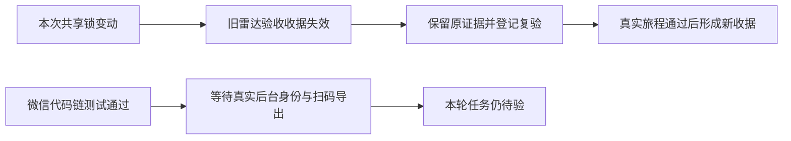

# T1110 全局对账实际结果

2026-10-09本次完整 `node orchestrator/process/reconcile.mjs --concise` 实际退出1，46 ERROR、0 WARNING。该命令真正运行全部配置回归，输出只列前5项和省略数量；不能把省略部分说成已取得完整文本。原始本机reconcile.log摘要与SHA、实际遥测和独立收据audit的交叉核对见 `reconcile-findings.json`。

| 来源 | 本次数量 | 处理 |
|---|---:|---|
| 看板超限 | 1 | 原T1101-global-gates欠债；没有在功能任务里删除历史任务 |
| 原review收据 | 23 | 当场独立audit与旧T1106记录同名；T1110本次SPEC收据单独核验通过 |
| 原frontend收据缺completion | 2 | T1022/T1023-agent-recovery原问题，沿T1082 |
| T1106共享路径变化 | 1 | 本次membership-lock增加真实在途nativeReports保护，旧watched_paths收据不能绑定当前树；新增T1110-related-gates追踪真人雷达旅程与收据归属，不能把历史PASS重哈希成新PASS |
| 实际lesson失败 | 19 | 本次.lessons-stats真实fireCount变化及配置onFail已摘录；旧功能/类型/超时失败沿T1018/T1081/T1101-global-gates，首因不明的旧回归沿T1106-related-gates，未清除旧断言 |

相对T1106旧45项，本次LED052又失败、LED055未触发；两者不能相互销账。LED052实际原命令独立探针退出1，明确缺 `CREATOROS_TEST_POSTGRES_URL`，没有进入真实PG测试，也未接用户库或猜连接信息。T1106历史隔离PG59 PASS保留，不能代签本轮。其余18个本轮lesson均在旧列表出现；对子命令ignore隐藏的首因没有推测为新的产品问题或环境问题。

本次新增的T1106收据漂移属于当前提交的验收待项，不能把整个46项说成纯旧基线。当前任务仍缺两微信stable identity/date/row count实际witness、产品独立profile扫码、五私人实文件解析与1366/1024真实页面旅程，因此不complete；代码用配置未就绪状态明确关闭实际扫码和采集入口。组件与公共隔离链通过只证明已验证范围。

