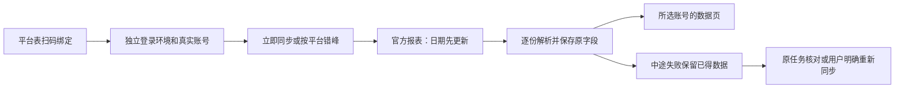

# T1110 实现与当场验证（尚未完成真人验收）

2026-10-09，在隔离工作树 `codex/t1101-canvas-binding`、原HEAD `dc61f1d6` 实施。用户授权“开始推进”；按product-to-code-orchestrator 3.29.0及项目oil-ui-pro 0.10.0推进。根会话是唯一产品树写入者，独立代理仅提供/tmp候选与复核。本记录不宣布任务完成、安装版可用或全局Gate全绿。

## 已落地的用户行为

平台能力表与原扫码弹窗扩展公众号/视频号，扫码身份及profile继续经后端原归属事务。账号成员可直接“查看数据”；微信分支读取原生报表，不要求作品目录完整。五类报表分别保存日期选择、原字段/原值和单位，0与未知分开；单篇发布时间范围不冒充全历史或指标累计窗口。两份公众号报表、三份视频号报表全部提交且浏览器实际停止后才完成。

立即同步沿原持久CollectionRun，生成中禁止重复提交。未知响应只核对原键/任务；普通拒绝、格式失败与真实登录过期各用对应文案。部分报表失败保留已取得数据；真实原期限耗尽后不自动再执行，用户点击“重新同步”才创建新意图。账号切换及取消后的晚回调不能写回。真实停止未确认时保持资源占用，不伪释放；超时/取消主因不会被清理竞态遮盖。

默认缺失的self.metrics任务分别在每2小时的0/5/10/15/20分钟同步抖音/小红书/快手/视频号/公众号。保留已有任务ID、关闭状态和自定义时间；只沿原scheduler生产，原扫描入口仅恢复合法原任务。微信任务识别真实持久调度owner，暂停/未知保原ID，失败/取消按原状态收口；伪造请求前缀不授权。

## 当场已通过的检查

| 检查 | 实際结果与边界 |
|---|---|
| 原生契约 | 5 PASS；含0/null/率/秒/ID、来源脱敏和整份报表合计10000行上限 |
| 真实解析器与浏览器窄端口 | 24 PASS（解析7、驱动17）；实际BIFF/HTML/CSV合成协议字节，browser/profile明确为fixture；不是本人平台验收 |
| 公开DB链、执行器、恢复、调度 | 47 PASS：公开链12、执行器17、恢复7、调度11。公开start→原lease→实际worker解析器→commit→公开read；两平台全部报表、第三报表坏格式保两份、终页响应丢失仍查到原complete、取消/原deadline晚写、同SHA空文件移动窗口、跨组/转组和原owner保护；另公开转组2 PASS，queued/running都拒绝，取消原run后按新预览转组成功 |
| 页面组件与服务端页面 | 57 PASS；真实组件+隔离端口。包括已确定拒绝/未知响应、原键扫码恢复、防重复/取消、窗口/0/null/负净增、按需展开、切组/卸载竞态及未就绪禁用；不是真实Chrome截图 |
| 原绑定和采集兼容 | backend 5文件59 PASS；共享local binding stage 12 PASS，保原三平台及四local平台新阶段事务/补偿 |
| 原调度、bootstrap、准入和startup | 4文件44 PASS；后续微信deadline修正另由47项最终组合验证覆盖 |
| 隔离PGlite迁移 | 最终16 PASS、6 SKIP（真实PG未配置）；全新、root/diagnostic/canvas旧完整账本及subset双启，旧ID/文件/ledger保持，未知未来/缺前缀/SQL漂移拒绝，0131真实回执强制。仅测试库，未迁移用户库 |
| 类型 | contract/backend/frontend/ai-worker最终命令全部exit0 |
| LED047 | 8文件174 PASS；没有以删除历史或阻断合法任务提速 |
| 物理/语义/追溯 | boundary exit0，无新增违规（原5条基线）；semantic exit0；orphan exit0，原100 warning保留 |
| pmem | 实际sync exit0，PROJECT和CodeGraph已刷新 |

精确命令、日志摘要与SHA见 `gate-observations.json`。*.log是本机原始输出，遵循项目gitignore；安全的关键证据摘录进JSON，不将真实报表、Cookie、export URL或完整平台账号ID入库。

最终独立代码复核见 `INDEPENDENT_CODE_REVIEW.md`：指定源码范围未发现新增确定性缺陷，空报表窗口、调度owner、已知拒绝提示、终页回执丢失、期限与实停、慢关闭续租及真实公共转组保护均已核对。审查者只读当前源码和既有当场日志，没有重跑或代签真人/视觉验收。报告SHA256为 `a90a015af37a6216d81125189b304ad94eb94df29835aff3b967207e69539549`。

## 真正发生的RED与修正

新增协议/驱动/执行器先缺模块失败，随后原同一测试通过。原公开回读缺operation当场3 FAIL/1 PASS，修复后4 PASS。新增窗口/调度owner三项先3 FAIL，再修selectionKey及-reports owner；复评收据 `b6b7772b74ff` 绑定新SPEC，原收据不代签。

页面原7 FAIL/25 PASS后实现；已耗尽期限测试5 FAIL/13 PASS、已知业务拒绝5 FAIL/20 PASS后分别实现并合并为57 PASS。第一轮默认HTTP fixture缺响应meta造成1 FAIL，修正fixture提供正式meta，生产严格校验保留。

公开组装链初次10 PASS/2 FAIL，实际暴露普通解析错误被停止race遮盖；独立复核后保主因与资源状态，最终通过。真实关闭超过20秒时心跳误认LEASE_LOST的用例当场1 FAIL，修正仅在submit检查callback失败而非心跳检查，最终执行器17 PASS。恢复扫描原期限用例1 FAIL/6 PASS；调度原期限的正式协议用例3 FAIL/8 PASS，修复后7与11 PASS。最初调度新增测试误用未定义helper的失败只作为探针错误保留，不冒称业务RED。

0131回执守卫当场1 FAIL后1 PASS；后续最终迁移16 PASS。旧绑定测试默认1秒观察在负载下错误提前结束，按LED053改为有限180秒观察与完整外层预算后12 PASS，不改生产状态/断言。

## 全局失败保留

完整contract当前402 PASS/43 FAIL。将原HEAD dc61f1d6的contract及backend package复制至隔离/tmp、复用同安装依赖重新测试，原树397 PASS/43 FAIL，失败名称相同：42个入口的旧404数量断言与registry未列四个既有正式路径。本次只登记新批准reports路由，未放宽/清除旧断言。原首次suite在负载下还有一次5秒预算失败；扩大实际有限测试预算后该额外失败消失。原基线第一次/tmp依赖启动失败也保留，不算任何通过证据。

`node tools/timeout-policy/verify.mjs`实际exit1：静态原27条短预算/既有vendor项仍归T1018/T1081；原call-ledger 10秒beforeAll在负载下失败，独立180秒预算重新运行25 PASS，原失败不销账。最终静态扫描仍27 FAIL，无本次新微信文件。完整verify各已跑动态组结果保留，不称整个timeout门通过。

整体验收收据audit保留原历史欠债；T1110单独verifyReviewReceipt实际exit0（task-review-receipt.json），并未用新收据代签旧任务。

context绑定实际被旧T1026 write_set非法glob阻断，沿已登记T1083；没有手改进度或伪造context包。当前完整reconcile实际exit1、46 ERROR/0 WARNING，详见GLOBAL_GATES.md和reconcile-findings.json。23旧review、2旧frontend、1看板、19实际lesson仍失败；新增1项为本次membership-lock改动使T1106旧watched_paths收据不能绑定，已登记T1110-related-gates，未重哈希旧报告。LED052本轮缺隔离PG配置，独立原命令探针同样真实拒绝；LED055本轮未触发，不用它抵消其他ERROR。

## b1f0cc54时未验收与停止事实（历史记录）

`createWechatBrowserSource()`当前无实际stable identity和日期/总数读取witness，`configured=false`，两微信平台绑定/采集能力因此保持暂不可用；页面已有报表可以展开。没有用昵称、token、人工ID、研究Cookie或浏览器默认profile充当授权。

本轮私人五个原始导出文件路径实际已不存在，smoke五项均FILE_UNAVAILABLE。历史T1108/T1109确有导出，但不能把历史元数据代签当前解析器的实文件结果。1366/1024真实Chrome旅程、真人隔离profile扫码与下载、普通账号页稳定字段仍未验证。

研究浏览器空间20已被用户接管/结束。本轮一次只读恢复被明确停止，之后未重试、未新建空间绕过。已发起用户继续操作问题，尚无答复；须获明确继续后再认领同一空间，核稳定身份/日期字段、重新取得五报表，再用产品独立profile进行真人扫码与真实页面验收。依据[ego-browser技能](/Users/zyongzhu/.agents/skills/ego-browser/SKILL.md:418)："Stop when the user takes control or the space is inactive or unassigned. Do not retry or route around the stop." 此控制要求来自技能，并非要求用户重新确认已授权实现方向。

## 用户允许恢复后的当前状态

用户2026-10-09明确答复“允许的”，成功恢复原空间并由taskctl resume。当前普通身份字段、详情日期/原生总数和五份实文件已实际核验，正式composition已装配内置reader；原缺witness段落只描述b1f0cc54当时状态。恢复中发现BIFF八位日期兼容和单篇与日报窗口差异并据实修复，见[LIVE_WITNESS_20261009.md](LIVE_WITNESS_20261009.md)。原文件缺失、读数失败、TDD RED及全局失败均未抹去。用户已在产品独立Chrome扫码；原任务实际因正式sourceAdapters漏bind登记而failed/null，原失败保留。已据此补两平台公开composition行为RED并修同源bind/nativeReports配置；真人重新绑定/完整采集/双视口UI尚未验收，不能完成任务。
