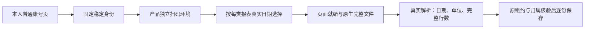

# 微信普通后台与五份实文件：恢复后的当场核验

用户明确答复“允许的”后，2026-10-09成功认领原Ego空间20，`taskctl resume T-1110`留下真实事件。沿既有已登录普通后台只读核查，未搬运Cookie或研究profile。本文是当前事实补充，不替换b1f0cc54时的缺失文件/控制停止记录，不宣布真人产品绑定与整体UI验收完成。

## 已取得的实际证据

公众号普通`/cgi-bin/settingpage`的当前账号信息明确显示AppID与名称。可修改的“公众号ID”不作稳定身份；固定采用当前账号设置AppID，不在以后遇到gh字段时自动换协议。本人字段SHA256为`56b7ddb9a2008cfefe09e731e8dcd3b6454a7b2636b908ff09802b05c4252952`；完整ID只在本机私人验收目录。微信支付[官方必要参数说明](https://pay.wechatpay.cn/doc/v3/partner/4013080340)说明公众平台公众号/小程序申请的AppID是唯一标识；[官方网页授权](https://developers.weixin.qq.com/doc/service/guide/h5/auth.html)另说明服务号appid唯一性。后者服务号范围不被扩写成所有公众号的API权限，本接入仍只读本人普通后台，不申请AppSecret或调用认证接口。

视频号普通`/platform`的`#finder-uid-copy.finder-uniq-id`可见文本与data-clipboard-text一致，`h2.finder-nickname`仅作展示。页面原生提示明确说明视频号ID唯一标识身份。本人字段SHA256为`24866f23b434a6cd0036756fa03e575529a50623c67b38d9e1b232fade378d75`；未使用uin、session、昵称或人工身份兜底。

五个当前原始文件均实际重新接收，公众号通过当前DOM真实原生href同会话fetch得到HTTP200，视频号监听native download并在同轮saveAs。文件只存本机私人目录，Git仅保以下安全元数据及`private-file-result-final.ndjson`。当前内容/单篇字节摘要与历史研究不同，未用旧摘要或历史结果代签。

| 原生报告 | 实际范围及含义 | 文件字节/真实解析行数 |
|---|---|---|
| 公众号内容分析 | 9月9日至10月8日，统计日期 | 45056；阅读趋势240、分享等趋势30、阅读来源60 |
| 公众号用户增长 | 9月8日至10月8日，统计日期 | 7401；31 |
| 视频号全部视频日报 | 9月9日至10月8日，统计日期 | 1100；30 |
| 视频号关注者增长 | 9月9日至10月8日，统计日期 | 998；30 |
| 视频号单篇视频 | 9月10日至10月9日，发布时间选择 | 5102；13，原生视频ID亦13个；指标累计范围仍未知 |

全部日期为2026年、Asia/Shanghai。单篇页面总数13、第一页10条，实际CSV13条。被动观察本次详情近30天引起的原生POST：startTime/endTime换算为上述9月10日至10月9日；响应成功协议为errCode=0、data.totalCount=13、第一页list长度10。只观察该UI实际发出的请求，不直接构造/调用平台内部接口，不持久化完整请求body或会话字段。

## 据此修正的实现

正式composition装配`wechat-dom-witness`，不再把缺witness的空工厂当作已可用。两平台身份固定读上述普通信息页；表格的近30天精确限定到`.filter-row:has(.filter-extra)`详情区域，避免同页趋势区控件抢先命中。单篇以本次新请求/响应、实际选择和总数共同就绪，监听前发出的旧请求即使同窗口晚回也不作证据。内部expectedRows随下载传到唯一真实解析器，CSV截断为10条时在commit前拒绝，保留已得前两份，不变成登录过期。

公众号内容页只有图表，用户增长表只有当前页10个日期；不能要求30/31个DOM日期或计算一组日期冒充表格。reader核当前可见日期输入与真实native href的日期相同；接收后解析器继续严格核统计表实际完整日期集合。下载前重新核同一状态，阻止过期href/总数变更。

实BIFF另发现阅读来源发表日期为YYYYMMDD；新增只在BIFF日期字段解码的兼容，raw仍保原八位字符串，非法日期仍拒绝。旧按横线日期合成的fixture不足以发现此问题，当前私人内容文件首次实际REPORT_DATE_RANGE失败保留，修复后五份文件全部解析PASS。

独评另指出隐藏登录提示、跨午夜重算窗口、无frame请求事件抛错。各项当场RED后修复：仅实际可见登录提示可判登录失效，本次窗口只冻结一次，无frame的无关请求只忽略；不会使合法采集失败。完整source+内置witness在等待原生response时取消/原剩余期限耗尽，实停后late response不再交第三份，原前两份保留。扫码弹窗去掉用户不需要的内部runId文字，原索引和可核对任务仍保留。

实际源码只读reader还通过Ego普通页运行：公众号身份哈希与私人字段一致；内容页返回真实日期输入/href证据，dates为空，没有假造30天表。最初桥接误把Ego异步url当作Playwright同步url，返回null；修正只读adapter后验证身份。内容页初次尚未完成加载同样null，后续实际读数通过；生产observe等待就绪，不以首次快照签成功。这些null不是登录过期或成功证据。

## 仍待完成

产品自身隔离Next实例已运行，临时PGlite与所有登录目录均在本次新建`/tmp/creatoros-t1110-fullpage.*`根，没有连接或迁移用户库。通过实际平台能力表→视频号弹窗→公开accounts.bind.start启动一次真实扫码任务；Ego空间20实际handoff后用户确认“已扫码登录”，根会话才takeOver继续原ID核对。

原任务`execution-task-4eb3a857-15`公开accounts.bind.status实际HTTP200但终态failed、accountId为空，错误为“该平台能力尚未接入可用的数据适配器”，组成员仍0。实际身份读取成功后，正式sourceAdapters仅登记nativeReports、漏bind，commitVerifiedBinding的原守卫因此拒绝。本次失败完整保留；不是Cookie过期，不称绑定成功，不把原失败ID改成功或自动重发。

补两平台公开composition行为回归：外部浏览器读数是明确合成fixture，实际start/status→profile采纳→原backend绑定事务→账号/组成员回读不替换。Vitest4签名错误导致0test的首次无效运行另存；修test后两平台真实行为RED（failed/null），再登记configured条件下bind/nativeReports两项，未绕过adapter、身份、成员或停止守卫。当前37个worker协议/停止/解析用例一次实际PASS，含两平台嵌套visibility:hidden/display:none反例和真实可见正例。

根会话继续核验修复后的产品绑定、2+3份完整采集及1366/1024页面旅程；研究空间已登录仍不等于产品绑定成功。
当前5份实文件、合成协议/公开DB链、类型及组件检查分别记录；真实产品扫码、完整browser采集与视觉旅程未签PASS。原全局46项失败与T1110-related-gates仍保留，不能据局部通过声称整仓全绿。

## 当前合并回归与保留的失败

当前一次完整worker三文件37 PASS（DOM11/source17/parser9），公开真实composition七例7 PASS，UI四文件57 PASS，frontend与worker类型检查实际exit0。公开composition首次正确签名执行为两微信行为2FAIL；修bind登记后5PASS/2FAIL，旧三平台case仅断言与当前批准SPEC的错峰时刻相反，修测试期待为小红书5/快手10，生产时刻未改，再完整7PASS。无效Vitest4签名0test运行另存，不记作行为RED。

LED047首轮并发8文件173PASS/1FAIL，原run-controls异步查询在并行负载下未及时满足；保此事实，不改断言/产品。同命令仅maxWorkers=1、retry0串行复验8文件174PASS。当前timeout-policy实际exit1，旧27个静态短预算项仍存在，无本次新微信文件；没有把动态35PASS的backend执行组误当worker用例。

新增独立闭合复核`t1110-witness-bind-closure-audit.md`核实际37/7/57与源码SHA；只签源代码接缝，没有代签真人或视觉。root曾误用三个不存在的check-*.mjs命令导致MODULE_NOT_FOUND，实际无Gate运行，日志另标command-invalid；随后按现有正式scan命令执行。此前context/progress唯一步骤缺失以及旧46个全局失败继续保留，不用局部回归替换全局事实。

产品已在同一隔离PGlite根温和重启配置，原failed扫码任务仍保留。root经实际表格弹窗明确开始新intent，公开索引为`execution-task-3eba3525-15`，实际页面等待扫码验证；Ego20已handoff给用户，未在用户控制时继续浏览。后续本人绑定和平台采集均仍待验证。

## 后续实际绑定与未通过的同步

第二次产品扫码的公开`accounts.bind.status`实际HTTP200、succeeded，accountId为`acct-3eba3525-70`，error为空。公开账号与账号组回读确认真实成员；稳定平台身份摘要与上文普通后台一致。初始化的视频号self.metrics任务实际启用，cron为`15 */2 * * *`。产品使用本次临时根中的独立登录环境，没有搬运研究登录。确认成功后才重新takeOver原Ego空间20。公众号产品扫码尚未执行，这些事实只签视频号绑定。

绑定后原计划任务实际`EXPORT_FAILED`、0报表。root未改变原任务ID或终态，随后为定位问题明确建立新的手动intent。`collection-5d521b69-104`实际failed、0页，安全诊断为prepare/channelsDaily/REPORT_WINDOW_MISSING。对普通页面的实际DOM观察表明：全部视频与关注者增长都有唯一`.filter-row:has(.filter-extra)`详情行，日期radio值仍为1/2/3；不是另一个日期协议。一次普通导航domcontentloaded后iframe数组尚为空；随后的观察发生平台逻辑异常与研究页登录跳转，不能把这轮桥接失败记成真实采集PASS。

代码另有可确定的渲染时序缺口：标签尚未出现时跳过点击，日期控件尚未出现时立即拒绝。两种日报标签/控件延迟用例实际RED（2FAIL/11PASS，继承仓库retry配置），改为沿原signal/剩余预算等待唯一可见标签并点击、再等唯一详情日期控件。完整30个实际日期、单篇新请求响应/真实总数及下载前复核均未放宽。新增重复标签用例明确拒绝，不能取第一项。

修复后的实际新intent `collection-dfe56a37-49`仍failed/0页，安全诊断为prepare/channelsDaily/REPORT_PAGE_MISSING；所以渲染缺口修复没有闭合实际采集。下一次分段诊断intent `collection-8d52aafb-55`更早在navigate发生BROWSER_OPERATION_FAILED/Error，同样failed/0页；没有证据证明两次同因，更不能推断Cookie过期。当前细分iframe、标签缺失/重复，并增加固定Chromium导航/目标关闭分类，仍不输出message、stack、URL、目录、身份或Cookie。

内部诊断首次5个必要用例均有当场RED，之后三文件42PASS；日期等待后完整44PASS、重复标签后45PASS；4个固定导航类别用例当场4FAIL，最新完整三文件49PASS。错误parser路径的一轮实际只运行两文件35PASS，另留`render-ready-wrong-path-partial.log`，没有当作完整回归。worker与frontend新类型检查实际exit0。安全索引见`diagnostic-source-verification-index.json`；独评只覆盖源码/已有日志，不代签真人采集。

双视口影子Next旅程还没有执行：首次启动器强制webpack，真实页面HTTP500（node:crypto UnhandledSchemeError），原启动日志保留。启动器改用产品默认Turbopack，并在HTTP500时明确失败；本次修正尚待实际启动与浏览器验证，不改产品配置或安全守卫。视频号三报表/公众号两报表完整公开入库以及实际页面验收继续待验，任务保持进行中。

## 标签观测与公众号原扫码失败

新增固定导航类别后，原手动intent遇到HTTP连接重置；再次提交使用已保存的同一个clientRequestId，公开返回唯一`collection-34ba48c1-55`。它在15:09:35Z实际failed/0报表，诊断为prepare/channelsDaily/REPORT_SECTION_MISSING，不能把正式iframe存在等同标签已经可操作，也不能据此判断Cookie失效。原ID及终态保留。

随后从实际平台表公众号行打开原弹窗并启动`execution-task-34ba48c1-61`，Ego20交还用户。该任务先waiting_verification，后15:16:09Z实际failed、accountId为空，公开错误为“微信后台页面或原生下载暂未完成，请查看原任务”。本次没有binding分段诊断，根因未知；窗口已结束，不再要求扫描旧窗口，也不称公众号绑定成功。后续新增binding脱敏日志须先完成实际检查，再启动明确的新扫码intent。

默认Turbopack的第二次影子Next启动也实际失败：隔离副本第三方依赖链接回原工作树，Next无法在其root内解析next/package.json。保留原next.log和启动失败；新QA准备器复制必要依赖，保留相对链接并校验副本inode/链接范围、原安装及HEAD首末一致。新增辅助脚本纳入PAGE_SPEC watched_paths。此修改仅准备验收环境，尚未执行复制、页面编译或Chrome旅程，未签PASS。

## 五字段观测回归与QA准备实证

root在正式树先仅加入测试，新增靶向实际7FAIL/60SKIP（67例、retry0），再采纳生产实现，完整三文件67PASS与worker类型actual exit0。五字段只在同一frame的typed标签缺失后读取一次，并独立验证/重构；取消、实际原期限、晚快照和停止未确认仍走原链。SDK显式120秒裁剪到同一原end，fallback重取余量；共享guard预检在其race前等待的既有边界未被这些mock测试覆盖，不称完整浏览器生命周期已通过。

新的公众号原扫码任务`execution-task-a1e2c022-51`收到用户“已扫码并选择公众号”后，实际readIdentity/IDENTITY_MISSING，仍未有绑定账号。该证据只说明普通稳定身份未读到，没有登录过期证据；不重写原failed任务，不自动把研究身份传给产品。

隔离QA准备实际成功于HEAD`88b663a6`：106220个regular文件、4986个链接，source/clone首末摘要一致、0共享inode/逃根/broken链接，Next16.2.9实际解析位于影子根；独评再次逐个核验，页面编译也已实际HTTP200。但首次旅程未进入页面：Ego服务进程没有收到shell自定义环境变量，先在参数检查失败；原server state另有spread覆盖schema的静态缺陷。这两处修复、准备预算按独评扩至1440秒（覆盖4git+archive/tar+5cp+收尾）。原服务经PID归属核对后停止，失败文件和日志保留；必须在新冻结源码上重跑，不能把准备成功当页面PASS。
